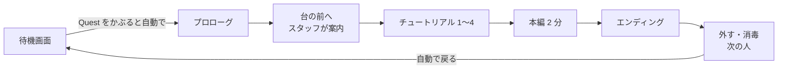

Temporal teaser

# MouthOfGod_System

AI生成により、不自然です。

> 触感デバイスが口の中に食感を伝えます。プレイヤーはその食感から食べ物・生物を特定します。その食べ物・生物を生み出して、世界（ミニチュアの村）を再構築するゲームです。
> *This game is ...*（TLDR の英文は応募時に確定します）

IVRC に出展した作品を、GDC 向けに再構成するプロジェクトです。IVRC 版との最大の違いは 2 つです。1 つは **「ゲームとして成立させること（ゲーム性・チュートリアル設計）」** です。もう 1 つは **神様コンセプトの前面化** です。

# 開発
- Unity: **6000.0.73f1**
- 共同編集: Scene Fusion
# どうやって開発するか
- 開発の進め方: [CONTRIBUTING.md](./CONTRIBUTING.md)
- 設計方針と避けること: [docs/architecture.md](./docs/architecture.md)
- 決めたことと、採用しなかった案: [docs/decisions.md](./docs/decisions.md)
- 見た目の方針と、何にどの素材を使うか: [docs/visual-direction.md](./docs/visual-direction.md)
- 体験の台本（仮。場面ごとの語り・画面・進む条件）: [docs/scenario-book.md](./docs/scenario-book.md)
- やることと進み具合: 下の「[プロジェクト管理](#プロジェクト管理)」

## プロジェクト管理

やることはすべて **Issue** にし、**マイルストーン**に入れています。マイルストーンは、ゴール（応募動画 → 応募）に向かう**日付つきの区切り**です。期限の近い区切りから順に終わらせます。Issue 同士の順番は、**Relationships → Blocked by** で表します。これは各 Issue の右側にあり、先に終わっている必要がある Issue を示します。

**普段の流れ**
1. 下の「今の区切り」の「すぐ着手できる」から選びます。
2. 何日かかけて進めるなら、その Issue の **Assignee に自分を入れる**ようにします。すると「着手中」に出るので、2 人が同じものを始めなくなります。その日のうちに終わるときや、誰がやるか合意が取れているときは付けなくて構いません（[CONTRIBUTING「作業の進め方」](CONTRIBUTING.md#作業の進め方)）。
3. PR で Issue を閉じます。図と活動記録は自動で更新されます。
4. 週に 1 回（例: 月曜）、ロードマップを見て今週やるものを決めます。⚠ が出ていたら、削るか後ろへ回すかを決めます。
5. ミーティングで話すことには、Issue にラベルを付けます。見てほしいなら **`mtg-share`**、その場で決めたいなら **`mtg-decide`** を使います。同じことを **議題 Issue**（「次の MTG の議題と議事録」）にも書きます。MTG のあとは、議事録を議題 Issue に書きます。それからラベルを外し、議題 Issue を閉じます（[CONTRIBUTING「作業の進め方」](CONTRIBUTING.md#作業の進め方)）。

新しい Issue を作ったら、マイルストーン（どの区切りか）と Blocked by を設定します。

### 今の区切り

### 今の区切りのゴールと Issue

一番上（🎯）が今の区切りのゴールです。その下に「そのために先に要る Issue」が並びます。下から上へ進めます。記号の意味は次のとおりです。

- 🟨 すぐ着手できる
- 🟦 着手中
- 🟩 完了
- ↪ ほかの所に出てくる Issue
- 点線の箱: 前の区切りの Issue

画像を押すと、ロードマップ Issue に移ります。そこの図では、箱を押すとその Issue に移動できます。

### 区切りの流れ

区切りごとの Issue の依存の図と、全区切りの表は、ピン留めした **[ロードマップ Issue](https://github.com/Fialuxe/MouthOfGod_System/issues?q=is%3Aissue+is%3Aopen+label%3Aroadmap)** にあります。これは GitHub Actions の [`roadmap.yml`](.github/workflows/roadmap.yml) が自動で更新するので、手で編集しないでください。

### 活動記録

比べるためではなく、**自分がやったことを振り返るための記録**です。話し合い・調べもの・ものづくりなど、数字に出ない作業もたくさんあります。週ごとの数と、最近やったことの一覧は、ピン留めした **[活動記録 Issue](https://github.com/Fialuxe/MouthOfGod_System/issues?q=is%3Aissue+is%3Aopen+label%3Aactivity)** にあります。

---

## 1. コンセプト：あなたは神様

プレイヤーは、村で信仰されている神様です。

1. 神様は村から奉納された食べ物（お供え物）を食べて暮らしています。
2. その食感を覚えています。
3. ある日、村が食料難に陥ります（木にリンゴがならない、川に魚が現れない）。
4. 神様は雲や霞を食べます。そして、**お供え物と同じ食感のものを口から生み出して**、村を助けます。

> 「なぜこの操作をするのか」「なぜこの目的を達成したいのか」を、世界観が説明します。これが神様コンセプトの役割です。

## 2. ゲームの骨子

| 項目 | 内容 |
|---|---|
| 目的 | 適切な食べ物を、適切な場所に届ける |
| 操作 | フォーク型のデバイスで雲を刺す。先を口に含んで噛みます。食感は時間で変化します。狙った食感になった瞬間に決定すると、それが生み出されます |
| チャレンジ | 口の中の感覚だけで「今のは牛だ」と見分ける |
| 成功 | 適切な食べ物を適切な場所に届けられた |
| 失敗 | 時間内に届けられなかった |
| スコア（仮） | 住民の満足度が高いほどハイスコア |
| 手応え | 自分が生み出したもので村が豊かになっていく |

### 体験のイメージ
- 目の前に、山・海・草原・村のフィールドを持つミニチュアの村があります。
- 最初にお供え物を食べ、「食べ物と食感の対応」を覚えます。
- フォーク型のデバイスで、周りに浮かぶ雲（霞）を刺します。その一部を口に含んで噛むと、食感が時間ごとに切り替わります。
- 出せるのは、はっきりした食べ物の食感（リンゴの食感など）ではありません。**見分けられる数種類の食感**を出します。それぞれが 1 つの食べ物・生物に対応します。どれに対応させるかは #54 で決めます。
- 欲しい食感の瞬間にボタンで決定します。すると、その食べ物・生物が口から生み出されます。
- それを必要な場所に届ける（例: リンゴ→村の木、魚→海）。何をどこに届けるかは #54 で決めます。
- プレイヤーはミニチュアの周りを移動して場所を選びます。位置はコントローラーで取得します。

### IVRC 版からの変更点
| | IVRC | GDC |
|---|---|---|
| 復元される対象 | 食品だけ | 食品だけでなくてもよい（牛・魚などの生物も） |
| コンセプト | 神様コンセプトは裏設定 | **神様コンセプトを前面に** |
| ユーザーの移動 | 移動しない | 移動してもらう（見栄えのため） |

## 3. 体験フロー

**体験はすべて英語で行います**。語り・画面の文・スタッフの説明も英語にします。この節は日本語の下書きです。英語の文は [シナリオブック](docs/scenario-book.md)（仮）にあります。

1 人あたり約 8 分かかります（Quest をつけている間は約 6 分）。数字はすべて仮で、試遊しながら変えます。詳しい案と経緯は [#38 のコメント](https://github.com/Fialuxe/MouthOfGod_System/issues/38#issuecomment-6083490067) にあります。

| 場面 | 時間（仮） | どこで |
|---|---|---|
| 受付・説明・Quest とデバイスをつける | 1 分 | ブース（スタッフ） |
| プロローグ | 45 秒 | 座っても立ってもよい |
| 台の前へ | 15 秒 | スタッフが案内 |
| チュートリアル 1〜4 | 2 分 30 秒 | 台の前 |
| 本編 | 2 分 | 台の周り |
| エンディング | 30 秒 | 台の前 |
| 外す・消毒・次の人の準備 | 1 分 | ブース（スタッフ） |

GDC には 1 人あたりの時間の決まりはありません。目安は、出展者の助言（デモは 10 分くらいに収める）とします。混んだときのために、本編の制限時間は設定（データ）で変えられるようにします。

### プロローグ（仮）
**お供え物は食べず、見せるだけ**にします。食感は、台の前へ移動したあとのチュートリアルで初めて体験します。座って見ても、立って見ても構いません。

伝えること（#21）:
- あなたは神です
- あなたは口からものうみだせます
- あなたはこの村の人々から信仰されていました
- ある日、村に飢饉が起こり、お供えものがなくなり、村の人達が困っています
- あなたの出番です
- さぁ、助けましょう的な

見せ方は 2 案あります（#38）。

**Case 1: 巻物 + 妖精サイズの巫女が説明する**

以下は巫女の説明です。括弧内は、体験者の視界に表示されるものを示します。

> 昔々、○○という神がいての、、、（巻物や屏風など）
>
> その神は雲から農作物の始祖を生み出し、村の人々によく信仰されてたんじゃ、、、
>
> （画面フェードアウト、切り替わる）
>
> 村の人々は毎年、信仰してる神にお供え物をあげていての、、、（お供え物がQuest画面にでてくる）
>
> （画面フェードアウト、切り替わる）
>
> あるときのこと、その村は災害により飢饉に襲われてしまっての、、、（村に雨がふったり第三次な様子）
>
> その村では一切、自然の恵みが取れなくなってしまったんじゃ、、、（牛、豚、などが世界から消えていくような描写？）
>
> これより体験してもらうは、村の人々が語るその神の神話、そなたには神になりてその能力にて村を救うてもらう。驚くでないぞ、、、、
>
> 指示表示：チュートリアルが終わりました。立ちあがり、ブース担当者の指示を聞いてください

**Case 2: ウィジェット**

> ＊あなたには神になってもらいます。
>
> ＊その神はこの村で信仰されており、その口からこの村の人々の生活を支える自然の恵みをつくっていました。
>
> ＊あるとき、村には飢饉が訪れ、、、、
>
> 、、、説明はほぼ同じ

### チュートリアル
最終的にやらせたいことは、**場所に応じた食べ物を口の中から生成し、ミニチュアを豊かにする**ことです。ここから逆算して、段階的に教えます。簡単なことから本筋へ近づけます。

1. お供え物を食べて、食べ物と食感の対応を覚える
2. デバイスの使い方を理解する（フォークで雲を刺して口に含む／噛むと食感が切り替わる／ボタンで決定）
3. 噛んで決定すると物が出てくることを知る
4. 出てきた物で何をしてほしいかを知る（必要な場所に届ける）
5. 木のフィールドで実際にやってみる（例：リンゴを木へ）
6. 木以外のフィールドでもできることを体験する（例：魚を川へ）

各ステップのゴールは「**どうやるか**を理解させること」です。目的が分かりやすい状況を用意して、やりたいと思わせます。

6 ステップを、チュートリアル 1〜4 の Issue に次のように割り当てます。

| チュートリアル | 扱うステップ |
|---|---|
| 1（#12）デバイスの使い方 | 2 |
| 2（#13）噛むと物が生まれる | 1、3。お供え物はプロローグで見せるだけなので、食感はここで初めて体験します |
| 3（#14）食感で物が変わる・要求を知る | 4 |
| 4（#15）届ける | 5、6 |

### メイン体験（本編）
**2 分（仮）のあいだ、村のあちこちで「これが欲しい」が出ます。プレイヤーは歩いて行き、噛んで生み出して届けます。** 届けた分だけ村が豊かになります。**ここが「一番楽しいところ」です。**

- **フィールド**: 山・海・草原・村の 4 つです（雪は山に含めます）。定義は [docs/fields.md](docs/fields.md) にあります。どのフィールドが何を欲しがるかは #54 の対応表で決めます。
- **欲しい物の出し方**: 村人の頭の上に吹き出しで出します。同時に、そのフィールドを光らせます。最初の 30 秒は 1 つずつ出します。そのあとは同時に最大 2 つ出し、プレイヤーがどちらから行くかを選びます。
- **間違えたとき**: 物が霞になって消え、村人が首を振ります。欲しい物は残ります。罰は付けず、失うのは時間だけにします。
- **ゲーム性**:
  - 吹き出しに待ち時間のゲージ（20 秒）を付けます。間に合わないと村人ががっかりし、その分の満足度は入りません。
  - 食感は時間で切り替わります。そのため、欲しい食感の瞬間に決定すること自体が腕前になります。
  - 間違えずに続けて届けると、ご褒美が大きくなります（下の「満足度とご褒美」）。
  - 難しさは、待ち時間の長さと同時に出る数で調整します。試遊でクリア率を見て決めます（#16）。
- **終わり**: 残り 10 秒でカウントダウンします。時間切れで止め、届けている途中の物は消します。

### 満足度とご褒美
「やった！」を、すぐに・何度も・少しずつ大きく感じさせます。そうして、もう 1 回届けたくなるようにします。

| ねらい | どう見せるか |
|---|---|
| すぐ返す | 届けた瞬間（0.5 秒以内）に、音・光・村人の歓声・「+満足度」が出ます |
| 積み上がりが見える | 届けた物は村に残り、村が目に見えて育ちます |
| 続けるほど大きく | 連続で当てると、音の高さが上がり、光が大きくなります。外すと元に戻ります |
| ときどき大当たり | まれに「金のリンゴ」「村人が踊る」など、予想していないご褒美が出ます |
| 惜しいを伝える | 外したとき、正解の食感が近かったら「惜しい！」と出します |
| 最後にためて見せる | エンディングで星を 1 つずつ発表します |
| 人と比べられる（案） | ブースのモニターに「今日の神様」上位を出します |

満足度の計算は単純にします。届けた数 × 連続ボーナスで出します（#78）。細かい計算より、届けた瞬間の手応えを優先します。

### 体験終了（エンディング）
- プロローグと同じ語りで閉じます（例: 「そなたのおかげで、村に恵みが戻った…」）。
- VR 酔いを避けるため、カメラは動かしません。プレイヤーの周りの村が、届けた分だけ豊かになっているのを見せます。
- 星を 1 つずつ、間をためて出します（3 段階）。そのあと、豊かになった村全体と、笑顔の村人の数を見せます。満足度の数字は小さく添えます。
- 最後に「体験は終わりです。デバイスを口から外して、そのままお待ちください」を出します。そのあと自動で待機画面に戻ります。

### 途中でやめた・止まったとき
**キーボードも Inspector も使いません**。できるだけ自動にします。残りは Quest のコントローラーで操作します。

- **自動**:
  - 待機画面で Quest をかぶると、プロローグが始まります。
  - 途中で外すと一時停止します。つけ直すと続きます。
  - 外したまま 30 秒たつか、エンディングが終わると、待機画面に戻ります。このとき、村・欲しい物・満足度を初期状態（飢饉）に戻します。AprilTag の位置合わせは残します。
- **スタッフ**: 左のコントローラーを持ちます。誤操作を防ぐため、操作はすべて長押しにします。押している間は、視界の端にゲージを出します。

| 操作（左のコントローラー） | すること |
|---|---|
| X を 2 秒長押し | 今の場面を飛ばして次へ |
| Y を 2 秒長押し | どこからでも待機画面に戻す |
| X と Y を同時に 3 秒長押し | デバイスが動かないとき、Mock 入力に切り替えます。スティックで食感を切り替え、トリガーで決定します |

- 体験者の手は、フォークを持つだけにします。**届け先は、体験者が立っている場所**（ミニチュアの周りの位置）で決まります。口から生まれた物は、目の前のフィールドに落ちます。位置とフォークの取り方は #40・#62 で決めます。

## 4. 未解決・要確認

| 項目 | 状況 |
|---|---|
| **食感の要素** | まだ決まっていません。「形状＋噛み心地」「水分量」の案があります。形状再現のほうがよいのでは、という案もあります。現行システムでは、水分量で食感を完全に再現するのは不可能だという懸念があります。**食べ物そのものの食感（リンゴの食感など）ははっきり出せません**。そこで、見分けられる数種類の食感を物に対応させます。チュートリアルでは、噛んでいる間に生まれる物の影を見せて、対応を覚えてもらいます。本編では影を出しません（案。[シナリオブック](docs/scenario-book.md) S4） |
| 「設計図ベースのやつ」 | 以前話した案です。チュートリアルにしやすいとのことです。内容を確認する必要があります |
| スコア設計 | 満足度で見せる方針は決めました（「3. 体験フロー」の「満足度とご褒美」）。計算の細部は #78 で決めます |
| チュートリアルの具体ステップ | 上記は叩き台で、確定していません |
| 生成対象 × 置き場所の組み合わせ | まだ確定していません |
| 成功・失敗の条件の詳細 | 制限時間は 2 分（仮）と決めました。届け間違いは時間を失うだけ、とも決めました。1 回の要求の判定の細部は #61 で決めます |

## 5. 開発の進め方（概要）

- リポジトリ: https://github.com/Fialuxe/MouthOfGod_System
- Git のブランチ運用と Scene Fusion を使います。詳細は [CONTRIBUTING.md](./CONTRIBUTING.md) を参照してください。
- ブランチの使い分け: 機能は `feature/`、バグは `fix/`、シーン制作は `scene/` を使います。
- 実行用の共有シーンは `Assets/Scenes/Main.unity` の 1 つだけにします。動作確認用シーンは `Assets/Scenes/Sandbox/` に自分専用のものを作ります。
- コードの型の名前とデータの置き場所（`Assets/Resources/Data/`）は、[CONTRIBUTING.md「型の名前とデータの置き場所」](./CONTRIBUTING.md#型の名前とデータの置き場所) にあります。
- アセットはローポリで統一すると調達しやすくなります。

## 資料

体験スペースと配置イメージ

雲を食べ物に変える瞬間のイメージ

## 6. 応募（GDC）

alt.ctrl.GDC 2027 に応募します。フォームの全項目と条件は [docs/alt-ctrl-gdc-application.md](docs/alt-ctrl-gdc-application.md) にあります。

### 締切と提出物
- **締切: 2026/10/30**。時刻・時差は書かれていません。そのため、**10/29（日本時間）に出します**。応募は無料です。
- 入選したら、**2027/3/1〜5 に San Francisco で展示**します。旅費・宿は自分たちで払います。展示中は常に 1 人以上がブースにいます。

| 提出物 | 条件 | Issue |
|---|---|---|
| 審査用の動画 | 1 本・**5 分以内**。限定公開で構いません | #70、#111 |
| 宣伝用の説明 | 英文 **50 語以内**。入選すると公開されます | #73 |
| 何が特別で「alt」なのか | 英文 1 段落。この操作でしか作れない体験だと説明します | #73 |
| 展示スペースの図面 | **6 × 8 ft（約 1.8 × 2.4 m）** をどう使うか。応募の時点で要ります | #89 |
| 題名・チーム・連絡先・住所など | 代表者 1 人（決定と請求の窓口）の名前・役割・メール・電話 | #116 |

### 動画審査
- 見られるのは**冒頭だけ**と考えます。最初にゲーム内容を分かりやすく伝え、補足は後半に回します。
- 「何をするゲームか」「チャレンジ内容と成功/失敗」「面白さ」を伝えます。新規性があると有利になります。
- 最も楽しいところだけを映せば十分です。5 分より短くて構いません。

| 構成 | 内容 |
|---|---|
| TLDR | どんなゲームかを一目で。文字＋プレイ画面。`This game is ...` |
| Concept | 世界観、やってほしいこと、避けたいこと。「あなたは神です」、なぜそれをやるのか |
| Play View | メイン体験の最も楽しい部分 |
| Appendix | デバイスの仕組みなどの補足 |

TLDR 案: *触感デバイスを使って口内に伝わってくる触感をもとに対応する食品・生物を特定し、それをもとに世界を再構築するゲーム*

### 方針の確認（相談メモより）
- 位置情報を取るためにコントローラーを使うのは、問題ありません。
- 現在の案でも、時間内にできなければ失敗になります。そのため、ゲームとして成立しえます。
- GDC のために用意すべき最重要項目は**ゲーム性**で、とくに**チュートリアル設計**です。
- 応募欄をきちんと埋めれば大丈夫です。
