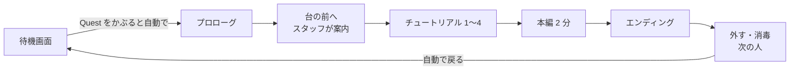

Temporal teaser

# MouthOfGod_System

AI生成により、不自然です。

> 触感デバイスが口の中に食感を伝えます。プレイヤーはその食感から食べ物・生物を特定します。その食べ物・生物を生み出して、世界（ミニチュアの村）を再構築するゲームです。
> *This game is ...*（TLDR の英文は応募時に確定します）

IVRC に出展した作品を、GDC 向けに再構成するプロジェクトです。IVRC 版との最大の違いは 2 つです。1 つは **「ゲームとして成立させること（ゲーム性・チュートリアル設計）」** です。もう 1 つは **神様コンセプトの前面化** です。

# 開発
- Unity: **6000.0.73f1**
- 共同編集: Scene Fusion
# どうやって開発するか
- 開発の進め方: [CONTRIBUTING.md](./CONTRIBUTING.md)
- 設計方針と避けること: [docs/architecture.md](./docs/architecture.md)
- スクリプトのリファレンス（設計の理由・つながりの図・やりたいこと別の手順・全部の型）: [docs/api/README.md](./docs/api/README.md)
- 決めたことと、採用しなかった案: [docs/decisions.md](./docs/decisions.md)
- 見た目の方針と、何にどの素材を使うか: [docs/visual-direction.md](./docs/visual-direction.md)
- 体験の台本（仮。場面ごとの語り・画面・進む条件）: [docs/scenario-book.md](./docs/scenario-book.md)
- やることと進み具合: 下の「[プロジェクト管理](#プロジェクト管理)」

## プロジェクト管理

やることはすべて **Issue** にし、**マイルストーン**に入れています。マイルストーンは、ゴール（応募動画 → 応募）に向かう**日付つきの区切り**です。期限の近い区切りから順に終わらせます。Issue 同士の順番は、**Relationships → Blocked by** で表します。これは各 Issue の右側にあり、先に終わっている必要がある Issue を示します。

**普段の流れ**
1. 下の「今の区切り」の「すぐ着手できる」から選びます。
2. 何日かかけて進めるなら、その Issue の **Assignee に自分を入れる**ようにします。すると「着手中」に出るので、2 人が同じものを始めなくなります。その日のうちに終わるときや、誰がやるか合意が取れているときは付けなくて構いません（[CONTRIBUTING「作業の進め方」](CONTRIBUTING.md#作業の進め方)）。
3. PR で Issue を閉じます。図と活動記録は自動で更新されます。
4. 週に 1 回（例: 月曜）、ロードマップを見て今週やるものを決めます。⚠ が出ていたら、削るか後ろへ回すかを決めます。
5. ミーティングで話すことには、Issue にラベルを付けます。見てほしいなら **`mtg-share`**、その場で決めたいなら **`mtg-decide`** を使います。同じことを **議題 Issue**（「次の MTG の議題と議事録」）にも書きます。MTG のあとは、議事録を議題 Issue に書きます。それからラベルを外し、議題 Issue を閉じます（[CONTRIBUTING「作業の進め方」](CONTRIBUTING.md#作業の進め方)）。

新しい Issue を作ったら、マイルストーン（どの区切りか）と Blocked by を設定します。

### 今の区切り

### 今の区切りのゴールと Issue

一番上（🎯）が今の区切りのゴールです。その下に「そのために先に要る Issue」が並びます。下から上へ進めます。記号の意味は次のとおりです。

- 🟨 すぐ着手できる
- 🟦 着手中
- 🟩 完了
- ↪ ほかの所に出てくる Issue
- 点線の箱: 前の区切りの Issue

画像を押すと、ロードマップ Issue に移ります。そこの図では、箱を押すとその Issue に移動できます。

### 区切りの流れ

区切りごとの Issue の依存の図と、全区切りの表は、ピン留めした **[ロードマップ Issue](https://github.com/Fialuxe/MouthOfGod_System/issues?q=is%3Aissue+is%3Aopen+label%3Aroadmap)** にあります。これは GitHub Actions の [`roadmap.yml`](.github/workflows/roadmap.yml) が自動で更新するので、手で編集しないでください。

### 活動記録

比べるためではなく、**自分がやったことを振り返るための記録**です。話し合い・調べもの・ものづくりなど、数字に出ない作業もたくさんあります。週ごとの数と、最近やったことの一覧は、ピン留めした **[活動記録 Issue](https://github.com/Fialuxe/MouthOfGod_System/issues?q=is%3Aissue+is%3Aopen+label%3Aactivity)** にあります。

---

## 1. コンセプト：あなたは神様

プレイヤーは、村で信仰されている神様です。

1. 神様は村から奉納された食べ物（お供え物）を食べて暮らしています。
2. その食感を覚えています。
3. ある日、村の食べ物が足りなくなります。山の木にリンゴがならず、海に魚が現れなくなります。
4. 神様は雲や霞を食べます。そして、**お供え物と同じ食感のものを口から生み出して**、村を助けます。

> 「なぜこの操作をするのか」「なぜこの目的を達成したいのか」を、世界観が説明します。これが神様コンセプトの役割です。

## 2. ゲームの骨子

| 項目 | 内容 |
|---|---|
| 目的 | 適切な食べ物を、適切な場所に届ける |
| 操作 | フォーク型のデバイスで雲を刺す。先を口に含んで噛みます。食感は時間で変化します。狙った食感になった瞬間に決定すると、それが生み出されます |
| チャレンジ | 口の中の感覚だけで「今のは牛だ」と見分ける |
| 成功 | 適切な食べ物を適切な場所に届けられた |
| 失敗 | 時間内に届けられなかった |
| スコア（仮） | 住民の満足度が高いほどハイスコア |
| 手応え | 自分が生み出したもので村が豊かになっていく |

### 体験のイメージ
- 目の前に、山・海・草原・村のフィールドを持つミニチュアの村があります。
- 最初にお供え物を食べ、「食べ物と食感の対応」を覚えます。
- フォーク型のデバイスで、周りに浮かぶ雲（霞）を刺します。その一部を口に含んで噛むと、食感が時間ごとに切り替わります。
- 出せるのは、はっきりした食べ物の食感（リンゴの食感など）ではありません。**見分けられる数種類の食感**を出します。それぞれが 1 つの食べ物・生物に対応します。どれに対応させるかは #54 で決めます。
- 欲しい食感の瞬間にボタンで決定します。すると、その食べ物・生物が口から生み出されます。
- それを必要な場所に届けます。たとえば、野菜は村へ、魚は海へ届けます。何をどこに届けるかは #54 で決めます。
- プレイヤーはミニチュアの周りを移動して場所を選びます。立つ位置の取り方は #64 で決めます。

### IVRC 版からの変更点
| | IVRC | GDC |
|---|---|---|
| 復元される対象 | 食品だけ | 食品だけでなくてもよい（牛・魚などの生物も） |
| コンセプト | 神様コンセプトは裏設定 | **神様コンセプトを前面に** |
| ユーザーの移動 | 移動しない | 移動してもらう（見栄えのため） |

## 3. 体験フロー

**体験はすべて英語で行います**。語り・画面の文・スタッフの説明も英語にします。この節は日本語の下書きです。英語の文は [シナリオブック](docs/scenario-book.md)（仮）にあります。

1 人あたり約 8 分かかります（Quest をつけている間は約 6 分）。数字はすべて仮で、試遊しながら変えます。詳しい案と経緯は [#38 のコメント](https://github.com/Fialuxe/MouthOfGod_System/issues/38#issuecomment-6083490067) にあります。

| 場面 | 時間（仮） | どこで |
|---|---|---|
| 受付・説明・Quest とデバイスをつける | 1 分 | ブース（スタッフ） |
| プロローグ | 45 秒 | 座っても立ってもよい |
| 台の前へ | 15 秒 | スタッフが案内 |
| チュートリアル 1〜4 | 2 分 30 秒 | 台の前 |
| 本編 | 2 分 | 台の周り |
| エンディング | 30 秒 | 台の前 |
| 外す・消毒・次の人の準備 | 1 分 | ブース（スタッフ） |

GDC には 1 人あたりの時間の決まりはありません。目安は、出展者の助言（デモは 10 分くらいに収める）とします。混んだときのために、本編の制限時間は設定（データ）で変えられるようにします。

場面ごとの詳しい流れは、[docs/experience-flow.md](docs/experience-flow.md) にあります。いまの台本は [シナリオブック](docs/scenario-book.md) です。2 つが食い違うときは、シナリオブックが正しいです。

## 4. 未解決・要確認

まだ決まっていないことは、Issue と [docs/experience-flow.md「未解決・要確認」](docs/experience-flow.md#未解決要確認) にあります。

## 5. 開発の進め方（概要）

- リポジトリ: https://github.com/Fialuxe/MouthOfGod_System
- Git のブランチ運用と Scene Fusion を使います。詳細は [CONTRIBUTING.md](./CONTRIBUTING.md) を参照してください。
- ブランチの使い分け: 機能は `feature/`、バグは `fix/`、シーン制作は `scene/` を使います。
- 実行用の共有シーンは `Assets/Scenes/Main.unity` の 1 つだけにします。動作確認用シーンは `Assets/Scenes/Sandbox/` に自分専用のものを作ります。
- コードの型の名前とデータの置き場所（`Assets/Resources/Data/`）は、[CONTRIBUTING.md「型の名前とデータの置き場所」](./CONTRIBUTING.md#型の名前とデータの置き場所) にあります。
- アセットはローポリで統一すると調達しやすくなります。

## 資料

体験スペースと配置イメージ

雲を食べ物に変える瞬間のイメージ

## 6. 応募（GDC）

alt.ctrl.GDC 2027 に応募します。フォームの全項目と条件は [docs/alt-ctrl-gdc-application.md](docs/alt-ctrl-gdc-application.md) にあります。

### 締切と提出物
- **締切: 2026/10/31 3:59（日本時間）**。公式ページの「October 30」は米国の日付です。応募は無料です。
- 入選したら、**2027/3/1〜5 に San Francisco で展示**します。旅費・宿は自分たちで払います。展示中は常に 1 人以上がブースにいます。

| 提出物 | 条件 | Issue |
|---|---|---|
| 審査用の動画 | 1 本・**5 分以内**。限定公開で構いません | #70、#111 |
| 宣伝用の説明 | 英文 **50 語以内**。入選すると公開されます | #73 |
| 何が特別で「alt」なのか | 英文 1 段落。この操作でしか作れない体験だと説明します | #73 |
| 展示スペースの図面 | **6 × 8 ft（約 1.8 × 2.4 m）** をどう使うか。応募の時点で要ります | #89 |
| 題名・チーム・連絡先・住所など | 代表者 1 人（決定と請求の窓口）の名前・役割・メール・電話 | #116 |

動画審査の考え方は、[docs/alt-ctrl-gdc-application.md](docs/alt-ctrl-gdc-application.md#動画審査) にあります。相談メモで確かめた方針も、同じ文書にあります。
