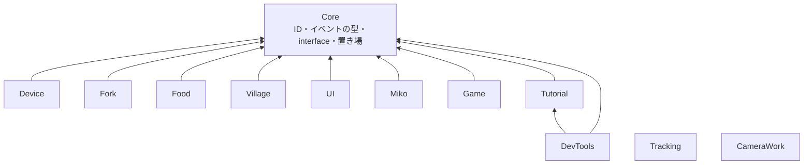
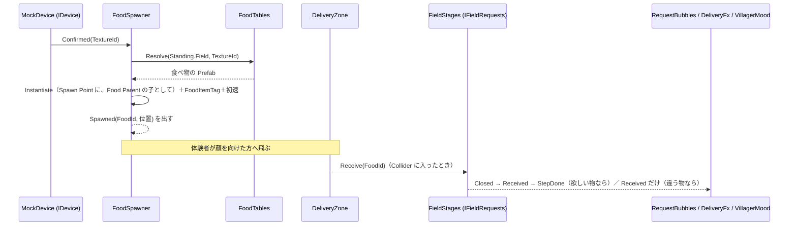
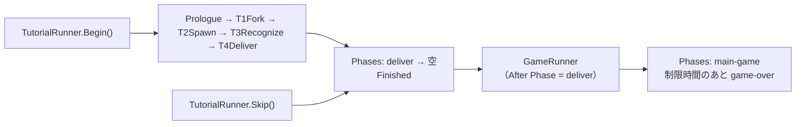

# スクリプト API リファレンス

2026-10-28 時点の `Assets/Scripts` の全スクリプトについて、API・名前空間・Inspector での見え方・機能どうしのつながりをまとめます。

> この文書の「API」「Inspector」の表は、`tools/api_doc/build.py` が C# のコードから作ります。手で直さないでください。直すときは、コードの `///` の説明か `[Tooltip]` を直して、`python3 tools/api_doc/build.py` を実行します。章の説明文は `tools/api_doc/template.md` に書きます。

## この文書の読み方

- 対象は、`main`（`5530138`、マップ仕上げ #346）に、PR #347（カメラのカット再生・チュートリアルのスキップ・置き場・巫女の追従）を重ねた状態です。#347 が入るまでは、`CameraWork` 全体と、`TutorialRunner.Skip`・`FoodSpawner.FoodParent`・`DeliveryFx.FxParent`・`MikoMover` の追従まわりが、`main` にはありません。
- 第 1 章は全体の作りです。第 2 章は、機能どうしがどうつながるかです。第 3 章は、共有シーン Main の中身です。第 4 章は、機能ごとの型の一覧です。付録に、メニューとファイルの置き場所があります。
- 各型の表は、公開されている `public`・`protected` のメンバーだけを載せます。`internal` はテスト用の入口なので載せません。
- 「Inspector」の表は、Unity が Inspector に出す項目です。項目名は、Unity が変数名から作る表示名です。`[Header]` は太字の行で示します。
- 確かめたこと: 型・メンバー・既定値・説明は、コードから機械的に取り出しています。Main シーンの位置は、`Main.unity` と入れ子の Prefab の YAML から計算しました。
- 確かめていないこと: Unity でコンパイルも実行もしていません。Mesh の見た目の大きさは読んでいないので、第 3 章の位置は、オブジェクトの原点です。

## 1. 全体像

### 1.1 層と依存の向き

機能は、`Core` の小さな型・interface・置き場を通してだけつながります。機能どうしは、互いのクラスを参照しません。

- `Tracking` と `CameraWork` は、`Core` も参照しません。どちらの機能も、ほかの機能の型を使いません。
- `DevTools` だけが、`Tutorial` を参照します。`TutorialDebugHud` が `TutorialRunner` を操作するためです。
- 機能の中の依存の向きは、asmdef の `references` で決まります。`.github/scripts/check_coupling.py` は、`MouthOfGod.<他の機能>` を参照するコードを、警告として PR に出します（止めません）。
- 全機能を参照する組み立て役（Bootstrap）と、中央の進行クラス（`GameManager`）は、置きません（[architecture.md](architecture.md)）。

### 1.2 アセンブリと名前空間

名前空間は、フォルダ名に合わせて `MouthOfGod.<フォルダ>` です。エディタ専用の部分は、`.Editor` を付けた別のアセンブリです。

| アセンブリ | 名前空間 | 参照する asmdef |
|---|---|---|
| `MouthOfGod.Core` | `MouthOfGod.Core` | なし |
| `MouthOfGod.Device` | `MouthOfGod.Device` | Core、Unity.InputSystem |
| `MouthOfGod.Fork` | `MouthOfGod.Fork` | Core、Unity.InputSystem |
| `MouthOfGod.Food` | `MouthOfGod.Food` | Core |
| `MouthOfGod.Village` | `MouthOfGod.Village` | Core |
| `MouthOfGod.UI` | `MouthOfGod.UI` | Core |
| `MouthOfGod.Miko` | `MouthOfGod.Miko` | Core、UnityEngine.UI |
| `MouthOfGod.Tutorial` | `MouthOfGod.Tutorial`、`MouthOfGod.Tutorial.Sandbox` | Core、Unity.InputSystem |
| `MouthOfGod.Game` | `MouthOfGod.Game` | Core、Unity.TextMeshPro |
| `MouthOfGod.Tracking` | `MouthOfGod.Tracking` | meta.xr.mrutilitykit、Oculus.VR、Unity.InputSystem、AprilTag.Runtime |
| `MouthOfGod.CameraWork` | `MouthOfGod.CameraWork` | なし |
| `MouthOfGod.DevTools` | `MouthOfGod.DevTools` | Core、Tutorial、Unity.InputSystem |
| `MouthOfGod.Device.Editor` | `MouthOfGod.Device.Editor` | Device |
| `MouthOfGod.Fork.Editor` | `MouthOfGod.Fork.Editor` | Fork |
| `MouthOfGod.Food.Editor` | `MouthOfGod.Food.Editor` | Food |
| `MouthOfGod.Village.Editor` | `MouthOfGod.Village.Editor`、`MouthOfGod.Village.Editor.Draft` | Village、Food |
| `MouthOfGod.Miko.Editor` | `MouthOfGod.Miko.Editor` | Miko |
| `MouthOfGod.Tutorial.Editor` | `MouthOfGod.Tutorial.Editor` | Tutorial、Miko |
| `MouthOfGod.CameraWork.Editor` | `MouthOfGod.CameraWork.Editor` | CameraWork |
| `MouthOfGod.DevTools.Editor` | `MouthOfGod.DevTools.Editor` | Core、DevTools、Tutorial、Fork、Food、Village、UI、Miko、Tutorial.Editor |

- テストは、機能ごとに `MouthOfGod.<機能>.Tests`（Editor のみ）です。`Core`・`Device`・`Food`・`Fork`・`Game`・`Tutorial`・`UI`・`CameraWork`・`Village` は、`InternalsVisibleTo` で `internal` をテストに見せています。
- `Tracking` の asmdef は `Core` を参照しません。コードも `MouthOfGod.Core` を使いません。ほかの機能には、`Transform` と追跡中かどうかだけを渡します。

### 1.3 Play のたびに自動で置かれるもの

手でシーンに置かなくても、次のものは Play で現れます。

| 自動で置かれるもの | 条件 | 置く所 |
|---|---|---|
| `MockDevice`（と `MockDeviceModel`） | シーン読み込みのあと、実機のデバイスが先に `Devices` へ登録していなければ | `MockDevice.GetOrCreate`。Prefab `Resources/Prefabs/Device/MockDevice` があればそれ、なければコードで作る。`DontDestroyOnLoad` |
| `RequestBubbles` | シーン読み込みのあと | 自分で GameObject を作って付く（村人の頭の上の吹き出し） |
| `AprilTagDetectionService` | `AprilTagPlace` が必要なとき | `AprilTagDetectionService.GetOrCreate` |
| `AprilTagRecalibrateInput` | `AprilTagDetectionService` が起動したとき | 同じ GameObject に自動で付く |
| `DeliveryFx` | `FieldStages` を持つ物に付いていないとき | `FieldStages` が自分で付ける |
| `FoodItemTag` | 食べ物を生んだとき | `FoodSpawner` が、生んだ食べ物に付ける |
| `SphereCollider`・`Rigidbody` | `ForkTip` に無いとき | `ForkTip` が自分に足す |

## 2. 機能どうしのつなぎ方

### 2.1 置き場（Core の static クラス）

機能をまたいで使う「もの」は、自分で置き場に登録します。使う側は、置き場から受け取ります。置き場は static なので、Play のたびに空にします（`RuntimeInitializeOnLoadMethod` の `Reset`）。

| 置き場 | 持つもの | 登録・設定する側 | 受け取る側（例） |
|---|---|---|---|
| `Devices` | `IDevice`（1 台） | `MockDevice` | `FoodSpawner`、`FoodShadow`、`ForkTip`、`TutorialScript` の待ち、`TutorialDebugHud` |
| `Forks` | `IFork`（1 本） | `ForkTip` | `FoodShadow`、`TutorialScript` の待ち、`TutorialDebugHud` |
| `FoodSpawners` | `IFoodSpawner`（1 つ） | `FoodSpawner` | `FoodShadow`、`TutorialScript` の待ち |
| `Fields` | `IFieldRequests`（フィールドごと） | `FieldStages` | `RequestBubbles`、`DeliveryZone`、`TutorialRunner`（Skip）、`T3Recognize`、`T4Deliver`、待ち、`TutorialDebugHud` |
| `Standing` | 前に立っているフィールド（`FieldId`） | `StandArea` | `FoodSpawner`（食べ物の表を選ぶ）、`StandWait`、`TutorialDebugHud` |
| `Phases` | いまの場面（`PhaseId`） | `TutorialRunner`、`GameRunner` | `GameRunner`、`FoodShadow`、`TutorialScript`、`TutorialDebugHud` |
| `Cues` | 合図（`CueRequested`） | `TutorialScript.Cue`、`TutorialRunner.Skip` | `MikoCueReceiver`、`CloudCues`、`FoodShadow`、`StandArea`、`CueReaction`、`TutorialDebugHud` |

`FoodTables`（Food）は、`FoodTable` の置き場です。機能をまたぐ置き場ではなく、Food の内側にあります。

### 2.2 合図（`Cues`）の名前

出す側は、誰が受けるかを知りません。受ける側がいなければ、何も起きません。名前は、機能ごとの決まりに従います。

| 合図の名前 | 受ける所 | 意味 |
|---|---|---|
| `miko.say.<id>` | `MikoCueReceiver` → `MikoSpeech` | 巫女がセリフ `<id>` を言う |
| `miko.face.<名前>` | `MikoCueReceiver` → `MikoFace` | 表情を変える（normal / happy / squint / love / sleep / wink / tired） |
| `miko.point` | `MikoCueReceiver` | 指さしをする |
| `miko.hush` | `MikoCueReceiver` → `MikoSpeech` | しゃべるのをやめる |
| `miko.follow` / `miko.stay` | `MikoCueReceiver` → `MikoMover` | 体験者についてくる / その場にとどまる |
| `cloud.glow` | `CloudCues` | 正面にいちばん近い雲を 1 つ光らせる |
| `cloud.approach` | `CloudCues` | 光る雲を、体験者の近くへ寄せる |
| `cloud.calm` | `CloudCues` | 光を消し、雲を戻す |
| `shadow.show` / `shadow.faint` / `shadow.emphasize` / `shadow.hide` | `FoodShadow` | 食べ物の影を、ふつうに / 薄く / 強く出す / 消す |
| `<フィールド>.footprint` / `<フィールド>.footprint-off` | `StandArea` | 床の足あとの印を出す / 消す |
| `<フィールド>.glow` / `<フィールド>.glow-off` | `CueReaction`（Inspector で設定した物） | フィールドを光らせる / 消す |
| `offering.show` / `offering.hide` | `CueReaction`（Inspector で設定した物） | T2 のお供え物を出す / 隠す |
| `device.button.glow` / `device.button.glow-strong` / `device.button.glow-off` | `CueReaction`（Inspector で設定した物） | デバイスのボタンを光らせる / 強く光らせる / 消す |
| `staff.alert` | `CueReaction`（Inspector で設定した物） | スタッフに知らせる |
| `prologue.start` / `prologue.end` | `CueReaction`（Inspector で設定した物） | プロローグの動画の前後 |

- `CueReaction` は、合図の名前ごとに、物を出す・消す・`UnityEvent` を呼ぶ、を Inspector だけで設定できる部品です。コードの外で足せる反応は、これで受けます。
- 合図の名前は、`TutorialScript` を継いだ各スクリプトの Inspector で変えられます。空にすると、その合図は出しません。
- フィールドの合図は、フィールド名から始めます（`sea.glow`、`village.footprint`）。決まりは [requests.md](requests.md) にあります。

### 2.3 場面（`Phases`）の名前

`Phases.Current` に入る名前です。番号ではなく、やることを表す名前にします。一覧と決める所は [progress-keys.md](progress-keys.md) にもあります。

| 名前 | 決める所 | 意味 |
|---|---|---|
| `prologue` | `PrologueVideo` | 導入の動画 |
| `fork` | `T1Fork` | フォークの使い方 |
| `spawn` | `T2Spawn` | 口から物が生まれる |
| `recognize` | `T3Recognize` | 食感で物が変わる・欲しい物を知る |
| `deliver` | `T4Deliver` | 立つ場所で届ける |
| `main-game` | `GameRunner` | 本編（制限時間のあいだ） |
| `game-over` | `GameRunner` | 本編の時間切れ |

### 2.4 流れ 1: 食べ物を生んで、届けるまで

1. デバイスが決定すると、`IDevice.Confirmed` が、そのときの食感を運びます。噛む前の決定（食感が空）は、食べ物を生みません。
2. `FoodSpawner` が `FoodTables.Resolve` で Prefab を引きます。引く順は、立っているフィールドの表、共通の表、なし、です。立っているフィールドは `Standing.Field` です。
3. `Spawn Point` の位置と向きに生みます。`Food Parent` を入れてあれば、その子にします。`FoodItemTag` を付け、`Launch Speed` が 0 より大きく、`Rigidbody` が動く物なら、前向きに初速を与えます。
4. 食べ物は、物理で飛びます。落ちた先の `DeliveryZone`（`Collider` の Is Trigger）が、`IFoodItem` を読んで、フィールドの `Receive` を呼びます。
5. `FieldStages.Receive` は、`DeliveryKind` を返します。欲しがっていた物（`Requested`）なら、ステップを済ませ、`Closed`（`Resolved = true`）、`Received`、`StepDone` の順に出します。このフィールドの物（`Own`）とよその物（`Foreign`）は、`Received` だけを出します。
6. `DeliveryFx` は、`StepDone` で喜びの粒と音を出し、`Received` が `Requested` 以外なら、困っている村人にトリガー `Missed` を送り、音を鳴らします。`RequestBubbles` は、`Closed` で吹き出しを消します。

### 2.5 流れ 2: 欲しい物を出す

- `IFieldRequests.Open()` が、次の欲しい物を出します。出せなければ `false` です（上限まで出ている、ステップが残っていない、など）。
- 出すと `Issued`（`RequestIssued`）が出ます。`RequestBubbles` は、`Anchor`（村人の頭の上の `Transform`）に吹き出しを出します。
- 同じフィールドで、同時に複数出せます。上限は `FieldStages` の Max Open Requests（既定 2）です。欲しい物は、`Request`（番号）で見分けます。
- `Expire()` は、出ている欲しい物を、届かないまま終えます（`Closed` の `Resolved = false`）。`Restart()` は、フィールドを最初に戻します。
- 本編が、いつ・どこに出すかを決めるコードは、まだありません。いまは、`OpenAllRequestsAfterTutorial`（試験用）が、チュートリアルのあとに、全フィールドへ出せるだけ出します。

### 2.6 流れ 3: チュートリアルから本編へ

- `TutorialRunner` は、子の `TutorialScript` を、Hierarchy の順に 1 つずつ動かします。動かす間、`Phases` を各スクリプトの場面にします。例外が出たスクリプトは、そこでやめて、次へ進みます。
- 全部終わると、`Phases` を空に戻し、`Finished` を出します。
- `GameRunner` は、場面 `deliver` のあとに場面が空になったとき、本編を始めます（After Phase の既定は `deliver`）。`TutorialRunner` の型は、参照しません。
- `TutorialRunner.Skip()` は、チュートリアルを飛ばして、全部終わった扱いにします。まず、動いていれば止め、`Memory` を空にし、全フィールドを `Restart` します。次に、`<フィールド>.glow-off`・`<フィールド>.footprint-off`・`miko.stay` の合図を出します。最後に、場面を Skip Phase（既定 `deliver`）から空の場面へ進め、`Finished` を出します。
- Skip で本編が始まるには、シーンに `GameRunner` が必要です。**2026-10-28 時点の Main シーンには `GameRunner` がありません**（第 3 章）。

### 2.7 ID の型

| 型 | 中身 | 例 |
|---|---|---|
| `TextureId` | 食感 | `placeholder-a` |
| `FoodId` | 食べ物。Prefab のファイル名と同じ | `fish` |
| `FieldId` | フィールド（`village` / `mountain` / `sea` / `grassland`） | `sea` |
| `CueId` | 合図の名前 | `miko.say.t1-pierce` |
| `PhaseId` | 場面の名前 | `deliver` |

どれも、文字列を包んだ `readonly struct` です。`null` と空文字は、どちらも空 ID（`None`、`IsEmpty`）です。大文字小文字を区別します。型が違えば、同じ文字列でも別物です。

## 3. 共有シーン Main の姿

`Assets/Scenes/Main.unity` を、YAML から読んで計算した結果です。単位はメートル、座標はワールドです。ミニチュアの台は、`Border_*` の枠で、およそ ±0.6 m 四方です。

### 3.1 位置

| 物 | 位置 (x, y, z) | 備考 |
|---|---|---|
| Main Camera | (-0.27, 1.51, -1.34) | FOV 60。子に `MouthAnchor` (-0.27, 1.43, -1.26)、`ButtonGlow`、`ButtonGlowStrong`、`StaffAlert` |
| Miko | (-1.17, 1.21, 0.26) | 向きは Y 軸 180 度 |
| 村（`Village/Village/Plaza`） | (-0.31, 0.11, -0.30) | 村人・家・畑・木 |
| 山（`MountVer2/mount`） | (-0.27, 0.13, 0.30) | |
| 草原（`Grass/Tree1`） | (0.28, 0.13, 0.39) | `Grass` のルートは (0.27, 0.01, 0.27) |
| 海（`Sea_work`） | (0.31, -0.07, -0.30) | `Terrain_sea` は (0.04, 0.06, -0.57) |
| 立つ場所（`StandArea`） | 村 (-1.02, -0.06, -1.03)、海 (1.07, -0.16, -0.85)、草原 (0.90, -0.09, 1.17)、山 (-0.93, -0.06, 1.00) | |

### 3.2 Hierarchy とコンポーネント

Main.unity のシーンに直接付いている、このリポジトリのスクリプトです。

| オブジェクト | コンポーネント |
|---|---|
| `Main Camera` | `DesktopHead` |
| `MinitureBase` | `AprilTagPlace` |
| `CloudRing` | `CloudRing`、`CloudCues` |
| `ForkTip` | `ForkTip`、`HandHeldPose` |
| `Indicators` | `CueReaction` |
| `DebugHud` | `TutorialDebugHud` |
| `OpenAllRequestsAfterTutorial` | `OpenAllRequestsAfterTutorial` |

Prefab として置かれている物と、その中のコンポーネントです。

| Prefab の置き場 | 中身 |
|---|---|
| `Resources/Prefabs/Miko/Miko` | `Body` に `MikoFloat`・`MikoMover`・`MikoPointer`・`MikoCueReceiver`・`MikoFace`・`MikoSpeech`。子の `LineBook` に `MikoLineBook` |
| `Resources/Prefabs/Misc/FoodSpawner` | `FoodSpawner`、`FoodTable`（共通の表） |
| `Resources/Prefabs/Misc/FoodShadow` | `FoodShadow` |
| `Resources/Prefabs/Misc/TutorialRunner` | `TutorialRunner`。Main では、子に `Prologue`・`T1Fork`・`T2Spawn`・`T3Recognize`・`T4Deliver` の Prefab が並ぶ（この順がチュートリアルの順） |
| `Resources/Prefabs/Tutorial/<名前>` | `PrologueVideo`（子に `VideoScreen`）、`T1Fork`、`T2Spawn`、`T3Recognize`、`T4Deliver`。どれにも `MikoLineBook` が付く |
| `[BuildingBlock] Camera Rig with MouthAnchor` | Meta XR のカメラ装置 |

フィールドの Prefab です。Main では、`Resources/Prefabs/Misc/` の Variant（`Village`、`Grass Variant`、`MountVer2 Variant`）と、`Resources/Prefabs/Sea/Sea_work` を使います。Variant は、元の Prefab に、Main 用の部品（`StandArea`、`DeliveryZone` など）を足した物です。

| フィールド | 元の Prefab | ルートのコンポーネント | ステップ（`FieldStep`、順に欲しい物） |
|---|---|---|---|
| 村 `village` | `Resources/Prefabs/Village/Village` | `FieldStages`、`SurfaceAnchor`、`DeliveryFx`、`DeliveryZone`、`FoodTable` | pumpkin、carrot、turnip、tomato |
| 海 `sea` | `Resources/Prefabs/Sea/Sea_work` | `SurfaceAnchor`、`FieldStages`、`FoodTable`、`DeliveryZone`、`DeliveryFx`、`CueReaction` | fish、shell、shrimp |
| 草原 `grassland` | `Resources/Prefabs/Grass/Grass` | `FieldStages`、`FoodTable` | chicken、pig、sheep、cow |
| 山 `mountain` | `Resources/Prefabs/Mount/MountVer2` | `FoodTable`、`FieldStages`、`DeliveryZone`、`DeliveryFx` | mushroom、apple、chestnut |

- 村人は、各フィールドの子に `VillagerMood` として置かれます。`FieldStep` の Helped に入れた村人が、そのステップが済むまで悩みます。
- 食べ物の Prefab は、`Resources/Prefabs/Food/` にあります（apple、carrot、chestnut、chicken、cow、fish、mushroom、pig、pumpkin、sheep、shell、shrimp、tomato、turnip）。ファイル名が食べ物の ID です。

### 3.3 Main にまだ無いもの

- `GameRunner` と `RemainingTimeText`: シーンにも Prefab にもありません。置かないと、チュートリアルが終わっても本編（`main-game`）は始まりません。`TutorialRunner.Skip()` も、同じです。
- 自動で置かれる物（1.3 節）は、手で置く必要がありません。

## 4. 機能別リファレンス

### 4.1 Core

全体で共有する、小さな基盤です。他の asmdef に依存しません。ロジックは置かず、ID・イベントのデータ・interface・置き場だけを置きます。

#### 置き場

##### `Devices`

- 名前空間: `MouthOfGod.Core`
- ファイル: `Assets/Scripts/Core/Devices.cs`
- 種類: static class

いま使える IDevice の受け取り口。デバイスは 1 台なので、全体で 1 つにする。実装（MockDevice、実機の Device）が Register し、使う側は WhenReady で受け取る（後から登録されても届く）。

**API**

| メンバー | 説明 |
|---|---|
| `static IDevice Current` | 登録されている IDevice。まだ無ければ null。 |
| `static void WhenReady(Action<IDevice> callback)` | IDevice が使えるようになったら callback を 1 回呼ぶ。すでに登録されていれば、すぐ呼ぶ。取り消せるように、ラムダではなくメソッドを渡す（CancelWhenReady はメソッドでしか外せない）。 |
| `static void CancelWhenReady(Action<IDevice> callback)` | まだ呼ばれていない WhenReady を取り消す（登録前に消える側が、OnDisable で呼ぶ）。WhenReady に渡したのと同じメソッドを渡す。 |
| `static bool Register(IDevice device)` | デバイスを登録する。別のデバイスがすでに登録されていれば、登録せずに警告を出して false を返す。待っている WhenReady を 1 つずつ呼ぶ。1 つが例外を投げても、残りは呼ぶ（例外は Console に出す）。 |
| `static void Unregister(IDevice device)` | 登録を外す。登録されているデバイスと同じときだけ外す。 |

##### `Forks`

- 名前空間: `MouthOfGod.Core`
- ファイル: `Assets/Scripts/Core/Forks.cs`
- 種類: static class

いま使える IFork の受け取り口。フォークは 1 本なので、全体で 1 つにする。実装（Fork）が Register し、使う側は WhenReady で受け取る（後から登録されても届く）。形は Devices と同じ。

**API**

| メンバー | 説明 |
|---|---|
| `static IFork Current` | 登録されている IFork。まだ無ければ null。 |
| `static void WhenReady(Action<IFork> callback)` | IFork が使えるようになったら callback を 1 回呼ぶ。すでに登録されていれば、すぐ呼ぶ。取り消せるように、ラムダではなくメソッドを渡す（CancelWhenReady はメソッドでしか外せない）。 |
| `static void CancelWhenReady(Action<IFork> callback)` | まだ呼ばれていない WhenReady を取り消す。WhenReady に渡したのと同じメソッドを渡す。 |
| `static bool Register(IFork fork)` | フォークを登録する。別のフォークがすでに登録されていれば、登録せずに警告を出して false を返す。待っている WhenReady を 1 つずつ呼ぶ。1 つが例外を投げても、残りは呼ぶ（例外は Console に出す）。 |
| `static void Unregister(IFork fork)` | 登録を外す。登録されているフォークと同じときだけ外す。 |

##### `FoodSpawners`

- 名前空間: `MouthOfGod.Core`
- ファイル: `Assets/Scripts/Core/FoodSpawners.cs`
- 種類: static class

いま使える IFoodSpawner の受け取り口。食べ物を生む所は 1 つなので、全体で 1 つにする。実装（Food の FoodSpawner）が Register し、使う側は WhenReady で受け取る（後から登録されても届く）。形は Devices・Forks と同じ。

**API**

| メンバー | 説明 |
|---|---|
| `static IFoodSpawner Current` | 登録されている IFoodSpawner。まだ無ければ null。 |
| `static void WhenReady(Action<IFoodSpawner> callback)` | IFoodSpawner が使えるようになったら callback を 1 回呼ぶ。すでに登録されていれば、すぐ呼ぶ。取り消せるように、ラムダではなくメソッドを渡す（CancelWhenReady はメソッドでしか外せない）。 |
| `static void CancelWhenReady(Action<IFoodSpawner> callback)` | まだ呼ばれていない WhenReady を取り消す。WhenReady に渡したのと同じメソッドを渡す。 |
| `static bool Register(IFoodSpawner spawner)` | 食べ物を生む所を登録する。別の食べ物を生む所がすでに登録されていれば、登録せずに警告を出して false を返す。待っている WhenReady を 1 つずつ呼ぶ。1 つが例外を投げても、残りは呼ぶ（例外は Console に出す）。 |
| `static void Unregister(IFoodSpawner spawner)` | 登録を外す。登録されているものと同じときだけ外す。 |

##### `Fields`

- 名前空間: `MouthOfGod.Core`
- ファイル: `Assets/Scripts/Core/Fields.cs`
- 種類: static class

いまシーンにあるフィールド（IFieldRequests）の掲示板。フィールドが自分で Register し、使う側（本編・チュートリアル・吹き出し・届いたかの判定）は All と Added で受け取る。誰も相手のクラスを知らずにつながる（docs/requests.md「API 仕様」）。

**API**

| メンバー | 説明 |
|---|---|
| `static IReadOnlyList<IFieldRequests> All` | 登録されているフィールド（登録した順）。 |
| `static event Action<IFieldRequests> Added` | フィールドが登録された。 |
| `static event Action<IFieldRequests> Removed` | フィールドの登録が外れた（シーンから消えた、無効になった）。 |
| `static IFieldRequests Find(FieldId id)` | その ID のフィールド。無ければ null。 |
| `static bool Register(IFieldRequests field)` | フィールドを登録する。ID が空・同じ ID がすでにあるなら、登録せずに警告を出して false。同じものを 2 回登録しても 1 つ。 |
| `static void Unregister(IFieldRequests field)` | 登録を外す。登録されていなければ何もしない。 |

##### `Standing`

- 名前空間: `MouthOfGod.Core`
- ファイル: `Assets/Scripts/Core/Standing.cs`
- 種類: static class

体験者がいま前に立っているフィールドの置き場。チュートリアルの「ここに立って」の案内と、そのフィールド専用の食べ物の表を選ぶのに使う。物がどのフィールドに届くかは、ここでは決めない。体験者が狙って飛ばした物が、実際に落ちたフィールドに届く（Village の DeliveryZone）。立つ位置を判定する側（Village の立つ場所）が Set し、使う側（Food・Tutorial・Game）は Field で読み、Changed で知らせを受ける。

**API**

| メンバー | 説明 |
|---|---|
| `static FieldId Field` | いま前に立っているフィールド。どこにも立っていなければ None。 |
| `static event Action<FieldId> Changed` | 立っているフィールドが変わった（新しいフィールドを運ぶ）。Field を更新してから出す。同じフィールドを Set しても出ない。 |
| `static void Set(FieldId field)` | いま立っているフィールドを決める。 |
| `static void Leave(FieldId field)` | そのフィールドに立っているときだけ、どこにも立っていない状態に戻す。離れた場所が、別の場所の判定を消さないようにするため。 |

##### `Phases`

- 名前空間: `MouthOfGod.Core`
- ファイル: `Assets/Scripts/Core/Phases.cs`
- 種類: static class

いまの場面（チュートリアルの名前、本編、エンディングなど）の置き場。決める側（Tutorial・Game）が Set し、使う側は Current で読み、Changed で変わった知らせを受ける。

**API**

| メンバー | 説明 |
|---|---|
| `static PhaseId Current` | いまの場面。決まっていなければ None。 |
| `static event Action<PhaseId> Changed` | 場面が変わった（新しい場面を運ぶ）。Current を更新してから出す。同じ場面を Set しても出ない。 |
| `static void Set(PhaseId phase)` | いまの場面を決める。いまと同じなら何もしない。 |

##### `Cues`

- 名前空間: `MouthOfGod.Core`
- ファイル: `Assets/Scripts/Core/Cues.cs`
- 種類: static class

合図（CueRequested）の置き場。Tutorial が Request し、Village や UI が Requested を受けて、見せ方を決める。

**API**

| メンバー | 説明 |
|---|---|
| `static event Action<CueRequested> Requested` | 合図が出た。 |
| `static void Request(CueId cue)` | 合図を出す。名前が空なら、警告して何もしない。 |

#### interface

##### `IDevice`

- 名前空間: `MouthOfGod.Core`
- ファイル: `Assets/Scripts/Core/IDevice.cs`
- 種類: interface

触感デバイスの入力。実装は Device（と MockDevice）。物理量は実装の内側で TextureId に変換する。

**API**

| メンバー | 説明 |
|---|---|
| `TextureId Current { get; }` | いまの食感。まだ噛んでいなければ TextureId.None。噛むのをやめても、最後の食感が残る。 |
| `event Action<TextureId> TextureChanged` | 食感が変わった（新しい食感を運ぶ）。Current を更新してから出す。噛み始めは Bitten の直後に、最初の食感で出す（前と同じ食感でも出す）。噛むのをやめても None では出さない。 |
| `event Action<TextureId> Confirmed` | 決定した。決定したときの食感（Current）を運ぶ。噛む前の決定なら TextureId.None。 |
| `event Action Bitten` | 噛み始めた。噛み始めるたびに 1 回出す（噛んでいる間は出さない）。 |

##### `IFork`

- 名前空間: `MouthOfGod.Core`
- ファイル: `Assets/Scripts/Core/IFork.cs`
- 種類: interface

体験者が持つフォーク。雲を刺したか（先に雲のかけらが付いているか）と、先が口の中にあるかを知らせる。実装は Fork の ForkTip。

**API**

| メンバー | 説明 |
|---|---|
| `bool IsLoaded { get; }` | 先に雲のかけらが付いている。 |
| `bool InMouth { get; }` | 先が口の中にある。 |
| `event Action Pierced` | 雲を刺した（かけらが付いた）。かけらが付いている間は、もう一度は出ない。 |
| `event Action MouthEntered` | 先が口に入った。 |
| `event Action MouthLeft` | 先が口から出た。 |
| `event Action Emptied` | かけらがなくなった（決定して、食べ物が生まれたとき）。 |

##### `IFoodSpawner`

- 名前空間: `MouthOfGod.Core`
- ファイル: `Assets/Scripts/Core/IFoodSpawner.cs`
- 種類: interface

決定した食感から食べ物を生む所。実装は Food の FoodSpawner。使う側（Tutorial・UI）は WhenReady で受け取る。

**API**

| メンバー | 説明 |
|---|---|
| `event Action<Spawned> Spawned` | 食べ物を生んだ直後に、1 回出る。 |
| `GameObject Preview(TextureId texture)` | その食感なら生まれる食べ物の Prefab を引くだけ。生まない。引けなければ null。いま立っているフィールドの表で引く。 |

##### `IFoodItem`

- 名前空間: `MouthOfGod.Core`
- ファイル: `Assets/Scripts/Core/IFoodItem.cs`
- 種類: interface

生まれた食べ物が持つ。届け先の判定など、機能をまたぐ側が「これはどの食べ物か」を読むために使う。実装は Food の FoodItemTag で、食べ物を生むときに付く。

**API**

| メンバー | 説明 |
|---|---|
| `FoodId Food { get; }` | 食べ物の ID（食べ物の Prefab のファイル名）。 |

##### `IFieldRequests`

- 名前空間: `MouthOfGod.Core`
- ファイル: `Assets/Scripts/Core/IFieldRequests.cs`
- 種類: interface

1 つのフィールドの欲しい物。いつもの実装は Village の FieldStages。フィールドは自分で Fields に登録し、Game・Tutorial・UI はそこから受け取る。

**API**

| メンバー | 説明 |
|---|---|
| `FieldId Field { get; }` |  |
| `bool IsOpen { get; }` | 欲しい物が 1 つ以上出ている（吹き出しが出ている）。 |
| `bool CanOpen { get; }` | 次の欲しい物を出せる（出ている数が上限より少なく、まだ出していない欲しい物が残っている）。すっかり戻ったフィールドは false。 |
| `bool Open()` | 次の欲しい物を出す（Issued が出る）。出せなければ false。 |
| `bool Open(FoodId food)` | その物を欲しがる、まだ済んでいないステップを出す（並び順によらない）。チュートリアルのように、出す物が台本で決まっているときに使う。上限まで出ている・その物を欲しがるステップが無いなら false。 |
| `DeliveryKind Receive(FoodId food)` | 物がこのフィールドに届いた。何が届いても受け取り、何だったかを返す（Received も 1 回出る）。出ている欲しい物のどれかと同じ物（Requested）なら、同じ物を欲しがる一番古いものが済んで、見た目が変わってから Closed（Resolved = true）が出る。それ以外（Own・Foreign）は、フィールドは戻らない。反応（豊作・いびつな世界など）は、Received を受けた側が足す。物が落ちた場所を決める所（DeliveryZone）が呼ぶ。 |
| `void Expire()` | 出ている欲しい物を、すべて届かないまま終える（Closed が Resolved = false で、出した順に出る）。出ていなければ何もしない。 |
| `void Expire(int request)` | その番号の欲しい物だけを、届かないまま終える（待ちきれなかった。Closed が Resolved = false で出る）。出ていなければ何もしない。 |
| `void Restart()` | はじめ（何も戻っていない）に戻す。出ていた欲しい物も終える（Closed、Resolved = false）。体験の終わり（次の人へ）に呼ぶ。チュートリアルと本編の間では戻さない。 |
| `event Action<RequestIssued> Issued` |  |
| `event Action<RequestClosed> Closed` | 欲しい物が終わった。届いて解決した（Resolved = true）か、Expire やリセットで終わった（false）。 |
| `event Action<Delivered> Received` | 物が届いた（Receive のたびに 1 回）。採点はこれを数える。Requested のときは Closed の後に出る。 |

#### ID とイベントのデータ

##### `TextureId`

- 名前空間: `MouthOfGod.Core`
- ファイル: `Assets/Scripts/Core/Ids.cs`
- 種類: readonly struct、継承・実装: `IEquatable<TextureId>`

食感の論理 ID。文字列を包んだ値。null と空文字は、どちらも空 ID（TextureId.None）。大文字小文字は区別する。

**API**

| メンバー | 説明 |
|---|---|
| `static readonly TextureId None` |  |
| `TextureId(string value)` |  |
| `string Value` |  |
| `bool IsEmpty` |  |

##### `FoodId`

- 名前空間: `MouthOfGod.Core`
- ファイル: `Assets/Scripts/Core/Ids.cs`
- 種類: readonly struct、継承・実装: `IEquatable<FoodId>`

食べ物の ID。文字列を包んだ値。null と空文字は、どちらも空 ID（FoodId.None）。大文字小文字は区別する。

**API**

| メンバー | 説明 |
|---|---|
| `static readonly FoodId None` |  |
| `FoodId(string value)` |  |
| `string Value` |  |
| `bool IsEmpty` |  |

##### `FieldId`

- 名前空間: `MouthOfGod.Core`
- ファイル: `Assets/Scripts/Core/Ids.cs`
- 種類: readonly struct、継承・実装: `IEquatable<FieldId>`

フィールド（山・海・草原・村）の ID。文字列を包んだ値。null と空文字は、どちらも空 ID（FieldId.None）。大文字小文字は区別する。

**API**

| メンバー | 説明 |
|---|---|
| `static readonly FieldId None` |  |
| `FieldId(string value)` |  |
| `string Value` |  |
| `bool IsEmpty` |  |

##### `CueId`

- 名前空間: `MouthOfGod.Core`
- ファイル: `Assets/Scripts/Core/Ids.cs`
- 種類: readonly struct、継承・実装: `IEquatable<CueId>`

Tutorial から Village や UI への指示の ID。文字列を包んだ値。null と空文字は、どちらも空 ID（CueId.None）。大文字小文字は区別する。

**API**

| メンバー | 説明 |
|---|---|
| `static readonly CueId None` |  |
| `CueId(string value)` |  |
| `string Value` |  |
| `bool IsEmpty` |  |

##### `PhaseId`

- 名前空間: `MouthOfGod.Core`
- ファイル: `Assets/Scripts/Core/Ids.cs`
- 種類: readonly struct、継承・実装: `IEquatable<PhaseId>`

いまの場面（チュートリアルの名前、本編、エンディングなど）の ID。文字列を包んだ値。null と空文字は、どちらも空 ID（PhaseId.None）。大文字小文字は区別する。

**API**

| メンバー | 説明 |
|---|---|
| `static readonly PhaseId None` |  |
| `PhaseId(string value)` |  |
| `string Value` |  |
| `bool IsEmpty` |  |

##### `Spawned`

- 名前空間: `MouthOfGod.Core`
- ファイル: `Assets/Scripts/Core/Events.cs`
- 種類: readonly struct

食べ物が生まれた。

**API**

| メンバー | 説明 |
|---|---|
| `readonly FoodId Food` |  |
| `readonly Vector3 Position` |  |
| `Spawned(FoodId food, Vector3 position)` |  |

##### `DeliveryKind`

- 名前空間: `MouthOfGod.Core`
- ファイル: `Assets/Scripts/Core/Events.cs`
- 種類: enum

物がフィールドに届いたとき、そのフィールドにとって何だったか。採点や反応は、これを見て決める。

| 値 | 意味 |
|---|---|
| `Requested` | 吹き出しで欲しがっていた物。そのステップが済み、フィールドの一部が戻る。 |
| `Own` | このフィールドの物だが、いま欲しがってはいない（2 本目のにんじん、まだ頼んでいない物）。フィールドは戻らない。 |
| `Foreign` | このフィールドの物ではない（村に豚）。フィールドは戻らない。 |

##### `Delivered`

- 名前空間: `MouthOfGod.Core`
- ファイル: `Assets/Scripts/Core/Events.cs`
- 種類: readonly struct

物がフィールドに届いた。何が届いても、届いたたびに 1 回出る。Kind で、欲しがっていた物か・このフィールドの物か・よその物かが分かる。

**API**

| メンバー | 説明 |
|---|---|
| `readonly FoodId Food` |  |
| `readonly FieldId Field` |  |
| `readonly DeliveryKind Kind` |  |
| `Delivered(FoodId food, FieldId field, DeliveryKind kind)` |  |
| `bool WasRequested` | 欲しがっていた物だったか（Kind == Requested）。 |

##### `RequestIssued`

- 名前空間: `MouthOfGod.Core`
- ファイル: `Assets/Scripts/Core/Events.cs`
- 種類: readonly struct

フィールドの困っている人が、欲しい物を出した（吹き出しを出す合図）。1 つのフィールドに、同時に複数出ていることがある。どの欲しい物かは Request（番号）で見分ける。終わったときの RequestClosed にも、同じ番号が入る。

**API**

| メンバー | 説明 |
|---|---|
| `readonly FoodId Food` |  |
| `readonly FieldId Field` |  |
| `readonly Transform Anchor` | 吹き出しを出す場所（困っている人の頭の上など）。ミニチュアと一緒に動くので、位置ではなく Transform で渡す。無ければ null。 |
| `readonly int Request` | 欲しい物の番号。同じフィールドの中で、出すたびに変わる。フィールドと組で、1 つの欲しい物を見分ける。 |
| `RequestIssued(FoodId food, FieldId field, Transform anchor = null, int request = 0)` |  |

##### `RequestClosed`

- 名前空間: `MouthOfGod.Core`
- ファイル: `Assets/Scripts/Core/Events.cs`
- 種類: readonly struct

出ていた欲しい物が終わった（吹き出しを消す合図）。Resolved は、届いて解決したか（false なら、待ちきれなかった・やり直した）。

**API**

| メンバー | 説明 |
|---|---|
| `readonly FoodId Food` |  |
| `readonly FieldId Field` |  |
| `readonly bool Resolved` |  |
| `readonly int Request` | 終わった欲しい物の番号。出したときの Request と同じ。 |
| `RequestClosed(FoodId food, FieldId field, bool resolved, int request = 0)` |  |

##### `CueRequested`

- 名前空間: `MouthOfGod.Core`
- ファイル: `Assets/Scripts/Core/Events.cs`
- 種類: readonly struct

Tutorial から Village や UI への指示（「この場所を光らせる」など）。

**API**

| メンバー | 説明 |
|---|---|
| `readonly CueId Cue` |  |
| `CueRequested(CueId cue)` |  |

### 4.2 Device

触感デバイスの入力です。`MockDevice` が、デバイスなしで、Quest のコントローラやキーボードで「噛む・決定する」を代わりにします。実機は、`IDevice` を実装して `Devices.Register` するだけで差し替わります。

#### `MockDevice`

- 名前空間: `MouthOfGod.Device`
- ファイル: `Assets/Scripts/Device/MockDevice.cs`
- 種類: sealed class、継承・実装: `MonoBehaviour, IDevice`

デバイスなしで動かす IDevice。Meta Quest のコントローラ（ゲームパッド・キーボードも可）で「噛む・決定する」を代わりにする。噛み始めで Bitten、噛んでいる間は一定間隔で TextureChanged、決定操作で Confirmed。操作の割り当ては Inspector（InputAction）で変えられる。スクリプトで作れる（GetOrCreate）。Play すると自動で用意する。

**API**

| メンバー | 説明 |
|---|---|
| `float ContentPercent` | デバイスの内容量（0〜100 %）。見た目（MockDeviceModel）が読む。 |
| `TextureId Current` |  |
| `bool IsBiting` | 噛んでいる間（噛む操作を押している間）。見た目（MockDeviceModel）が読む。 |
| `event Action<TextureId> TextureChanged` |  |
| `event Action<TextureId> Confirmed` |  |
| `event Action Bitten` |  |
| `static MockDevice GetOrCreate()` | シーン内の MockDevice を返す。無ければ、Prefab があれば Prefab から、無ければスクリプトで作る（既定の操作割り当て付き）。Prefab にしておくと、Inspector で変えた設定（操作の割り当て・間隔・食感 ID）が残る。 |

**Inspector**

| 項目 | 型 | 既定値 | 説明 |
|---|---|---|---|
| Texture Ids | `string[]` | `{ "placeholder-a", "placeholder-b", "placeholder-c", "placeholder-d", "placeholder-e", "placeholder-f" }` | 噛んでいる間に順に切り替わる食感 ID。既定はプレースホルダー。実際の ID に差し替える。Play 中に変えても反映されない |
| Switch Interval Seconds | `float` | `1.5f` | 食感が切り替わる間隔（秒）。暫定。Play 中に変えても反映されない |
| Bite Action | `InputAction` | `new InputAction("Bite", InputActionType.Button, "<XRController>{RightHand}/triggerPressed")` | 噛む操作（押している間が噛んでいる間）。Inspector でバインドを変えられる。暫定: Quest 右トリガー / 左手を握る（ハンドトラッキング） / Space / ゲームパッド A |
| Confirm Action | `InputAction` | `new InputAction("Confirm", InputActionType.Button, "<XRController>{RightHand}/primaryButton")` | 決定操作。Inspector でバインドを変えられる。暫定: Quest 右 A ボタン / 左手のつまみ（ハンドトラッキング） / Enter / ゲームパッド Start。実機の「ハードのボタン 1 つ」の代わり |
| Log Events | `bool` | `true` | 噛む・食感・決定を Console に出す（受け取る側がまだ無くても、動いているか分かるように） |
| Content Percent | `float` |  | デバイスの内容量（0〜100 %）。先端に表示する。Inspector で動かして試せる |

#### `MockDeviceModel`

- 名前空間: `MouthOfGod.Device`
- ファイル: `Assets/Scripts/Device/MockDeviceModel.cs`
- 種類: sealed class、継承・実装: `MonoBehaviour`
- 属性: `[RequireComponent(typeof(MockDevice))]`

MockDevice の雑な見た目。細長い棒で、先端に内容量（%）を出す。手（Quest のハンドトラッキング）を握ると、手に付いて保持される。離すとその場に残る。見た目だけで、IDevice のイベントには関わらない。

**Inspector**

| 項目 | 型 | 既定値 | 説明 |
|---|---|---|---|
| Hand Anchor | `Transform` |  | 手の位置。空なら、シーン内の RightHandAnchor（OVRCameraRig）を探す |
| Grasp Threshold | `float` | `0.8f` | 握りの強さ（0〜1）。この値以上で握ったことにする。暫定 |
| Grasp Action | `InputAction` | `new InputAction("Grasp", InputActionType.Value, "<HandInteraction>{RightHand}/graspValue")` | 握る操作（float）。Inspector でバインドを変えられる。暫定: OpenXR Hand Interaction の右手 graspValue / Quest 右グリップ |
| Length | `float` | `0.2f` | 棒の長さ（m）。見た目を作るときに使う |
| Label | `TextMesh` |  | 先端の内容量（%）の表示。Prefab に入っていればそれを使う。空なら Play 時に見た目を作る |

エディタ専用:

#### `MockDevicePrefabGenerator`

- 名前空間: `MouthOfGod.Device.Editor`、ファイル: `Assets/Scripts/Device/Editor/MockDevicePrefabGenerator.cs`

MockDevice の Prefab を Assets/Resources/Prefabs/Device/ に作る。1 回実行して、できた Prefab をコミットする。Play すると、MockDevice はこの Prefab から作られる（Inspector で変えた設定が残る）。既にある Prefab は上書きしない。

- メニュー: `MouthOfGod/Device/Create MockDevice Prefab`

### 4.3 Fork

体験者が持つフォークです。雲を刺し、口に含み、決定で食べ終えるまでの状態を持ちます。

#### `Cloud`

- 名前空間: `MouthOfGod.Fork`
- ファイル: `Assets/Scripts/Fork/Cloud.cs`
- 種類: sealed class、継承・実装: `MonoBehaviour`

フォークで刺せる雲。当たり判定（Collider）と一緒に、雲の見た目に付ける。刺されると、見た目と当たり判定を隠し、Respawn Seconds たったら戻る。

**API**

| メンバー | 説明 |
|---|---|
| `bool IsAvailable` | いま刺せる（隠れていない）。 |
| `void Take()` | 刺された。隠して、時間がたったら戻す。 |

**Inspector**

| 項目 | 型 | 既定値 | 説明 |
|---|---|---|---|
| Respawn Seconds | `float` | `3f` | 刺されてから、また刺せるようになるまでの秒数。仮の値 |

#### `CloudCues`

- 名前空間: `MouthOfGod.Fork`
- ファイル: `Assets/Scripts/Fork/CloudCues.cs`
- 種類: sealed class、継承・実装: `MonoBehaviour`

雲の合図（Cues）を受けて、雲に見せる。CloudRing と同じオブジェクトに付ける（その子の雲を使う）。

**Inspector**

| 項目 | 型 | 既定値 | 説明 |
|---|---|---|---|
| Cloud Root | `Transform` |  | 雲を探す親。空なら、このオブジェクト（CloudRing）の子から探す |
| **合図の名前** | | | |
| Glow Cue | `string` | `"cloud.glow"` | 雲を 1 つ光らせる合図 |
| Approach Cue | `string` | `"cloud.approach"` | 光る雲を体験者の近くへ寄せる合図 |
| Calm Cue | `string` | `"cloud.calm"` | 光を消し、雲を戻す合図 |
| **光らせ方** | | | |
| Glow Color | `Color` | `new Color(1f, 0.85f, 0.4f)` | 光るときの色。元の色とこの色のあいだを行き来する |
| Pulse Scale | `float` | `0.15f` | 大きさの脈の幅。0.15 なら、元の 1〜1.15 倍のあいだで脈打つ |
| Pulse Per Second | `float` | `1.2f` | 1 秒に脈打つ回数 |
| **寄せ方** | | | |
| Approach Meters | `float` | `0.2f` | 頭のほうへ寄せる距離（m） |
| Min Head Distance | `float` | `0.25f` | 寄せても、頭からこの距離（m）より近くにはしない |
| Approach Seconds | `float` | `1.5f` | 寄せきるまでの秒数 |
| Return Seconds | `float` | `1f` | 元の位置へ戻りきるまでの秒数 |

#### `CloudRing`

- 名前空間: `MouthOfGod.Fork`
- ファイル: `Assets/Scripts/Fork/CloudRing.cs`
- 種類: sealed class、継承・実装: `MonoBehaviour`

体験者の前に、雲（Cloud）を半円状に浮かべる。体験者が歩くと、ついて来る。シーンのどこか 1 か所に置く。雲の Prefab は Resources/Prefabs/Fork/Cloud（メニュー「MouthOfGod/Fork/Generate Cloud Prefab」で作る）。

**Inspector**

| 項目 | 型 | 既定値 | 説明 |
|---|---|---|---|
| Cloud Prefab | `Cloud` |  | 雲の Prefab。空なら Resources/Prefabs/Fork/Cloud を使う |
| Count | `int` | `5` | 浮かべる雲の数。仮の値 |
| Radius | `float` | `0.45f` | 頭から雲までの水平の距離（m）。腕を伸ばして届く所。仮の値 |
| Height | `float` | `-0.3f` | 頭から見た雲の高さ（m）。マイナスで頭より下。仮の値 |
| Spread Degrees | `float` | `120f` | 雲を並べる角度の幅（度）。正面を中心に、この幅に並べる。360 で体験者を囲む |
| Bob Amplitude | `float` | `0.02f` | 上下にゆれる幅（m） |
| Follow Speed | `float` | `2f` | 体験者について来る速さ。大きいほど早く追いつく |

#### `ForkTip`

- 名前空間: `MouthOfGod.Fork`
- ファイル: `Assets/Scripts/Fork/ForkTip.cs`
- 種類: sealed class、継承・実装: `MonoBehaviour, IFork`

体験者が持つフォークの先。雲（Cloud）に触れたら刺したとし、口に近づいたら口に入ったとする。フォークの先の位置に置く。位置の取り方は知らない。手（ハンドトラッキング）や AprilTag からフォークの位置を推定する部品が、このオブジェクトか親を動かす。有効になると、自分で Forks に登録する。

**API**

| メンバー | 説明 |
|---|---|
| `bool IsLoaded` |  |
| `bool InMouth` |  |
| `event Action Pierced` |  |
| `event Action MouthEntered` |  |
| `event Action MouthLeft` |  |
| `event Action Emptied` |  |

**Inspector**

| 項目 | 型 | 既定値 | 説明 |
|---|---|---|---|
| Mouth | `Transform` |  | 口の位置。FoodSpawner の Spawn Point と同じ MouthAnchor を入れる。空なら、Main Camera から Mouth Offset だけずらした所 |
| Mouth Offset | `Vector3` | `new Vector3(0f, -0.1f, 0.1f)` | Mouth が空のときに使う、Main Camera から見た口の位置（m）。仮の値 |
| Mouth Enter Radius | `float` | `0.06f` | 先と口の距離がこれ以下になったら、口に入ったとする（m）。仮の値 |
| Mouth Exit Radius | `float` | `0.09f` | 口に入ったあと、これより離れたら出たとする（m）。境目で入る・出るをくり返さないよう、Enter より少し大きくする。仮の値 |
| Tip Radius | `float` | `0.02f` | 先の当たり判定の半径（m）。雲に触れたかを見る |
| Loaded Piece | `GameObject` |  | 刺した雲のかけらの見た目。刺している間だけ表示する。空なら何も出さない |
| Pierce Action | `InputAction` | `new InputAction("Pierce", InputActionType.Button, "<Keyboard>/p")` | Quest なしで試すときの「刺す」。展示では使わない |
| Mouth Action | `InputAction` | `new InputAction("Mouth", InputActionType.Button, "<Keyboard>/m")` | Quest なしで試すときの「口に入れる」（押している間）。M キーのほか、ハンドトラッキングで右手を握っている間も、口の中にあることにする。展示では使わない |
| Log Events | `bool` | `true` | 刺す・口・食べたを Console に出す |

エディタ専用:

#### `CloudPrefabGenerator`

- 名前空間: `MouthOfGod.Fork.Editor`、ファイル: `Assets/Scripts/Fork/Editor/CloudPrefabGenerator.cs`

雲の Prefab を、白い球を重ねて Assets/Resources/Prefabs/Fork/Cloud.prefab に作る。1 回実行して、できた Prefab をコミットする（Play 時には使わない）。既にある Prefab は上書きしない。素材の雲が無いので仮の見た目にしている。素材ができたら、この Prefab の見た目だけを差し替える（Cloud と当たり判定は残す）。

- メニュー: `MouthOfGod/Fork/Generate Cloud Prefab`

### 4.4 Food

食感から食べ物を引いて、生み、前へ飛ばします。「食感 → 食べ物」の表は、全フィールド共通の表（`Field Id` が空）と、フィールドごとの表に分けます。

#### `FoodRow`

- 名前空間: `MouthOfGod.Food`
- ファイル: `Assets/Scripts/Food/FoodRow.cs`
- 種類: struct
- Inspector では、配列や List の 1 要素として見えます（`[Serializable]`）。

FoodTable の 1 行。「この食感のとき、この食べ物が生まれる」。

**API**

| メンバー | 説明 |
|---|---|
| `FoodRow(string texture, GameObject food)` |  |

**Inspector**

| 項目 | 型 | 既定値 | 説明 |
|---|---|---|---|
| Texture | `string` |  | 食感の ID。デバイスが出す食感と同じ文字にする（大文字小文字は区別する）。空の行は使われない |
| Food | `GameObject` |  | この食感で生まれる食べ物の Prefab。Prefab のファイル名が、食べ物の ID（FoodId）になる |

#### `FoodSpawner`

- 名前空間: `MouthOfGod.Food`
- ファイル: `Assets/Scripts/Food/FoodSpawner.cs`
- 種類: sealed class、継承・実装: `MonoBehaviour, IFoodSpawner`

デバイスで決定した食感から、食べ物を引いて生み、前へ飛ばす。食感が決まったとき（Confirmed）に、Resolve で Prefab を引き、Spawn Point の位置に生む。

**API**

| メンバー | 説明 |
|---|---|
| `Func<FieldId> CurrentField { get; set; }` | 体験者の前のフィールドを返す関数。入れたときだけ、Field の代わりに使う。空のままなら、Core の Field（立っている場所。どこにも立っていなければ共通の表だけ）。 |
| `Transform FoodParent` | 生んだ食べ物の置き場（親）。空ならシーンの直下。 |
| `event Action<Spawned> Spawned` | 食べ物を生んだ直後に、1 回出る。 |
| `GameObject Preview(TextureId texture)` | 食感から、生まれる食べ物の Prefab を引くだけ。生まない。チュートリアルで、噛んでいる間に、その食感で生まれる物の影を見せるときに使う。引けなければ null。 |
| `GameObject Spawn(TextureId texture)` | 食感から食べ物を引いて、1 つ生む。生んだ食べ物を返す。食感が空（噛む前の決定）なら、何もせず null。引けなければ、警告を出して null。 |

**Inspector**

| 項目 | 型 | 既定値 | 説明 |
|---|---|---|---|
| Spawn Point | `Transform` |  | 食べ物が生まれる位置と向き（口の位置。MouthAnchor を置いたら、ここに入れる）。空なら、このオブジェクトの位置と向き |
| Food Parent | `Transform` |  | 生んだ食べ物を、この子として置く（Hierarchy が散らからない・まとめて消せる）。位置と向きは Spawn Point のまま。空なら、シーンの直下 |
| Launch Speed | `float` | `2f` | 生んだ食べ物に、Spawn Point の前向きに与える初速（m/s）。0 以下、または食べ物に Rigidbody がなければ、与えない。そのあとの動きは、食べ物の Rigidbody（Mass など）しだい |

#### `FoodTable`

- 名前空間: `MouthOfGod.Food`
- ファイル: `Assets/Scripts/Food/FoodTable.cs`
- 種類: sealed class、継承・実装: `MonoBehaviour`

「食感 → 食べ物の Prefab」の表。Field Id が空なら全フィールド共通の表、フィールドの ID（village / mountain / sea / grassland）なら、そのフィールドの専用の表。専用の表は、そのフィールドの Prefab に付ける。有効になると、自分で FoodTables に登録する。

**API**

| メンバー | 説明 |
|---|---|
| `FieldId Field` | この表のフィールド。空なら共通の表。 |
| `bool IsDefault` | 全フィールド共通の表か。 |
| `IReadOnlyList<FoodRow> Rows` |  |
| `void Configure(string fieldId, params FoodRow[] rows)` | コードから表を作る（テストや補助ツール用）。有効なら、登録し直す。 |
| `GameObject Find(TextureId texture)` | この表だけを引く。行がない、食感が空、または Prefab が空なら null。同じ食感の行が重なっているときは、先の行を使う。 |

**Inspector**

| 項目 | 型 | 既定値 | 説明 |
|---|---|---|---|
| Field Id | `string` | `""` | 空なら全フィールド共通の表。専用の表は、フィールドの ID（village / mountain / sea / grassland）。そのフィールドの FieldStages の Field Id と同じ文字にする |
| Rows | `FoodRow[]` | `new FoodRow[0]` | 食感の ID と、生まれる食べ物の Prefab。食感の段階の順に並べる。足す・消すだけで、食感の数を変えられる |

**メニュー**

- 右クリック（ContextMenu）: `対応一覧を出す`

#### `FoodTables`

- 名前空間: `MouthOfGod.Food`
- ファイル: `Assets/Scripts/Food/FoodTables.cs`
- 種類: static class

いまシーンにある FoodTable の置き場。表は有効になると自分で Register する。食べ物は Resolve で引く（そのフィールドの表、なければ共通の表）。

**API**

| メンバー | 説明 |
|---|---|
| `static bool Register(FoodTable table)` | 表を登録する。空 ID の表がすでにある、または同じフィールドの表がすでにあるなら、登録せずに警告を出して false。同じ表を 2 回登録しても 1 つ。 |
| `static void Unregister(FoodTable table)` | 登録を外す。登録されていなければ何もしない。 |
| `static GameObject Resolve(FieldId field, TextureId texture)` | 食感から、生まれる食べ物の Prefab を引く。そのフィールドの表 → 共通の表 → null の順。フィールドが空、または専用の表がないフィールドは、共通の表だけで引く。食感が空なら null。 |
| `static FoodId IdOf(GameObject prefab)` | 食べ物の ID。Prefab のファイル名。 |
| `static IReadOnlyList<string> Validate()` | 表の食い違いを集める。無ければ空。共通の表がないことは、食い違いに入れない。フィールドの欲しい物（FieldStep）との突き合わせは、Food が Village を参照できないため、ここではしない。 |
| `static string Describe()` | 登録されている表の一覧（フィールド × 食感）。専用の表にない食感は、共通の表の食べ物に「(共通)」を付けて出す。 |

エディタ専用:

#### `FoodIconGenerator`

- 名前空間: `MouthOfGod.Food.Editor`、ファイル: `Assets/Scripts/Food/Editor/FoodIconGenerator.cs`

食べ物の Prefab を、遠近のあるカメラで斜め前から写し、背景が透明な PNG にする。村人の吹き出しのアイコンに使う。Assets/Resources/Prefabs/Food/ のすべての Prefab から、Assets/Resources/Icons/Food/<食べ物の ID>.png を作る。1 回実行して、できた PNG をコミットする（Play 時には使わない）。既にある PNG は上書きしない。手で描いたアイコンを同じ名前で置けば、そちらが使われる。作り直すときは、Project で食べ物の Prefab を選び、右クリックの「MouthOfGod/Food/Generate Icon From Selected」を使う（上書きする）。

- メニュー: `MouthOfGod/Food/Generate Icons`
- メニュー: `Assets/MouthOfGod/Food/Generate Icon From Selected`

#### `FoodPrefabFitter`

- 名前空間: `MouthOfGod.Food.Editor`、ファイル: `Assets/Scripts/Food/Editor/FoodPrefabFitter.cs`

手で作った食べ物の Prefab（FoodPrefabGenerator を通っていないもの）の大きさを、その場で合わせる。一番長い辺が目標の長さ（m）になるよう、一番上の大きさを同じ倍率で変える。GUID も Mass などの設定も変わらない。すでに目標どおりの Prefab は、何もしない（何度実行しても同じ）。食べ物を飛ばして見やすい大きさは、FoodPrefabGenerator の Sources と同じ考えで、長さは仮。

- メニュー: `MouthOfGod/Food/Fit Prefab Sizes`

#### `FoodPrefabGenerator`

- 名前空間: `MouthOfGod.Food.Editor`、ファイル: `Assets/Scripts/Food/Editor/FoodPrefabGenerator.cs`

食べ物の Prefab を、素材（FBX）から Assets/Resources/Prefabs/Food/ に作る。1 回実行して、できた Prefab をコミットする（Play 時には使わない）。既にある Prefab は上書きしない。Prefab のファイル名が食べ物の ID（FoodId）になるので、村の欲しい物（FieldStep の Food）と同じ小文字にする。素材の置き場所は docs/quaternius-assets.md。

- メニュー: `MouthOfGod/Food/Generate Prefabs`
- メニュー: `MouthOfGod/Food/Regenerate Prefabs (Overwrite)`

### 4.5 Village

フィールド（村・山・海・草原）の見た目の戻り方と、欲しい物です。物が落ちた場所の判定、届いたときの反応、立つ場所の判定も、ここにあります。

#### `DeliveryFx`

- 名前空間: `MouthOfGod.Village`
- ファイル: `Assets/Scripts/Village/DeliveryFx.cs`
- 種類: sealed class、継承・実装: `MonoBehaviour`

物が届いたときの、フィールドの標準の反応。FieldStages と同じ物に付ける（無ければ FieldStages が自分で付ける）。何も入れなくても、標準の反応が出る。見た目を変えたいときだけ、Inspector で差し替える。

**API**

| メンバー | 説明 |
|---|---|
| `Transform FxParent` | 効果の置き場（親）。空ならシーンの直下。DeliveryZone・PopInEffect の効果もここに出る。 |

**Inspector**

| 項目 | 型 | 既定値 | 説明 |
|---|---|---|---|
| **欲しい物が届いたとき** | | | |
| Joy | `ParticleSystem` |  | 助かった村人の頭の上に出す粒。一度だけ出して、終わると自分で消える（Stop Action を Destroy にする）。空なら Resources/Prefabs/Village/Fx_Joy |
| Done Clip | `AudioClip` |  | ステップが済んだときの音（短い物）。空なら Resources/Sounds/Village/Done |
| On Requested | `UnityEvent` | `new UnityEvent()` | 欲しい物が届いたときに、ほかに呼ぶもの |
| **違う物が届いたとき** | | | |
| Missed Trigger | `string` | `VillagerMood.MissedTrigger` | 困っている村人の Animator に送るトリガーの名前。Animator Controller に、この名前のトリガーが無ければ何もしない |
| Missed Clip | `AudioClip` |  | 違う物が届いたときの音。空なら Resources/Sounds/Village/Missed |
| On Missed | `UnityEvent` | `new UnityEvent()` | 違う物が届いたときに、ほかに呼ぶもの |
| **置き場** | | | |
| Fx Parent | `Transform` |  | このフィールドの効果（喜びの粒・消える煙・出現の星）を、この子として出す。空なら、シーンの直下 |
| **音** | | | |
| Volume | `float` | `0.6f` |  |

#### `DeliveryZone`

- 名前空間: `MouthOfGod.Village`
- ファイル: `Assets/Scripts/Village/DeliveryZone.cs`
- 種類: sealed class、継承・実装: `MonoBehaviour`
- 属性: `[RequireComponent(typeof(Collider))]`

食べ物が落ちる場所。フィールドの上に置き、食べ物が入ったら、そのフィールドの Receive を呼ぶ。Collider（Is Trigger）と一緒に付ける。頼まれた物かどうかは、フィールドが判断する。ここでは判断しない。

**API**

| メンバー | 説明 |
|---|---|
| `bool Deliver(Component other)` | 入った物が食べ物なら、フィールドに届ける。届けたら true。食べ物でない・もう届けた・届け先のフィールドが見つからないときは、何もせず false。 |

**Inspector**

| 項目 | 型 | 既定値 | 説明 |
|---|---|---|---|
| Field Id | `string` | `""` | 届けるフィールドの ID（village など）。空なら、親にあるフィールド（FieldStages）に届ける |
| Consume Requested | `bool` | `true` | 頼まれた物が届いたら、その食べ物を消す |
| Consume Others | `bool` |  | 頼まれていない物（同じ物の 2 つ目や、よその物）が届いたら、その食べ物をすぐ消す。Vanish Others より先に効く |
| Vanish Others | `bool` | `true` | 頼まれていない物が届いたら、煙を出して、だんだん小さくして消す（霞のように消える）。外すと、フィールドに残る |
| Vanish Seconds | `float` | `1f` | 消えるまでの秒数 |
| Vanish Fx | `GameObject` |  | 消えるときに出す物（煙など）。空なら Resources/Prefabs/Village/Fx_Smoke |

#### `FieldStages`

- 名前空間: `MouthOfGod.Village`
- ファイル: `Assets/Scripts/Village/FieldStages.cs`
- 種類: sealed class、継承・実装: `MonoBehaviour, IFieldRequests`

フィールド（山・海・草原・村）の戻り方と欲しい物。フィールドの一番上の物に 1 つ付ける。戻り方は、下にある FieldStep を Hierarchy の並び順に使う（番号は持たない）。有効になると Core の Fields に自分を登録する。本編（Game）とチュートリアル（Tutorial）は、そこから IFieldRequests として受け取り、 欲しい物を出す（Open）。いつ出すかは、ここでは決めない（docs/requests.md）。

**API**

| メンバー | 説明 |
|---|---|
| `event Action<RequestIssued> Issued` |  |
| `event Action<RequestClosed> Closed` |  |
| `event Action<Delivered> Received` |  |
| `event Action<FieldStep> StepDone` | ステップが済んだとき（済んだステップ）。Closed の後に出る。フィールドごとの独自の演出を、ここから足せる。 |
| `event Action Restarted` | はじめ（全部まだ）に戻したとき。 |
| `string FieldId` | フィールドの ID。有効な間に変えると、Fields に登録し直す（空・重なりの確かめもやり直す）。 |
| `FieldId Field` |  |
| `IReadOnlyList<FieldStep> Steps` |  |
| `int DoneCount` |  |
| `bool IsFullyRecovered` |  |
| `bool IsOpen` |  |
| `bool CanOpen` |  |
| `FoodId Current` | 出ている欲しい物のうち、一番古いもの（出ていなければ FoodId.None）。 |
| `int OpenCount` | 出ている欲しい物の数。 |
| `int MaxOpenRequests` | 同時に出せる欲しい物の数。Play の前に決める（出し始めたあとに変えても、効かない）。 |
| `bool IsDone(FieldStep step)` |  |
| `bool Open()` | 次の欲しい物を出す（Issued）。上限まで出ている・出せる物が残っていないなら false。 |
| `RequestOrder Order` |  |
| `bool Open(FoodId food)` | その物を欲しがる、まだ済んでいないステップを出す（並び順によらない。チュートリアル用）。出せなければ false。 |
| `DeliveryKind Receive(FoodId food)` | 物が届いた。何が届いても受け取り、何だったかを返す。Received を 1 回出す。欲しがっていた物（Requested）なら、ステップを済ませ（見た目が変わる）、Closed（Resolved = true）→ Received → StepDone の順に出す。このフィールドの物（Own）・よその物（Foreign）なら、フィールドは戻らず、Received だけ出す（反応は受けた側が足す）。物が落ちた場所を決める所（DeliveryZone）が IFieldRequests 越しに呼ぶ。 |
| `void Expire()` | 出ている欲しい物を、すべて届かないまま終える（出した順に Closed）。 |
| `void Expire(int request)` | その番号の欲しい物だけを、届かないまま終える。出ていなければ何もしない。 |
| `void Restart()` | はじめ（全部まだ）に戻す。出ていた欲しい物も終える（体験の終わりのリセット）。 |

**Inspector**

| 項目 | 型 | 既定値 | 説明 |
|---|---|---|---|
| Field Id | `string` | `""` | フィールドの ID（docs/fields.md）。village / mountain / sea / grassland のどれか。空のままだと、本編などにつながらない（Play の始めに警告） |
| Request Order | `RequestOrder` | `RequestOrder.InOrder` | 欲しい物を出す順番。InOrder: Steps の並び順。Random: まだのステップからランダム |
| Max Open Requests | `int` | `2` | このフィールドに、同時に出せる欲しい物の数。別々の村人が、それぞれ別の物を欲しがれる。仮の値。全体で同時にいくつ出すかは、本編（Game）が決める |

**メニュー**

- 右クリック（ContextMenu）: `Open Next Want`
- 右クリック（ContextMenu）: `Deliver Wanted Food`
- 右クリック（ContextMenu）: `Deliver Foreign Food (test)`
- 右クリック（ContextMenu）: `Complete Next Step`
- 右クリック（ContextMenu）: `Restart`

#### `RequestOrder`

- 名前空間: `MouthOfGod.Village`
- ファイル: `Assets/Scripts/Village/FieldStages.cs`
- 種類: enum

| 値 | 意味 |
|---|---|
| `InOrder` |  |
| `Random` |  |

#### `FieldStep`

- 名前空間: `MouthOfGod.Village`
- ファイル: `Assets/Scripts/Village/FieldStep.cs`
- 種類: sealed class、継承・実装: `MonoBehaviour`

フィールドの戻り方の 1 段（ステップ）。FieldStages の下の Steps に、空のオブジェクトを作って付ける。Hierarchy の並び順が、ステップの順番（番号はどこにも書かない。足す・挟む・消す・並べ替えるは Hierarchy の操作だけ）。- このオブジェクトの子: ステップが済むと出る物（芽、羊など）。- hideWhenDone: ステップが済むと消える物（枯れた茎など。どこに置いてあってもよい）。- helped: このステップで困りごとが解ける人。1 人目の頭の上に吹き出しを出す。子の物に自分のスクリプトを付ければ、出たとき（OnEnable）に動き出せる。フィールドごとの独自の演出はそこに書く。

**API**

| メンバー | 説明 |
|---|---|
| `string Food` |  |
| `IReadOnlyList<VillagerMood> Helped` |  |
| `IReadOnlyList<GameObject> HideWhenDone` |  |
| `Transform Anchor` | 吹き出しの場所。1 人目の頭の上の印、無ければその人、誰もいなければこのステップ。 |
| `void SetHelped(params VillagerMood[] villagers)` |  |
| `void SetHideWhenDone(params GameObject[] objects)` |  |

**Inspector**

| 項目 | 型 | 既定値 | 説明 |
|---|---|---|---|
| Food | `string` |  | 欲しい物の FoodId（食べ物のデータの ID）。空なら欲しい物は出さない（開発中の右クリックメニューでだけ済ませられる） |
| Helped | `VillagerMood[]` | `System.Array.Empty<VillagerMood>()` | このステップで困りごとが解ける人。1 人目の頭の上に吹き出しを出す。全部のステップが済むと元気になる |
| Hide When Done | `GameObject[]` | `System.Array.Empty<GameObject>()` | このステップが済むと消える物 |
| Pop In | `bool` | `true` | 子の物が出るとき、小さい所から「ぽんっ」と大きくする。物を置くだけで効く。出方を自分で作る物には、SkipPopIn を付ける。全部やめるなら外す |
| On Done | `UnityEvent` | `new UnityEvent()` | このステップが済んだとき（音・光など）。Inspector からつなぐ |

#### `SkipPopIn`

- 名前空間: `MouthOfGod.Village`
- ファイル: `Assets/Scripts/Village/PopInEffect.cs`
- 種類: sealed class、継承・実装: `MonoBehaviour`

ステップの子の物を、このスクリプトで「ぽんっ」と出さないようにする印。付けた物は、出るときに拡大しない。自分のスクリプトで出方を作る物（OnEnable で大きさを動かす物など）に付ける。

#### `StandArea`

- 名前空間: `MouthOfGod.Village`
- ファイル: `Assets/Scripts/Village/StandArea.cs`
- 種類: sealed class、継承・実装: `MonoBehaviour`
- 属性: `[assembly: InternalsVisibleTo("MouthOfGod.Village.Tests")]`

体験者が、そのフィールドの前に立っているかを判定する場所。フィールドごとに 1 つ置く。頭が箱に入ったら Core の Set を呼び、出たら Leave を呼ぶ。立っている場所は、チュートリアルの案内と、そのフィールド専用の食べ物の表を選ぶのに使う。物がどこに届くかは、落ちた所（DeliveryZone）で決まる。

**API**

| メンバー | 説明 |
|---|---|
| `FieldId Field` | この場所のフィールド。Field Id が空なら、親のフィールド。見つからなければ None。 |
| `bool IsInside` | 頭が、いまこの場所に入っているか。 |

**Inspector**

| 項目 | 型 | 既定値 | 説明 |
|---|---|---|---|
| Field Id | `string` | `""` | このフィールドの ID（village など）。空なら、親にあるフィールド（FieldStages）の ID |
| Center | `Vector3` | `new Vector3(0f, 1f, 0f)` | 立つ場所の箱の中心（このオブジェクトのローカル座標） |
| Size | `Vector3` | `new Vector3(0.8f, 2f, 0.6f)` | 立つ場所の箱の大きさ（このオブジェクトのローカル座標）。台の 1 辺の前に、体験者が立つ広さにする |
| Ignore Height | `bool` | `true` | 高さを見ない（床の上の広さだけで判定する）。しゃがんでも、背が高くても、同じに扱う |
| Margin | `float` | `0.1f` | 出たと判定するまでの余白（ローカル座標の長さ）。境目で、入る・出るをくり返さないようにする |
| Head | `Transform` |  | 体験者の頭。空なら、Main Camera |
| Footprint | `GameObject` |  | 床の印（足あと）。合図 <field>.footprint で出し、<field>.footprint-off で消す。空でもよい |
| Hide Footprint On Arrive | `bool` | `true` | 体験者が立ったら、床の印を消す |
| Hide Footprint At Start | `bool` | `true` | Play の始めに、床の印を消しておく（合図で出す） |
| Log Events | `bool` | `true` | 立った・離れたを Console に出す |

**メニュー**

- 右クリック（ContextMenu）: `Stand Here`
- 右クリック（ContextMenu）: `Leave`

#### `StepProgress`

- 名前空間: `MouthOfGod.Village`
- ファイル: `Assets/Scripts/Village/StepProgress.cs`
- 種類: sealed class

フィールド 1 つの、ステップ（戻り方の 1 段）の進み具合。Unity に依存しない（テストできる）。ステップごとに欲しい物が 1 つあり、届くとそのステップが済む。済んだかはステップごとに持つ（番号で数えない）。同時に出せる欲しい物は MaxOpen まで。次に出すのは、まだ済んでおらず、出てもいない最初のステップ（NextIndex）。

**API**

| メンバー | 説明 |
|---|---|
| `StepProgress(IReadOnlyList<FoodId> wants, int maxOpen = 1)` |  |
| `int Count` |  |
| `int MaxOpen { get; }` | 同時に出せる欲しい物の数。 |
| `IReadOnlyList<int> OpenIndices` | 出ている欲しい物のステップ。出した順（古い順）。 |
| `int OpenIndex` | 出ている欲しい物のうち、一番古いもののステップ。出ていなければ -1。 |
| `bool IsOpen` |  |
| `bool IsOpenAt(int index)` |  |
| `FoodId Current` | 出ている欲しい物のうち、一番古いもの。出ていなければ FoodId.None。 |
| `FoodId WantOf(int index)` | そのステップの欲しい物。範囲の外なら FoodId.None。 |
| `bool IsDone(int index)` |  |
| `int DoneCount` |  |
| `bool IsComplete` |  |
| `int NextIndex` | 次に出すステップ（まだ済んでおらず、出てもおらず、欲しい物があるもの）。無ければ -1。順番を変えたいときは、ここだけを変える。 |
| `bool CanOpen` |  |
| `bool TryOpen(out int index, System.Random random = null)` | 次の欲しい物を出す。出せなければ false（index は -1）。random を渡すと、並び順ではなく、出せるステップからランダムに選ぶ。 |
| `bool Wants(FoodId food)` | このフィールドのどれかのステップが欲しがる物か（済んだステップも含む）。 |
| `bool TryOpen(FoodId food, out int index)` | その物を欲しがる、出せる最初のステップを出す。上限まで出ている・出せるステップが無いなら false（index は -1）。 |
| `bool TryResolve(FoodId delivered, out int index)` | 届いた物を、出ている欲しい物のうち、同じ物を欲しがる一番古いものに当てる。当たれば、そのステップを済ませて閉じる（true）。どれにも当たらなければ false（index は -1）。 |
| `int Close()` | 出ている欲しい物のうち、一番古いものを、届かないまま閉じる。閉じたステップを返す（出ていなければ -1）。 |
| `bool Close(int index)` | そのステップの欲しい物を、届かないまま閉じる。出ていなければ false。 |
| `int[] CloseAll()` | 出ている欲しい物を、すべて届かないまま閉じる。閉じたステップを、出した順に返す。 |
| `void Complete(int index)` | 欲しい物を通さずに、ステップを済ませる（開発中の確認用）。出ていたら閉じる。 |
| `void Reset()` | はじめ（全部まだ）に戻す。出ていた欲しい物も閉じる。 |

#### `SurfaceAnchor`

- 名前空間: `MouthOfGod.Village`
- ファイル: `Assets/Scripts/Village/SurfaceAnchor.cs`
- 種類: sealed class、継承・実装: `MonoBehaviour`
- 属性: `[ExecuteAlways]`

フィールドの Prefab の一番上に付ける。親（シーンの Village などの立方体の地面）の上面に乗せ、親の倍率を打ち消す。シーンの台は (0.54, 0.2, 0.54) のように縦が潰れているので、その子にそのまま置くと中身がゆがむ。これを付けると、Prefab の中は「1 = 1 m」のままになる。編集中もシーンで同じ見た目になる。

**Inspector**

| 項目 | 型 | 既定値 | 説明 |
|---|---|---|---|
| Surface Local Y | `float` | `0.5f` | 親のローカルで、乗せる面の高さ。Cube の上面は 0.5 |

#### `VillagerMood`

- 名前空間: `MouthOfGod.Village`
- ファイル: `Assets/Scripts/Village/VillagerMood.cs`
- 種類: sealed class、継承・実装: `MonoBehaviour`

村人の気持ち。FieldStages が、この人の名前があるステップ（FieldStep の Helped）がすべて済むまで「悩む」にする。悩んでいる間: 頭の上に印を出し、肩を落としてゆっくり立つ（Worried）。ときどき、がっくりうなだれる（Slump = Defeat）。うなだれる間隔と長さは人ごとにばらつかせ、全員が同時に動かないようにする（止まって見えないように）。元気: Idle。ステップが済んだときは、元気な人が Victory を 1 回やって喜ぶ。Animator は Villager.controller（VillagePrefabGenerator が作る）。村人の Prefab に付いている。

**API**

| メンバー | 説明 |
|---|---|
| `const string MissedTrigger` | 違う物が届いたときに送る、Animator のトリガーの名前（Villager.controller に入っている）。 |
| `GameObject WorryMark` |  |
| `bool IsWorried` |  |
| `bool React(string trigger)` | Animator に、その名前のトリガーを送る。Animator Controller にその名前のトリガーが無ければ、何もしないで false。動きを足すときは、Animator Controller にトリガーとステートを足し、ここに名前を渡すだけでよい（コードは直さない）。 |
| `void SetWorried(bool worried, bool celebrate)` | 悩むか元気かを決める。celebrate なら、元気な人は喜ぶ（ステップが済んだとき）。FieldStages が呼ぶ。 |

**Inspector**

| 項目 | 型 | 既定値 | 説明 |
|---|---|---|---|
| Worry Mark | `GameObject` |  | 悩んでいる間だけ見える、頭の上の印 |
| Upright Seconds | `Vector2` | `new Vector2(4f, 9f)` | 体を起こしている時間（秒）の範囲。この間でばらつく |
| Slump Seconds | `Vector2` | `new Vector2(3f, 6f)` | うなだれている時間（秒）の範囲。この間でばらつく |

エディタ専用:

#### `VillageBaker`

- 名前空間: `MouthOfGod.Village.Editor.Draft`、ファイル: `Assets/Scripts/Village/Editor/Draft/VillageBaker.cs`

下書きの配置（VillageLayout）から、村のフィールドの Prefab（Village.prefab）を作る。作った後は Prefab を開いて手で直す。もう一度 Bake すると手で直した分が消えるので、上書きの前に確かめる。できる Prefab の形: Village（FieldStages・SurfaceAnchor。シーンの Village の地面の子に置く）├ 置き物・村人（素材の Prefab のインスタンス。1 = 1 m。はじめからある物）└ Steps ├ 1 Pumpkin（FieldStep: 欲しい物・困りごとが解ける人・消す物）│ └ 済むと出る物 └ 2 Carrot …

- メニュー: `MouthOfGod/Village/Bake Draft Village Prefab`

#### `VillageItem`

- 名前空間: `MouthOfGod.Village.Editor.Draft`、ファイル: `Assets/Scripts/Village/Editor/Draft/VillageLayout.cs`

フィールドの 1 つの置き物（下書き）。Unity に依存しない（テストできる）。

#### `VillageStep`

- 名前空間: `MouthOfGod.Village.Editor.Draft`、ファイル: `Assets/Scripts/Village/Editor/Draft/VillageLayout.cs`

戻り方の 1 段（下書き）。Bake すると FieldStep になる。

#### `VillageField`

- 名前空間: `MouthOfGod.Village.Editor.Draft`、ファイル: `Assets/Scripts/Village/Editor/Draft/VillageLayout.cs`

#### `VillageLayout`

- 名前空間: `MouthOfGod.Village.Editor.Draft`、ファイル: `Assets/Scripts/Village/Editor/Draft/VillageLayout.cs`

村の配置の下書き。メニュー MouthOfGod > Village > Bake Draft Village Prefab で、ここから Village.prefab を作る。作った後の配置は Prefab を手で直す（ここは最初の下書きとして残す。Prefab と同じに保つ必要はない）。数字はすべて実物のミニチュアの寸法（メートル）。台は 1.08 m 四方、村はその中の 0.54 m 四方。村らしく見せるための決まり（README「配置の考え方」）: 1. 中心に広場と井戸（目が最初に行く所）。道は広場で交わり、村の外（隣のフィールド）へ抜ける。2. 家は道か広場に正面を向け、少しずつ角度と下がり具合を変える（一直線にそろえない）。3. 北は山に接するので、風車や家畜は置かない（道は北へ延ばさない）。4. 畑・納屋・家畜は外側。家の集まりと畑の間を細い道でつなぐ。5. 外周に木を置いて、村の端をやわらげる。詰め込みすぎず、広場のまわりは空ける。6. 村人は、何かをしている場所にいる。1 か所に集めない。村は届けるたびに少しずつ戻る（README「ステップ」）。はじめは飢饉（畑は枯れ、木は茶色、家は屋根が無く、村人は全員悩む）。どのステップの欲しい物も農作物で、1 ステップに戻るものは、畝 1 本・木 1 本・家 1 軒・村人 1 人: 1 かぼちゃ（畑の入り口の人が元気になる）2 にんじん（井戸の人が元気になる）3 かぶ（畑の中の人が元気になる）4 トマト（戸口の人も元気になり、全員が元気）北（山のフィールド）と東（海のフィールド）の端には、何も置かない・畑を寄せない（隣の景色とぶつけないため）。

#### `VillageFxGenerator`

- 名前空間: `MouthOfGod.Village.Editor`、ファイル: `Assets/Scripts/Village/Editor/VillageFxGenerator.cs`

村の演出（煙・喜びの粒）の Prefab を、Assets/Resources/Prefabs/Village/ に作る。粒の絵は Kenney の Particle Pack（CC0）。素材の場所は Assets/ArtisticResources/ThirdParty/Kenney/。既にある Prefab は上書きしない。作り直すときは、消してから実行する。「Generate Prefabs」（VillagePrefabGenerator）からも呼ばれる。Quest で重くならないよう、粒の数を少なくし、衝突・軌跡・ライトは使わない。

- メニュー: `MouthOfGod/Village/Generate Effects`

#### `VillagePrefabGenerator`

- 名前空間: `MouthOfGod.Village.Editor`、ファイル: `Assets/Scripts/Village/Editor/VillagePrefabGenerator.cs`

村の置き物の Prefab を、素材（FBX）から Assets/Resources/Prefabs/Village/ に作る。1 回実行して、できた Prefab をコミットする（Play 時には使わない）。既にある Prefab は上書きしない。ただし村人と Villager.controller は、毎回作り直す（悩む動き・印を変えたら反映するため）。素材の置き場所は docs/quaternius-assets.md。

- メニュー: `MouthOfGod/Village/Add Missed To Villager Controller`
- メニュー: `MouthOfGod/Village/Generate Prefabs`

### 4.6 UI

表示の部品です。Core のイベントと合図を受けます。

#### `CueReaction`

- 名前空間: `MouthOfGod.UI`
- ファイル: `Assets/Scripts/UI/CueReaction.cs`
- 種類: sealed class、継承・実装: `MonoBehaviour`

合図（Requested）を受けて、物を出す・消す・UnityEvent を呼ぶ。コードを書かずに、Inspector だけで合図に反応できる。例: sea.glow で光る物を出す、village.cheer で村人の Animator を呼ぶ、staff.alert でスタッフ向けの表示を出す。

**API**

| メンバー | 説明 |
|---|---|
| `IReadOnlyList<Entry> Entries` | 反応の一覧。 |

#### `Entry`

- 名前空間: `MouthOfGod.UI`
- ファイル: `Assets/Scripts/UI/CueReaction.cs`
- 種類: sealed class
- Inspector では、配列や List の 1 要素として見えます（`[Serializable]`）。

1 つの合図への反応。

**API**

| メンバー | 説明 |
|---|---|
| `Entry()` |  |

**Inspector**

| 項目 | 型 | 既定値 | 説明 |
|---|---|---|---|
| Cue | `string` | `""` | 受ける合図の名前（例: sea.glow、village.cheer、device.button.glow） |
| Show | `GameObject[]` | `new GameObject[0]` | 合図で出す物 |
| Hide | `GameObject[]` | `new GameObject[0]` | 合図で消す物 |
| Seconds | `float` |  | 0 なら、そのまま。0 より大きければ、その秒数のあとに元に戻す（Show を消し、Hide を出す） |
| On Cue | `UnityEvent` | `new UnityEvent()` | 合図で呼ぶもの（音、Animator のトリガー、パーティクルなど） |
| Cue | `string` | `> cue` |  |
| Seconds | `float` | `> seconds` |  |
| On Cue | `UnityEvent` | `> onCue` |  |
| Entries | `Entry[]` | `new Entry[0]` | 合図ごとの反応。上から順に動く |

#### `ShadowMode`

- 名前空間: `MouthOfGod.UI`
- ファイル: `Assets/Scripts/UI/FoodShadow.cs`
- 種類: enum

影の見せ方。FoodShadow が合図で切り替える。

| 値 | 意味 |
|---|---|
| `Hidden` | 出さない。 |
| `Normal` | ふつうの濃さで出す（チュートリアル 2）。 |
| `Faint` | 薄く出す（チュートリアル 3）。 |
| `Emphasize` | 強く、脈打つように出す（外し続けたとき）。 |

#### `FoodShadow`

- 名前空間: `MouthOfGod.UI`
- ファイル: `Assets/Scripts/UI/FoodShadow.cs`
- 種類: sealed class、継承・実装: `MonoBehaviour`

口に含んでいる間、「いまの食感なら生まれる物」の影（シルエット）を、霞の中に見せる（シナリオブック S4・S5）。合図で出し入れする。【参考】試しに作った部品です。影は実装しないことになったので（#277）、体験の機能としては使いません。チュートリアル 2・3 の参考の流れが、合図を出しているだけです。

**API**

| メンバー | 説明 |
|---|---|
| `ShadowMode Mode` | いまの見せ方。 |

**Inspector**

| 項目 | 型 | 既定値 | 説明 |
|---|---|---|---|
| **出す場所** | | | |
| Anchor | `Transform` |  | 影を出す場所（霞の位置など）。空なら、Camera.main の前に出す |
| Camera Offset | `Vector3` | `new Vector3(0f, -0.05f, 0.35f)` | Anchor が空のとき、カメラから見た位置（右・上・前、メートル） |
| Size | `float` | `0.12f` | 影のいちばん長い辺の長さ（メートル）。食べ物の大きさがばらばらでも、同じくらいに見せる。0 なら Prefab の大きさのまま |
| **見た目** | | | |
| Shadow Material | `Material` |  | 影に使うマテリアル（透明にできるもの。URP の Unlit で Surface Type を Transparent にしたものなど）。空なら Sprites/Default で作る |
| Color | `Color` | `new Color(0.12f, 0.1f, 0.2f, 1f)` | 影の色。透明度は下の 3 つで決める |
| Normal Alpha | `float` | `0.55f` | shadow.show のときの濃さ（0 = 見えない、1 = 不透明） |
| Faint Alpha | `float` | `0.2f` | shadow.faint のときの濃さ |
| Emphasize Alpha | `float` | `0.9f` | shadow.emphasize のときの濃さ（脈打つときの最も濃いところ） |
| Pulse Per Second | `float` | `1.5f` | shadow.emphasize のとき、1 秒に何回脈打つか |
| Pulse Depth | `float` | `0.5f` | shadow.emphasize のとき、脈打つ深さ（0 = 脈打たない、1 = 消えるところまで薄くなる） |
| Emphasize Scale | `float` | `1.2f` | shadow.emphasize のときの大きさの倍率 |
| Spin Degrees Per Second | `float` | `30f` | ゆっくり回る速さ（度/秒）。0 なら回らない |
| Bob Height | `float` | `0.005f` | 上下にゆれる幅（メートル）。0 ならゆれない |
| Bob Per Second | `float` | `0.5f` | 上下にゆれる速さ（1 秒に何回） |
| **出す条件** | | | |
| Only While In Mouth | `bool` | `true` | 入れると、フォークがあるときは、かけらの付いた先を口に含んでいる間だけ出す（口から出したら消す） |
| Hide When Phase Ends | `bool` | `true` | 入れると、場面が空になったとき（チュートリアルが終わった・止めた）に消す |
| **受ける合図の名前** | | | |
| Show Cue | `string` | `"shadow.show"` | 影を出す |
| Faint Cue | `string` | `"shadow.faint"` | 影を薄く出す |
| Emphasize Cue | `string` | `"shadow.emphasize"` | 影を強く出す |
| Hide Cue | `string` | `"shadow.hide"` | 影を消す |

#### `RequestBubbleSettings`

- 名前空間: `MouthOfGod.UI`
- ファイル: `Assets/Scripts/UI/RequestBubbleSettings.cs`
- 種類: sealed class、継承・実装: `ScriptableObject`
- 属性: `[CreateAssetMenu(fileName = ResourceName, menuName = "MouthOfGod/UI/Request Bubble Settings")]`

村人の吹き出しの見た目の設定。Assets/Resources/RequestBubbleSettings.asset があれば、それを使う。なければコードの既定値で動く。Project でアセットを選び、Inspector で値を直す。Play 中に直しても、すぐ吹き出しに効き、Play を止めても値は残る。変更は、このアセット（ファイル）の差分として残るので、誰が直しても PR で見える。

**API**

| メンバー | 説明 |
|---|---|
| `const string ResourceName` |  |
| `float Size` |  |
| `float Height` |  |
| `float BackgroundOpacity` |  |
| `float ClosedHoldSeconds` |  |
| `float CornerRadius` |  |
| `float IconPadding` |  |
| `Color OpenColor` |  |
| `Color ResolvedColor` |  |
| `Color UnresolvedColor` |  |
| `static RequestBubbleSettings Load()` | アセットがあればそれを、なければ既定値のインスタンスを返す。 |

**Inspector**

| 項目 | 型 | 既定値 | 説明 |
|---|---|---|---|
| Size | `float` | `0.07f` | 吹き出し全体の大きさ（ワールドでの倍率）。1 で、アイコンの一辺が約 1.2 m。ミニチュアに合わせて直す |
| Height | `float` | `0.15f` | 村人の頭の目印（Anchor）から、吹き出しの中心までの高さ（m） |
| Background Opacity | `float` | `0.75f` | 背景としっぽの不透明度。下げると、吹き出しの後ろの物が透けて見える。アイコンと文字は透けない |
| Closed Hold Seconds | `float` | `0.6f` | 届いたとき・届かずに終わったとき、色を変えて残す秒数。0 ですぐ消える |
| Corner Radius | `float` | `0.25f` | 角の丸み（吹き出しの中の大きさ。アイコンの一辺が 1.2） |
| Icon Padding | `float` | `0.08f` | アイコンと吹き出しの縁のあいだ（吹き出しの中の大きさ） |
| Open Color | `Color` | `new Color(1f, 0.95f, 0.7f)` | 欲しい物が出ているときの背景の色（不透明度は Background Opacity で決まる） |
| Resolved Color | `Color` | `new Color(0.6f, 0.95f, 0.6f)` | 届いたときの背景の色 |
| Unresolved Color | `Color` | `new Color(0.8f, 0.8f, 0.8f)` | 届かずに終わったときの背景の色 |

#### `RequestBubbleText`

- 名前空間: `MouthOfGod.UI`
- ファイル: `Assets/Scripts/UI/RequestBubbles.cs`
- 種類: static class

吹き出しに出す文字を作る純粋な部品（Unity に依存しない）。

**API**

| メンバー | 説明 |
|---|---|
| `static Func<FoodId, string> NameLookup { get; set; }` | 吹き出しの文字を引く所。差し替えると、名前の引き方が変わる（食べ物のデータ（アイコン付き）へ移るときの入口）。null を入れると、いつもの DisplayName に戻る。Play のたびに戻る。static なのは、Play で自動で置かれる吹き出し（外から手が届かない）にも効かせるため。 |
| `static string DisplayName(FoodId food)` | FoodId から英語の表示名を作る（"fish" → "Fish"、"sea_bass" → "Sea bass"）。空 ID は "?"。 |
| `static string Resolve(FoodId food)` | 差し替えた引き方（NameLookup）で名前を引く。無い・空の文字が返ったときは DisplayName。 |
| `static string Resolve(FoodId food, Func<FoodId, string> lookup)` |  |
| `static string IconPath(FoodId food)` | 食べ物のアイコンの Resources の場所（"Icons/Food/fish"）。アイコンは、Food のメニュー「MouthOfGod/Food/Generate Icons」で作る。ファイル名が食べ物の ID なのは、食べ物の Prefab と同じ決まり。空 ID は null。 |

#### `RequestBubbles`

- 名前空間: `MouthOfGod.UI`
- ファイル: `Assets/Scripts/UI/RequestBubbles.cs`
- 種類: class、継承・実装: `MonoBehaviour`

村人の欲しい物を、頭の上の吹き出しで見せる（#59・#270）。食べ物のアイコンがあれば絵を、無ければ英語の名前を出す。Play で自動で置かれるので、手で置かなくてよい。Fields のフィールドの Issued で Anchor の上に出し、Closed で消す（届いたか・待ちきれなかったかで色を変えて、少しだけ見せてから消す）。Village の型は参照しない。Prefab もシーンも使わず、子の物をコードで作る。遠くの村人への気づき方（見えない位置の村人をどう知らせるか）は別 Issue。

### 4.7 Miko

巫女です。浮いて、体験者の方を向き、しゃべり、表情を変え、指さし、体験者についてきます。身振りは Animator が担当します。

#### `MikoCueReceiver`

- 名前空間: `MouthOfGod.Miko`
- ファイル: `Assets/Scripts/Miko/MikoCueReceiver.cs`
- 種類: sealed class、継承・実装: `MonoBehaviour`

合図（Cues）のうち、名前が miko. で始まるものを受けて、巫女に身振りをさせる。受けた合図は、すべて Console に出す。

**API**

| メンバー | 説明 |
|---|---|
| `void PointAt(Transform target)` | target の方を向いて、指さしをする。target が空なら、既定の先（Point Target）を使う。 |
| `void Point()` | 指さしをする。 |

**Inspector**

| 項目 | 型 | 既定値 | 説明 |
|---|---|---|---|
| Animator | `Animator` |  |  |
| Point Target | `Transform` |  | 指さす先の既定。セリフに指さす物が無いときに使う |
| Point Look Seconds | `float` | `3f` | 指さしたあと、その方を向いている時間 |

**メニュー**

- 右クリック（ContextMenu）: `Point`

#### `MikoEye`

- 名前空間: `MouthOfGod.Miko`
- ファイル: `Assets/Scripts/Miko/MikoFace.cs`
- 種類: enum

目の形（Miko_Eyes.png の絵の順番）。

| 値 | 意味 |
|---|---|
| `Open` |  |
| `Line` |  |
| `Happy` |  |
| `Gt` |  |
| `Lt` |  |
| `Heart` |  |
| `Dot` |  |
| `Sleepy` |  |

#### `MikoExpression`

- 名前空間: `MouthOfGod.Miko`
- ファイル: `Assets/Scripts/Miko/MikoFace.cs`
- 種類: enum

表情。左右の目の形の組み合わせ。

| 値 | 意味 |
|---|---|
| `Normal` | ●● |
| `Happy` | ^^ |
| `Squint` | ＞＜ |
| `Love` | ♡♡ |
| `Sleep` | ーー |
| `Wink` | ー・ |
| `Tired` | ∪∪ |

#### `MikoFace`

- 名前空間: `MouthOfGod.Miko`
- ファイル: `Assets/Scripts/Miko/MikoFace.cs`
- 種類: sealed class、継承・実装: `MonoBehaviour`

巫女の表情を切り替える。目は、顔に貼った 2 枚の板（Quad）に、絵（8 コマ）の 1 コマを映して変える。表情が Normal のときは、ときどきまばたきをする。

**API**

| メンバー | 説明 |
|---|---|
| `MikoExpression Expression` |  |
| `void Set(MikoExpression value)` | 表情を変える。 |
| `bool Set(string name)` | 名前（normal / happy / squint / love / sleep / wink / tired）で変える。分からない名前なら false。 |

**Inspector**

| 項目 | 型 | 既定値 | 説明 |
|---|---|---|---|
| Viewer Left Eye | `Renderer` |  | 見ている人から見て左の目 |
| Viewer Right Eye | `Renderer` |  |  |
| Expression | `MikoExpression` | `MikoExpression.Normal` |  |
| Blink Interval | `Vector2` | `new Vector2(2.5f, 5f)` | まばたきの間隔（秒） |
| Blink Seconds | `float` | `0.12f` |  |

**メニュー**

- 右クリック（ContextMenu）: `表情: ふつう`
- 右クリック（ContextMenu）: `表情: にっこり`
- 右クリック（ContextMenu）: `表情: ＞＜`
- 右クリック（ContextMenu）: `表情: ♡♡`
- 右クリック（ContextMenu）: `表情: ーー`
- 右クリック（ContextMenu）: `表情: ー・`
- 右クリック（ContextMenu）: `表情: ∪∪`

#### `MikoFloat`

- 名前空間: `MouthOfGod.Miko`
- ファイル: `Assets/Scripts/Miko/MikoFloat.cs`
- 種類: sealed class、継承・実装: `MonoBehaviour`

巫女を、人が宙に浮いているように見せる。ゆっくり上下に揺れ、プレイヤー（メインカメラ）の方を向く。動かすのは、このコンポーネントが付いた一番上のオブジェクトだけ。身振りは Animator が担当する。居場所（揺れの中心）は Anchor で、MikoMover が動かす。

**API**

| メンバー | 説明 |
|---|---|
| `Vector3 Anchor` | 揺れの中心（世界座標）。 |
| `Transform LookAt { get; set; }` | 向く相手。空なら、プレイヤー（メインカメラ）の方を向く。 |

**Inspector**

| 項目 | 型 | 既定値 | 説明 |
|---|---|---|---|
| Amplitude | `float` | `0.01f` | 上下の揺れの幅（m） |
| Period | `float` | `2.5f` | 揺れの周期（秒） |
| Turn Speed | `float` | `180f` | 向きを変える速さ（度 / 秒） |

#### `MikoLine`

- 名前空間: `MouthOfGod.Miko`
- ファイル: `Assets/Scripts/Miko/MikoLine.cs`
- 種類: sealed class
- Inspector では、配列や List の 1 要素として見えます（`[Serializable]`）。

巫女のセリフ 1 つ。合図 miko.say.<id> で出る。シーンの Miko の MikoSpeech に並べる。

**Inspector**

| 項目 | 型 | 既定値 | 説明 |
|---|---|---|---|
| Id | `string` |  |  |
| Text | `string` |  |  |
| Voice | `AudioClip` |  | 空なら、字幕だけ出す |
| Change Expression | `bool` |  |  |
| Expression | `MikoExpression` |  |  |
| Point | `bool` |  | しゃべりはじめに指さしをする |
| Point Target | `Transform` |  | 指さす物。空なら、MikoCueReceiver の Point Target（それも空なら向きを変えない） |
| Move To | `Transform` |  | しゃべりはじめに、この場所へ飛んで行く。空なら、動かない |
| Speak After Move | `bool` |  | 入れると、着いてからしゃべる。外すと、動きながらしゃべる |
| Seconds | `float` |  | 字幕を出している長さ。0 なら、音声の長さか文字数から決まる |

#### `MikoLineBook`

- 名前空間: `MouthOfGod.Miko`
- ファイル: `Assets/Scripts/Miko/MikoLineBook.cs`
- 種類: sealed class、継承・実装: `MonoBehaviour`

巫女のセリフの一覧。文・声・指さす物を、セリフごとに入れる。MikoSpeech が、合図 miko.say.<id> の id で引く。

**API**

| メンバー | 説明 |
|---|---|
| `IEnumerable<string> Ids` | この一覧の id。 |
| `MikoLine Find(string id)` | id のセリフを探す。無ければ null。 |
| `static MikoLine FindAny(string id)` | 有効なすべての LineBook から、id のセリフを探す。先に有効になった LineBook を先に見る。無ければ null。 |

**Inspector**

| 項目 | 型 | 既定値 | 説明 |
|---|---|---|---|
| Lines | `List<MikoLine>` | `new List<MikoLine>()` |  |

#### `MikoLineQueue`

- 名前空間: `MouthOfGod.Miko`
- ファイル: `Assets/Scripts/Miko/MikoLineQueue.cs`
- 種類: sealed class

しゃべっている間に来たセリフの順番待ち。新しいセリフだけを 1 つ残す（古い待ちは捨てる）。早く進める体験者でも、いま起きたことへの反応（「Splendid!」など）が、古いセリフに遅れないようにするため。

**API**

| メンバー | 説明 |
|---|---|
| `bool HasWaiting` |  |
| `void Enqueue(MikoLine line)` | 待たせる。すでに待っているセリフがあれば、捨てて置き換える。 |
| `MikoLine Dequeue()` | 待っているセリフを返して、空にする。無ければ null。 |
| `void Clear()` |  |
| `static float CutAt(float hideAt, float shownAt, float minShowSeconds, float now)` | いま出ているセリフを、いつ切り上げるか。出しはじめから minShowSeconds 秒は見せる。もともとの終わりの時刻（hideAt）より遅くはしない。 |

#### `MikoMode`

- 名前空間: `MouthOfGod.Miko`
- ファイル: `Assets/Scripts/Miko/MikoMover.cs`
- 種類: enum

巫女の居場所の決め方。

| 値 | 意味 |
|---|---|
| `Stay` | いまの場所にいる |
| `Go` | 指定の場所（Transform）へ行って、着いたら Stay になる |
| `Follow` | プレイヤーのそばについてくる |

#### `MikoMover`

- 名前空間: `MouthOfGod.Miko`
- ファイル: `Assets/Scripts/Miko/MikoMover.cs`
- 種類: sealed class、継承・実装: `MonoBehaviour`
- 属性: `[RequireComponent(typeof(MikoFloat))]`

巫女を動かす。開発者が決めた場所へ行くか、プレイヤーについてくるか、その場にいるかを切り替える。

**API**

| メンバー | 説明 |
|---|---|
| `MikoMode Mode` |  |
| `void Stay()` | その場にいる。 |
| `void Follow()` | プレイヤーについてくる。 |
| `void GoTo(Transform goal)` | 目印へ行く。着いたら、その場にいる。 |

**Inspector**

| 項目 | 型 | 既定値 | 説明 |
|---|---|---|---|
| Mode | `MikoMode` | `MikoMode.Stay` |  |
| Move Speed | `float` | `0.75f` | Go のときの速さ（m / 秒） |
| **Follow** | | | |
| Follow Distance | `float` | `1.2f` | プレイヤーの前、この距離 |
| Follow Side | `float` | `0.5f` | プレイヤーの右、この距離（負で左） |
| Follow Height | `float` | `-0.15f` | 目の高さから、この高さ |
| Follow Speed | `float` | `2.5f` | 追いつく速さ（m / 秒） |
| Follow Dead Zone | `float` | `0.4f` | 目標から横にこの距離までは、動かない |
| Follow Pitch | `float` | `0.6f` | 顔の上下の向きを取り入れる割合（0 で水平、1 で顔の向きどおり） |
| Follow Height Speed | `float` | `3f` | 高さを追いつく速さ（m / 秒） |
| Follow Height Dead Zone | `float` | `0.08f` | 目標から高さにこの距離までは、動かない |
| **なめらかさ** | | | |
| Smooth Time | `float` | `0.45f` | 目標に追いつくまでの目安（秒）。大きいほど、ゆったり動く |

#### `MikoPointer`

- 名前空間: `MouthOfGod.Miko`
- ファイル: `Assets/Scripts/Miko/MikoPointer.cs`
- 種類: sealed class、継承・実装: `MonoBehaviour`

指さしの腕を、指さし先の方へ向ける。アニメーションの腕は「前やや上」に決まっているので、 Animator のあとで、右腕を指さし先へ回す。体の向きは MikoFloat が合わせる。

**API**

| メンバー | 説明 |
|---|---|
| `void Begin(Transform target)` | target へ向けて指さす。アニメーションを始める合図と同時に呼ぶ。 |

#### `MikoSpeech`

- 名前空間: `MouthOfGod.Miko`
- ファイル: `Assets/Scripts/Miko/MikoSpeech.cs`
- 種類: sealed class、継承・実装: `MonoBehaviour`

巫女にしゃべらせる。セリフの一覧（MikoLineBook）から id で引いて、字幕を出し、音声を鳴らし、表情と指さしをつける。字幕は、見ている人の視線の少し下に出す。頭を回す・見下ろすと、ゆっくり追う。台のミニチュアより手前に置き、ほかの物に隠れないように描く。

**API**

| メンバー | 説明 |
|---|---|
| `bool IsSpeaking` |  |
| `bool Say(string id)` | id のセリフをしゃべる。見つからなければ false。 |
| `void Hush()` | しゃべるのをやめて、字幕を消す。順番待ちのセリフも捨てる。 |

**Inspector**

| 項目 | 型 | 既定値 | 説明 |
|---|---|---|---|
| Voice Source | `AudioSource` |  |  |
| Font | `Font` |  | 空なら、Unity 組み込みのフォント（英語向け）。日本語を出すときは指定する |
| Subtitle Distance Meters | `float` | `0.7f` | 見ている人から字幕までの距離（m）。台のミニチュア（およそ 0.9 m 先）より手前にする |
| Seconds Per Character | `float` | `0.06f` | 字幕の長さ（秒）= 文字数 × この値 + 余白。Seconds が 0 で、音声もないときに使う。英語を読む速さの目安 |
| Subtitle Padding Seconds | `float` | `1.5f` | 字幕の長さの余白（秒）。読み始めるまでの間 |
| Min Subtitle Seconds | `float` | `2f` | 字幕の長さの下限（秒）。短いセリフでも、これだけは出す |
| Min Show Seconds | `float` | `1f` | 言っている最中に次のセリフが来たとき、いまのセリフを最低これだけ（秒）は見せてから、次のセリフに移る |
| Subtitle Below Gaze | `float` | `12f` | 視線より、この角度だけ下に出す（度）。見ている物を字幕でふさがないため |
| Pitch Range | `Vector2` | `new Vector2(-55f, 10f)` | 見下ろす・見上げるのに合わせて、字幕の上下を追う範囲（度。下が負）。台を見下ろしても字幕が視界に入るようにする |
| Subtitle Width Meters | `float` | `0.55f` | 字幕の幅（m）。文字の大きさも、幅に合わせて変わる |
| Follow Speed | `float` | `3f` | 頭を回したとき、字幕が追いかける速さ |
| Always On Top | `bool` | `true` | 入れると、字幕をほかの物より前に描く（村や雲に埋もれない） |

**メニュー**

- 右クリック（ContextMenu）: `テスト: 最初のセリフ`

エディタ専用:

#### `MikoPrefabGenerator`

- 名前空間: `MouthOfGod.Miko.Editor`、ファイル: `Assets/Scripts/Miko/Editor/MikoPrefabGenerator.cs`

巫女の Prefab と、身振りのアニメーション（浮いて待つ・指さす）を、Assets/Resources/Prefabs/Miko/ に作る。素材は Assets/ArtisticResources/ThirdParty/Miko-san.fbx（Generic）。骨の名前と、取り込んだ骨の位置から、向きと左右を調べて作る。軸の値は決め打ちしない。何度実行してもよい。Prefab とクリップは同じ場所に上書きするので、GUID は変わらない。

- メニュー: `MouthOfGod/Miko/Generate Prefab`

### 4.8 Tutorial

プロローグとチュートリアル 1〜4 を進めます。1 チュートリアル = 1 つの `TutorialScript`（人形劇スクリプト）を、`TutorialRunner` が順に動かします。

#### `PrologueVideo`

- 名前空間: `MouthOfGod.Tutorial`
- ファイル: `Assets/Scripts/Tutorial/PrologueVideo.cs`
- 種類: sealed class、継承・実装: `TutorialScript`

プロローグ（シナリオブック S1）。導入の動画を VideoScreen で流し、終わったら「立ち上がって、スタッフの指示を聞いて」と伝える。TutorialRunner の最初の子に置く。終わると、次のチュートリアル 1 へ進む。

**API**

| メンバー | 説明 |
|---|---|
| `override PhaseId Phase` |  |
| `override IEnumerator Play()` |  |
| `protected override void OnAborted()` |  |

**Inspector**

| 項目 | 型 | 既定値 | 説明 |
|---|---|---|---|
| Screen | `VideoScreen` |  | 動画を流す画面。空なら、このオブジェクトか子の VideoScreen |
| Delay Before Seconds | `float` | `1.5f` | 動画を流し始める前に待つ秒数。Quest をかぶった直後に、目が慣れるまで待つ |
| Start Cue | `string` | `"prologue.start"` | 動画を流す前に出す合図。空なら出さない |
| End Cue | `string` | `"prologue.end"` | 動画が終わったあとに出す合図。空なら出さない |
| Stand Up Line | `string` | `"prologue-stand-up"` | 動画のあとに言わせるセリフの id（巫女の LineBook）。空なら言わない |
| Hold After Seconds | `float` | `4f` | セリフのあと、次へ進むまでの秒数 |
| Skip Action | `InputAction` | `new InputAction("SkipVideo", InputActionType.Button, "<Keyboard>/k")` | 動画を飛ばすキー。動画を流している間だけ効く。スタッフが PC のキーボードで押す |

#### `T1Fork`

- 名前空間: `MouthOfGod.Tutorial`
- ファイル: `Assets/Scripts/Tutorial/T1Fork.cs`
- 種類: sealed class、継承・実装: `TutorialScript`

チュートリアル 1「フォークの使い方」（シナリオブック S3）。雲を刺す → 口に含む → 食感が切り替わる → ボタンで決定する、の順に進める。

**API**

| メンバー | 説明 |
|---|---|
| `override PhaseId Phase` |  |
| `override IEnumerator Play()` |  |

**Inspector**

| 項目 | 型 | 既定値 | 説明 |
|---|---|---|---|
| **0. 立つ場所** | | | |
| Stand Field | `string` | `""` | 最初に立ってもらうフィールドの名前。空なら、この段を飛ばす（チュートリアル 1 は、どこに立っていても遊べる） |
| Stand Cue Suffix | `string` | `".footprint"` | 立つ場所の印の合図の後ろ半分。Stand Field のあとに付けて出す（village.footprint）。空なら出さない |
| Stand Line | `string` | `""` | 立つ場所を案内するセリフの id。空なら言わない |
| Stand Give Up Seconds | `float` | `15f` | この秒数たっても立たなければ、そのまま進む。0 なら立つまで待ち続ける |
| **1. 雲を刺す** | | | |
| Pierce Glow Cue | `string` | `"cloud.glow"` | 雲を 1 つ光らせる合図。空なら出さない |
| Pierce Line | `string` | `"t1-pierce"` | 刺すように言うセリフの id。Take the fork in your hand. Pierce that glowing cloud. |
| Pierce Hint Seconds | `float` | `10f` | この秒数たっても刺せなければ、ヒントの合図を出す。0 ならヒントなし |
| Pierce Hint Cue | `string` | `"cloud.approach"` | 刺せないときのヒントの合図（光る雲を近くへ寄せる）。空なら出さない |
| Pierce Give Up Seconds | `float` | `45f` | この秒数たっても刺せなければ、次へ進む。0 なら待ち続ける |
| **2. 口に含む** | | | |
| Mouth Line | `string` | `"t1-mouth"` | 口に含むように言うセリフの id。Now bring it to your mouth. |
| Mouth Hint Seconds | `float` | `10f` | この秒数たっても含まなければ、もう一度言う。0 ならくり返さない |
| Mouth Hint Line | `string` | `"t1-mouth-again"` | くり返すセリフの id。Bring it to your mouth. |
| Mouth Alert Seconds | `float` | `20f` | この秒数たっても含まなければ、スタッフに知らせる合図を出す（待ち始めからの秒数）。0 なら出さない |
| Mouth Alert Cue | `string` | `"staff.alert"` | スタッフに知らせる合図。空なら出さない |
| Mouth Give Up Seconds | `float` | `45f` | この秒数たっても含まなければ、次へ進む。0 なら待ち続ける |
| **3. 食感が切り替わる** | | | |
| Changing Line | `string` | `"t1-changing"` | 含んだままでいるように言うセリフの id。Keep it in your mouth. Feel it? The texture keeps changing. |
| Texture Changes | `int` | `3` | 食感が何回切り替わったら進むか |
| Changing Give Up Seconds | `float` | `30f` | この秒数たっても切り替わりきらなければ、次へ進む。0 なら待ち続ける |
| **4. ボタンで決定する** | | | |
| Button Glow Cue | `string` | `"device.button.glow"` | ボタンの位置を光らせる合図。空なら出さない |
| Button Line | `string` | `"t1-button"` | ボタンを押すように言うセリフの id。When it feels right, press the button. |
| Button Hint Seconds | `float` | `10f` | この秒数たっても押さなければ、ヒントの合図を出す。0 ならヒントなし |
| Button Hint Cue | `string` | `"device.button.glow-strong"` | 押さないときのヒントの合図（ボタンを強く光らせる）。空なら出さない |
| Button Give Up Seconds | `float` | `45f` | この秒数たっても押さなければ、次へ進む。0 なら待ち続ける |
| **5. 終わり** | | | |
| Calm Cue | `string` | `"cloud.calm"` | 雲の光を消し、寄せた雲を戻す合図。空なら出さない |
| Button Off Cue | `string` | `"device.button.glow-off"` | ボタンの光を消す合図。空なら出さない |
| Good Line | `string` | `"t1-good"` | ほめるセリフの id。Good. |
| End Hold Seconds | `float` | `2f` | ほめたあと、次のチュートリアルへ進むまでの秒数（セリフを聞き終わるまで） |
| **間** | | | |
| Beat Pause Seconds | `float` | `0.5f` | 段と段のあいだの秒数。できた直後に次のセリフを重ねないため |

#### `T2Spawn`

- 名前空間: `MouthOfGod.Tutorial`
- ファイル: `Assets/Scripts/Tutorial/T2Spawn.cs`
- 種類: sealed class、継承・実装: `TutorialScript`

チュートリアル 2「物が生まれる」（シナリオブック S4。場面 spawn）。口に含んだ食感で、口から物が生まれることを見せる。【参考】この流れは、担当者が作り直すときの参考です（#317・#318 で、かぶって試しながら調整する）。霞の中の影（shadow.* の合図と FoodShadow）は、試しに入れたものです。影は実装しないことになったので（#277）、使わなくてかまいません。使わないときは、Inspector で shadow の合図の名前を空にします。

**API**

| メンバー | 説明 |
|---|---|
| `override PhaseId Phase` |  |
| `override IEnumerator Play()` |  |
| `protected override void OnAborted()` |  |

**Inspector**

| 項目 | 型 | 既定値 | 説明 |
|---|---|---|---|
| **食べ物** | | | |
| Target Food | `string` | `"apple"` | 生んでほしい食べ物の ID。これが生まれたら成功 |
| Misses Before Emphasize | `int` | `3` | 目当て以外を何回生んだら、影を強く見せるか（0 なら強くしない） |
| **お供え物** | | | |
| Offering | `GameObject` |  | 目の前に浮かべるお供え物のリンゴ。入れれば、始めに表示し、終わりに隠す。空なら合図だけ出す |
| **時間（秒）** | | | |
| Pierce Hint Seconds | `float` | `10f` | 雲を刺さないとき、刺すヒントをくり返す間隔（0 ならくり返さない） |
| Mouth Hint Seconds | `float` | `10f` | 口に含まないとき、含むヒントをくり返す間隔（0 ならくり返さない） |
| Spawn Hint Seconds | `float` | `20f` | 何も生まれないとき、「リンゴの影を待て」をくり返す間隔（0 ならくり返さない） |
| Give Up Seconds | `float` | `90f` | 始めてからこの秒数がたったら、生まれていなくても先へ進む（ブースで止まらないように）。0 なら、いつまでも待つ |
| Born Delay Seconds | `float` | `0.5f` | 目当ての物が生まれてから、「見よ」と言うまでの間（物が落ちるのを見せる） |
| End Pause Seconds | `float` | `4f` | 最後のセリフのあと、次のチュートリアルへ進むまでの間（セリフを聞き終える時間） |
| **セリフの id（Miko の LineBook の Id。空なら言わない）** | | | |
| Remember Line | `string` | `"t2-remember"` | 最初の語り。「供えたリンゴを覚えておるか。雲を刺して、口に含んでみよ」 |
| Remember Short Line | `string` | `"t2-remember-short"` | チュートリアル 1 を済ませた（fork-learned）ときの、短い最初の語り。空なら Remember Line を使う |
| Pierce Hint Line | `string` | `"t2-hint-pierce"` | 雲を刺さないときのヒント。「フォークで雲を刺すのじゃ」 |
| Mouth Hint Line | `string` | `"t2-hint-mouth"` | 口に含まないときのヒント。「口に含むのじゃ」 |
| Wait Apple Line | `string` | `"t2-wait-apple"` | 口に含んだあと。「歯ざわりが変われば、生まれる物も変わる。リンゴの影が見えたら、そこじゃ」 |
| Wrong Line | `string` | `"t2-wrong"` | ほかの物が生まれたとき。「それも恵みじゃ。だが今はリンゴを」 |
| Born Line | `string` | `"t2-born"` | 目当ての物が生まれたとき。「見よ、そなたの口から恵みが生まれたぞ！」 |
| Give Up Line | `string` | `""` | あきらめて先へ進むときのセリフ（空なら言わない） |
| **合図の名前（空なら出さない）** | | | |
| Offering Show Cue | `string` | `"offering.show"` | お供え物のリンゴを見せる |
| Offering Hide Cue | `string` | `"offering.hide"` | お供え物のリンゴを消す |
| Cloud Glow Cue | `string` | `"cloud.glow"` | 雲を光らせる |
| Shadow Show Cue | `string` | `"shadow.show"` | 影を出し始める（UI の FoodShadow が受ける） |
| Shadow Emphasize Cue | `string` | `"shadow.emphasize"` | 外し続けたとき、影を強く見せる |
| Shadow Hide Cue | `string` | `"shadow.hide"` | 影を消す |

#### `T3Recognize`

- 名前空間: `MouthOfGod.Tutorial`
- ファイル: `Assets/Scripts/Tutorial/T3Recognize.cs`
- 種類: sealed class、継承・実装: `TutorialScript`

チュートリアル 3「食感で変わる・欲しい物」（シナリオブック S5。場面 recognize）。海の村人が魚を欲しがる吹き出しを見せ、体験者に、魚の食感を思い出して魚を生ませる。【参考】この流れは、担当者が作り直すときの参考です（#317・#318 で、かぶって試しながら調整する）。霞の中の影（shadow.* の合図と FoodShadow）は、試しに入れたものです。影は実装しないことになったので（#277）、使わなくてかまいません。使わないときは、Inspector で shadow の合図の名前を空にします。

**API**

| メンバー | 説明 |
|---|---|
| `override PhaseId Phase` |  |
| `override IEnumerator Play()` |  |

**Inspector**

| 項目 | 型 | 既定値 | 説明 |
|---|---|---|---|
| **欲しい物** | | | |
| Request Field | `string` | `"sea"` | 欲しい物を出すフィールドの ID（village / mountain / sea / grassland）。光らせる合図は「<この ID>.glow」になる |
| Request Food | `string` | `"fish"` | 欲しがる食べ物の ID。これが生まれたら先へ進む |
| **合図（空にすると出さない）** | | | |
| Field Glow Suffix | `string` | `"glow"` | フィールドを光らせる合図の、フィールド ID の後ろの部分。「glow」なら「sea.glow」を出す。空にすると出さない |
| Shadow Faint Cue | `string` | `"shadow.faint"` | 影を薄く出す合図。T2 で影を見た（texture-shadow-seen）ときに出す |
| Shadow Show Cue | `string` | `"shadow.show"` | 影をふつうに出す合図。T2 で影を見ていないときに出す |
| Shadow Emphasize Cue | `string` | `"shadow.emphasize"` | 何回か外したときに、影をはっきり出す合図 |
| Shadow Hide Cue | `string` | `"shadow.hide"` | 影を消す合図。魚が生まれたら出す |
| Cloud Glow Cue | `string` | `"cloud.glow"` | 刺す雲を光らせる合図 |
| **巫女のセリフ（LineBook の id。空にすると言わない）** | | | |
| Troubled Line | `string` | `"t3-troubled"` | Oh, the people by the sea are troubled. They want fish.（おや、海の者が困っておる。魚が欲しいようじゃ。） |
| Which Feel Line | `string` | `"t3-which-feel"` | Pierce a new cloud. Which feel was the fish?（新しい雲を刺してみよ。魚は、どの歯ざわりであったかの？） |
| Wrong Line | `string` | `"t3-wrong"` | 違う物が生まれたときのセリフ（仮: Not that one. Which feel was the fish?） |
| Fish Here Line | `string` | `"t3-fish-here"` | That's the fish — but blessings fall where you stand. Fish belong in the sea.（うむ、魚じゃ。だが恵みは、そなたの立つ場所に落ちる。魚は海のものじゃ。） |
| **間と時間切れ** | | | |
| Pause After Troubled Seconds | `float` | `3f` | 「海の者が困っておる」のあと、次のセリフまで待つ秒数 |
| Pause Before Fish Here Seconds | `float` | `1.5f` | 魚が生まれたあと、「魚は海のもの」と言うまで待つ秒数（魚が落ちて跳ねるのを見せる間） |
| Pause At End Seconds | `float` | `4f` | 最後のセリフのあと、次のチュートリアルへ進むまで待つ秒数 |
| Misses Before Emphasize | `int` | `2` | この回数だけ違う物が生まれたら、影をはっきり出す（shadow.emphasize）。0 なら出さない |
| Give Up Seconds | `float` | `60f` | 魚が生まれるのを待つ秒数。過ぎたら、あきらめて先へ進む（ブースで止まらないため）。0 なら、ずっと待つ |

#### `T4Deliver`

- 名前空間: `MouthOfGod.Tutorial`
- ファイル: `Assets/Scripts/Tutorial/T4Deliver.cs`
- 種類: sealed class、継承・実装: `TutorialScript`

チュートリアル 4「届ける」（シナリオブック S6）。届け先は、体験者が立っている場所で決まることを覚えてもらう。欲しがっているフィールド（既定は海）の前まで歩き、そこで欲しい物（既定は魚）を生み出すと終わる。

**API**

| メンバー | 説明 |
|---|---|
| `override PhaseId Phase` |  |
| `override IEnumerator Play()` |  |

**Inspector**

| 項目 | 型 | 既定値 | 説明 |
|---|---|---|---|
| **届け先** | | | |
| Field | `string` | `"sea"` | 届けてもらうフィールドの ID（village / mountain / sea / grassland）。合図の名前の頭にも使う |
| Food | `string` | `"fish"` | 届けてもらう物の ID。このフィールドが欲しがっていなければ、始めに Open で欲しがらせる |
| **セリフ（巫女の LineBook の Id。空なら言わない）** | | | |
| Walk Line | `string` | `"t4-walk"` | 指示。「Walk to the sea, and create the fish there.」。しばらく届かないときも、くり返す |
| Here Line | `string` | `"t4-here"` | 目当てのフィールドの前に立ったとき。「Now, create it here.」 |
| Not Here Line | `string` | `"t4-not-here"` | よそのフィールドに届いたとき。「Not here — go to the place that glows.」 |
| Wrong Food Line | `string` | `"t4-walk"` | 目当てのフィールドに、違う物が届いたとき。既定は指示のくり返し |
| Splendid Line | `string` | `"t4-splendid"` | 正しく届いたとき。「Splendid!」 |
| True God Line | `string` | `"t4-true-god"` | 締め。「Find what each place needs, go there, and create it. Now you are a true god.」 |
| **合図（フィールドの ID のあとに付ける接尾辞。空なら出さない）** | | | |
| Glow Suffix | `string` | `"glow"` | 目当てのフィールドを光らせる（<field>.glow） |
| Glow Off Suffix | `string` | `"glow-off"` | 光を消す（<field>.glow-off）。最後に出す |
| Footprint Suffix | `string` | `"footprint"` | 目当てのフィールドの前に、足あとの印を出す（<field>.footprint） |
| Footprint Off Suffix | `string` | `"footprint-off"` | 足あとの印を消す（<field>.footprint-off）。前に立ったときと、最後に出す |
| Cheer Suffix | `string` | `""` | 正しく届いたフィールドに出す合図（<field>.cheer）。空なら出さない。届いたときの反応は、フィールドの DeliveryFx が出すので、ふつうは空のまま |
| Shake Head Suffix | `string` | `""` | 違う場所・違う物が届いたフィールドに出す合図（<届いたフィールド>.shake-head）。空なら出さない。ふつうは空のまま（DeliveryFx が反応する） |
| **巫女の合図（空なら出さない）** | | | |
| Miko Follow Cue | `string` | `"miko.follow"` | 指示を出すときに、巫女を体験者についてこさせる |
| Miko Stay Cue | `string` | `"miko.stay"` | 締めのセリフの前に、巫女をその場にとどまらせる |
| **時間（秒）** | | | |
| Hint Seconds | `float` | `15f` | この秒数のあいだ何も届かなければ、指示をもう一度言う。0 なら言わない |
| Give Up Seconds | `float` | `60f` | この秒数たっても正しく届かなければ、あきらめて締めへ進む。0 ならいつまでも待つ |
| Pause After Splendid | `float` | `2f` | 「Splendid!」のあと、締めのセリフまでの間 |
| Pause After True God | `float` | `5f` | 締めのセリフのあと、次の場面へ進むまでの間 |

#### `TutorialHistory`

- 名前空間: `MouthOfGod.Tutorial`
- ファイル: `Assets/Scripts/Tutorial/TutorialHistory.cs`
- 種類: sealed class、継承・実装: `IDisposable`

チュートリアルが始まってから、体験者がしたことの記録。待ちが、先回りした操作も数えるために使う。たとえば「刺して」と言う前に刺していたら、刺すのを待つ待ちは、すぐ終わる。

**API**

| メンバー | 説明 |
|---|---|
| `TutorialHistory()` |  |
| `int Pending(TutorialEvent kind)` | kind の、まだ使われていない記録の数。 |
| `void UseAll(TutorialEvent kind)` | kind の記録を、今までの分すべて使ったことにする。 |
| `void Dispose()` | 記録をやめ、聞くのをやめる。 |

#### `TutorialEvent`

- 名前空間: `MouthOfGod.Tutorial`
- ファイル: `Assets/Scripts/Tutorial/TutorialHistory.cs`
- 種類: enum

TutorialHistory が記録すること。

| 値 | 意味 |
|---|---|
| `Pierced` | 雲を刺した。 |
| `MouthEntered` | かけらの付いた先を、口に含んだ。 |
| `TextureChanged` | 食感が変わった（噛み始めの最初の食感も含む）。 |
| `Confirmed` | 食感を選んで決定した。 |
| `Spawned` | 食べ物が生まれた。 |

#### `TutorialMemory`

- 名前空間: `MouthOfGod.Tutorial`
- ファイル: `Assets/Scripts/Tutorial/TutorialMemory.cs`
- 種類: sealed class

チュートリアルのあいだで引き継ぐ「覚えたこと」。名前（文字列）だけを持つ。TutorialRunner が 1 つ持ち、人形劇スクリプトに渡す。T3 は、T2 のことではなく、名前だけを見る。

**API**

| メンバー | 説明 |
|---|---|
| `bool Has(string key)` | 覚えているか。名前が空なら false。 |
| `void Set(string key)` | 覚える。名前が空なら何もしない。 |
| `void Clear()` | 覚えていることを、すべて忘れる。 |
| `int Count` |  |

#### `TutorialRunner`

- 名前空間: `MouthOfGod.Tutorial`
- ファイル: `Assets/Scripts/Tutorial/TutorialRunner.cs`
- 種類: sealed class、継承・実装: `MonoBehaviour`

子の TutorialScript（人形劇スクリプト）を、Hierarchy の並び順に 1 つずつ動かす。どのチュートリアルでも同じコード。動かしている間は、Phases を各スクリプトの場面にする。

**API**

| メンバー | 説明 |
|---|---|
| `TutorialMemory Memory { get; }` | チュートリアルのあいだで引き継ぐ、覚えたこと。 |
| `bool IsRunning` | 動いているか。 |
| `event Action<PhaseId> ScriptStarted` | スクリプトを動かし始めた（その場面の名前を運ぶ）。 |
| `event Action<PhaseId> ScriptFinished` | スクリプトが終わった（例外でやめた場合も含む）。 |
| `event Action Finished` | 全部のスクリプトが終わった。Stop でやめたときは出ない。 |
| `bool Begin()` | 最初から動かす。すでに動いていれば、警告して false。 |
| `void Skip()` | チュートリアルを飛ばして、全部終わった扱いにする。動いていれば止め、村を最初に戻し、 合図の後片付け（巫女をとどまらせる・光と足あとを消す）をして、場面を skipPhase から空へ進め、Finished を出す。 |
| `void Stop()` | 途中でやめる。待ちを外し、場面を空に戻す。動いていなければ何もしない。 |

**Inspector**

| 項目 | 型 | 既定値 | 説明 |
|---|---|---|---|
| Begin On Start | `bool` |  | 入れると、Play を始めたときに自動で Begin する。入れないときは、呼ぶ側（台の前に立った、など）が Begin を呼ぶ |
| Wait Until Worn | `bool` | `true` | Begin On Start のとき、Quest をかぶるまで待ってから始める。かぶっているかが分からない（エディタなど）ときは、待たない |
| Begin Delay Seconds | `float` |  | Begin On Start のとき、始めるまで待つ秒数 |
| Skip On Start | `bool` |  | 入れると、Play を始めたときにチュートリアルを飛ばして、本編を始める（Begin On Start より優先）。試験用 |
| Skip Phase | `string` | `"deliver"` | Skip したときに、一度だけ入る場面。最後のチュートリアルの場面名（GameRunner の After Phase と同じ）にする |

**メニュー**

- 右クリック（ContextMenu）: `Begin`
- 右クリック（ContextMenu）: `Stop`
- 右クリック（ContextMenu）: `Skip`

#### `TutorialScript`

- 名前空間: `MouthOfGod.Tutorial`
- ファイル: `Assets/Scripts/Tutorial/TutorialScript.cs`
- 種類: abstract class、継承・実装: `MonoBehaviour`

人形劇スクリプトの土台。チュートリアル 1 つにつき、これを継いだクラスを 1 つ書く（T1.cs … T4.cs）。流れ（合図を出す、待つ、分岐する）をコルーチンで書く。見せ方は、合図を受けるフィールドや UI が決める。

**API**

| メンバー | 説明 |
|---|---|
| `abstract PhaseId Phase { get; }` | このチュートリアルの場面の名前（fork、spawn など）。動いているあいだ Current になる。番号は使わない。 |
| `abstract IEnumerator Play()` | 流れを書く。yield return で待つ。 |
| `protected TutorialMemory Memory` | 前のチュートリアルで覚えたこと。TutorialRunner が渡す。 |
| `protected TutorialHistory History` | このチュートリアルが始まってから、体験者がしたことの記録。先回りした操作を数えるのに使う。 |
| `protected bool AlreadyDone(TutorialEvent kind)` | kind の操作が、先回りして（まだ待ちに使われずに）残っているか。先回りした段のセリフを飛ばすときに使う。 |
| `protected void Cue(string cue)` | 合図を出す。見せ方は、受けた側が決める。 |
| `protected DeliveryWait WaitForDelivery(string field = "", float timeoutSeconds = 0f)` | フィールドに物が届くのを待つ。field を空にすると、どこへ届いてもよい。timeoutSeconds が 0 なら、時間切れはない。 |
| `protected ConfirmWait WaitForConfirm(float timeoutSeconds = 0f)` | デバイスで決定するのを待つ。先に決定していれば、すぐ終わる。timeoutSeconds が 0 なら、時間切れはない。 |
| `protected ForkWait WaitForPierce(float timeoutSeconds = 0f)` | フォークで雲を刺すのを待つ。もう刺していれば（先に刺していれば）、すぐ終わる。timeoutSeconds が 0 なら、時間切れはない。 |
| `protected ForkWait WaitForMouth(float timeoutSeconds = 0f)` | 雲のかけらが付いたフォークの先を、口に含むのを待つ。もう含んでいれば（先に含んでいれば）、すぐ終わる。timeoutSeconds が 0 なら、時間切れはない。 |
| `protected SpawnWait WaitForSpawn(string food = "", float timeoutSeconds = 0f)` | 食べ物が生まれるのを待つ。food を空にすると、何が生まれてもよい。先に生まれていれば、すぐ終わる。timeoutSeconds が 0 なら、時間切れはない。 |
| `protected TextureChangeWait WaitForTextureChanges(int count, float timeoutSeconds = 0f)` | 噛んでいる間に、食感が count 回切り替わるのを待つ。先に切り替わった分も数える。timeoutSeconds が 0 なら、時間切れはない。 |
| `protected StandWait WaitForStanding(string field = "", float timeoutSeconds = 0f)` | 体験者が、そのフィールドの前に立つのを待つ。field を空にすると、どこでもよい。もう立っていれば、すぐ終わる。timeoutSeconds が 0 なら、時間切れはない。 |
| `protected void Say(string lineId)` | 巫女にセリフを言わせる（合図 miko.say.<id>）。id が空なら何もしない。セリフの中身は、シーンの Miko の LineBook に書く。 |
| `protected AnyWait WaitForAny(params TutorialWait[] waits)` | 渡した待ちのうち、どれかが終わるのを待つ。終わったら、ほかは取り消す。 |
| `protected virtual void OnAborted()` | 途中でやめられた（Stop）。流している動画を止めるなど、後片付けを書く。最後まで進んだときは呼ばれない。 |
| `protected virtual void OnDestroy()` |  |

#### `TutorialWait`

- 名前空間: `MouthOfGod.Tutorial`
- ファイル: `Assets/Scripts/Tutorial/TutorialWait.cs`
- 種類: abstract class、継承・実装: `CustomYieldInstruction`

人形劇スクリプトで yield return して待つもの。待っているあいだだけ、Core の知らせを聞く。条件が満たされるか、時間切れになるか、Cancel されると終わり、聞くのをやめる。

**API**

| メンバー | 説明 |
|---|---|
| `protected TutorialWait(float timeoutSeconds, Func<float> clock)` |  |
| `bool IsDone` | 終わったか（条件が満たされた、時間切れ、取り消しのどれか）。 |
| `bool TimedOut` | 時間切れで終わったか。 |
| `override bool keepWaiting` |  |
| `void Cancel()` | 待つのをやめる。聞くのもやめる。終わっていれば何もしない。 |
| `protected void Complete()` |  |
| `protected abstract void Unsubscribe()` |  |

#### `DeliveryWait`

- 名前空間: `MouthOfGod.Tutorial`
- ファイル: `Assets/Scripts/Tutorial/TutorialWait.cs`
- 種類: sealed class、継承・実装: `TutorialWait`

フィールドに物が届くのを待つ。only を指定すれば、そのフィールドへの届きだけ。指定しなければ、どこへ届いてもよい。終わったあとの Result で、何がどこへ届いたか（Kind で正しいか）が分かる。時間切れなら null。

**API**

| メンバー | 説明 |
|---|---|
| `Delivered? Result` |  |
| `protected override void Unsubscribe()` |  |

#### `ConfirmWait`

- 名前空間: `MouthOfGod.Tutorial`
- ファイル: `Assets/Scripts/Tutorial/TutorialWait.cs`
- 種類: sealed class、継承・実装: `TutorialWait`

デバイスで決定する（Confirmed）のを待つ。噛む前の決定（食感が空）は数えない。終わったあとの Result が、決定したときの食感。時間切れなら空。

**API**

| メンバー | 説明 |
|---|---|
| `TextureId Result` |  |
| `protected override void Unsubscribe()` |  |

#### `ForkWait`

- 名前空間: `MouthOfGod.Tutorial`
- ファイル: `Assets/Scripts/Tutorial/TutorialWait.cs`
- 種類: sealed class、継承・実装: `TutorialWait`

フォークで雲を刺すのを待つ（Pierce）。または、雲のかけらが付いたフォークの先を、口に含むのを待つ（Mouth）。待ち始めたときに、もうその状態なら、すぐ終わる。

**API**

| メンバー | 説明 |
|---|---|
| `protected override void Unsubscribe()` |  |

#### `SpawnWait`

- 名前空間: `MouthOfGod.Tutorial`
- ファイル: `Assets/Scripts/Tutorial/TutorialWait.cs`
- 種類: sealed class、継承・実装: `TutorialWait`

食べ物が生まれるのを待つ（Spawned）。only を指定すれば、その食べ物だけ。指定しなければ、何が生まれてもよい。終わったあとの Result で、何が生まれたかが分かる。時間切れなら null。

**API**

| メンバー | 説明 |
|---|---|
| `Spawned? Result` |  |
| `protected override void Unsubscribe()` |  |

#### `TextureChangeWait`

- 名前空間: `MouthOfGod.Tutorial`
- ファイル: `Assets/Scripts/Tutorial/TutorialWait.cs`
- 種類: sealed class、継承・実装: `TutorialWait`

噛んでいる間に、食感が count 回切り替わるのを待つ（TextureChanged）。待ち始めてからの回数を数える。噛み始めの最初の食感も 1 回に数える。待ち始める前の回数（先回りした分）を already で渡せる。

**API**

| メンバー | 説明 |
|---|---|
| `int Changes` | 食感が切り替わった回数（先回りした分を含む）。 |
| `protected override void Unsubscribe()` |  |

#### `StandWait`

- 名前空間: `MouthOfGod.Tutorial`
- ファイル: `Assets/Scripts/Tutorial/TutorialWait.cs`
- 種類: sealed class、継承・実装: `TutorialWait`

体験者が、あるフィールドの前に立つのを待つ（Standing）。field を空にすると、どこかのフィールドの前に立てばよい。待ち始めたときに、もうその場所に立っていれば、すぐ終わる。

**API**

| メンバー | 説明 |
|---|---|
| `protected override void Unsubscribe()` |  |

#### `ForkGoal`

- 名前空間: `MouthOfGod.Tutorial`
- ファイル: `Assets/Scripts/Tutorial/TutorialWait.cs`
- 種類: enum

ForkWait が待つもの。

| 値 | 意味 |
|---|---|
| `Pierce` | 雲を刺して、先にかけらが付いた。 |
| `Mouth` | かけらが付いた先を、口に含んだ。 |

#### `AnyWait`

- 名前空間: `MouthOfGod.Tutorial`
- ファイル: `Assets/Scripts/Tutorial/TutorialWait.cs`
- 種類: sealed class、継承・実装: `CustomYieldInstruction`

渡した待ちのうち、どれかが終わるのを待つ。終わったら、ほかの待ちは取り消す。終わったあとの Index が、最初に終わった待ちの番号（0 から）。同じフレームに複数が終わったときは、先に渡したほうを選ぶ。

**API**

| メンバー | 説明 |
|---|---|
| `int Index` | 最初に終わった待ちの番号。まだなら -1。 |
| `TutorialWait Winner` | 最初に終わった待ち。まだなら null。 |
| `override bool keepWaiting` |  |

#### `VideoScreen`

- 名前空間: `MouthOfGod.Tutorial`
- ファイル: `Assets/Scripts/Tutorial/VideoScreen.cs`
- 種類: sealed class、継承・実装: `MonoBehaviour`

VR で動画を見せる画面。体験者の正面の空間に、視界をほぼ覆う大きな画面を置いて流す（頭には付けない）。流している間は、周りを暗い球で囲み、村やミニチュアを見せない。プロローグ（PrologueVideo）が使う。エンディングなど、ほかの場面でも使える。

**API**

| メンバー | 説明 |
|---|---|
| `bool IsBusy` | 流している（読み込み・フェードの間も含む）。 |
| `bool HasVideo` | 流せる動画が入っているか。 |
| `void Play()` | 動画を流し始める。終わるまで IsBusy が true。もう流していれば何もしない。 |
| `void Skip()` | 途中でやめる（フェードして消す）。流していなければ何もしない。 |
| `CustomYieldInstruction PlayAndWait()` | 流し始め、終わるまで待つ。yield return で使う。 |

**Inspector**

| 項目 | 型 | 既定値 | 説明 |
|---|---|---|---|
| **動画** | | | |
| Clip | `VideoClip` |  | 流す動画。Clip と File のどちらかを入れる。両方あれば Clip を使う |
| Streaming Assets File | `string` | `""` | StreamingAssets の中の動画ファイル名（例: prologue.mp4）。大きい動画はこちらに置く。Clip が空のときに使う |
| Volume | `float` | `1f` | 音量（0〜1）。動画の音は、頭の位置によらず、そのまま鳴る |
| Prepare Timeout Seconds | `float` | `10f` | 読み込みを待つ最長の秒数。過ぎたら、流さずに終わる |
| Max Seconds | `float` |  | 流す最長の秒数。0 なら、動画の終わりまで。動画が終わらないときの保険 |
| **置き方** | | | |
| Head | `Transform` |  | 頭の位置と向き。空なら Main Camera |
| Distance | `float` | `3f` | 頭から画面までの距離（m） |
| View Degrees | `float` | `80f` | 画面の幅を、水平の視野の角度（度）で決める。Quest の視野（水平 100〜110 度）は、端が見えにくいので、80 でほぼ視界いっぱいに収まる。高さは動画の縦横比で決まる |
| Max Vertical Degrees | `float` | `55f` | 画面の高さを、縦の視野の角度（度）で抑える。縦長の動画でも、画面が上下にはみ出さないようにする |
| Height Offset | `float` | `-0.1f` | 画面の中心を、目の高さからずらす量（m）。負なら下 |
| Recenter Angle | `float` | `50f` | 頭の向きがこの角度より大きくずれたら、画面を正面へ回り込ませる（度）。0 なら回り込まない |
| Recenter Speed | `float` | `1.5f` | 回り込む速さ（1 秒あたりの割合） |
| **見え方** | | | |
| Dark Surround | `bool` | `true` | 流している間、周りを暗い球で囲み、村やミニチュアを見せない |
| Surround Color | `Color` | `Color.black` | 周りの球の色 |
| Screen Material | `Material` |  | 画面のマテリアル。空なら UI/Default で作る。色（_Color / _BaseColor）の透明度でフェードする |
| Fade Seconds | `float` | `1f` | 出す・消すときのフェードの秒数 |
| Hide While Playing | `GameObject[]` | `new GameObject[0]` | 動画を流している間だけ隠す物（村など）。終わったら元に戻す |
| Show While Playing | `GameObject[]` | `new GameObject[0]` | 動画を流している間だけ出す物（暗い背景など）。終わったら隠す |

**メニュー**

- 右クリック（ContextMenu）: `Skip`

試験用（`MouthOfGod.Tutorial.Sandbox`）:

#### `OpenAllRequestsAfterTutorial`

- 名前空間: `MouthOfGod.Tutorial.Sandbox`、ファイル: `Assets/Scripts/Tutorial/Sandbox/OpenAllRequestsAfterTutorial.cs`

チュートリアルが終わったら、すべてのフィールドに、欲しい物をいっぺんに出す仮のスクリプト。吹き出しが出るか、フィールドの設定に抜けがないかを確かめるために使う。本編（Game）ができたら消す。

- メニュー: `Open Now`

#### `TutorialAutoStart`

- 名前空間: `MouthOfGod.Tutorial.Sandbox`、ファイル: `Assets/Scripts/Tutorial/Sandbox/TutorialAutoStart.cs`

Play を始めてしばらくしたら、同じ GameObject の TutorialRunner を動かす。試験用。

#### `VillageTutorialProbe`

- 名前空間: `MouthOfGod.Tutorial.Sandbox`、ファイル: `Assets/Scripts/Tutorial/Sandbox/VillageTutorialProbe.cs`

村だけで、チュートリアルを進める仕組みが動くか確かめる仮のスクリプト。本番の T1〜T4 ができたら消す。村の欲しい物を 1 つずつ出し、食べ物が届くのを待つ。3 つ届くか、時間切れで終わる。

エディタ専用:

#### `TutorialPrefabGenerator`

- 名前空間: `MouthOfGod.Tutorial.Editor`、ファイル: `Assets/Scripts/Tutorial/Editor/TutorialPrefabGenerator.cs`

プロローグとチュートリアル 1〜4 の Prefab を、Assets/Resources/Prefabs/Tutorial/ に作る。メニュー「MouthOfGod/Tutorial/Generate Tutorial Prefabs」。1 回実行して、できた Prefab をコミットする（Play 時には使わない）。既にある Prefab は上書きしない（担当者が直した所を消さないため）。

- メニュー: `MouthOfGod/Tutorial/Generate Tutorial Prefabs`

### 4.9 Game

本編の進行です。チュートリアルが終わったら本編を始め、制限時間が来たら終わらせます。

#### `GameClock`

- 名前空間: `MouthOfGod.Game`
- ファイル: `Assets/Scripts/Game/GameClock.cs`
- 種類: sealed class

本編の制限時間の時計。Unity に依存しない（Tick に経過秒を渡して進める）。

**API**

| メンバー | 説明 |
|---|---|
| `const float CountdownSeconds` | カウントダウンを始める残り秒。 |
| `GameClock(float totalSeconds)` |  |
| `float TotalSeconds { get; }` |  |
| `float Remaining` | 残り秒（0 以上）。 |
| `int RemainingWholeSeconds` | 切り上げた残り秒。UI に出す数。 |
| `bool IsCountdown` | 残り CountdownSeconds 秒以下（時間切れも含む）。 |
| `bool IsTimeUp` |  |
| `event Action<int> RemainingChanged` | 切り上げた残り秒が変わった（新しい残り秒を運ぶ）。 |
| `event Action CountdownStarted` | 残りが CountdownSeconds 秒以下になった（1 回だけ）。 |
| `event Action TimeUp` | 時間切れになった（1 回だけ）。 |
| `void Tick(float deltaSeconds)` | 経過秒だけ進める。0 以下の値と、時間切れのあとの呼び出しは何もしない。 |

#### `GameRunner`

- 名前空間: `MouthOfGod.Game`
- ファイル: `Assets/Scripts/Game/GameRunner.cs`
- 種類: sealed class、継承・実装: `MonoBehaviour`

本編の進行役。チュートリアルが終わったら本編（場面 main-game）を始め、制限時間が来たら終わらせる（場面 game-over）。時間の計算は GameClock。ここは Unity とつなぐだけ。

**API**

| メンバー | 説明 |
|---|---|
| `event Action<int> RemainingChanged` | 残り秒（切り上げ）が変わった。本編の開始時にも最初の値を出す。 |
| `event Action CountdownStarted` | 残り 10 秒以下になった（カウントダウン開始。1 回）。 |
| `event Action TimeUp` | 時間切れ（1 回）。場面を game-over にしてから出す。 |
| `bool IsRunning` | 本編が動いている。 |
| `float Remaining` | 残り秒。本編が始まる前は制限時間。 |
| `void Begin()` | 本編を始める（場面を main-game にして、時計を動かす）。動いている間に呼ぶと、はじめからやり直す。 |

**Inspector**

| 項目 | 型 | 既定値 | 説明 |
|---|---|---|---|
| Time Limit Seconds | `float` | `120f` | 本編の制限時間（秒）。120 は仮の値 |
| After Phase | `string` | `"deliver"` | この場面が終わって場面が空になったら、本編を始める（最後のチュートリアルの場面名。空にすると自動では始めない） |

#### `RemainingTimeText`

- 名前空間: `MouthOfGod.Game`
- ファイル: `Assets/Scripts/Game/RemainingTimeText.cs`
- 種類: sealed class、継承・実装: `MonoBehaviour`

GameRunner の残り秒を、指定した TMP_Text に書く最小の表示部品。置き場所と見た目は、シーンを組む人が決める。

**Inspector**

| 項目 | 型 | 既定値 | 説明 |
|---|---|---|---|
| Text | `TMP_Text` |  | 残り秒を書く先 |
| Runner | `GameRunner` |  | 残り秒を知らせる本編の進行役 |

### 4.10 Tracking

AprilTag とハンドトラッキングで、位置を合わせます。ほかの機能には、`Transform` と追跡中かどうかだけを渡します。

#### `AprilTagDetectionService`

- 名前空間: `MouthOfGod.Tracking`
- ファイル: `Assets/Scripts/Tracking/AprilTagDetectionService.cs`
- 種類: sealed class、継承・実装: `MonoBehaviour, IAprilTagSource`
- 属性: `[RequireComponent(typeof(PassthroughCameraAccess))]` `[DefaultExecutionOrder(-50)]`

パススルーカメラの RGB フレームから AprilTag を検出し、ワールド座標の姿勢を IAprilTagSource として公開する。シーンに 1 つだけ存在する（AprilTagPlace が必要なときに自動で作るので、手で置かなくてよい）。カメラの読み出しと検出は重いため、タグごとではなくここで 1 回だけ行い、各 AprilTagPlace が結果を共有する。設定は AprilTagSettings（Resources/AprilTagSettings.asset）から読む。

**API**

| メンバー | 説明 |
|---|---|
| `static AprilTagDetectionService GetOrCreate()` | シーンにあればそれを、なければ作って返す。AprilTagPlace が使うので、手で置く必要はない。 |
| `event Action<IReadOnlyList<AprilTagObservation>> ObservationsUpdated` |  |
| `bool TryGetLatest(int tagId, out AprilTagObservation observation)` |  |

#### `AprilTagGeometry`

- 名前空間: `MouthOfGod.Tracking`
- ファイル: `Assets/Scripts/Tracking/AprilTagGeometry.cs`
- 種類: static class

カメラの内部パラメータの換算と、座標変換。Unity のオブジェクトに依存しない純粋な計算。

**API**

| メンバー | 説明 |
|---|---|
| `static ImageIntrinsics ToImageIntrinsics(` | センサー基準の内部パラメータを、現在の画像解像度の基準に換算する。画像は、センサーを中央でクロップして縮小したもの（Meta の PassthroughCameraAccess と同じ扱い）。 |
| `static float VerticalFovRadians(float focalLengthY, int imageHeight)` | AprilTag ライブラリに渡す、垂直方向の画角（ラジアン）。ライブラリは画素が正方形で主点が画像中央にあると仮定する。 |
| `static Pose CameraLocalToWorld(Pose cameraWorldPose, Vector3 localPosition, Quaternion localRotation)` | カメラのローカル座標で得たタグの姿勢を、ワールド座標に直す。 |
| `static Quaternion AlignNormalToVertical(Quaternion rotation, Vector3 localNormalAxis)` | タグの法線（タグ座標の localNormalAxis 軸）が鉛直になるように、傾きだけを取り除く。法線まわりの回転（水平なタグなら向き）は変えない。法線が上向きなら上、下向きなら下に揃える。水平な面に置いたタグ向け。壁など、法線が水平なタグには使わない。 |
| `static Pose ApplyOffsets(Pose tag, Vector3 localPosition, Vector3 localEuler, Vector3 worldEuler)` | タグの姿勢に、オフセットを足した、対象の姿勢を求める。基準の向きは「ワールド軸の回転 × タグの回転」。ワールドの回転を 0 にすれば、タグの向きそのまま。位置のオフセットとローカルのオイラー角は、この基準の座標系で足す。そのため、ワールドの回転は、タグの位置を軸に全体を回す。 |
| `static Pose AlignRigToTarget(Pose rig, Pose observed, Pose desired, bool alignYaw)` | 観測したタグの姿勢を、シーンの基準の姿勢に重ねるために、リグ（ユーザー側）を動かした後の姿勢を求める。動かすのは、位置と、鉛直軸まわりの向き（alignYaw のとき）だけ。傾きは変えない（VR の水平線が傾かないように）。「タグから見たリグの位置」を、動かす前後で変えない。つまり、シーン空間でのユーザーの姿勢 = 基準の姿勢 × 観測したタグの姿勢の逆 × ワールドでのユーザーの姿勢。 |
| `static float YawDelta(Quaternion from, Quaternion to)` | from から to へ、鉛直軸まわりに回す角度（度）。前（Z）が鉛直に近いときは、右（X）で比べる。 |
| `static bool IsValidRotation(Quaternion rotation)` | 回転が (0,0,0,0)（未取得）でないか。 |

#### `ImageIntrinsics`

- 名前空間: `MouthOfGod.Tracking`
- ファイル: `Assets/Scripts/Tracking/AprilTagGeometry.cs`
- 種類: readonly struct

現在の画像（ピクセル）に換算した内部パラメータ。原点は左下、y は上向き（Unity のテクスチャと同じ）。

**API**

| メンバー | 説明 |
|---|---|
| `ImageIntrinsics(Vector2 focalLength, Vector2 principalPoint)` |  |
| `Vector2 FocalLength { get; }` |  |
| `Vector2 PrincipalPoint { get; }` |  |

#### `AprilTagObservation`

- 名前空間: `MouthOfGod.Tracking`
- ファイル: `Assets/Scripts/Tracking/AprilTagObservation.cs`
- 種類: readonly struct

ある 1 フレームで検出された AprilTag 1 枚分の結果。ワールド座標。

**API**

| メンバー | 説明 |
|---|---|
| `AprilTagObservation(int id, Pose worldPose, double receivedAt)` |  |
| `int Id { get; }` |  |
| `Pose WorldPose { get; }` | タグ中心のワールド座標での位置と向き。向きの軸は AprilTag ライブラリの規約に従う。 |
| `double ReceivedAt { get; }` | 結果を受け取った時刻（realtimeSinceStartupAsDouble）。見失い判定に使う。 |

#### `AprilTagPlace`

- 名前空間: `MouthOfGod.Tracking`
- ファイル: `Assets/Scripts/Tracking/AprilTagPlace.cs`
- 種類: sealed class、継承・実装: `MonoBehaviour`

指定した ID の AprilTag の位置に、対象の Transform（既定は自分自身）を合わせる。他の機能が必要とするのは、この Transform（子にするか、位置を読む）と、 追跡中かどうか（IsTracked、Found、Lost）だけ。タグを見失っても、Transform は最後の位置に残る。表示の切り替えなどは、イベントを受けた側で行う。2 つの動作がある。追従（既定）: 見えている間、観測に合わせて動かす（平滑化あり）。測って固定（_lockAfterCalibration）: 観測を集めて平均した位置に置き、以後は動かさない。タグが動かないなら、こちらが最も安定する。取り直すときは Recalibrate。

**API**

| メンバー | 説明 |
|---|---|
| `int TagId` |  |
| `bool IsTracked` | 追従モードでは、いまタグが見えているか。固定モードでは、位置が固定済みか。 |
| `bool IsCalibrating` | 固定モードで、観測を集めている最中か。 |
| `float CalibrationProgress` | 固定モードの進み具合（0〜1）。 |
| `event Action Found` |  |
| `event Action Lost` |  |
| `static void RecalibrateAll()` | シーン内の、固定モードのすべての AprilTagPlace を取り直す。 |
| `void Recalibrate()` | 固定した位置を捨てて、観測を集め直す。集め終わるまで、対象は直前の位置に残る。追従モードでは何もしない。 |

**Inspector**

| 項目 | 型 | 既定値 | 説明 |
|---|---|---|---|
| **Tag** | | | |
| Tag Id | `int` |  |  |
| **Target** | | | |
| Target | `Transform` |  | 動かす対象。空なら、このコンポーネントが付いた GameObject 自身。 |
| Follow Rotation | `bool` | `true` |  |
| Local Position Offset | `Vector3` |  | タグのローカル座標でのオフセット（メートル）。 |
| Local Euler Offset | `Vector3` |  |  |
| World Euler Offset | `Vector3` |  | ワールド軸での回転オフセット（度）。タグの位置を軸に、全体を回す。タグの座標系ではなく、ワールドの軸で指定する（Y が鉛直軸まわりの向き）。位置とローカルのオフセットは、回したあとの向きで足す。 |
| **Stabilization: tilt** | | | |
| Keep Normal Vertical | `bool` |  | タグの法線を鉛直に揃え、傾き（ピッチ・ロール）を捨てる。水平な面（机・床）に置いたタグ用。壁のタグではオフにする。 |
| Tag Normal Axis | `Vector3` | `Vector3.forward` | タグ座標での、タグ面に垂直な軸。Marker の薄い板が、タグに貼り付く向きの軸（既定は Z）。 |
| **Stabilization: lock** | | | |
| Lock After Calibration | `bool` |  | オンにすると、観測を集めて平均した位置に置き、以後は動かさない（追従しない）。タグが動かない前提。 |
| Calibration Samples | `int` | `20` | 固定する前に集める観測の数。検出は 1 秒に十数回なので、20 でおよそ 1〜2 秒。 |
| Calibration Position Outlier Meters | `float` | `0.02f` | 位置の中央値からこの距離（メートル）より離れた観測を、外れ値として捨てる。 |
| Calibration Angle Outlier Degrees | `float` | `10f` | 平均の向きからこの角度（度）より離れた観測を、外れ値として捨てる。 |
| **Alignment** | | | |
| Align Rig Instead | `bool` |  | オンにすると、対象を動かす代わりに、OVRCameraRig（ユーザー側）を動かして、観測したタグを、対象のいまのワールド姿勢に重ねる。Terrain のように回せないものが子にあるときに使う。固定モード（Lock After Calibration）と Keep Normal Vertical を、自動で有効にする。リグは、位置と鉛直軸まわりの向きだけ動かす（傾きは変えない）。対象の向きは Y が上、前（Z）が水平になるようにし、タグの向きとの差は Local Euler Offset で合わせる。固定が終わったときに 1 回だけ合わせ、取り直すとまた合わせる。 |
| **Stabilization: follow mode** | | | |
| Smoothing Seconds | `float` | `0.1f` | 平滑化の時定数（秒）。大きいほどなめらかだが、遅れる。0 で平滑化しない。固定モードでは使わない。 |
| Lost Timeout Seconds | `float` | `0.5f` | この時間、タグが見えなければ見失ったとみなす（秒）。固定モードでは使わない。 |

**メニュー**

- 右クリック（ContextMenu）: `Recalibrate`

#### `AprilTagRecalibrateInput`

- 名前空間: `MouthOfGod.Tracking`
- ファイル: `Assets/Scripts/Tracking/AprilTagRecalibrateInput.cs`
- 種類: sealed class、継承・実装: `MonoBehaviour`

タグの位置の取り直しを、アプリ内の入力で行う。Quest の**左**コントローラーの Y ボタンを長押し（スタッフの操作）、またはキーボードの R キー（開発中）。AprilTagDetectionService が自動で付ける。固定モードの AprilTagPlace すべてを取り直す。

**Inspector**

| 項目 | 型 | 既定値 | 説明 |
|---|---|---|---|
| Hold Seconds | `float` | `2f` | 左の Y ボタンを、この秒数押し続けると取り直す |

#### `AprilTagSettings`

- 名前空間: `MouthOfGod.Tracking`
- ファイル: `Assets/Scripts/Tracking/AprilTagSettings.cs`
- 種類: sealed class、継承・実装: `ScriptableObject`
- 属性: `[CreateAssetMenu(fileName = ResourceName, menuName = "MouthOfGod/Tracking/AprilTag Settings")]`

AprilTag 検出の設定。Assets/Resources/AprilTagSettings.asset があれば、それを使う。なければコードの既定値で動く。シーンやオブジェクトに値を入れる必要はなく、変更は、このアセット（ファイル）の差分として残る。

**API**

| メンバー | 説明 |
|---|---|
| `const string ResourceName` |  |
| `float TagSizeMeters` |  |
| `int Decimation` |  |
| `float MinDetectIntervalSeconds` |  |
| `bool LogStats` |  |
| `float StatsIntervalSeconds` |  |
| `static AprilTagSettings Load()` | アセットがあればそれを、なければ既定値のインスタンスを返す。 |

**Inspector**

| 項目 | 型 | 既定値 | 説明 |
|---|---|---|---|
| Tag Size Meters | `float` | `0.075f` | タグの一辺の長さ（メートル）。tagStandard41h12 では、黒い枠の**内側の縁**で囲まれた正方形（5 マス分）の一辺。1 マスの一辺 × 5。 |
| Decimation | `int` | `2` | 検出時に画像を縮小する倍率。大きいほど速いが、遠くのタグを検出しにくくなる。 |
| Min Detect Interval Seconds | `float` | `0.05f` | 検出の最小間隔（秒）。0 でカメラの新しいフレームごとに検出する。 |
| Log Stats | `bool` | `true` | 検出回数・処理時間・検出した ID を、一定間隔でログに出す。 |
| Stats Interval Seconds | `float` | `2f` |  |

#### `HandHeldPose`

- 名前空間: `MouthOfGod.Tracking`
- ファイル: `Assets/Scripts/Tracking/HandHeldPose.cs`
- 種類: sealed class、継承・実装: `MonoBehaviour`

手（ハンドトラッキング）の位置に、オフセットを足して、手に持ったものの先の位置に自分を動かす。フォークなら、ForkTip のオブジェクトか、その親に付ける。ForkTip は位置の取り方を知らないので、これを付けるだけでつながる。手は OVRCameraRig の手のアンカー（RightHandAnchor）から読む。コントローラで動かしても同じ動きになるが、握る位置が違うので、オフセットは手で測り直す。

**API**

| メンバー | 説明 |
|---|---|
| `Vector3 TipOffset` | 手の座標系での、いまの先の位置（m）。 |

**Inspector**

| 項目 | 型 | 既定値 | 説明 |
|---|---|---|---|
| Tip Offset | `Vector3` | `new Vector3(0f, 0f, 0.15f)` | 手の座標系での、先の位置（m）。手の前（+Z）に 15 cm。仮の値。口に当てて C キーで測り直せる |
| Smoothing Seconds | `float` | `0.05f` | 手のぶれをならす時定数（秒）。大きいほど滑らかだが遅れる。0 でならさない。仮の値 |
| Use Right Hand | `bool` | `true` | true なら右手、false なら左手 |
| Mouth Offset | `Vector3` | `new Vector3(0f, -0.1f, 0.1f)` | 測り直すときの、頭から見た口の位置（m）。ForkTip の Mouth Offset と同じ値にする。仮の値 |
| Calibrate Action | `InputAction` | `new InputAction("CalibrateTip", InputActionType.Button, "<Keyboard>/c")` | 先を口に当てて、オフセットを測り直す。開発中の入力 |
| Log Events | `bool` | `true` | 測り直した結果を Console に出す |

#### `HandHeldTip`

- 名前空間: `MouthOfGod.Tracking`
- ファイル: `Assets/Scripts/Tracking/HandHeldTip.cs`
- 種類: sealed class

手の姿勢から、手に持ったもの（フォークなど）の先の姿勢を出す。先は「手の座標系でのオフセット」で表し、手の向きに合わせて回る。先を口に当てた姿勢からオフセットを測り直せる（Calibrate）。Unity のオブジェクトに依存しない（HandHeldPose が使う）。

**API**

| メンバー | 説明 |
|---|---|
| `HandHeldTip(Vector3 localOffset, float smoothingSeconds)` |  |
| `Vector3 LocalOffset` | 手の座標系での、先の位置（m）。 |
| `Pose Current` | 平滑化後の先の姿勢。Update を呼ぶ前は単位姿勢。 |
| `static Pose Compute(Pose hand, Vector3 localOffset)` | 手の姿勢から、オフセットだけ離れた先の姿勢を求める。向きは手と同じ。 |
| `static Vector3 SolveOffset(Pose hand, Vector3 worldPoint)` | 先が、いまの手から見てワールドの worldPoint にあるときの、オフセットを求める。 |
| `Pose Update(Pose hand, float deltaTime)` | 手の姿勢を受け取り、平滑化した先の姿勢を返す。最初の 1 回と、測り直した直後は、補間せずその位置に置く。 |
| `void Calibrate(Pose hand, Vector3 worldPoint)` | 先がいま worldPoint（たとえば口の位置）にあるとして、オフセットを測り直す。 |

#### `IAprilTagSource`

- 名前空間: `MouthOfGod.Tracking`
- ファイル: `Assets/Scripts/Tracking/IAprilTagSource.cs`
- 種類: interface

AprilTag の検出結果の供給元。検出の実装（実機のカメラ、擬似実装など）を差し替えられるようにする。

**API**

| メンバー | 説明 |
|---|---|
| `event Action<IReadOnlyList<AprilTagObservation>> ObservationsUpdated` | 検出のたびに呼ばれる。引数のリストは次回の検出で再利用されるため、保持しないこと。検出したタグが 0 枚のときは呼ばれない。 |
| `bool TryGetLatest(int tagId, out AprilTagObservation observation)` | 指定 ID の、最後に検出した結果を返す。まだ検出していなければ false。 |

#### `PoseCalibrator`

- 名前空間: `MouthOfGod.Tracking`
- ファイル: `Assets/Scripts/Tracking/PoseCalibrator.cs`
- 種類: sealed class

複数の観測を集め、外れ値を除いて平均した 1 つの姿勢を返す。タグが動かない前提で、位置を「測って固定する」ために使う。Unity のオブジェクトに依存しない。

**API**

| メンバー | 説明 |
|---|---|
| `PoseCalibrator(int requiredSamples, float maxPositionOutlierMeters, float maxAngleOutlierDegrees)` |  |
| `int Count` |  |
| `int RequiredSamples` |  |
| `bool IsComplete` |  |
| `void Reset()` |  |
| `void Add(Pose sample)` | サンプルを足す。必要な数が集まったあとは無視する。 |
| `bool TryGetResult(out Pose result)` | 集めたサンプルの平均を返す。サンプルが 1 つもなければ false。 |

#### `PoseTracker`

- 名前空間: `MouthOfGod.Tracking`
- ファイル: `Assets/Scripts/Tracking/PoseTracker.cs`
- 種類: sealed class

1 枚のタグの追跡状態。観測を受け取り、平滑化した姿勢と「追跡中か」を管理する。見つかった（Found）／一定時間見えなくなった（Lost）をイベントで通知する。

**API**

| メンバー | 説明 |
|---|---|
| `PoseTracker(float smoothingSeconds, float lostTimeoutSeconds)` |  |
| `bool IsTracked` |  |
| `Pose Current` | 平滑化後の姿勢。見失っても最後の値を保つ。 |
| `event Action Found` |  |
| `event Action Lost` |  |
| `void Observe(Pose pose, double now)` |  |
| `void Tick(double now, float deltaTime)` |  |

### 4.11 CameraWork

付けたオブジェクト（カメラなど）を、決めた軌道と速さで動かします。直線・ベジェ曲線・円弧・待ちのカットをつなぎ、緩急・向き・ズームを Inspector で決めます。村のカットを置くメニューは、`MouthOfGod/CameraWork/Add Village Tour` と `Add Village Zoom-Out` です。

#### `CameraCutPlayer`

- 名前空間: `MouthOfGod.CameraWork`
- ファイル: `Assets/Scripts/CameraWork/CameraCutPlayer.cs`
- 種類: sealed class、継承・実装: `MonoBehaviour`

付けたオブジェクト（カメラなど）を、決めた軌道と速さで動かす。アニメのカット割りのように、直線・曲線・円弧のカットをつないで撮る。

**API**

| メンバー | 説明 |
|---|---|
| `bool IsPlaying` | 再生中か。 |
| `int CurrentIndex` | いま撮っているカットの番号。再生していなければ -1。 |
| `CameraShot[] Shots` |  |
| `event Action<int> ShotStarted` | カットが始まった（番号）。 |
| `event Action Finished` | 全カットが終わった（Stop でやめたときは出ない）。 |
| `void Play()` | 最初のカットから撮る。再生中なら、やり直す。 |
| `void Play(int fromIndex)` | fromIndex 番のカットから撮る。いまの位置が出発点になる。 |
| `void Stop()` | その場でやめる。位置はそのまま。 |

**Inspector**

| 項目 | 型 | 既定値 | 説明 |
|---|---|---|---|
| Shots | `CameraShot[]` | `new CameraShot[0]` |  |
| Play On Start | `bool` |  | Play を始めたときに、自動で再生する |
| Loop | `bool` |  | 最後のカットのあと、最初に戻ってくり返す。最初のカットの出発点は、そのときの位置になる |
| Unscaled Time | `bool` |  | 動かすのを Time.timeScale に左右されない時間にする（ポーズ中でも撮る） |
| On Finished | `UnityEvent` | `new UnityEvent()` | 全カットが終わったときに呼ぶ |

**メニュー**

- 右クリック（ContextMenu）: `Play`
- 右クリック（ContextMenu）: `Stop`

#### `CameraEase`

- 名前空間: `MouthOfGod.CameraWork`
- ファイル: `Assets/Scripts/CameraWork/CameraPathMath.cs`
- 種類: enum

動きの緩急のつけ方。

| 値 | 意味 |
|---|---|
| `Linear` | 一定の速さ |
| `EaseIn` | ゆっくり出て、速く着く |
| `EaseOut` | 速く出て、ゆっくり着く |
| `EaseInOut` | ゆっくり出て、ゆっくり着く |
| `Custom` | Ease Curve で決める |

#### `CameraPathMath`

- 名前空間: `MouthOfGod.CameraWork`
- ファイル: `Assets/Scripts/CameraWork/CameraPathMath.cs`
- 種類: static class

カメラの軌道の計算。Unity の Transform を知らない、位置と数だけの計算。

**API**

| メンバー | 説明 |
|---|---|
| `static float Ease(CameraEase ease, float t, float strength, AnimationCurve curve = null)` | 緩急をかける。t は 0〜1 で、結果も 0〜1。strength が大きいほど、緩急が強い（1 で Linear と同じ）。 |
| `static Vector3 Line(Vector3 from, Vector3 to, float t)` | 直線。from から to へ、t（0〜1）の位置。 |
| `static Vector3 Bezier(Vector3[] points, float t)` | ベジェ曲線。points の最初が出発点、最後が到着点で、間は引っぱる点（曲がり方を決める）。3 点なら二次、4 点なら三次、それ以上でも動く。点が 1 つなら、その点。 |
| `static Vector3 Orbit(Vector3 start, Vector3 center, Vector3 axis, float angle, float radiusScale, float heightChange, float t)` | 円弧・らせん。center のまわりを、axis を軸に angle 度まわる。start は出発点。radiusScale は到着までに半径を何倍にするか（1 で同じ円）、heightChange は軸の向きに動く高さ（m）。360 度で一周する。負の角度で逆向き。 |
| `static float Length(System.Func<float, Vector3> position)` | 軌道の長さを、細かく区切って測る。 |
| `static float Duration(bool useSpeed, float seconds, float speed, float length)` | 動かす長さ（秒）。useSpeed なら、軌道の長さ ÷ 速さ（m / 秒）。そうでなければ seconds。0 にはしない。 |

#### `ShotKind`

- 名前空間: `MouthOfGod.CameraWork`
- ファイル: `Assets/Scripts/CameraWork/CameraShot.cs`
- 種類: enum

1 カットの軌道の種類。

| 値 | 意味 |
|---|---|
| `Line` | 直線 |
| `Curve` | 曲線（ベジェ） |
| `Orbit` | 円弧・一周・らせん |
| `Hold` | その場で待つ（向きだけ変える） |

#### `ShotAim`

- 名前空間: `MouthOfGod.CameraWork`
- ファイル: `Assets/Scripts/CameraWork/CameraShot.cs`
- 種類: enum

動いている間の向きの決め方。

| 値 | 意味 |
|---|---|
| `Keep` | 向きは変えない |
| `AlongPath` | 進む向きを向く |
| `LookAtTarget` | Aim Target を見続ける |
| `MatchEnd` | 到着点（End）の向きに、だんだん合わせる |

#### `CameraShot`

- 名前空間: `MouthOfGod.CameraWork`
- ファイル: `Assets/Scripts/CameraWork/CameraShot.cs`
- 種類: sealed class
- Inspector では、配列や List の 1 要素として見えます（`[Serializable]`）。

カメラの 1 カット。出発点は、前のカットの到着点（最初のカットは、いまの位置）。使う項目は種類しだいで、Inspector では使わない項目も見える。種類ごとの使う項目は、各項目の説明にある。

**Inspector**

| 項目 | 型 | 既定値 | 説明 |
|---|---|---|---|
| Name | `string` | `"Shot"` | メモ用の名前。動きには効かない |
| Kind | `ShotKind` | `ShotKind.Line` |  |
| **時間** | | | |
| Use Speed | `bool` |  | 入れると、Speed（m / 秒）で動く。外すと、Seconds で動く。Hold は常に Seconds |
| Seconds | `float` | `2f` |  |
| Speed | `float` | `1f` |  |
| **緩急（Lerp 加減）** | | | |
| Ease | `CameraEase` | `CameraEase.EaseInOut` |  |
| Ease Strength | `float` | `2f` | 緩急の強さ。1 で一定の速さ、大きいほど出だしと着き際がゆっくりになる |
| Ease Curve | `AnimationCurve` | `AnimationCurve.EaseInOut(0f, 0f, 1f, 1f)` | Ease が Custom のときの曲線（横: 進み具合 0〜1、縦: 動いた割合 0〜1） |
| **Line / Curve の到着点** | | | |
| End | `Transform` |  | 到着点（位置と向き）。入れると、ここへ向かう。Line で空なら、Direction From の前向きに Distance 進む。Curve では必須 |
| Direction From | `Transform` |  | Line で End が空のとき、この Transform の前向きに進む。空なら、カメラ自身の前向き |
| Distance | `float` | `2f` | Line で End が空のとき、進む距離（m）。負で後ろへ |
| **Curve** | | | |
| Control Points | `Transform[]` | `new Transform[0]` | 曲がり方を決める点。順に並べる。1 つで二次、2 つで三次のベジェ。曲線はこれらの点に引き寄せられる（通りはしない） |
| **Orbit** | | | |
| Center | `Transform` |  | まわる中心 |
| Axis | `Vector3` | `Vector3.up` | まわる軸（世界座標）。既定は真上（水平にまわる） |
| Angle | `float` | `90f` | まわる角度（度）。360 で一周、負で逆向き |
| Radius Scale | `float` | `1f` | 到着までに半径を何倍にするか。1 で同じ円、1 より小さいと中心へ寄る |
| Height Change | `float` |  | まわりながら、軸の向きに動く高さ（m）。0 以外でらせんになる |
| **向き** | | | |
| Aim | `ShotAim` | `ShotAim.AlongPath` |  |
| Aim Target | `Transform` |  | Aim が LookAtTarget のとき、見る相手 |
| Aim Target End | `Transform` |  | Aim が LookAtTarget のとき、入れると、見る点が Aim Target からここへ、カットの進みに合わせて移る（山を見ながら始めて、村を見て終わる、など） |
| Aim Blend Seconds | `float` | `0.3f` | 向きを新しい向きに合わせるのにかける秒数（カットの頭で、向きが急に変わらないように） |
| **ズーム** | | | |
| Field Of View End | `float` |  | 0 より大きいと、このカットの間に、画角（度）をここまで変える。小さいほど寄り、大きいほど引く。0 なら変えない。同じオブジェクトに Camera が必要 |
| **このカットの終わり** | | | |
| On Arrived | `UnityEvent` | `new UnityEvent()` | 到着したときに呼ぶもの（音を鳴らす・次の演出を始める、など） |

#### `ShotPath`

- 名前空間: `MouthOfGod.CameraWork`
- ファイル: `Assets/Scripts/CameraWork/ShotPath.cs`
- 種類: sealed class

1 カットの軌道。カットが始まる瞬間に、出発点と目印の位置を写し取って作る（目印がその後に動いても、軌道は変わらない）。

**API**

| メンバー | 説明 |
|---|---|
| `float Length { get; }` | 軌道の長さ（m）。Hold は 0。 |
| `float Duration { get; }` | 動かす秒数。 |
| `Vector3 StartPosition` |  |
| `Vector3 EndPosition` |  |
| `ShotPath(CameraShot shot, Vector3 start, Quaternion startRotation, Vector3 selfForward)` |  |
| `Vector3 Position(float u)` | 軌道上の位置。u は 0〜1（緩急をかける前の、軌道に沿った割合）。 |
| `Vector3 Tangent(float u, Vector3 fallback)` | 軌道上の進む向き。止まっている（Hold・長さ 0）ときは、fallback。 |
| `Quaternion EndRotation` | 到着点の向き。End が無ければ、出発したときの向き。 |

エディタ専用:

#### `VillageTourBuilder`

- 名前空間: `MouthOfGod.CameraWork.Editor`、ファイル: `Assets/Scripts/CameraWork/Editor/VillageTourBuilder.cs`

草原から村へ引いていく「村の一連」のカットを、開いているシーンに組む。草原（MinitureBase/Content/Grass/Tree1）と村（.../Village/Village/Plaza）の位置から、目印とカメラを置く。動きの確認は tools/camera_preview/village_tour.py（同じ位置・同じカット）。

- メニュー: `MouthOfGod/CameraWork/Add Village Tour`
- メニュー: `MouthOfGod/CameraWork/Add Village Zoom-Out`

### 4.12 DevTools

Quest なしで試すための道具です。展示では使いません。

#### `DesktopHead`

- 名前空間: `MouthOfGod.DevTools`
- ファイル: `Assets/Scripts/DevTools/DesktopHead.cs`
- 種類: sealed class、継承・実装: `MonoBehaviour`

Quest なしで試すための頭。Main Camera に付けると、キーボードとマウスで歩いて見回せる。

**API**

| メンバー | 説明 |
|---|---|
| `void Teleport(Vector3 position, float yaw)` | 水平の位置だけを移す。高さはそのまま。向きは yaw（度）にする。 |

**Inspector**

| 項目 | 型 | 既定値 | 説明 |
|---|---|---|---|
| Walk Speed | `float` | `1.2f` | 歩く速さ（m / 秒） |
| Run Multiplier | `float` | `3f` | Shift を押している間、歩く速さを何倍にするか |
| Degrees Per Pixel | `float` | `0.15f` | マウスを 1 ピクセル動かしたときに回る角度（度） |
| Max Pitch | `float` | `80f` | 上下を向ける角度の上限（度） |

#### `TutorialDebugHud`

- 名前空間: `MouthOfGod.DevTools`
- ファイル: `Assets/Scripts/DevTools/TutorialDebugHud.cs`
- 種類: sealed class、継承・実装: `MonoBehaviour`

Quest なしで試すときの表示。Game ビューの左上に、いまの場面・立っている場所・食感・フォーク・欲しい物・覚えたこと・最近の合図を出す。ボタンで、チュートリアルを始める・止める、立つ場所へ移る、ができる。

**Inspector**

| 項目 | 型 | 既定値 | 説明 |
|---|---|---|---|
| Runner | `TutorialRunner` |  | 始める・止めるボタンと、覚えたことの表示に使う |
| Head | `DesktopHead` |  | 移るボタンで動かす頭。空なら、Main Camera の DesktopHead |
| Teleport Targets | `Transform[]` | `new Transform[0]` | 移るボタンの行き先。ふつうは各フィールドの StandArea |
| Memory Keys | `string[]` | `{ "fork-learned", "food-born", "texture-shadow-seen", "request-seen", "delivered-by-standing", }` | 表示する、覚えたことの名前（docs/progress-keys.md） |
| Cue Lines | `int` | `12` | 最近の合図を、いくつまで出すか |
| Width | `float` | `420f` | 表示の幅（ピクセル） |

エディタ専用（メニュー「MouthOfGod/Dev」）:

#### `FieldDiagnostics`

- 名前空間: `MouthOfGod.DevTools.Editor`、ファイル: `Assets/Scripts/DevTools/Editor/FieldDiagnostics.cs`

Play 中に押すと、場所ごとに食べ物が引けているかを調べる材料を、Console に 1 回で出す。出すもの: いま立っているフィールド、頭の位置、各「立つ場所」の位置・広さ・頭との距離・入っているか、登録された食べ物の表。フィールドの前に立った状態で押す。結果を貼れば、箱に入っていないのか、表が引けないのかが分かる。

- メニュー: `MouthOfGod/Dev/Print Field Diagnostics (Play mode)`

#### `MainSeaSwapper`

- 名前空間: `MouthOfGod.DevTools.Editor`、ファイル: `Assets/Scripts/DevTools/Editor/MainSeaSwapper.cs`

共有シーン（Main）の仮の海（Misc/Sea(Temporal)）を、完成版の海（Sea/Sea_work）に入れ替える（#329・#338）。仮の海は、村人も海の食べ物の表も持たない。そのため、吹き出しが村人から離れた所に出て、海では共通の表（e・f だけ）しか引けなかった。位置・向き・親・兄弟の順・体験者の頭（StandArea の Head）は、仮の海から引き継ぐ。仮の海を指していた参照は、新しい海に付け替える。1 回実行して、Main をコミットする。Main に仮の海が無ければ、何もしない（何度実行しても同じ）。

- メニュー: `MouthOfGod/Dev/Swap Main Sea (Temporal to Sea_work)`
- メニュー: `MouthOfGod/Dev/Fix Main Sea Placement (remove SurfaceAnchor)`

#### `MainSeaVillagerResizer`

- 名前空間: `MouthOfGod.DevTools.Editor`、ファイル: `Assets/Scripts/DevTools/Editor/MainSeaVillagerResizer.cs`

共有シーン（Main）の海の村人の背の高さを、村の村人の平均に合わせる。高さはワールド座標で測る。海の親は (0.54, 0.2, 0.54) とつぶれていて、海の村人のローカルの大きさは縦だけ大きくして打ち消している。そのため、ローカルの大きさに同じ倍率を 3 軸ともかけて、打ち消しを崩さないようにする。変更は Main の上書きとして残し、Sea_work.prefab は変えない。直した海は、バックアップとして独立した Prefab（Sea_work_VillagerResized）にも保存する。何度実行しても同じ結果になる。

- メニュー: `MouthOfGod/Dev/Match Main Sea Villager Height to Village`

#### `MountDeliveryZoneAdder`

- 名前空間: `MouthOfGod.DevTools.Editor`、ファイル: `Assets/Scripts/DevTools/Editor/MountDeliveryZoneAdder.cs`

山の Main 用 Prefab（Misc/MountVer2 Variant）に、届ける場所（DeliveryZone）と、それを受けるトリガーの箱を足す。山には、食べ物が落ちた場所を判定する DeliveryZone が無く、山の村人に向けて飛ばしても届いたことにならなかった。草原の Variant と同じ形にする。箱は、山の見た目（立つ場所の足あとは除く）の広さに合わせ、横に余白を、上に高さを足す。1 回実行して、Variant をコミットする。すでに DeliveryZone があれば、何もしない（何度実行しても同じ）。

- メニュー: `MouthOfGod/Dev/Add Delivery Zone To Mount Variant`

#### `TutorialTestSceneBuilder`

- 名前空間: `MouthOfGod.DevTools.Editor`、ファイル: `Assets/Scripts/DevTools/Editor/TutorialTestSceneBuilder.cs`

Quest なしで、プロローグとチュートリアル 1〜4 を通して試すシーンを作る。メニュー「MouthOfGod/Dev/Build Tutorial Test Scene」。

- メニュー: `MouthOfGod/Dev/Build Tutorial Test Scene`

## 付録 A. メニュー一覧

| 種類 | メニュー | 型 |
|---|---|---|
| エディタ | `Assets/MouthOfGod/Food/Generate Icon From Selected` | `FoodIconGenerator` |
| エディタ | `MouthOfGod/CameraWork/Add Village Tour` | `VillageTourBuilder` |
| エディタ | `MouthOfGod/CameraWork/Add Village Zoom-Out` | `VillageTourBuilder` |
| エディタ | `MouthOfGod/Dev/Add Delivery Zone To Mount Variant` | `MountDeliveryZoneAdder` |
| エディタ | `MouthOfGod/Dev/Build Tutorial Test Scene` | `TutorialTestSceneBuilder` |
| エディタ | `MouthOfGod/Dev/Fix Main Sea Placement (remove SurfaceAnchor)` | `MainSeaSwapper` |
| エディタ | `MouthOfGod/Dev/Match Main Sea Villager Height to Village` | `MainSeaVillagerResizer` |
| エディタ | `MouthOfGod/Dev/Print Field Diagnostics (Play mode)` | `FieldDiagnostics` |
| エディタ | `MouthOfGod/Dev/Swap Main Sea (Temporal to Sea_work)` | `MainSeaSwapper` |
| エディタ | `MouthOfGod/Device/Create MockDevice Prefab` | `MockDevicePrefabGenerator` |
| エディタ | `MouthOfGod/Food/Fit Prefab Sizes` | `FoodPrefabFitter` |
| エディタ | `MouthOfGod/Food/Generate Icons` | `FoodIconGenerator` |
| エディタ | `MouthOfGod/Food/Generate Prefabs` | `FoodPrefabGenerator` |
| エディタ | `MouthOfGod/Food/Regenerate Prefabs (Overwrite)` | `FoodPrefabGenerator` |
| エディタ | `MouthOfGod/Fork/Generate Cloud Prefab` | `CloudPrefabGenerator` |
| エディタ | `MouthOfGod/Miko/Generate Prefab` | `MikoPrefabGenerator` |
| エディタ | `MouthOfGod/Tutorial/Generate Tutorial Prefabs` | `TutorialPrefabGenerator` |
| エディタ | `MouthOfGod/Village/Add Missed To Villager Controller` | `VillagePrefabGenerator` |
| エディタ | `MouthOfGod/Village/Bake Draft Village Prefab` | `VillageBaker` |
| エディタ | `MouthOfGod/Village/Generate Effects` | `VillageFxGenerator` |
| エディタ | `MouthOfGod/Village/Generate Prefabs` | `VillagePrefabGenerator` |
| 右クリック | `Begin` | `TutorialRunner` |
| 右クリック | `Complete Next Step` | `FieldStages` |
| 右クリック | `Deliver Foreign Food (test)` | `FieldStages` |
| 右クリック | `Deliver Wanted Food` | `FieldStages` |
| 右クリック | `Leave` | `StandArea` |
| 右クリック | `Open Next Want` | `FieldStages` |
| 右クリック | `Open Now` | `OpenAllRequestsAfterTutorial` |
| 右クリック | `Play` | `CameraCutPlayer` |
| 右クリック | `Point` | `MikoCueReceiver` |
| 右クリック | `Recalibrate` | `AprilTagPlace` |
| 右クリック | `Restart` | `FieldStages` |
| 右クリック | `Skip` | `VideoScreen` |
| 右クリック | `Skip` | `TutorialRunner` |
| 右クリック | `Stand Here` | `StandArea` |
| 右クリック | `Stop` | `CameraCutPlayer` |
| 右クリック | `Stop` | `TutorialRunner` |
| 右クリック | `テスト: 最初のセリフ` | `MikoSpeech` |
| 右クリック | `対応一覧を出す` | `FoodTable` |
| 右クリック | `表情: ∪∪` | `MikoFace` |
| 右クリック | `表情: ♡♡` | `MikoFace` |
| 右クリック | `表情: にっこり` | `MikoFace` |
| 右クリック | `表情: ふつう` | `MikoFace` |
| 右クリック | `表情: ー・` | `MikoFace` |
| 右クリック | `表情: ーー` | `MikoFace` |
| 右クリック | `表情: ＞＜` | `MikoFace` |

## 付録 B. Resources の置き場所

コードが `Resources.Load` で読む場所です。

| パス | 読む所 | 中身 |
|---|---|---|
| `Resources/Prefabs/Device/MockDevice` | `MockDevice.GetOrCreate` | MockDevice の Prefab |
| `Resources/Prefabs/Fork/Cloud` | `CloudRing` | 雲の Prefab |
| `Resources/Prefabs/Food/<食べ物の ID>` | `FoodTable`（Prefab の参照）、`FoodTables.IdOf` | 食べ物の Prefab。ファイル名が食べ物の ID |
| `Resources/Icons/Food/<食べ物の ID>` | `RequestBubbleText.IconPath` | 吹き出しのアイコン |
| `Resources/Prefabs/Village/Fx_Joy`・`Fx_Smoke` | `DeliveryFx`、`DeliveryZone`、`PopInEffect` | 喜びの粒・煙 |
| `Resources/Sounds/Village/Done`・`Missed` | `DeliveryFx` | 欲しい物が届いた音・違う物が届いた音 |
| `Resources/Prefabs/Miko/Miko` | シーンの Miko | 巫女の Prefab |
| `Resources/Prefabs/Tutorial/<名前>` | `TutorialRunner` の子 | プロローグと T1〜T4 の Prefab |
| `Resources/AprilTagSettings` | `AprilTagSettings.Load` | AprilTag の設定（無ければコードの既定値） |
| `Resources/RequestBubbleSettings` | `RequestBubbleSettings.Load` | 吹き出しの設定（無ければコードの既定値） |
