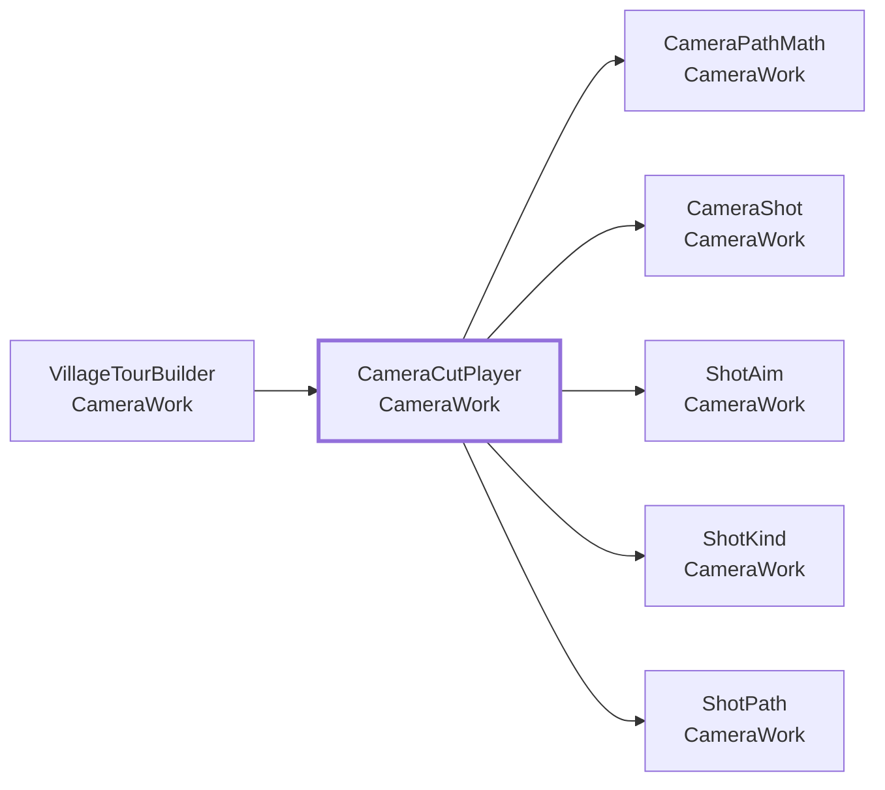
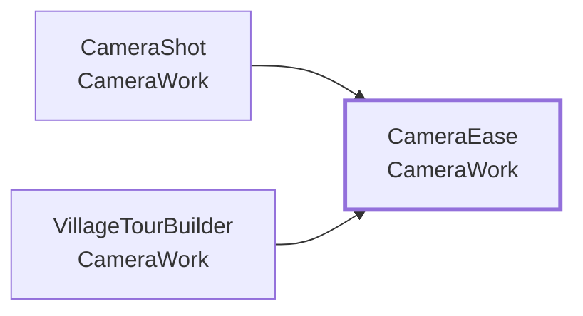
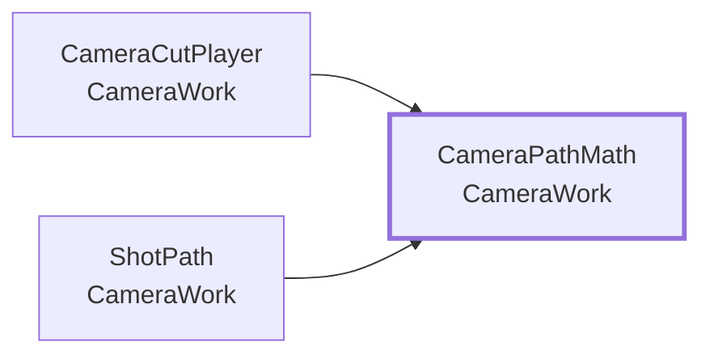
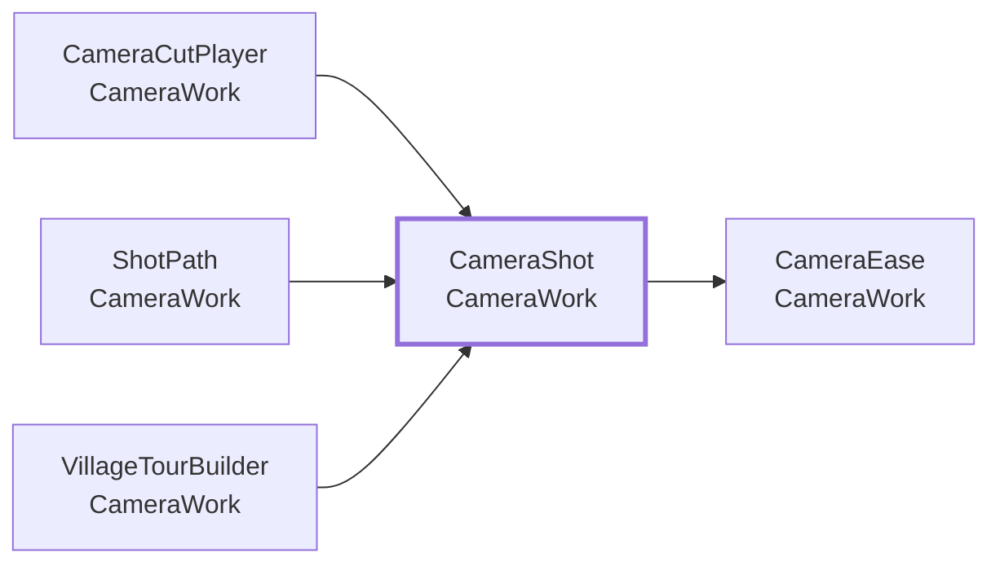
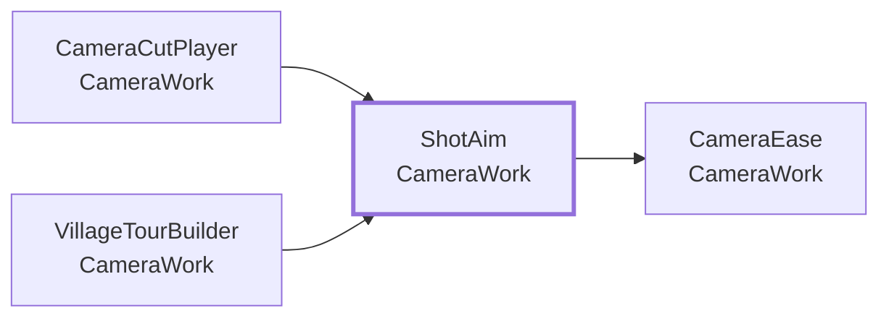
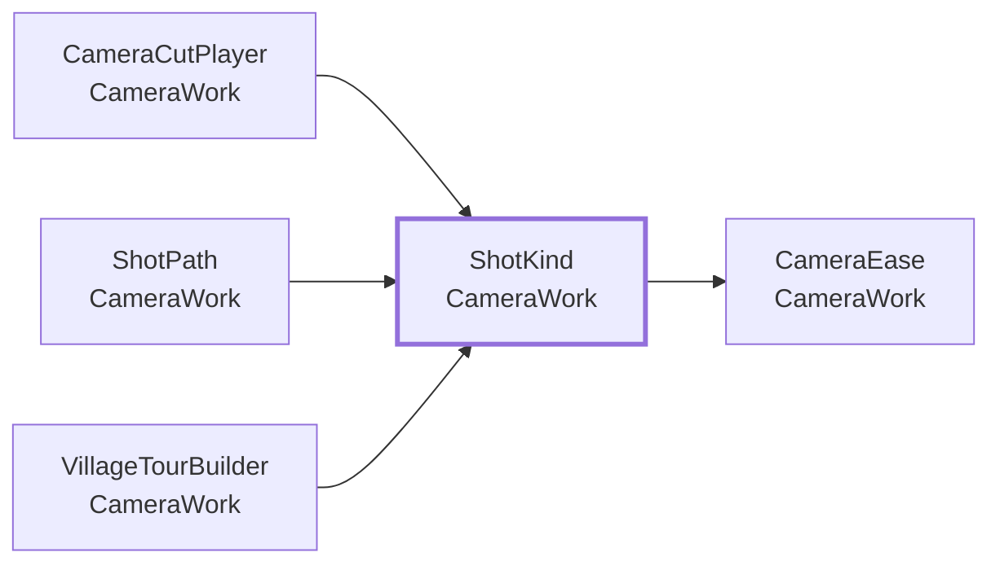
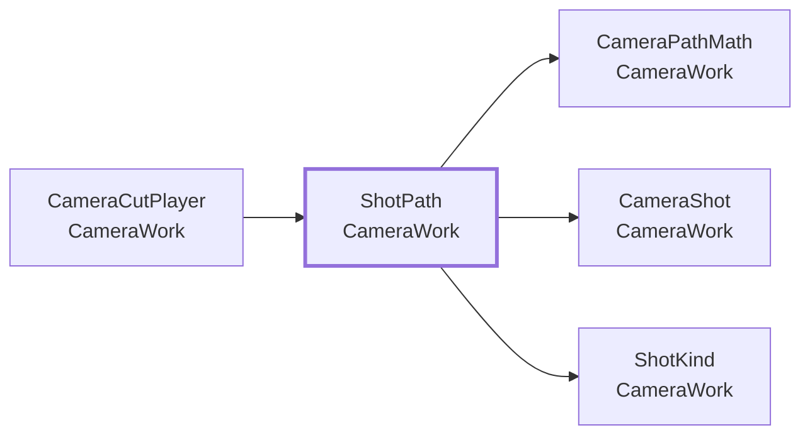

<!-- このページは tools/api_doc/build_md.py が作ります。手で直さないでください。 -->
[入口](README.md) ・ [設計の考え方](design.md) ・ [つながりの図](diagrams.md) ・ [やりたいこと別の手順](recipes.md) ・ [ガイド](guide.md)

# MouthOfGod.CameraWork

付けたオブジェクト（カメラなど）を、決めた軌道と速さで動かします。直線・ベジェ曲線・円弧・待ちのカットをつなぎ、緩急・向き・ズームを Inspector で決めます。村のカットを置くメニューは、`MouthOfGod/CameraWork/Add Village Tour` と `Add Village Zoom-Out` です。

## この機能に関わる決まり（なぜこの形か）

- **[計算は Unity から切り離して、テストできるようにする](design.md#d-pure)**: Quest をかぶらずに、Play もせずに、EditMode のテストで正しさを確かめられるからです。
- **[カメラワークは、どの物にも付けられる独立した部品にする](design.md#d-camera)**: アニメのカット割りのように、カメラを自由に動かせるようにするためです。

## 型の一覧

| 役割 | 型 | 説明 |
|---|---|---|
| コンポーネント | [`CameraCutPlayer`](#t-cameracutplayer) | 付けたオブジェクト（カメラなど）を、決めた軌道と速さで動かす。 |
| static（置き場・計算） | [`CameraPathMath`](#t-camerapathmath) | カメラの軌道の計算。 |
| データ | [`CameraShot`](#t-camerashot) | カメラの 1 カット。 |
| 選択肢（enum） | [`CameraEase`](#t-cameraease) | 動きの緩急のつけ方。 |
| 選択肢（enum） | [`ShotAim`](#t-shotaim) | 動いている間の向きの決め方。 |
| 選択肢（enum） | [`ShotKind`](#t-shotkind) | 1 カットの軌道の種類。 |
| クラス | [`ShotPath`](#t-shotpath) | 1 カットの軌道。 |
| エディタ | [`VillageTourBuilder`](#t-villagetourbuilder) | 草原から村へ引いていく「村の一連」のカットを、開いているシーンに組む。 |

---

## CameraCutPlayer

**コンポーネント**（GameObject に付ける）・ `sealed class` ・ 名前空間 `MouthOfGod.CameraWork` ・ [`CameraWork/CameraCutPlayer.cs`](../../Assets/Scripts/CameraWork/CameraCutPlayer.cs)
 継承・実装: `MonoBehaviour`

付けたオブジェクト（カメラなど）を、決めた軌道と速さで動かす。アニメのカット割りのように、直線・曲線・円弧のカットをつないで撮る。

### なぜこの形か

- **[カメラワークは、どの物にも付けられる独立した部品にする](design.md#d-camera)**: アニメのカット割りのように、カメラを自由に動かせるようにするためです。

### しくみ・注意

使い方:
1. カメラ（またはカメラの親）に付ける。Shots に、カットを順に足す。
2. 位置の目印は、シーンに空の GameObject を置き、End・Control Points・Center に入れる。目印を動かすと、軌道の線がシーンビューに出る。
3. `Play` を呼ぶ（Play On Start で自動でも）。Play 中は、右クリックメニューの「Play」でも試せる。

カットの種類:
- Line: 出発点から End へ直線。End が空なら、Direction From（空ならカメラ自身）の前向きに Distance 進む。
- Curve: Control Points に引き寄せられるベジェ曲線で、End へ。
- Orbit: Center のまわりを、Axis を軸に Angle 度まわる。360 で一周。Radius Scale・Height Change でらせんや寄り引きになる。
- Hold: その場で Seconds 待つ。向きだけ変えたいとき、間を置きたいときに使う。

速さ・緩急: Use Speed を入れると m / 秒で、外すと秒数で動く。Ease と Ease Strength で、出だしと着き際の緩急をつける。
出発点は、前のカットの到着点。最初のカットは、再生を始めたときの位置。目印の位置は、そのカットが始まる瞬間に読む。

### つながり

- この型を使う所: [`VillageTourBuilder`](#t-villagetourbuilder)
- この型が使う型: [`CameraPathMath`](#t-camerapathmath)、[`CameraShot`](#t-camerashot)、[`ShotAim`](#t-shotaim)、[`ShotKind`](#t-shotkind)、[`ShotPath`](#t-shotpath)

### この型を使う手順

- [カメラのカットを作る](recipes.md#r-camera-cut)

### Inspector（5 項目）

| 項目 | 型 | 既定値 | 説明 |
|---|---|---|---|
| Shots | `CameraShot[]` | 空 |  |
| Play On Start | `bool` | オフ | Play を始めたときに、自動で再生する |
| Loop | `bool` | オフ | 最後のカットのあと、最初に戻ってくり返す。最初のカットの出発点は、そのときの位置になる |
| Unscaled Time | `bool` | オフ | 動かすのを Time.timeScale に左右されない時間にする（ポーズ中でも撮る） |
| On Finished | `UnityEvent` | 空 | 全カットが終わったときに呼ぶ |

### メンバー（8）

| 種類 | メンバー | 説明 |
|---|---|---|
| イベント | `Action<int> ShotStarted` | カットが始まった（番号）。 |
| イベント | `Action Finished` | 全カットが終わった（Stop でやめたときは出ない）。 |
| プロパティ | `bool IsPlaying` | 再生中か。 |
| プロパティ | `int CurrentIndex` | いま撮っているカットの番号。再生していなければ -1。 |
| プロパティ | `CameraShot[] Shots` | （説明はコードにありません） |
| メソッド | `void Play()` | 最初のカットから撮る。再生中なら、やり直す。 |
| メソッド | `void Play(int fromIndex)` | fromIndex 番のカットから撮る。いまの位置が出発点になる。 |
| メソッド | `void Stop()` | その場でやめる。位置はそのまま。 |

### メニュー

- 右クリック: `Play`
- 右クリック: `Stop`

---

## CameraEase

**選択肢（enum）**（決まった値の中から選ぶ）・ `enum` ・ 名前空間 `MouthOfGod.CameraWork` ・ [`CameraWork/CameraPathMath.cs`](../../Assets/Scripts/CameraWork/CameraPathMath.cs)

動きの緩急のつけ方。

### なぜこの形か

- **[カメラワークは、どの物にも付けられる独立した部品にする](design.md#d-camera)**: アニメのカット割りのように、カメラを自由に動かせるようにするためです。

### つながり

- この型を使う所: [`CameraShot`](#t-camerashot)、[`VillageTourBuilder`](#t-villagetourbuilder)

### この型を使う手順

- [カメラのカットを作る](recipes.md#r-camera-cut)

### 値

| 値 | 意味 |
|---|---|
| `Linear` | 一定の速さ |
| `EaseIn` | ゆっくり出て、速く着く |
| `EaseOut` | 速く出て、ゆっくり着く |
| `EaseInOut` | ゆっくり出て、ゆっくり着く |
| `Custom` | Ease Curve で決める |

---

## CameraPathMath

**static（置き場・計算）**（コードから直接呼ぶ）・ `static class` ・ 名前空間 `MouthOfGod.CameraWork` ・ [`CameraWork/CameraPathMath.cs`](../../Assets/Scripts/CameraWork/CameraPathMath.cs)

カメラの軌道の計算。Unity の Transform を知らない、位置と数だけの計算。

### なぜこの形か

- **[計算は Unity から切り離して、テストできるようにする](design.md#d-pure)**: Quest をかぶらずに、Play もせずに、EditMode のテストで正しさを確かめられるからです。
- **[カメラワークは、どの物にも付けられる独立した部品にする](design.md#d-camera)**: アニメのカット割りのように、カメラを自由に動かせるようにするためです。

### つながり

- この型を使う所: [`CameraCutPlayer`](#t-cameracutplayer)、[`ShotPath`](#t-shotpath)

### メンバー（6）

| 種類 | メンバー | 説明 |
|---|---|---|
| メソッド | `static float Ease(CameraEase ease, float t, float strength, AnimationCurve curve = null)` | 緩急をかける。t は 0〜1 で、結果も 0〜1。strength が大きいほど、緩急が強い（1 で Linear と同じ）。 |
| メソッド | `static Vector3 Line(Vector3 from, Vector3 to, float t)` | 直線。from から to へ、t（0〜1）の位置。 |
| メソッド | `static Vector3 Bezier(Vector3[] points, float t)` | ベジェ曲線。points の最初が出発点、最後が到着点で、間は引っぱる点（曲がり方を決める）。3 点なら二次、4 点なら三次、それ以上でも動く。点が 1 つなら、その点。 |
| メソッド | `static Vector3 Orbit(Vector3 start, Vector3 center, Vector3 axis, float angle, float radiusScale, float heightChange, float t)` | 円弧・らせん。center のまわりを、axis を軸に angle 度まわる。start は出発点。radiusScale は到着までに半径を何倍にするか（1 で同じ円）、heightChange は軸の向きに動く高さ（m）。360 度で一周する。負の角度で逆向き。 |
| メソッド | `static float Length(System.Func<float, Vector3> position)` | 軌道の長さを、細かく区切って測る。 |
| メソッド | `static float Duration(bool useSpeed, float seconds, float speed, float length)` | 動かす長さ（秒）。useSpeed なら、軌道の長さ ÷ 速さ（m / 秒）。そうでなければ seconds。0 にはしない。 |

---

## CameraShot

**データ**（値を運ぶ型）・ `sealed class` ・ 名前空間 `MouthOfGod.CameraWork` ・ [`CameraWork/CameraShot.cs`](../../Assets/Scripts/CameraWork/CameraShot.cs)

カメラの 1 カット。出発点は、前のカットの到着点（最初のカットは、いまの位置）。使う項目は種類しだいで、Inspector では使わない項目も見える。種類ごとの使う項目は、各項目の説明にある。

Inspector では、配列や List の 1 要素として見えます（`[Serializable]`）。

### なぜこの形か

- **[カメラワークは、どの物にも付けられる独立した部品にする](design.md#d-camera)**: アニメのカット割りのように、カメラを自由に動かせるようにするためです。

### つながり

- この型を使う所: [`CameraCutPlayer`](#t-cameracutplayer)、[`ShotPath`](#t-shotpath)、[`VillageTourBuilder`](#t-villagetourbuilder)
- この型が使う型: [`CameraEase`](#t-cameraease)

### この型を使う手順

- [カメラのカットを作る](recipes.md#r-camera-cut)

### Inspector（23 項目）

| 項目 | 型 | 既定値 | 説明 |
|---|---|---|---|
| Name | `string` | `"Shot"` | メモ用の名前。動きには効かない |
| Kind | `ShotKind` | Line |  |
| **時間** | | | |
| Use Speed | `bool` | オフ | 入れると、Speed（m / 秒）で動く。外すと、Seconds で動く。Hold は常に Seconds |
| Seconds | `float` | 2 |  |
| Speed | `float` | 1 |  |
| **緩急（Lerp 加減）** | | | |
| Ease | `CameraEase` | EaseInOut |  |
| Ease Strength | `float` | 2 | 緩急の強さ。1 で一定の速さ、大きいほど出だしと着き際がゆっくりになる |
| Ease Curve | `AnimationCurve` | `AnimationCurve.EaseInOut(0f, 0f, 1f, 1f)` | Ease が Custom のときの曲線（横: 進み具合 0〜1、縦: 動いた割合 0〜1） |
| **Line / Curve の到着点** | | | |
| End | `Transform` | なし | 到着点（位置と向き）。入れると、ここへ向かう。Line で空なら、Direction From の前向きに Distance 進む。Curve では必須 |
| Direction From | `Transform` | なし | Line で End が空のとき、この Transform の前向きに進む。空なら、カメラ自身の前向き |
| Distance | `float` | 2 | Line で End が空のとき、進む距離（m）。負で後ろへ |
| **Curve** | | | |
| Control Points | `Transform[]` | 空 | 曲がり方を決める点。順に並べる。1 つで二次、2 つで三次のベジェ。曲線はこれらの点に引き寄せられる（通りはしない） |
| **Orbit** | | | |
| Center | `Transform` | なし | まわる中心 |
| Axis | `Vector3` | `Vector3.up` | まわる軸（世界座標）。既定は真上（水平にまわる） |
| Angle | `float` | 90 | まわる角度（度）。360 で一周、負で逆向き |
| Radius Scale | `float` | 1 | 到着までに半径を何倍にするか。1 で同じ円、1 より小さいと中心へ寄る |
| Height Change | `float` | 0 | まわりながら、軸の向きに動く高さ（m）。0 以外でらせんになる |
| **向き** | | | |
| Aim | `ShotAim` | AlongPath |  |
| Aim Target | `Transform` | なし | Aim が LookAtTarget のとき、見る相手 |
| Aim Target End | `Transform` | なし | Aim が LookAtTarget のとき、入れると、見る点が Aim Target からここへ、カットの進みに合わせて移る（山を見ながら始めて、村を見て終わる、など） |
| Aim Blend Seconds | `float` | 0.3 | 向きを新しい向きに合わせるのにかける秒数（カットの頭で、向きが急に変わらないように） |
| **ズーム** | | | |
| Field Of View End | `float` | 0 | 0 より大きいと、このカットの間に、画角（度）をここまで変える。小さいほど寄り、大きいほど引く。0 なら変えない。同じオブジェクトに Camera が必要 |
| **このカットの終わり** | | | |
| On Arrived | `UnityEvent` | 空 | 到着したときに呼ぶもの（音を鳴らす・次の演出を始める、など） |

---

## ShotAim

**選択肢（enum）**（決まった値の中から選ぶ）・ `enum` ・ 名前空間 `MouthOfGod.CameraWork` ・ [`CameraWork/CameraShot.cs`](../../Assets/Scripts/CameraWork/CameraShot.cs)

動いている間の向きの決め方。

### なぜこの形か

- **[カメラワークは、どの物にも付けられる独立した部品にする](design.md#d-camera)**: アニメのカット割りのように、カメラを自由に動かせるようにするためです。

### つながり

- この型を使う所: [`CameraCutPlayer`](#t-cameracutplayer)、[`VillageTourBuilder`](#t-villagetourbuilder)
- この型が使う型: [`CameraEase`](#t-cameraease)

### この型を使う手順

- [カメラのカットを作る](recipes.md#r-camera-cut)

### 値

| 値 | 意味 |
|---|---|
| `Keep` | 向きは変えない |
| `AlongPath` | 進む向きを向く |
| `LookAtTarget` | Aim Target を見続ける |
| `MatchEnd` | 到着点（End）の向きに、だんだん合わせる |

---

## ShotKind

**選択肢（enum）**（決まった値の中から選ぶ）・ `enum` ・ 名前空間 `MouthOfGod.CameraWork` ・ [`CameraWork/CameraShot.cs`](../../Assets/Scripts/CameraWork/CameraShot.cs)

1 カットの軌道の種類。

### なぜこの形か

- **[カメラワークは、どの物にも付けられる独立した部品にする](design.md#d-camera)**: アニメのカット割りのように、カメラを自由に動かせるようにするためです。

### つながり

- この型を使う所: [`CameraCutPlayer`](#t-cameracutplayer)、[`ShotPath`](#t-shotpath)、[`VillageTourBuilder`](#t-villagetourbuilder)
- この型が使う型: [`CameraEase`](#t-cameraease)

### この型を使う手順

- [カメラのカットを作る](recipes.md#r-camera-cut)

### 値

| 値 | 意味 |
|---|---|
| `Line` | 直線 |
| `Curve` | 曲線（ベジェ） |
| `Orbit` | 円弧・一周・らせん |
| `Hold` | その場で待つ（向きだけ変える） |

---

## ShotPath

**クラス**（コードから new して使う）・ `sealed class` ・ 名前空間 `MouthOfGod.CameraWork` ・ [`CameraWork/ShotPath.cs`](../../Assets/Scripts/CameraWork/ShotPath.cs)

1 カットの軌道。カットが始まる瞬間に、出発点と目印の位置を写し取って作る（目印がその後に動いても、軌道は変わらない）。

### なぜこの形か

- **[カメラワークは、どの物にも付けられる独立した部品にする](design.md#d-camera)**: アニメのカット割りのように、カメラを自由に動かせるようにするためです。

### つながり

- この型を使う所: [`CameraCutPlayer`](#t-cameracutplayer)
- この型が使う型: [`CameraPathMath`](#t-camerapathmath)、[`CameraShot`](#t-camerashot)、[`ShotKind`](#t-shotkind)

### メンバー（8）

| 種類 | メンバー | 説明 |
|---|---|---|
| コンストラクタ | `ShotPath(CameraShot shot, Vector3 start, Quaternion startRotation, Vector3 selfForward)` | （説明はコードにありません） |
| プロパティ | `float Length { get; }` | 軌道の長さ（m）。Hold は 0。 |
| プロパティ | `float Duration { get; }` | 動かす秒数。 |
| プロパティ | `Vector3 StartPosition` | （説明はコードにありません） |
| プロパティ | `Vector3 EndPosition` | （説明はコードにありません） |
| プロパティ | `Quaternion EndRotation` | 到着点の向き。End が無ければ、出発したときの向き。 |
| メソッド | `Vector3 Position(float u)` | 軌道上の位置。u は 0〜1（緩急をかける前の、軌道に沿った割合）。 |
| メソッド | `Vector3 Tangent(float u, Vector3 fallback)` | 軌道上の進む向き。止まっている（Hold・長さ 0）ときは、fallback。 |

---

## エディタ専用・試験用

### VillageTourBuilder

`CameraWork/Editor/VillageTourBuilder.cs`（エディタ）

草原から村へ引いていく「村の一連」のカットを、開いているシーンに組む。草原（MinitureBase/Content/Grass/Tree1）と村（.../Village/Village/Plaza）の位置から、目印とカメラを置く。動きの確認は tools/camera_preview/village_tour.py（同じ位置・同じカット）。

- メニュー: `MouthOfGod/CameraWork/Add Village Tour`
- メニュー: `MouthOfGod/CameraWork/Add Village Zoom-Out`
