<!-- このページは tools/api_doc/build_md.py が作ります。手で直さないでください。 -->
[入口](README.md) ・ [設計の考え方](design.md) ・ [つながりの図](diagrams.md) ・ [やりたいこと別の手順](recipes.md) ・ [ガイド](guide.md)

# MouthOfGod.Core

全体で共有する、小さな基盤です。他の asmdef に依存しません。ロジックは置かず、ID・イベントのデータ・interface・置き場だけを置きます。

#### 置き場

## この機能に関わる決まり（なぜこの形か）

- **[中央の進行役を作らない](design.md#d-nocenter)**: 進行役が全部を持つと、何かを足すたびに、全員がその 1 つのファイルを直します。
- **[置き場に自分で登録する（組み立て役を置かない）](design.md#d-registry)**: 4 つのフィールドは、4 人が別々に作り、最後に 1 つのシーンへまとめます。
- **[機能どうしは Core だけを通してつながる](design.md#d-core)**: 機能どうしが絡み合うと、1 か所の変更が全体を壊し、作業が止まります。
- **[ID は文字列にする（enum にしない）](design.md#d-ids)**: `enum` にすると、食感や食べ物を 1 つ足すたびに、Core を直すことになります。
- **[チュートリアルは合図を出し、見せ方は受け手が決める](design.md#d-cues)**: チュートリアルの担当者は流れだけを、フィールドの担当者は見せ方だけを直せるようにするためです。
- **[フィールドの戻り方は Hierarchy の並びで持ち、いつ出すかは Game・Tutorial が決める](design.md#d-steps)**: 4 つのフィールドを別々の人が作り、それでも全体が調和して動くようにするためです。
- **[何が届いても受け取り、何が届いたかを知らせる](design.md#d-receive)**: 体験者は、頼まれていない物も投げてきます。
- **[1 つのフィールドに、欲しい物を同時に複数出す](design.md#d-multi)**: 1 つの場所にいる何人かが、それぞれ別の物を欲しがるほうが、ゲームとして面白いからです（10/20 の判断）。
- **[生まれた物は、体験者が狙って飛ばす](design.md#d-aim)**: 狙いを定めて飛ばすことが、この体験の遊びだからです。
- **[デバイスがなくても、全部が動く](design.md#d-mock)**: 実機のデバイスは、ゲームと並行して作っています。

## 型の一覧

| 役割 | 型 | 説明 |
|---|---|---|
| static（置き場・計算） | [`Cues`](#t-cues) | 合図（CueRequested）の置き場。 |
| static（置き場・計算） | [`Devices`](#t-devices) | いま使える IDevice の受け取り口。 |
| static（置き場・計算） | [`Fields`](#t-fields) | いまシーンにあるフィールド（IFieldRequests）の掲示板。 |
| static（置き場・計算） | [`FoodSpawners`](#t-foodspawners) | いま使える IFoodSpawner の受け取り口。 |
| static（置き場・計算） | [`Forks`](#t-forks) | いま使える IFork の受け取り口。 |
| static（置き場・計算） | [`Phases`](#t-phases) | いまの場面（チュートリアルの名前、本編、エンディングなど）の置き場。 |
| static（置き場・計算） | [`Standing`](#t-standing) | 体験者がいま前に立っているフィールドの置き場。 |
| データ | [`CueId`](#t-cueid) | Tutorial から Village や UI への指示の ID。 |
| データ | [`CueRequested`](#t-cuerequested) | Tutorial から Village や UI への指示（「この場所を光らせる」など）。 |
| データ | [`Delivered`](#t-delivered) | 物がフィールドに届いた。 |
| データ | [`FieldId`](#t-fieldid) | フィールド（山・海・草原・村）の ID。 |
| データ | [`FoodId`](#t-foodid) | 食べ物の ID。 |
| データ | [`PhaseId`](#t-phaseid) | いまの場面（チュートリアルの名前、本編、エンディングなど）の ID。 |
| データ | [`RequestClosed`](#t-requestclosed) | 出ていた欲しい物が終わった（吹き出しを消す合図）。 |
| データ | [`RequestIssued`](#t-requestissued) | フィールドの困っている人が、欲しい物を出した（吹き出しを出す合図）。 |
| データ | [`Spawned`](#t-spawned) | 食べ物が生まれた。 |
| データ | [`TextureId`](#t-textureid) | 食感の論理 ID。 |
| interface | [`IDevice`](#t-idevice) | 触感デバイスの入力。 |
| interface | [`IFieldRequests`](#t-ifieldrequests) | 1 つのフィールドの欲しい物。 |
| interface | [`IFoodItem`](#t-ifooditem) | 生まれた食べ物が持つ。 |
| interface | [`IFoodSpawner`](#t-ifoodspawner) | 決定した食感から食べ物を生む所。 |
| interface | [`IFork`](#t-ifork) | 体験者が持つフォーク。 |
| 選択肢（enum） | [`DeliveryKind`](#t-deliverykind) | 物がフィールドに届いたとき、そのフィールドにとって何だったか。 |

---

<a id="t-cueid"></a>

## CueId

**データ**（値を運ぶ型）・ `struct` ・ 名前空間 `MouthOfGod.Core` ・ [`Core/Ids.cs`](../../Assets/Scripts/Core/Ids.cs)
<br>継承・実装: `IEquatable<CueId>`

Tutorial から Village や UI への指示の ID。文字列を包んだ値。null と空文字は、どちらも空 ID（CueId.None）。大文字小文字は区別する。

### なぜこの形か

- **[ID は文字列にする（enum にしない）](design.md#d-ids)**: `enum` にすると、食感や食べ物を 1 つ足すたびに、Core を直すことになります。
- **[チュートリアルは合図を出し、見せ方は受け手が決める](design.md#d-cues)**: チュートリアルの担当者は流れだけを、フィールドの担当者は見せ方だけを直せるようにするためです。

### つながり

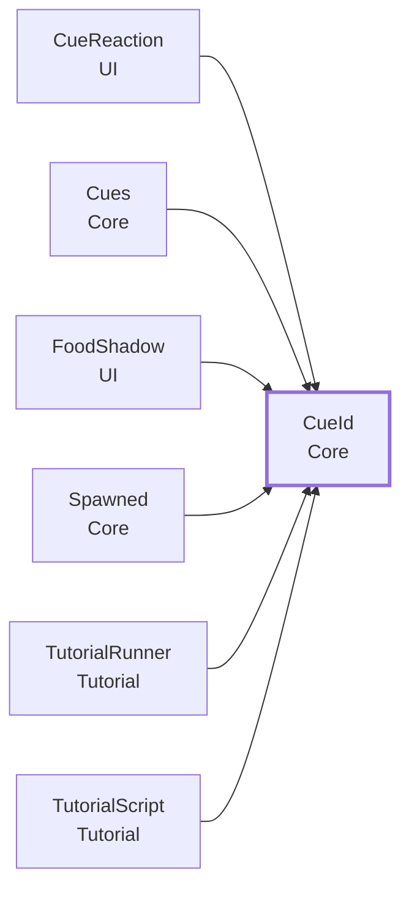

- この型を使う所: [`CueReaction`](UI.md#t-cuereaction)、[`Cues`](#t-cues)、[`FoodShadow`](UI.md#t-foodshadow)、[`Spawned`](#t-spawned)、[`TutorialRunner`](Tutorial.md#t-tutorialrunner)、[`TutorialScript`](Tutorial.md#t-tutorialscript)

### この型を使う手順

- [合図に反応させる](recipes.md#r-react-cue)

### メンバー（4）

| 種類 | メンバー | 説明 |
|---|---|---|
| コンストラクタ | `CueId(string value)` | （説明はコードにありません） |
| プロパティ | `string Value` | （説明はコードにありません） |
| プロパティ | `bool IsEmpty` | （説明はコードにありません） |
| 定数 | `static readonly CueId None` | （説明はコードにありません） |


---

<a id="t-cuerequested"></a>

## CueRequested

**データ**（値を運ぶ型）・ `struct` ・ 名前空間 `MouthOfGod.Core` ・ [`Core/Events.cs`](../../Assets/Scripts/Core/Events.cs)

Tutorial から Village や UI への指示（「この場所を光らせる」など）。

### なぜこの形か

- **[機能どうしは Core だけを通してつながる](design.md#d-core)**: 機能どうしが絡み合うと、1 か所の変更が全体を壊し、作業が止まります。
- **[チュートリアルは合図を出し、見せ方は受け手が決める](design.md#d-cues)**: チュートリアルの担当者は流れだけを、フィールドの担当者は見せ方だけを直せるようにするためです。

### つながり

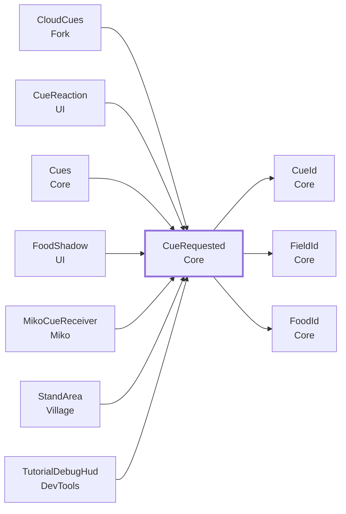

- この型を使う所: [`CloudCues`](Fork.md#t-cloudcues)、[`CueReaction`](UI.md#t-cuereaction)、[`Cues`](#t-cues)、[`FoodShadow`](UI.md#t-foodshadow)、[`MikoCueReceiver`](Miko.md#t-mikocuereceiver)、[`StandArea`](Village.md#t-standarea)、[`TutorialDebugHud`](DevTools.md#t-tutorialdebughud)
- この型が使う型: [`CueId`](#t-cueid)、[`FieldId`](#t-fieldid)、[`FoodId`](#t-foodid)

### この型を使う手順

- [合図に反応させる](recipes.md#r-react-cue)

### メンバー（2）

| 種類 | メンバー | 説明 |
|---|---|---|
| コンストラクタ | `CueRequested(CueId cue)` | （説明はコードにありません） |
| プロパティ | `readonly CueId Cue` | （説明はコードにありません） |


---

<a id="t-cues"></a>

## Cues

**static（置き場・計算）**（コードから直接呼ぶ）・ `static class` ・ 名前空間 `MouthOfGod.Core` ・ [`Core/Cues.cs`](../../Assets/Scripts/Core/Cues.cs)

合図（[`CueRequested`](#t-cuerequested)）の置き場。Tutorial が Request し、Village や UI が Requested を受けて、見せ方を決める。

### なぜこの形か

- **[置き場に自分で登録する（組み立て役を置かない）](design.md#d-registry)**: 4 つのフィールドは、4 人が別々に作り、最後に 1 つのシーンへまとめます。
- **[チュートリアルは合図を出し、見せ方は受け手が決める](design.md#d-cues)**: チュートリアルの担当者は流れだけを、フィールドの担当者は見せ方だけを直せるようにするためです。

### しくみ・注意

- 合図の名前（[`CueId`](#t-cueid)）は、フィールド名から始める（例: `sea.glow`、`village.cheer`）。決まりは docs/requests.md。
- 出す側は、誰が受けるかを知らない。受ける側は、合図の見せ方を自由に決める。受ける側がいなければ、何も起きない。
- 受ける側は OnEnable で購読し、OnDisable で外す。
- static なので、Play のたびに空にする。すべてメインスレッドから呼ぶ。
- この形を変えるときは、使う側すべてに効くので、別の PR にする。

### つながり

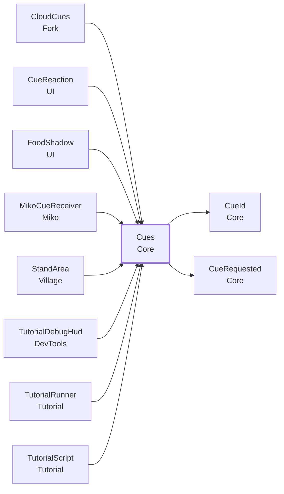

- この型を使う所: [`CloudCues`](Fork.md#t-cloudcues)、[`CueReaction`](UI.md#t-cuereaction)、[`FoodShadow`](UI.md#t-foodshadow)、[`MikoCueReceiver`](Miko.md#t-mikocuereceiver)、[`StandArea`](Village.md#t-standarea)、[`TutorialDebugHud`](DevTools.md#t-tutorialdebughud)、[`TutorialRunner`](Tutorial.md#t-tutorialrunner)、[`TutorialScript`](Tutorial.md#t-tutorialscript)
- この型が使う型: [`CueId`](#t-cueid)、[`CueRequested`](#t-cuerequested)

### この型を使う手順

- [合図に反応させる](recipes.md#r-react-cue)

### メンバー（2）

| 種類 | メンバー | 説明 |
|---|---|---|
| イベント | `static Action<CueRequested> Requested` | 合図が出た。 |
| メソッド | `static void Request(CueId cue)` | 合図を出す。名前が空なら、警告して何もしない。 |


---

<a id="t-delivered"></a>

## Delivered

**データ**（値を運ぶ型）・ `struct` ・ 名前空間 `MouthOfGod.Core` ・ [`Core/Events.cs`](../../Assets/Scripts/Core/Events.cs)

物がフィールドに届いた。何が届いても、届いたたびに 1 回出る。Kind で、欲しがっていた物か・このフィールドの物か・よその物かが分かる。

### なぜこの形か

- **[機能どうしは Core だけを通してつながる](design.md#d-core)**: 機能どうしが絡み合うと、1 か所の変更が全体を壊し、作業が止まります。
- **[何が届いても受け取り、何が届いたかを知らせる](design.md#d-receive)**: 体験者は、頼まれていない物も投げてきます。

### つながり

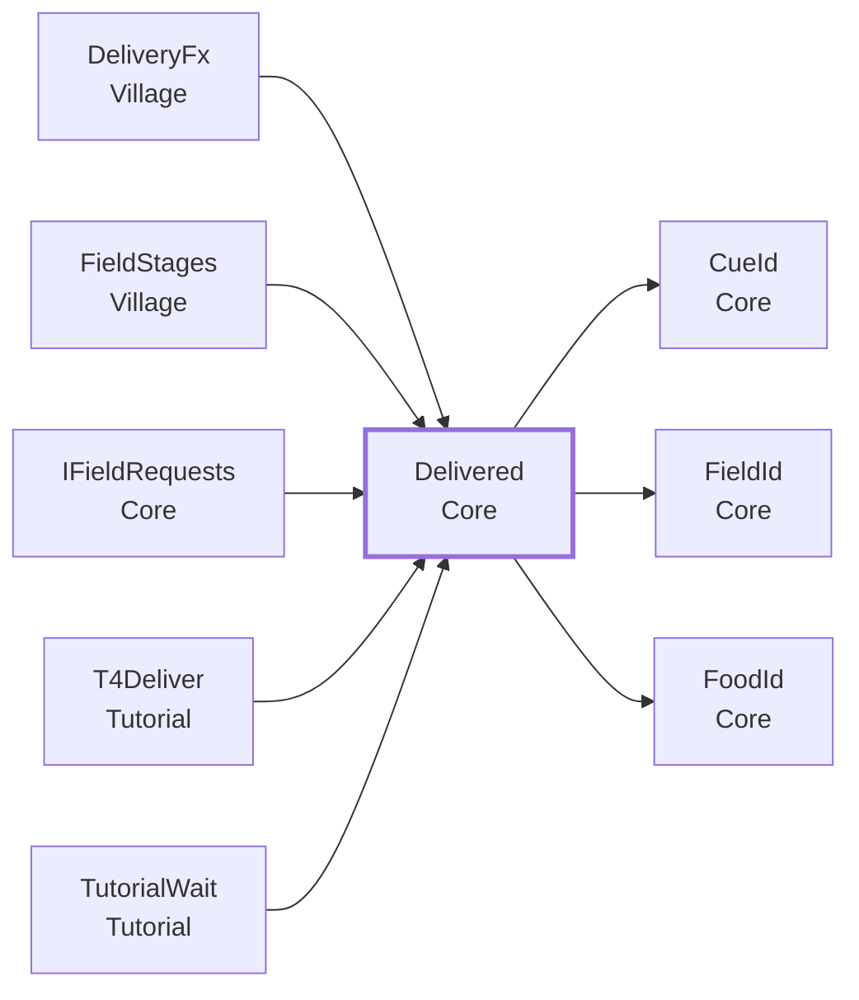

- この型を使う所: [`DeliveryFx`](Village.md#t-deliveryfx)、[`FieldStages`](Village.md#t-fieldstages)、[`IFieldRequests`](#t-ifieldrequests)、[`T4Deliver`](Tutorial.md#t-t4deliver)、[`TutorialWait`](Tutorial.md#t-tutorialwait)
- この型が使う型: [`CueId`](#t-cueid)、[`FieldId`](#t-fieldid)、[`FoodId`](#t-foodid)

### この型を使う手順

- [生き物に、自分で考えて動く振る舞い（AI のような動き）を持たせる](recipes.md#r-creature-ai)

### メンバー（5）

| 種類 | メンバー | 説明 |
|---|---|---|
| コンストラクタ | `Delivered(FoodId food, FieldId field, DeliveryKind kind)` | （説明はコードにありません） |
| プロパティ | `readonly FoodId Food` | （説明はコードにありません） |
| プロパティ | `readonly FieldId Field` | （説明はコードにありません） |
| プロパティ | `readonly DeliveryKind Kind` | （説明はコードにありません） |
| プロパティ | `bool WasRequested` | 欲しがっていた物だったか（Kind == Requested）。 |


---

<a id="t-deliverykind"></a>

## DeliveryKind

**選択肢（enum）**（決まった値の中から選ぶ）・ `enum` ・ 名前空間 `MouthOfGod.Core` ・ [`Core/Events.cs`](../../Assets/Scripts/Core/Events.cs)

物がフィールドに届いたとき、そのフィールドにとって何だったか。採点や反応は、これを見て決める。

### なぜこの形か

- **[何が届いても受け取り、何が届いたかを知らせる](design.md#d-receive)**: 体験者は、頼まれていない物も投げてきます。

### つながり

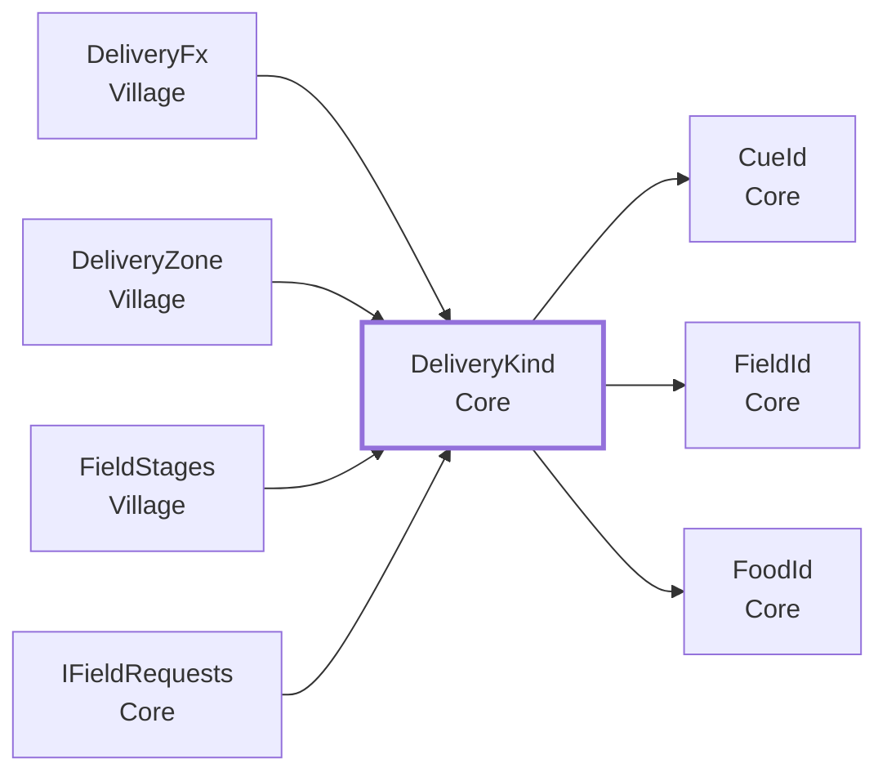

- この型を使う所: [`DeliveryFx`](Village.md#t-deliveryfx)、[`DeliveryZone`](Village.md#t-deliveryzone)、[`FieldStages`](Village.md#t-fieldstages)、[`IFieldRequests`](#t-ifieldrequests)
- この型が使う型: [`CueId`](#t-cueid)、[`FieldId`](#t-fieldid)、[`FoodId`](#t-foodid)

### この型を使う手順

- [生き物に、自分で考えて動く振る舞い（AI のような動き）を持たせる](recipes.md#r-creature-ai)

### 値

| 値 | 意味 |
|---|---|
| `Requested` | 吹き出しで欲しがっていた物。そのステップが済み、フィールドの一部が戻る。 |
| `Own` | このフィールドの物だが、いま欲しがってはいない（2 本目のにんじん、まだ頼んでいない物）。フィールドは戻らない。 |
| `Foreign` | このフィールドの物ではない（村に豚）。フィールドは戻らない。 |


---

<a id="t-devices"></a>

## Devices

**static（置き場・計算）**（コードから直接呼ぶ）・ `static class` ・ 名前空間 `MouthOfGod.Core` ・ [`Core/Devices.cs`](../../Assets/Scripts/Core/Devices.cs)

いま使える [`IDevice`](#t-idevice) の受け取り口。デバイスは 1 台なので、全体で 1 つにする。実装（[`MockDevice`](Device.md#t-mockdevice)、実機の Device）が Register し、使う側は WhenReady で受け取る（後から登録されても届く）。

### なぜこの形か

- **[置き場に自分で登録する（組み立て役を置かない）](design.md#d-registry)**: 4 つのフィールドは、4 人が別々に作り、最後に 1 つのシーンへまとめます。
- **[デバイスがなくても、全部が動く](design.md#d-mock)**: 実機のデバイスは、ゲームと並行して作っています。

### しくみ・注意

- すべてメインスレッドから呼ぶ（シリアル通信の受信スレッドから直接呼ばない）。
- 登録は起動時に 1 回の前提。途中で Unregister して別のデバイスを Register しても、すでに受け取った側には知らせない。

### つながり

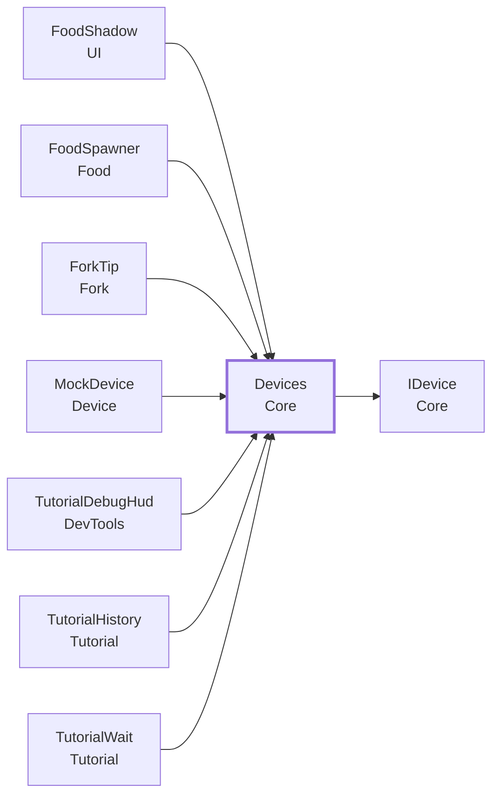

- この型を使う所: [`FoodShadow`](UI.md#t-foodshadow)、[`FoodSpawner`](Food.md#t-foodspawner)、[`ForkTip`](Fork.md#t-forktip)、[`MockDevice`](Device.md#t-mockdevice)、[`TutorialDebugHud`](DevTools.md#t-tutorialdebughud)、[`TutorialHistory`](Tutorial.md#t-tutorialhistory)、[`TutorialWait`](Tutorial.md#t-tutorialwait)
- この型が使う型: [`IDevice`](#t-idevice)

### メンバー（5）

| 種類 | メンバー | 説明 |
|---|---|---|
| プロパティ | `static IDevice Current` | 登録されている [`IDevice`](#t-idevice)。まだ無ければ null。 |
| メソッド | `static void WhenReady(Action<IDevice> callback)` | [`IDevice`](#t-idevice) が使えるようになったら callback を 1 回呼ぶ。すでに登録されていれば、すぐ呼ぶ。取り消せるように、ラムダではなくメソッドを渡す（CancelWhenReady はメソッドでしか外せない）。 |
| メソッド | `static void CancelWhenReady(Action<IDevice> callback)` | まだ呼ばれていない WhenReady を取り消す（登録前に消える側が、OnDisable で呼ぶ）。WhenReady に渡したのと同じメソッドを渡す。 |
| メソッド | `static bool Register(IDevice device)` | デバイスを登録する。別のデバイスがすでに登録されていれば、登録せずに警告を出して false を返す。待っている WhenReady を 1 つずつ呼ぶ。1 つが例外を投げても、残りは呼ぶ（例外は Console に出す）。 |
| メソッド | `static void Unregister(IDevice device)` | 登録を外す。登録されているデバイスと同じときだけ外す。 |


---

<a id="t-fieldid"></a>

## FieldId

**データ**（値を運ぶ型）・ `struct` ・ 名前空間 `MouthOfGod.Core` ・ [`Core/Ids.cs`](../../Assets/Scripts/Core/Ids.cs)
<br>継承・実装: `IEquatable<FieldId>`

フィールド（山・海・草原・村）の ID。文字列を包んだ値。null と空文字は、どちらも空 ID（FieldId.None）。大文字小文字は区別する。

### なぜこの形か

- **[ID は文字列にする（enum にしない）](design.md#d-ids)**: `enum` にすると、食感や食べ物を 1 つ足すたびに、Core を直すことになります。

### つながり

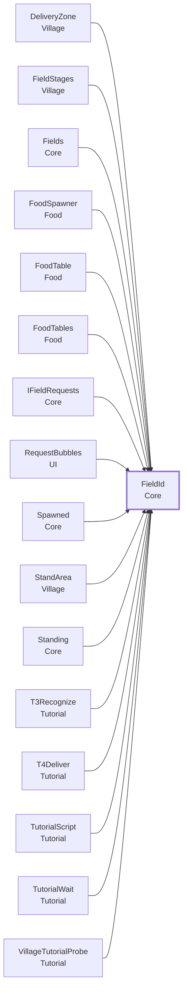

- この型を使う所: [`DeliveryZone`](Village.md#t-deliveryzone)、[`FieldStages`](Village.md#t-fieldstages)、[`Fields`](#t-fields)、[`FoodSpawner`](Food.md#t-foodspawner)、[`FoodTable`](Food.md#t-foodtable)、[`FoodTables`](Food.md#t-foodtables)、[`IFieldRequests`](#t-ifieldrequests)、[`RequestBubbles`](UI.md#t-requestbubbles)、[`Spawned`](#t-spawned)、[`StandArea`](Village.md#t-standarea)、[`Standing`](#t-standing)、[`T3Recognize`](Tutorial.md#t-t3recognize)、[`T4Deliver`](Tutorial.md#t-t4deliver)、[`TutorialScript`](Tutorial.md#t-tutorialscript)、[`TutorialWait`](Tutorial.md#t-tutorialwait)、[`VillageTutorialProbe`](Tutorial.md#t-villagetutorialprobe)

### メンバー（4）

| 種類 | メンバー | 説明 |
|---|---|---|
| コンストラクタ | `FieldId(string value)` | （説明はコードにありません） |
| プロパティ | `string Value` | （説明はコードにありません） |
| プロパティ | `bool IsEmpty` | （説明はコードにありません） |
| 定数 | `static readonly FieldId None` | （説明はコードにありません） |


---

<a id="t-fields"></a>

## Fields

**static（置き場・計算）**（コードから直接呼ぶ）・ `static class` ・ 名前空間 `MouthOfGod.Core` ・ [`Core/Fields.cs`](../../Assets/Scripts/Core/Fields.cs)

いまシーンにあるフィールド（[`IFieldRequests`](#t-ifieldrequests)）の掲示板。フィールドが自分で Register し、使う側（本編・チュートリアル・吹き出し・届いたかの判定）は All と Added で受け取る。誰も相手のクラスを知らずにつながる（docs/requests.md「API 仕様」）。

### なぜこの形か

- **[置き場に自分で登録する（組み立て役を置かない）](design.md#d-registry)**: 4 つのフィールドは、4 人が別々に作り、最後に 1 つのシーンへまとめます。

### しくみ・注意

- 使う側は、All を見てから Added を購読する（後から置かれたフィールドも届く）。OnDisable で Added・Removed の購読を外す。
- ID が空のフィールド、すでにある ID のフィールドは登録せず、警告を出す（Play は止めない）。データの間違いなので、先のフィールドが外れても、断ったフィールドを後から登録し直すことはしない。
- すべてメインスレッドから呼ぶ。
- この形を変えるときは、使う側すべてに効くので、別の PR にする。

### つながり

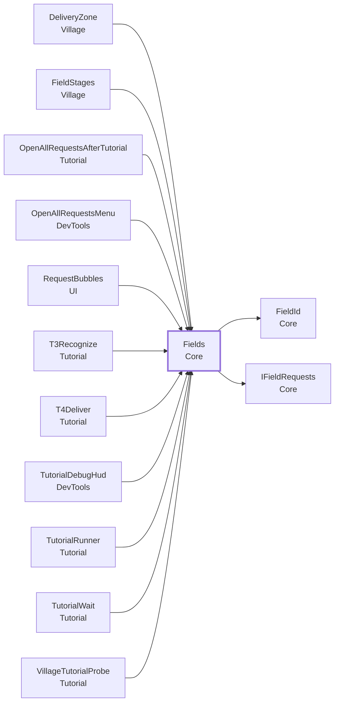

- この型を使う所: [`DeliveryZone`](Village.md#t-deliveryzone)、[`FieldStages`](Village.md#t-fieldstages)、[`OpenAllRequestsAfterTutorial`](Tutorial.md#t-openallrequestsaftertutorial)、[`OpenAllRequestsMenu`](DevTools.md#t-openallrequestsmenu)、[`RequestBubbles`](UI.md#t-requestbubbles)、[`T3Recognize`](Tutorial.md#t-t3recognize)、[`T4Deliver`](Tutorial.md#t-t4deliver)、[`TutorialDebugHud`](DevTools.md#t-tutorialdebughud)、[`TutorialRunner`](Tutorial.md#t-tutorialrunner)、[`TutorialWait`](Tutorial.md#t-tutorialwait)、[`VillageTutorialProbe`](Tutorial.md#t-villagetutorialprobe)
- この型が使う型: [`FieldId`](#t-fieldid)、[`IFieldRequests`](#t-ifieldrequests)

### この型を使う手順

- [生き物に、自分で考えて動く振る舞い（AI のような動き）を持たせる](recipes.md#r-creature-ai)
- [本編で欲しい物を出す](recipes.md#r-open-request)

### メンバー（6）

| 種類 | メンバー | 説明 |
|---|---|---|
| イベント | `static Action<IFieldRequests> Added` | フィールドが登録された。 |
| イベント | `static Action<IFieldRequests> Removed` | フィールドの登録が外れた（シーンから消えた、無効になった）。 |
| プロパティ | `static IReadOnlyList<IFieldRequests> All` | 登録されているフィールド（登録した順）。 |
| メソッド | `static IFieldRequests Find(FieldId id)` | その ID のフィールド。無ければ null。 |
| メソッド | `static bool Register(IFieldRequests field)` | フィールドを登録する。ID が空・同じ ID がすでにあるなら、登録せずに警告を出して false。同じものを 2 回登録しても 1 つ。 |
| メソッド | `static void Unregister(IFieldRequests field)` | 登録を外す。登録されていなければ何もしない。 |


---

<a id="t-foodid"></a>

## FoodId

**データ**（値を運ぶ型）・ `struct` ・ 名前空間 `MouthOfGod.Core` ・ [`Core/Ids.cs`](../../Assets/Scripts/Core/Ids.cs)
<br>継承・実装: `IEquatable<FoodId>`

食べ物の ID。文字列を包んだ値。null と空文字は、どちらも空 ID（FoodId.None）。大文字小文字は区別する。

### なぜこの形か

- **[ID は文字列にする（enum にしない）](design.md#d-ids)**: `enum` にすると、食感や食べ物を 1 つ足すたびに、Core を直すことになります。

### つながり

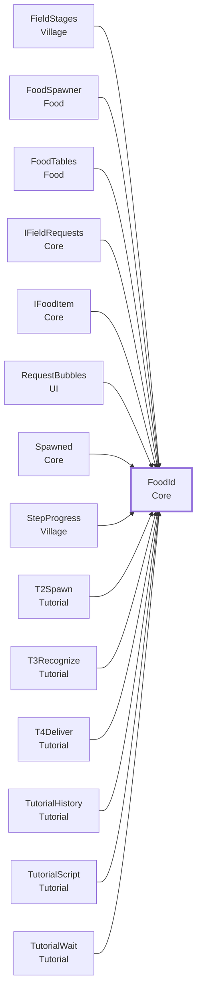

- この型を使う所: [`FieldStages`](Village.md#t-fieldstages)、[`FoodSpawner`](Food.md#t-foodspawner)、[`FoodTables`](Food.md#t-foodtables)、[`IFieldRequests`](#t-ifieldrequests)、[`IFoodItem`](#t-ifooditem)、[`RequestBubbles`](UI.md#t-requestbubbles)、[`Spawned`](#t-spawned)、[`StepProgress`](Village.md#t-stepprogress)、[`T2Spawn`](Tutorial.md#t-t2spawn)、[`T3Recognize`](Tutorial.md#t-t3recognize)、[`T4Deliver`](Tutorial.md#t-t4deliver)、[`TutorialHistory`](Tutorial.md#t-tutorialhistory)、[`TutorialScript`](Tutorial.md#t-tutorialscript)、[`TutorialWait`](Tutorial.md#t-tutorialwait)

### メンバー（4）

| 種類 | メンバー | 説明 |
|---|---|---|
| コンストラクタ | `FoodId(string value)` | （説明はコードにありません） |
| プロパティ | `string Value` | （説明はコードにありません） |
| プロパティ | `bool IsEmpty` | （説明はコードにありません） |
| 定数 | `static readonly FoodId None` | （説明はコードにありません） |


---

<a id="t-foodspawners"></a>

## FoodSpawners

**static（置き場・計算）**（コードから直接呼ぶ）・ `static class` ・ 名前空間 `MouthOfGod.Core` ・ [`Core/FoodSpawners.cs`](../../Assets/Scripts/Core/FoodSpawners.cs)

いま使える [`IFoodSpawner`](#t-ifoodspawner) の受け取り口。食べ物を生む所は 1 つなので、全体で 1 つにする。実装（Food の [`FoodSpawner`](Food.md#t-foodspawner)）が Register し、使う側は WhenReady で受け取る（後から登録されても届く）。形は [`Devices`](#t-devices)・[`Forks`](#t-forks) と同じ。

### なぜこの形か

- **[置き場に自分で登録する（組み立て役を置かない）](design.md#d-registry)**: 4 つのフィールドは、4 人が別々に作り、最後に 1 つのシーンへまとめます。

### しくみ・注意

- すべてメインスレッドから呼ぶ。
- 登録は起動時に 1 回の前提。途中で Unregister して別の食べ物を生む所を Register しても、すでに受け取った側には知らせない。

### つながり

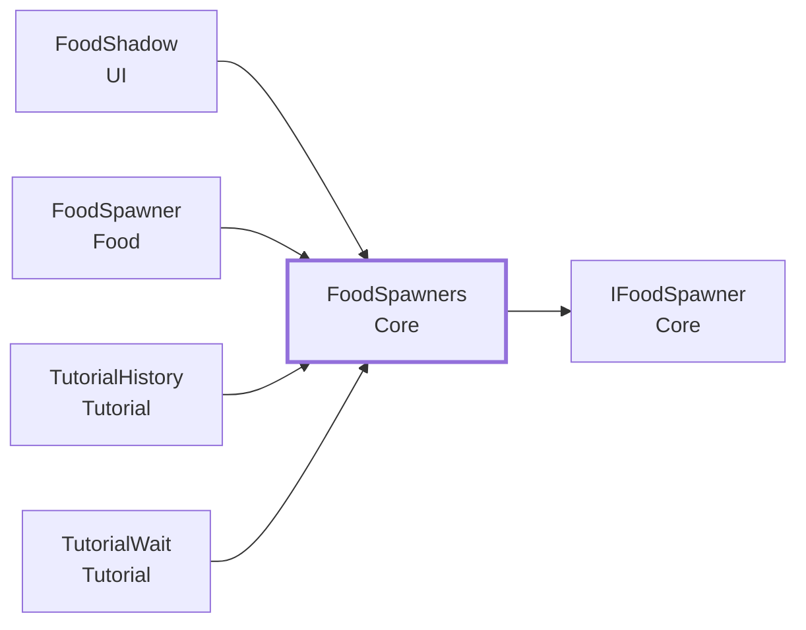

- この型を使う所: [`FoodShadow`](UI.md#t-foodshadow)、[`FoodSpawner`](Food.md#t-foodspawner)、[`TutorialHistory`](Tutorial.md#t-tutorialhistory)、[`TutorialWait`](Tutorial.md#t-tutorialwait)
- この型が使う型: [`IFoodSpawner`](#t-ifoodspawner)

### メンバー（5）

| 種類 | メンバー | 説明 |
|---|---|---|
| プロパティ | `static IFoodSpawner Current` | 登録されている [`IFoodSpawner`](#t-ifoodspawner)。まだ無ければ null。 |
| メソッド | `static void WhenReady(Action<IFoodSpawner> callback)` | [`IFoodSpawner`](#t-ifoodspawner) が使えるようになったら callback を 1 回呼ぶ。すでに登録されていれば、すぐ呼ぶ。取り消せるように、ラムダではなくメソッドを渡す（CancelWhenReady はメソッドでしか外せない）。 |
| メソッド | `static void CancelWhenReady(Action<IFoodSpawner> callback)` | まだ呼ばれていない WhenReady を取り消す。WhenReady に渡したのと同じメソッドを渡す。 |
| メソッド | `static bool Register(IFoodSpawner spawner)` | 食べ物を生む所を登録する。別の食べ物を生む所がすでに登録されていれば、登録せずに警告を出して false を返す。待っている WhenReady を 1 つずつ呼ぶ。1 つが例外を投げても、残りは呼ぶ（例外は Console に出す）。 |
| メソッド | `static void Unregister(IFoodSpawner spawner)` | 登録を外す。登録されているものと同じときだけ外す。 |


---

<a id="t-forks"></a>

## Forks

**static（置き場・計算）**（コードから直接呼ぶ）・ `static class` ・ 名前空間 `MouthOfGod.Core` ・ [`Core/Forks.cs`](../../Assets/Scripts/Core/Forks.cs)

いま使える [`IFork`](#t-ifork) の受け取り口。フォークは 1 本なので、全体で 1 つにする。実装（Fork）が Register し、使う側は WhenReady で受け取る（後から登録されても届く）。形は [`Devices`](#t-devices) と同じ。

### なぜこの形か

- **[置き場に自分で登録する（組み立て役を置かない）](design.md#d-registry)**: 4 つのフィールドは、4 人が別々に作り、最後に 1 つのシーンへまとめます。

### しくみ・注意

- すべてメインスレッドから呼ぶ。
- 登録は起動時に 1 回の前提。途中で Unregister して別のフォークを Register しても、すでに受け取った側には知らせない。

### つながり

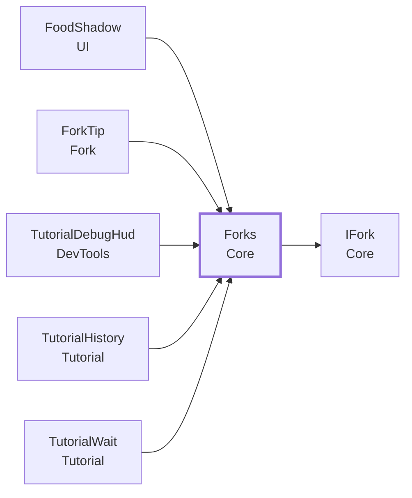

- この型を使う所: [`FoodShadow`](UI.md#t-foodshadow)、[`ForkTip`](Fork.md#t-forktip)、[`TutorialDebugHud`](DevTools.md#t-tutorialdebughud)、[`TutorialHistory`](Tutorial.md#t-tutorialhistory)、[`TutorialWait`](Tutorial.md#t-tutorialwait)
- この型が使う型: [`IFork`](#t-ifork)

### メンバー（5）

| 種類 | メンバー | 説明 |
|---|---|---|
| プロパティ | `static IFork Current` | 登録されている [`IFork`](#t-ifork)。まだ無ければ null。 |
| メソッド | `static void WhenReady(Action<IFork> callback)` | [`IFork`](#t-ifork) が使えるようになったら callback を 1 回呼ぶ。すでに登録されていれば、すぐ呼ぶ。取り消せるように、ラムダではなくメソッドを渡す（CancelWhenReady はメソッドでしか外せない）。 |
| メソッド | `static void CancelWhenReady(Action<IFork> callback)` | まだ呼ばれていない WhenReady を取り消す。WhenReady に渡したのと同じメソッドを渡す。 |
| メソッド | `static bool Register(IFork fork)` | フォークを登録する。別のフォークがすでに登録されていれば、登録せずに警告を出して false を返す。待っている WhenReady を 1 つずつ呼ぶ。1 つが例外を投げても、残りは呼ぶ（例外は Console に出す）。 |
| メソッド | `static void Unregister(IFork fork)` | 登録を外す。登録されているフォークと同じときだけ外す。 |


---

<a id="t-idevice"></a>

## IDevice

**interface**（機能どうしの約束）・ `interface` ・ 名前空間 `MouthOfGod.Core` ・ [`Core/IDevice.cs`](../../Assets/Scripts/Core/IDevice.cs)

触感デバイスの入力。実装は Device（と [`MockDevice`](Device.md#t-mockdevice)）。物理量は実装の内側で [`TextureId`](#t-textureid) に変換する。

### なぜこの形か

- **[機能どうしは Core だけを通してつながる](design.md#d-core)**: 機能どうしが絡み合うと、1 か所の変更が全体を壊し、作業が止まります。
- **[デバイスがなくても、全部が動く](design.md#d-mock)**: 実機のデバイスは、ゲームと並行して作っています。

### しくみ・注意

前提（この形に、全員のコードが乗っている）:
- 使う側（Food・Tutorial・UI など）は Devices.WhenReady で受け取り、相手が Mock か実機かを知らない。
- 実機は、IDevice を実装して Devices.Register するだけで差し替わる。実機が先に登録されていれば、MockDevice は自動で作られない。
  そのため実機は、通信がつながる前でも Awake か OnEnable で Register する（Start や接続後だと、Mock が先に登録される）。
- 約束: 噛み始めに Bitten、食感が変わったら TextureChanged、ボタンで Confirmed（そのときの食感）。
  内容量の制御や物理量の変換は、実装の内側に閉じる（使う側に ％ やパターン番号を見せない）。
- イベントはメインスレッドで出す（シリアル通信の受信スレッドから直接出さない）。
この形（メンバー・イベントの意味・受け取り方）を変えたい場合は、使う側すべてに影響するので、別の PR でお願いします。

### つながり

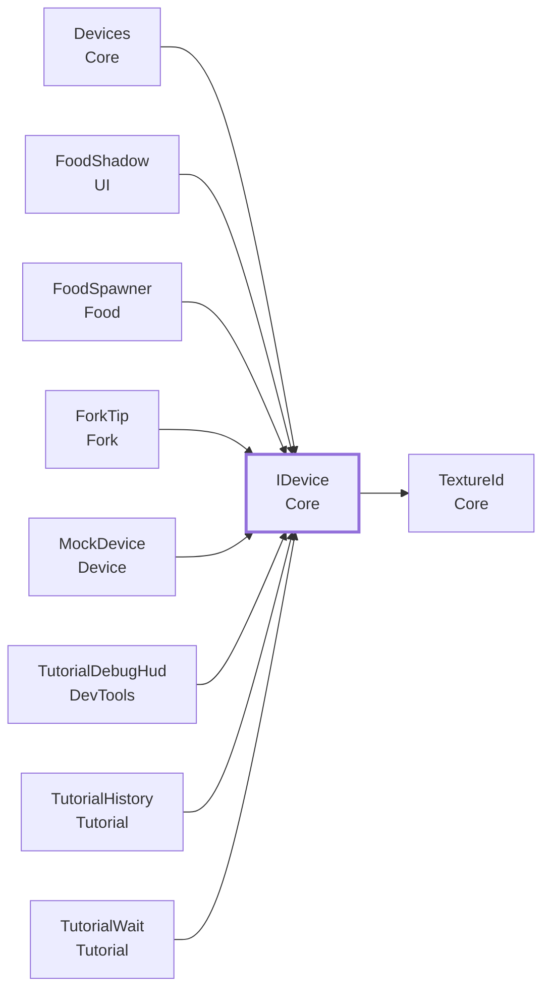

- この型を使う所: [`Devices`](#t-devices)、[`FoodShadow`](UI.md#t-foodshadow)、[`FoodSpawner`](Food.md#t-foodspawner)、[`ForkTip`](Fork.md#t-forktip)、[`MockDevice`](Device.md#t-mockdevice)、[`TutorialDebugHud`](DevTools.md#t-tutorialdebughud)、[`TutorialHistory`](Tutorial.md#t-tutorialhistory)、[`TutorialWait`](Tutorial.md#t-tutorialwait)
- この型が使う型: [`TextureId`](#t-textureid)

### メンバー（4）

| 種類 | メンバー | 説明 |
|---|---|---|
| イベント | `Action<TextureId> TextureChanged` | 食感が変わった（新しい食感を運ぶ）。Current を更新してから出す。噛み始めは Bitten の直後に、最初の食感で出す（前と同じ食感でも出す）。噛むのをやめても None では出さない。 |
| イベント | `Action<TextureId> Confirmed` | 決定した。決定したときの食感（Current）を運ぶ。噛む前の決定なら [`TextureId`](#t-textureid).None。 |
| イベント | `Action Bitten` | 噛み始めた。噛み始めるたびに 1 回出す（噛んでいる間は出さない）。 |
| プロパティ | `TextureId Current { get; }` | いまの食感。まだ噛んでいなければ [`TextureId`](#t-textureid).None。噛むのをやめても、最後の食感が残る。 |


---

<a id="t-ifieldrequests"></a>

## IFieldRequests

**interface**（機能どうしの約束）・ `interface` ・ 名前空間 `MouthOfGod.Core` ・ [`Core/IFieldRequests.cs`](../../Assets/Scripts/Core/IFieldRequests.cs)

1 つのフィールドの欲しい物。いつもの実装は Village の [`FieldStages`](Village.md#t-fieldstages)。フィールドは自分で [`Fields`](#t-fields) に登録し、Game・Tutorial・UI はそこから受け取る。

### なぜこの形か

- **[機能どうしは Core だけを通してつながる](design.md#d-core)**: 機能どうしが絡み合うと、1 か所の変更が全体を壊し、作業が止まります。
- **[フィールドの戻り方は Hierarchy の並びで持ち、いつ出すかは Game・Tutorial が決める](design.md#d-steps)**: 4 つのフィールドを別々の人が作り、それでも全体が調和して動くようにするためです。
- **[何が届いても受け取り、何が届いたかを知らせる](design.md#d-receive)**: 体験者は、頼まれていない物も投げてきます。

### しくみ・注意

フィールドを FieldStages とは違う独自の作りにしても、この interface を実装すれば、本編・チュートリアル・吹き出しにそのままつながる。
分担（docs/requests.md）:
- フィールドは「何が欲しいか」と「届いたら何が変わるか」だけを持つ。いつ出すかは決めない。
- いつ・どのフィールドに出すか（同時にいくつ、待ち時間）は、呼ぶ側（本編は Game、チュートリアルは Tutorial）が決める。
- 1 つのフィールドに、同時に複数の欲しい物が出ていることがある（上限はフィールドのデータで決まる）。どれかは番号（Request）で見分ける。フィールドの中の順番は、フィールドのデータで決まっている。
- 同じ番号の Issued と Closed は、1 回ずつ、この順に出る。状態を変えてから知らせるので、イベントの中から Open などをすぐ呼んでよい。メインスレッドから使う。
約束の全体は docs/requests.md「API 仕様」。形を変えるときは、使う側すべてに効くので別の PR にする。

### つながり

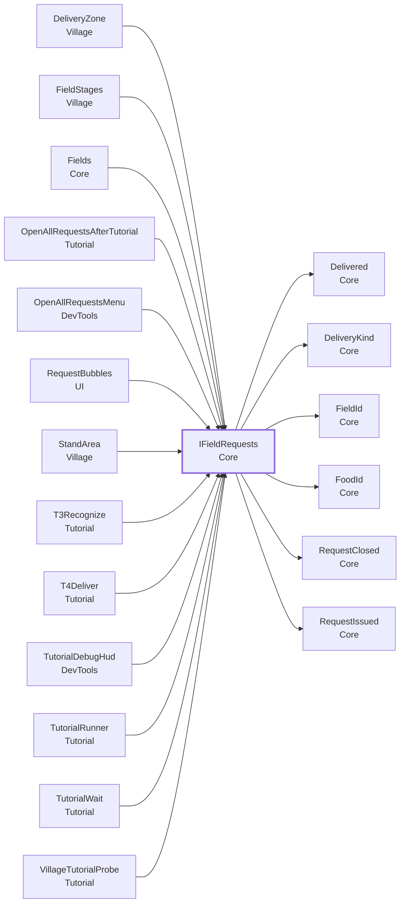

- この型を使う所: [`DeliveryZone`](Village.md#t-deliveryzone)、[`FieldStages`](Village.md#t-fieldstages)、[`Fields`](#t-fields)、[`OpenAllRequestsAfterTutorial`](Tutorial.md#t-openallrequestsaftertutorial)、[`OpenAllRequestsMenu`](DevTools.md#t-openallrequestsmenu)、[`RequestBubbles`](UI.md#t-requestbubbles)、[`StandArea`](Village.md#t-standarea)、[`T3Recognize`](Tutorial.md#t-t3recognize)、[`T4Deliver`](Tutorial.md#t-t4deliver)、[`TutorialDebugHud`](DevTools.md#t-tutorialdebughud)、[`TutorialRunner`](Tutorial.md#t-tutorialrunner)、[`TutorialWait`](Tutorial.md#t-tutorialwait)、[`VillageTutorialProbe`](Tutorial.md#t-villagetutorialprobe)
- この型が使う型: [`Delivered`](#t-delivered)、[`DeliveryKind`](#t-deliverykind)、[`FieldId`](#t-fieldid)、[`FoodId`](#t-foodid)、[`RequestClosed`](#t-requestclosed)、[`RequestIssued`](#t-requestissued)

### この型を使う手順

- [生き物に、自分で考えて動く振る舞い（AI のような動き）を持たせる](recipes.md#r-creature-ai)
- [本編で欲しい物を出す](recipes.md#r-open-request)

### メンバー（12）

| 種類 | メンバー | 説明 |
|---|---|---|
| イベント | `Action<RequestIssued> Issued` | （説明はコードにありません） |
| イベント | `Action<RequestClosed> Closed` | 欲しい物が終わった。届いて解決した（Resolved = true）か、Expire やリセットで終わった（false）。 |
| イベント | `Action<Delivered> Received` | 物が届いた（Receive のたびに 1 回）。採点はこれを数える。Requested のときは Closed の後に出る。 |
| プロパティ | `FieldId Field { get; }` | （説明はコードにありません） |
| プロパティ | `bool IsOpen { get; }` | 欲しい物が 1 つ以上出ている（吹き出しが出ている）。 |
| プロパティ | `bool CanOpen { get; }` | 次の欲しい物を出せる（出ている数が上限より少なく、まだ出していない欲しい物が残っている）。すっかり戻ったフィールドは false。 |
| メソッド | `bool Open()` | 次の欲しい物を出す（Issued が出る）。出せなければ false。 |
| メソッド | `bool Open(FoodId food)` | その物を欲しがる、まだ済んでいないステップを出す（並び順によらない）。チュートリアルのように、出す物が台本で決まっているときに使う。上限まで出ている・その物を欲しがるステップが無いなら false。 |
| メソッド | `DeliveryKind Receive(FoodId food)` | 物がこのフィールドに届いた。何が届いても受け取り、何だったかを返す（Received も 1 回出る）。出ている欲しい物のどれかと同じ物（Requested）なら、同じ物を欲しがる一番古いものが済んで、見た目が変わってから Closed（Resolved = true）が出る。それ以外（Own・Foreign）は、フィールドは戻らない。反応（豊作・いびつな世界など）は、Received を受けた側が足す。物が落ちた場所を決める所（[`DeliveryZone`](Village.md#t-deliveryzone)）が呼ぶ。 |
| メソッド | `void Expire()` | 出ている欲しい物を、すべて届かないまま終える（Closed が Resolved = false で、出した順に出る）。出ていなければ何もしない。 |
| メソッド | `void Expire(int request)` | その番号の欲しい物だけを、届かないまま終える（待ちきれなかった。Closed が Resolved = false で出る）。出ていなければ何もしない。 |
| メソッド | `void Restart()` | はじめ（何も戻っていない）に戻す。出ていた欲しい物も終える（Closed、Resolved = false）。体験の終わり（次の人へ）に呼ぶ。チュートリアルと本編の間では戻さない。 |


---

<a id="t-ifooditem"></a>

## IFoodItem

**interface**（機能どうしの約束）・ `interface` ・ 名前空間 `MouthOfGod.Core` ・ [`Core/IFoodItem.cs`](../../Assets/Scripts/Core/IFoodItem.cs)

生まれた食べ物が持つ。届け先の判定など、機能をまたぐ側が「これはどの食べ物か」を読むために使う。実装は Food の FoodItemTag で、食べ物を生むときに付く。

### なぜこの形か

- **[機能どうしは Core だけを通してつながる](design.md#d-core)**: 機能どうしが絡み合うと、1 か所の変更が全体を壊し、作業が止まります。

### しくみ・注意

受け取る側は、Food を参照せずに、この interface で食べ物の ID を読む。
例: `if (other.GetComponentInParent<IFoodItem>() is IFoodItem item) field.Receive(item.Food);`

### つながり

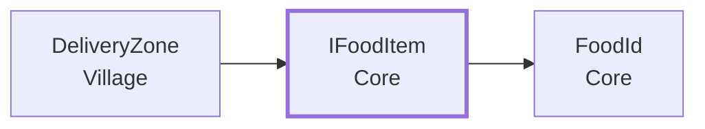

- この型を使う所: [`DeliveryZone`](Village.md#t-deliveryzone)
- この型が使う型: [`FoodId`](#t-foodid)

### メンバー（1）

| 種類 | メンバー | 説明 |
|---|---|---|
| プロパティ | `FoodId Food { get; }` | 食べ物の ID（食べ物の Prefab のファイル名）。 |


---

<a id="t-ifoodspawner"></a>

## IFoodSpawner

**interface**（機能どうしの約束）・ `interface` ・ 名前空間 `MouthOfGod.Core` ・ [`Core/IFoodSpawner.cs`](../../Assets/Scripts/Core/IFoodSpawner.cs)

決定した食感から食べ物を生む所。実装は Food の [`FoodSpawner`](Food.md#t-foodspawner)。使う側（Tutorial・UI）は WhenReady で受け取る。

### なぜこの形か

- **[機能どうしは Core だけを通してつながる](design.md#d-core)**: 機能どうしが絡み合うと、1 か所の変更が全体を壊し、作業が止まります。

### しくみ・注意

- チュートリアルは [`Spawned`](#t-spawned) で「何が生まれたか」を待つ。影を出す UI は `Preview` で「いまの食感なら何が生まれるか」を引く。
- 食感と食べ物の対応（表）は、実装の内側にある。使う側は表を知らない。
- イベントはメインスレッドで出す。
- この形を変えるときは、使う側すべてに効くので、別の PR にする。

### つながり

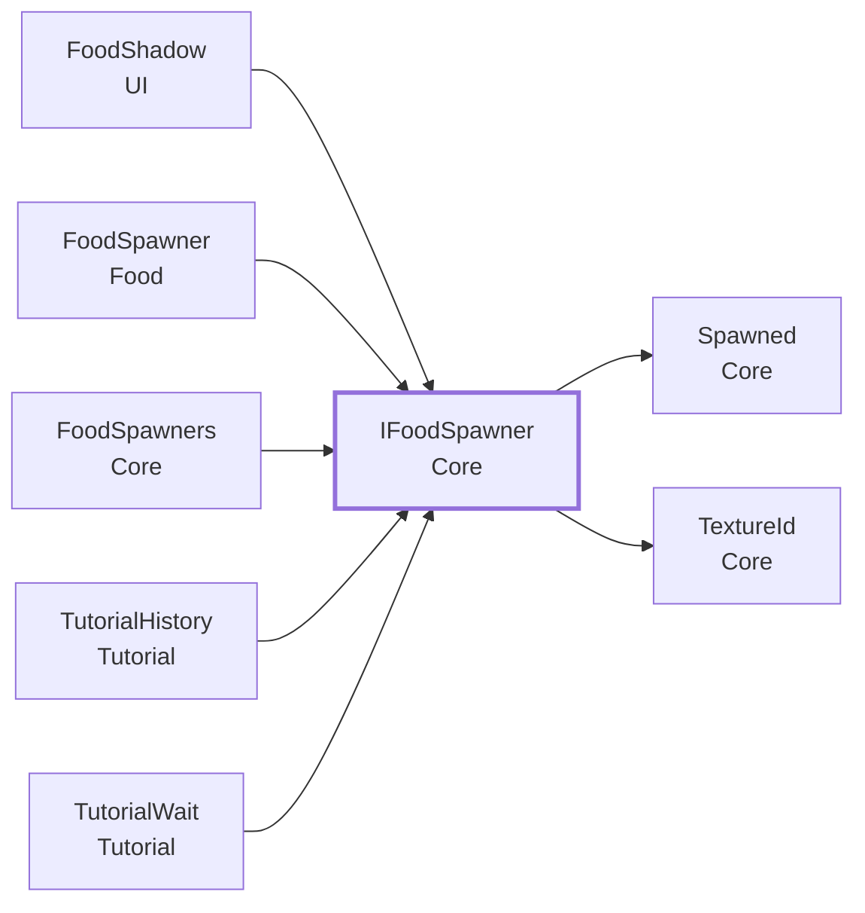

- この型を使う所: [`FoodShadow`](UI.md#t-foodshadow)、[`FoodSpawner`](Food.md#t-foodspawner)、[`FoodSpawners`](#t-foodspawners)、[`TutorialHistory`](Tutorial.md#t-tutorialhistory)、[`TutorialWait`](Tutorial.md#t-tutorialwait)
- この型が使う型: [`Spawned`](#t-spawned)、[`TextureId`](#t-textureid)

### メンバー（2）

| 種類 | メンバー | 説明 |
|---|---|---|
| イベント | `Action<Spawned> Spawned` | 食べ物を生んだ直後に、1 回出る。 |
| メソッド | `GameObject Preview(TextureId texture)` | その食感なら生まれる食べ物の Prefab を引くだけ。生まない。引けなければ null。いま立っているフィールドの表で引く。 |


---

<a id="t-ifork"></a>

## IFork

**interface**（機能どうしの約束）・ `interface` ・ 名前空間 `MouthOfGod.Core` ・ [`Core/IFork.cs`](../../Assets/Scripts/Core/IFork.cs)

体験者が持つフォーク。雲を刺したか（先に雲のかけらが付いているか）と、先が口の中にあるかを知らせる。実装は Fork の [`ForkTip`](Fork.md#t-forktip)。

### なぜこの形か

- **[機能どうしは Core だけを通してつながる](design.md#d-core)**: 機能どうしが絡み合うと、1 か所の変更が全体を壊し、作業が止まります。

### しくみ・注意

- 使う側（Tutorial・UI など）は `WhenReady` で受け取り、位置の取り方（ハンドトラッキング・AprilTag・キーボード）を知らない。
- 約束: 刺したら `Pierced`、先が口に入ったら `MouthEntered`、出たら `MouthLeft`、
  かけらがなくなったら `Emptied`。状態（`IsLoaded`・`InMouth`）を更新してから出す。
- イベントはメインスレッドで出す。
- この形を変えるときは、使う側すべてに効くので、別の PR にする。

### つながり

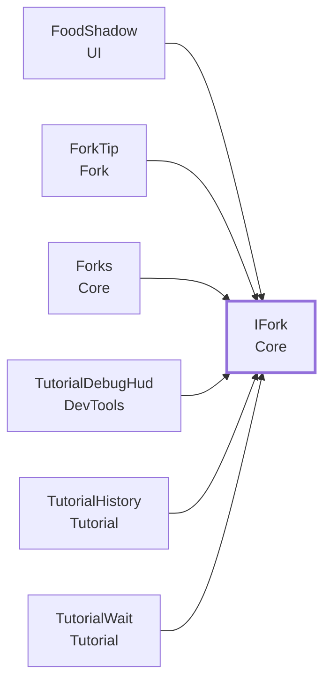

- この型を使う所: [`FoodShadow`](UI.md#t-foodshadow)、[`ForkTip`](Fork.md#t-forktip)、[`Forks`](#t-forks)、[`TutorialDebugHud`](DevTools.md#t-tutorialdebughud)、[`TutorialHistory`](Tutorial.md#t-tutorialhistory)、[`TutorialWait`](Tutorial.md#t-tutorialwait)

### メンバー（6）

| 種類 | メンバー | 説明 |
|---|---|---|
| イベント | `Action Pierced` | 雲を刺した（かけらが付いた）。かけらが付いている間は、もう一度は出ない。 |
| イベント | `Action MouthEntered` | 先が口に入った。 |
| イベント | `Action MouthLeft` | 先が口から出た。 |
| イベント | `Action Emptied` | かけらがなくなった（決定して、食べ物が生まれたとき）。 |
| プロパティ | `bool IsLoaded { get; }` | 先に雲のかけらが付いている。 |
| プロパティ | `bool InMouth { get; }` | 先が口の中にある。 |


---

<a id="t-phaseid"></a>

## PhaseId

**データ**（値を運ぶ型）・ `struct` ・ 名前空間 `MouthOfGod.Core` ・ [`Core/Ids.cs`](../../Assets/Scripts/Core/Ids.cs)
<br>継承・実装: `IEquatable<PhaseId>`

いまの場面（チュートリアルの名前、本編、エンディングなど）の ID。文字列を包んだ値。null と空文字は、どちらも空 ID（PhaseId.None）。大文字小文字は区別する。

### なぜこの形か

- **[ID は文字列にする（enum にしない）](design.md#d-ids)**: `enum` にすると、食感や食べ物を 1 つ足すたびに、Core を直すことになります。

### つながり

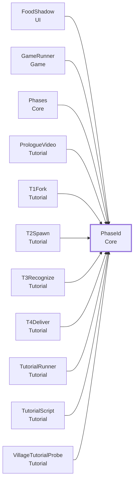

- この型を使う所: [`FoodShadow`](UI.md#t-foodshadow)、[`GameRunner`](Game.md#t-gamerunner)、[`Phases`](#t-phases)、[`PrologueVideo`](Tutorial.md#t-prologuevideo)、[`T1Fork`](Tutorial.md#t-t1fork)、[`T2Spawn`](Tutorial.md#t-t2spawn)、[`T3Recognize`](Tutorial.md#t-t3recognize)、[`T4Deliver`](Tutorial.md#t-t4deliver)、[`TutorialRunner`](Tutorial.md#t-tutorialrunner)、[`TutorialScript`](Tutorial.md#t-tutorialscript)、[`VillageTutorialProbe`](Tutorial.md#t-villagetutorialprobe)

### メンバー（4）

| 種類 | メンバー | 説明 |
|---|---|---|
| コンストラクタ | `PhaseId(string value)` | （説明はコードにありません） |
| プロパティ | `string Value` | （説明はコードにありません） |
| プロパティ | `bool IsEmpty` | （説明はコードにありません） |
| 定数 | `static readonly PhaseId None` | （説明はコードにありません） |


---

<a id="t-phases"></a>

## Phases

**static（置き場・計算）**（コードから直接呼ぶ）・ `static class` ・ 名前空間 `MouthOfGod.Core` ・ [`Core/Phases.cs`](../../Assets/Scripts/Core/Phases.cs)

いまの場面（チュートリアルの名前、本編、エンディングなど）の置き場。決める側（Tutorial・Game）が Set し、使う側は Current で読み、Changed で変わった知らせを受ける。

### なぜこの形か

- **[中央の進行役を作らない](design.md#d-nocenter)**: 進行役が全部を持つと、何かを足すたびに、全員がその 1 つのファイルを直します。
- **[置き場に自分で登録する（組み立て役を置かない）](design.md#d-registry)**: 4 つのフィールドは、4 人が別々に作り、最後に 1 つのシーンへまとめます。

### しくみ・注意

- 場面は [`PhaseId`](#t-phaseid)（文字列）。番号ではなく名前にする（チュートリアルの順番が変わっても、読む側を直さずに済む）。
  名前の一覧は docs/progress-keys.md の「場面（PhaseId の名前）」に書く。
- フィールドは、この置き場を読んで「いまのチュートリアルなら…」と分けてよい。ふつうの反応は [`Cues`](#t-cues)（合図）で受ける。
- 何も決まっていないときは `None`。
- static なので、Play のたびに空にする。すべてメインスレッドから呼ぶ。
- この形を変えるときは、使う側すべてに効くので、別の PR にする。

### つながり

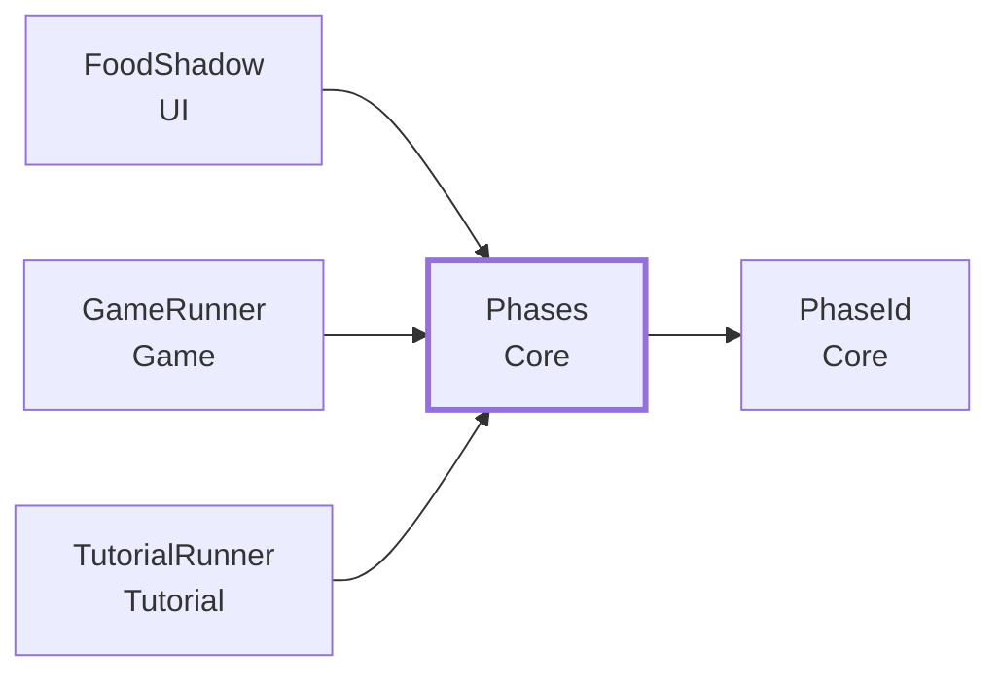

- この型を使う所: [`FoodShadow`](UI.md#t-foodshadow)、[`GameRunner`](Game.md#t-gamerunner)、[`TutorialRunner`](Tutorial.md#t-tutorialrunner)
- この型が使う型: [`PhaseId`](#t-phaseid)

### この型を使う手順

- [生き物に、自分で考えて動く振る舞い（AI のような動き）を持たせる](recipes.md#r-creature-ai)
- [新しいチュートリアルを足す](recipes.md#r-tutorial-new)

### メンバー（3）

| 種類 | メンバー | 説明 |
|---|---|---|
| イベント | `static Action<PhaseId> Changed` | 場面が変わった（新しい場面を運ぶ）。Current を更新してから出す。同じ場面を Set しても出ない。 |
| プロパティ | `static PhaseId Current` | いまの場面。決まっていなければ None。 |
| メソッド | `static void Set(PhaseId phase)` | いまの場面を決める。いまと同じなら何もしない。 |


---

<a id="t-requestclosed"></a>

## RequestClosed

**データ**（値を運ぶ型）・ `struct` ・ 名前空間 `MouthOfGod.Core` ・ [`Core/Events.cs`](../../Assets/Scripts/Core/Events.cs)

出ていた欲しい物が終わった（吹き出しを消す合図）。Resolved は、届いて解決したか（false なら、待ちきれなかった・やり直した）。

### なぜこの形か

- **[機能どうしは Core だけを通してつながる](design.md#d-core)**: 機能どうしが絡み合うと、1 か所の変更が全体を壊し、作業が止まります。
- **[1 つのフィールドに、欲しい物を同時に複数出す](design.md#d-multi)**: 1 つの場所にいる何人かが、それぞれ別の物を欲しがるほうが、ゲームとして面白いからです（10/20 の判断）。

### つながり

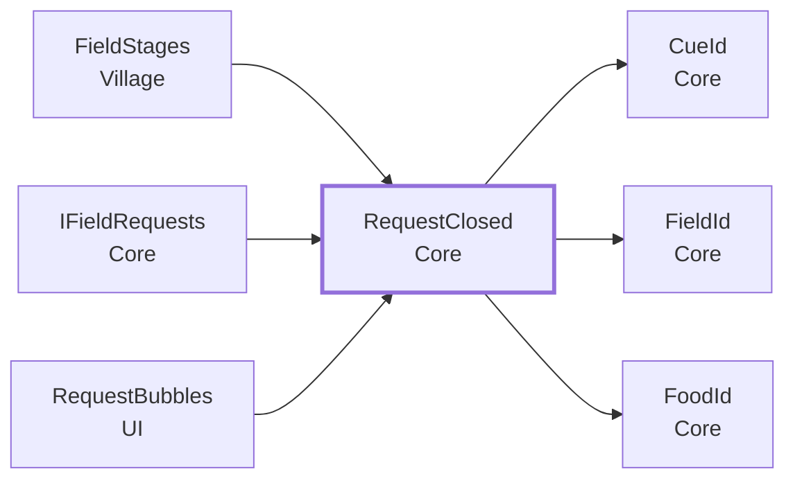

- この型を使う所: [`FieldStages`](Village.md#t-fieldstages)、[`IFieldRequests`](#t-ifieldrequests)、[`RequestBubbles`](UI.md#t-requestbubbles)
- この型が使う型: [`CueId`](#t-cueid)、[`FieldId`](#t-fieldid)、[`FoodId`](#t-foodid)

### この型を使う手順

- [本編で欲しい物を出す](recipes.md#r-open-request)

### メンバー（5）

| 種類 | メンバー | 説明 |
|---|---|---|
| コンストラクタ | `RequestClosed(FoodId food, FieldId field, bool resolved, int request = 0)` | （説明はコードにありません） |
| プロパティ | `readonly FoodId Food` | （説明はコードにありません） |
| プロパティ | `readonly FieldId Field` | （説明はコードにありません） |
| プロパティ | `readonly bool Resolved` | （説明はコードにありません） |
| プロパティ | `readonly int Request` | 終わった欲しい物の番号。出したときの Request と同じ。 |


---

<a id="t-requestissued"></a>

## RequestIssued

**データ**（値を運ぶ型）・ `struct` ・ 名前空間 `MouthOfGod.Core` ・ [`Core/Events.cs`](../../Assets/Scripts/Core/Events.cs)

フィールドの困っている人が、欲しい物を出した（吹き出しを出す合図）。1 つのフィールドに、同時に複数出ていることがある。どの欲しい物かは Request（番号）で見分ける。終わったときの [`RequestClosed`](#t-requestclosed) にも、同じ番号が入る。

### なぜこの形か

- **[機能どうしは Core だけを通してつながる](design.md#d-core)**: 機能どうしが絡み合うと、1 か所の変更が全体を壊し、作業が止まります。
- **[1 つのフィールドに、欲しい物を同時に複数出す](design.md#d-multi)**: 1 つの場所にいる何人かが、それぞれ別の物を欲しがるほうが、ゲームとして面白いからです（10/20 の判断）。

### つながり

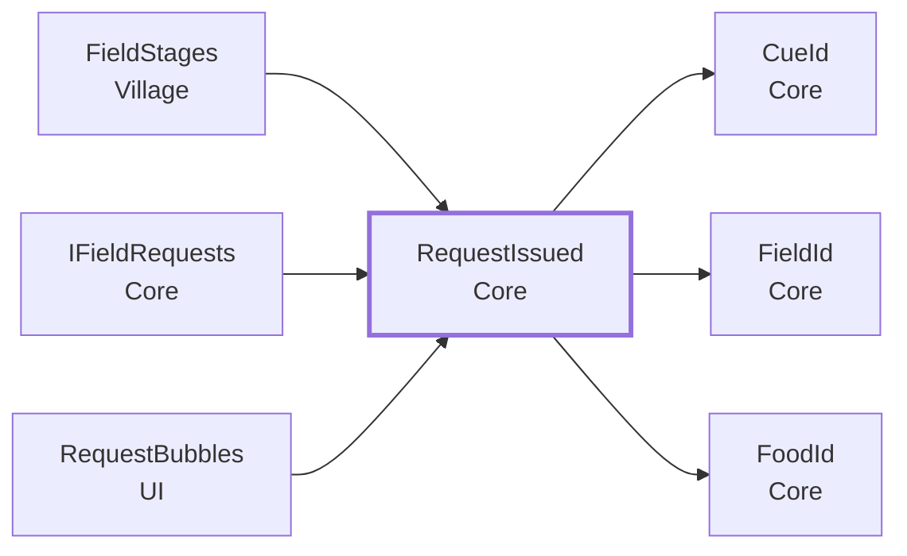

- この型を使う所: [`FieldStages`](Village.md#t-fieldstages)、[`IFieldRequests`](#t-ifieldrequests)、[`RequestBubbles`](UI.md#t-requestbubbles)
- この型が使う型: [`CueId`](#t-cueid)、[`FieldId`](#t-fieldid)、[`FoodId`](#t-foodid)

### この型を使う手順

- [本編で欲しい物を出す](recipes.md#r-open-request)

### メンバー（5）

| 種類 | メンバー | 説明 |
|---|---|---|
| コンストラクタ | `RequestIssued(FoodId food, FieldId field, Transform anchor = null, int request = 0)` | （説明はコードにありません） |
| プロパティ | `readonly FoodId Food` | （説明はコードにありません） |
| プロパティ | `readonly FieldId Field` | （説明はコードにありません） |
| プロパティ | `readonly Transform Anchor` | 吹き出しを出す場所（困っている人の頭の上など）。ミニチュアと一緒に動くので、位置ではなく Transform で渡す。無ければ null。 |
| プロパティ | `readonly int Request` | 欲しい物の番号。同じフィールドの中で、出すたびに変わる。フィールドと組で、1 つの欲しい物を見分ける。 |


---

<a id="t-spawned"></a>

## Spawned

**データ**（値を運ぶ型）・ `struct` ・ 名前空間 `MouthOfGod.Core` ・ [`Core/Events.cs`](../../Assets/Scripts/Core/Events.cs)

食べ物が生まれた。

### なぜこの形か

- **[機能どうしは Core だけを通してつながる](design.md#d-core)**: 機能どうしが絡み合うと、1 か所の変更が全体を壊し、作業が止まります。

### つながり

```mermaid
flowchart LR
  C_Spawned["Spawned<br/>Core"]:::me
  U_FoodSpawner["FoodSpawner<br/>Food"] --> C_Spawned
  U_IFoodSpawner["IFoodSpawner<br/>Core"] --> C_Spawned
  U_TutorialHistory["TutorialHistory<br/>Tutorial"] --> C_Spawned
  U_TutorialScript["TutorialScript<br/>Tutorial"] --> C_Spawned
  U_TutorialWait["TutorialWait<br/>Tutorial"] --> C_Spawned
  C_Spawned --> D_CueId["CueId<br/>Core"]
  C_Spawned --> D_FieldId["FieldId<br/>Core"]
  C_Spawned --> D_FoodId["FoodId<br/>Core"]
  classDef me stroke-width:3px
```

- この型を使う所: [`FoodSpawner`](Food.md#t-foodspawner)、[`IFoodSpawner`](#t-ifoodspawner)、[`TutorialHistory`](Tutorial.md#t-tutorialhistory)、[`TutorialScript`](Tutorial.md#t-tutorialscript)、[`TutorialWait`](Tutorial.md#t-tutorialwait)
- この型が使う型: [`CueId`](#t-cueid)、[`FieldId`](#t-fieldid)、[`FoodId`](#t-foodid)

### メンバー（3）

| 種類 | メンバー | 説明 |
|---|---|---|
| コンストラクタ | `Spawned(FoodId food, Vector3 position)` | （説明はコードにありません） |
| プロパティ | `readonly FoodId Food` | （説明はコードにありません） |
| プロパティ | `readonly Vector3 Position` | （説明はコードにありません） |


---

<a id="t-standing"></a>

## Standing

**static（置き場・計算）**（コードから直接呼ぶ）・ `static class` ・ 名前空間 `MouthOfGod.Core` ・ [`Core/Standing.cs`](../../Assets/Scripts/Core/Standing.cs)

体験者がいま前に立っているフィールドの置き場。チュートリアルの「ここに立って」の案内と、そのフィールド専用の食べ物の表を選ぶのに使う。物がどのフィールドに届くかは、ここでは決めない。体験者が狙って飛ばした物が、実際に落ちたフィールドに届く（Village の [`DeliveryZone`](Village.md#t-deliveryzone)）。立つ位置を判定する側（Village の立つ場所）が Set し、使う側（Food・Tutorial・Game）は Field で読み、Changed で知らせを受ける。

### なぜこの形か

- **[置き場に自分で登録する（組み立て役を置かない）](design.md#d-registry)**: 4 つのフィールドは、4 人が別々に作り、最後に 1 つのシーンへまとめます。
- **[生まれた物は、体験者が狙って飛ばす](design.md#d-aim)**: 狙いを定めて飛ばすことが、この体験の遊びだからです。

### しくみ・注意

- どこにも立っていないときは `None`。
- 立つ位置の取り方（頭の位置、床の印など）は、判定する側が決める。使う側は知らない。
- static なので、Play のたびに空にする。すべてメインスレッドから呼ぶ。
- この形を変えるときは、使う側すべてに効くので、別の PR にする。

### つながり

```mermaid
flowchart LR
  C_Standing["Standing<br/>Core"]:::me
  U_FieldDiagnostics["FieldDiagnostics<br/>DevTools"] --> C_Standing
  U_FoodSpawner["FoodSpawner<br/>Food"] --> C_Standing
  U_StandArea["StandArea<br/>Village"] --> C_Standing
  U_TutorialWait["TutorialWait<br/>Tutorial"] --> C_Standing
  C_Standing --> D_FieldId["FieldId<br/>Core"]
  classDef me stroke-width:3px
```

- この型を使う所: [`FieldDiagnostics`](DevTools.md#t-fielddiagnostics)、[`FoodSpawner`](Food.md#t-foodspawner)、[`StandArea`](Village.md#t-standarea)、[`TutorialWait`](Tutorial.md#t-tutorialwait)
- この型が使う型: [`FieldId`](#t-fieldid)

### この型を使う手順

- [生き物に、自分で考えて動く振る舞い（AI のような動き）を持たせる](recipes.md#r-creature-ai)

### メンバー（4）

| 種類 | メンバー | 説明 |
|---|---|---|
| イベント | `static Action<FieldId> Changed` | 立っているフィールドが変わった（新しいフィールドを運ぶ）。Field を更新してから出す。同じフィールドを Set しても出ない。 |
| プロパティ | `static FieldId Field` | いま前に立っているフィールド。どこにも立っていなければ None。 |
| メソッド | `static void Set(FieldId field)` | いま立っているフィールドを決める。 |
| メソッド | `static void Leave(FieldId field)` | そのフィールドに立っているときだけ、どこにも立っていない状態に戻す。離れた場所が、別の場所の判定を消さないようにするため。 |


---

<a id="t-textureid"></a>

## TextureId

**データ**（値を運ぶ型）・ `struct` ・ 名前空間 `MouthOfGod.Core` ・ [`Core/Ids.cs`](../../Assets/Scripts/Core/Ids.cs)
<br>継承・実装: `IEquatable<TextureId>`

食感の論理 ID。文字列を包んだ値。null と空文字は、どちらも空 ID（TextureId.None）。大文字小文字は区別する。

### なぜこの形か

- **[ID は文字列にする（enum にしない）](design.md#d-ids)**: `enum` にすると、食感や食べ物を 1 つ足すたびに、Core を直すことになります。

### つながり

```mermaid
flowchart LR
  C_TextureId["TextureId<br/>Core"]:::me
  U_FoodShadow["FoodShadow<br/>UI"] --> C_TextureId
  U_FoodSpawner["FoodSpawner<br/>Food"] --> C_TextureId
  U_FoodTable["FoodTable<br/>Food"] --> C_TextureId
  U_FoodTables["FoodTables<br/>Food"] --> C_TextureId
  U_ForkTip["ForkTip<br/>Fork"] --> C_TextureId
  U_IDevice["IDevice<br/>Core"] --> C_TextureId
  U_IFoodSpawner["IFoodSpawner<br/>Core"] --> C_TextureId
  U_MockDevice["MockDevice<br/>Device"] --> C_TextureId
  U_MockDeviceModel["MockDeviceModel<br/>Device"] --> C_TextureId
  U_TutorialHistory["TutorialHistory<br/>Tutorial"] --> C_TextureId
  U_TutorialScript["TutorialScript<br/>Tutorial"] --> C_TextureId
  U_TutorialWait["TutorialWait<br/>Tutorial"] --> C_TextureId
  classDef me stroke-width:3px
```

- この型を使う所: [`FoodShadow`](UI.md#t-foodshadow)、[`FoodSpawner`](Food.md#t-foodspawner)、[`FoodTable`](Food.md#t-foodtable)、[`FoodTables`](Food.md#t-foodtables)、[`ForkTip`](Fork.md#t-forktip)、[`IDevice`](#t-idevice)、[`IFoodSpawner`](#t-ifoodspawner)、[`MockDevice`](Device.md#t-mockdevice)、[`MockDeviceModel`](Device.md#t-mockdevicemodel)、[`TutorialHistory`](Tutorial.md#t-tutorialhistory)、[`TutorialScript`](Tutorial.md#t-tutorialscript)、[`TutorialWait`](Tutorial.md#t-tutorialwait)

### メンバー（4）

| 種類 | メンバー | 説明 |
|---|---|---|
| コンストラクタ | `TextureId(string value)` | （説明はコードにありません） |
| プロパティ | `string Value` | （説明はコードにありません） |
| プロパティ | `bool IsEmpty` | （説明はコードにありません） |
| 定数 | `static readonly TextureId None` | （説明はコードにありません） |
