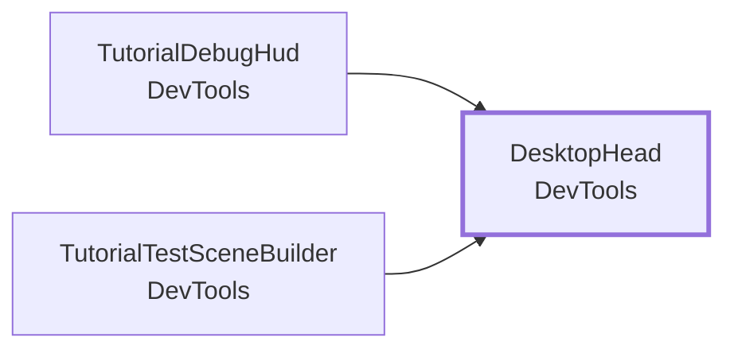
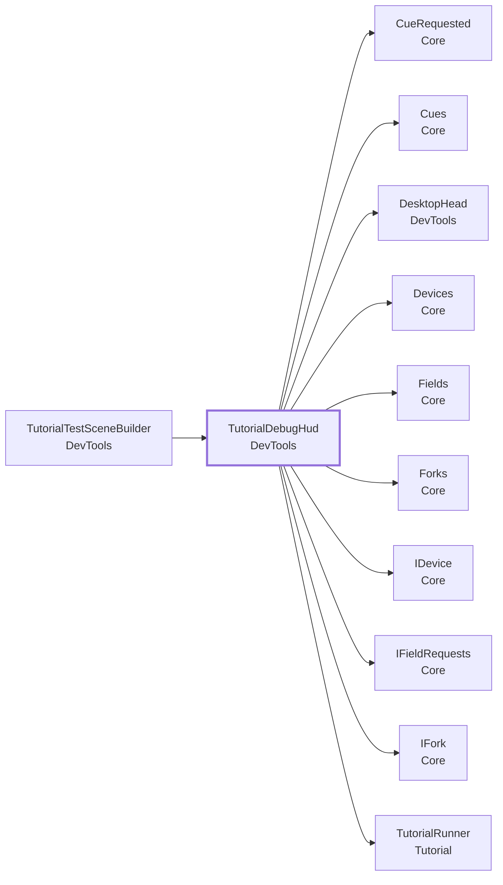

<!-- このページは tools/api_doc/build_md.py が作ります。手で直さないでください。 -->
[入口](README.md) ・ [設計の考え方](design.md) ・ [つながりの図](diagrams.md) ・ [やりたいこと別の手順](recipes.md) ・ [ガイド](guide.md)

# MouthOfGod.DevTools

Quest なしで試すための道具です。展示では使いません。

## この機能に関わる決まり（なぜこの形か）

- **[デバイスがなくても、全部が動く](design.md#d-mock)**: 実機のデバイスは、ゲームと並行して作っています。

## 型の一覧

| 役割 | 型 | 説明 |
|---|---|---|
| コンポーネント | [`DesktopHead`](#t-desktophead) | Quest なしで試すための頭。 |
| コンポーネント | [`TutorialDebugHud`](#t-tutorialdebughud) | Quest なしで試すときの表示。 |
| エディタ | [`FieldDiagnostics`](#t-fielddiagnostics) | Play 中に押すと、場所ごとに食べ物が引けているかを調べる材料を、Console に 1 回で出す。 |
| エディタ | [`MainCopySetup`](#t-maincopysetup) | Main の写し（Main_Copy）を、本編まで通して試せる形にする。 |
| エディタ | [`MainSeaSwapper`](#t-mainseaswapper) | 共有シーン（Main）の仮の海（Misc/Sea(Temporal)）を、完成版の海（Sea/Sea_work）に入れ替える（#329・#338）。 |
| エディタ | [`MainSeaVillagerResizer`](#t-mainseavillagerresizer) | 共有シーン（Main）の海の村人の背の高さを、村の村人の平均に合わせる。 |
| エディタ | [`MountDeliveryZoneAdder`](#t-mountdeliveryzoneadder) | 山の Main 用 Prefab（Misc/MountVer2 Variant）に、届ける場所（DeliveryZone）と、それを受けるトリガーの箱を足す。 |
| エディタ | [`OpenAllRequestsMenu`](#t-openallrequestsmenu) | Play 中に使うメニュー。 |
| エディタ | [`TutorialTestSceneBuilder`](#t-tutorialtestscenebuilder) | Quest なしで、プロローグとチュートリアル 1〜4 を通して試すシーンを作る。 |

---

## DesktopHead

**コンポーネント**（GameObject に付ける）・ `sealed class` ・ 名前空間 `MouthOfGod.DevTools` ・ [`DevTools/DesktopHead.cs`](../../Assets/Scripts/DevTools/DesktopHead.cs)
 継承・実装: `MonoBehaviour`

Quest なしで試すための頭。Main Camera に付けると、キーボードとマウスで歩いて見回せる。

### なぜこの形か

- **[デバイスがなくても、全部が動く](design.md#d-mock)**: 実機のデバイスは、ゲームと並行して作っています。

### しくみ・注意

- WASD で歩く。Shift を押している間は速く歩く。マウスの右ボタンを押しながら動かすと、向きが変わる。
- 高さは変えない。立っている場所（StandArea）は、頭の水平の位置で決まるため。
- Quest の頭が動いているときは、何もしない（頭の位置は XR が決める）。
- 展示では使わない。

### つながり

- この型を使う所: [`TutorialDebugHud`](#t-tutorialdebughud)、[`TutorialTestSceneBuilder`](#t-tutorialtestscenebuilder)

### Inspector（4 項目）

| 項目 | 型 | 既定値 | 説明 |
|---|---|---|---|
| Walk Speed | `float` | 1.2 | 歩く速さ（m / 秒） |
| Run Multiplier | `float` | 3 | Shift を押している間、歩く速さを何倍にするか |
| Degrees Per Pixel | `float` | 0.15 | マウスを 1 ピクセル動かしたときに回る角度（度） |
| Max Pitch | `float` | 80 | 上下を向ける角度の上限（度） |

### メンバー（1）

| 種類 | メンバー | 説明 |
|---|---|---|
| メソッド | `void Teleport(Vector3 position, float yaw)` | 水平の位置だけを移す。高さはそのまま。向きは yaw（度）にする。 |

---

## TutorialDebugHud

**コンポーネント**（GameObject に付ける）・ `sealed class` ・ 名前空間 `MouthOfGod.DevTools` ・ [`DevTools/TutorialDebugHud.cs`](../../Assets/Scripts/DevTools/TutorialDebugHud.cs)
 継承・実装: `MonoBehaviour`

Quest なしで試すときの表示。Game ビューの左上に、いまの場面・立っている場所・食感・フォーク・欲しい物・覚えたこと・最近の合図を出す。ボタンで、チュートリアルを始める・止める、立つ場所へ移る、ができる。

### なぜこの形か

- **[デバイスがなくても、全部が動く](design.md#d-mock)**: 実機のデバイスは、ゲームと並行して作っています。

### しくみ・注意

読むのは Core の置き場と、[`TutorialRunner`](Tutorial.md#t-tutorialrunner) だけ。展示では使わない（Quest の中には出ない）。

### つながり

- この型を使う所: [`TutorialTestSceneBuilder`](#t-tutorialtestscenebuilder)
- この型が使う型: [`CueRequested`](Core.md#t-cuerequested)、[`Cues`](Core.md#t-cues)、[`DesktopHead`](#t-desktophead)、[`Devices`](Core.md#t-devices)、[`Fields`](Core.md#t-fields)、[`Forks`](Core.md#t-forks)、[`IDevice`](Core.md#t-idevice)、[`IFieldRequests`](Core.md#t-ifieldrequests)、[`IFork`](Core.md#t-ifork)、[`TutorialRunner`](Tutorial.md#t-tutorialrunner)

### Inspector（6 項目）

| 項目 | 型 | 既定値 | 説明 |
|---|---|---|---|
| Runner | `TutorialRunner` | なし | 始める・止めるボタンと、覚えたことの表示に使う |
| Head | `DesktopHead` | なし | 移るボタンで動かす頭。空なら、Main Camera の DesktopHead |
| Teleport Targets | `Transform[]` | 空 | 移るボタンの行き先。ふつうは各フィールドの StandArea |
| Memory Keys | `string[]` | `{ "fork-learned", "food-born", "texture-shadow-seen", "request-seen", "delivered-by-standing", }` | 表示する、覚えたことの名前（docs/progress-keys.md） |
| Cue Lines | `int` | `12` | 最近の合図を、いくつまで出すか |
| Width | `float` | 420 | 表示の幅（ピクセル） |

---

## エディタ専用・試験用

### FieldDiagnostics

`DevTools/Editor/FieldDiagnostics.cs`（エディタ）

Play 中に押すと、場所ごとに食べ物が引けているかを調べる材料を、Console に 1 回で出す。出すもの: いま立っているフィールド、頭の位置、各「立つ場所」の位置・広さ・頭との距離・入っているか、登録された食べ物の表。フィールドの前に立った状態で押す。結果を貼れば、箱に入っていないのか、表が引けないのかが分かる。

- メニュー: `MouthOfGod/Dev/Print Field Diagnostics (Play mode)`

### MainCopySetup

`DevTools/Editor/MainCopySetup.cs`（エディタ）

Main の写し（Main_Copy）を、本編まで通して試せる形にする。共有シーン Main は触らない。- 本編の進行役（GameRunner）が無ければ置く。チュートリアルが終わると、これが本編を始める。- すべてのフィールドの Max Open Requests を、そのフィールドのステップの数にする。欲しい物を、全部同時に出せるようにするため。値は、シーンの上書き（Prefab override）として残す。フィールドの Prefab は変えない。Main_Copy を開いて 1 回実行し、シーンをコミットする。何度実行しても同じになる。

- メニュー: `MouthOfGod/Dev/Set Up Main Copy (GameRunner, Max Open Requests)`

### MainSeaSwapper

`DevTools/Editor/MainSeaSwapper.cs`（エディタ）

共有シーン（Main）の仮の海（Misc/Sea(Temporal)）を、完成版の海（Sea/Sea_work）に入れ替える（#329・#338）。仮の海は、村人も海の食べ物の表も持たない。そのため、吹き出しが村人から離れた所に出て、海では共通の表（e・f だけ）しか引けなかった。位置・向き・親・兄弟の順・体験者の頭（StandArea の Head）は、仮の海から引き継ぐ。仮の海を指していた参照は、新しい海に付け替える。1 回実行して、Main をコミットする。Main に仮の海が無ければ、何もしない（何度実行しても同じ）。

- メニュー: `MouthOfGod/Dev/Swap Main Sea (Temporal to Sea_work)`
- メニュー: `MouthOfGod/Dev/Fix Main Sea Placement (remove SurfaceAnchor)`

### MainSeaVillagerResizer

`DevTools/Editor/MainSeaVillagerResizer.cs`（エディタ）

共有シーン（Main）の海の村人の背の高さを、村の村人の平均に合わせる。高さはワールド座標で測る。海の親は (0.54, 0.2, 0.54) とつぶれていて、海の村人のローカルの大きさは縦だけ大きくして打ち消している。そのため、ローカルの大きさに同じ倍率を 3 軸ともかけて、打ち消しを崩さないようにする。変更は Main の上書きとして残し、Sea_work.prefab は変えない。直した海は、バックアップとして独立した Prefab（Sea_work_VillagerResized）にも保存する。何度実行しても同じ結果になる。

- メニュー: `MouthOfGod/Dev/Match Main Sea Villager Height to Village`

### MountDeliveryZoneAdder

`DevTools/Editor/MountDeliveryZoneAdder.cs`（エディタ）

山の Main 用 Prefab（Misc/MountVer2 Variant）に、届ける場所（DeliveryZone）と、それを受けるトリガーの箱を足す。山には、食べ物が落ちた場所を判定する DeliveryZone が無く、山の村人に向けて飛ばしても届いたことにならなかった。草原の Variant と同じ形にする。箱は、山の見た目（立つ場所の足あとは除く）の広さに合わせ、横に余白を、上に高さを足す。1 回実行して、Variant をコミットする。すでに DeliveryZone があれば、何もしない（何度実行しても同じ）。

- メニュー: `MouthOfGod/Dev/Add Delivery Zone To Mount Variant`

### OpenAllRequestsMenu

`DevTools/Editor/OpenAllRequestsMenu.cs`（エディタ）

Play 中に使うメニュー。チュートリアルが動いていなくて、まだ出ていない欲しい物（吹き出し）があれば、すべてのフィールドで出せるだけ出す。- チュートリアルが動いている間は、何もしない（チュートリアルの流れを崩さないため）。終わった後・Skip した後・Stop で止めた後・始める前は、出す。- 1 つのフィールドに同時に出せる数は、そのフィールドの Max Open Requests まで。全部出したいときは、 「MouthOfGod/Dev/Set Up Main Copy」で、ステップの数にそろえておく。- 試験用の OpenAllRequestsAfterTutorial（Tutorial/Sandbox）は、チュートリアルが終わったときに自動で同じことをする。こちらは、好きなときに手で押す（Skip・Stop の後や、届けて減った後に出し直すとき）。

### TutorialTestSceneBuilder

`DevTools/Editor/TutorialTestSceneBuilder.cs`（エディタ）

Quest なしで、プロローグとチュートリアル 1〜4 を通して試すシーンを作る。メニュー「MouthOfGod/Dev/Build Tutorial Test Scene」。

- メニュー: `MouthOfGod/Dev/Build Tutorial Test Scene`
