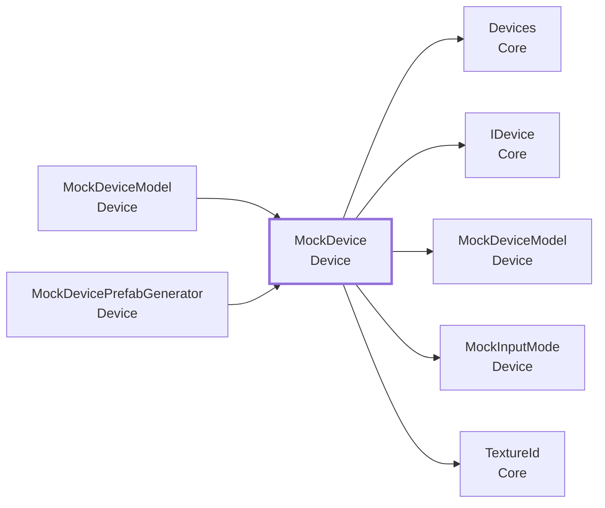
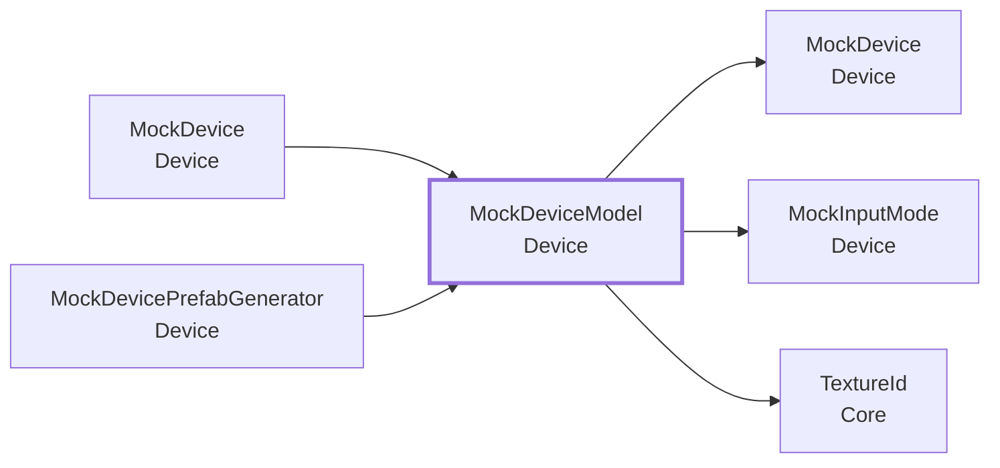
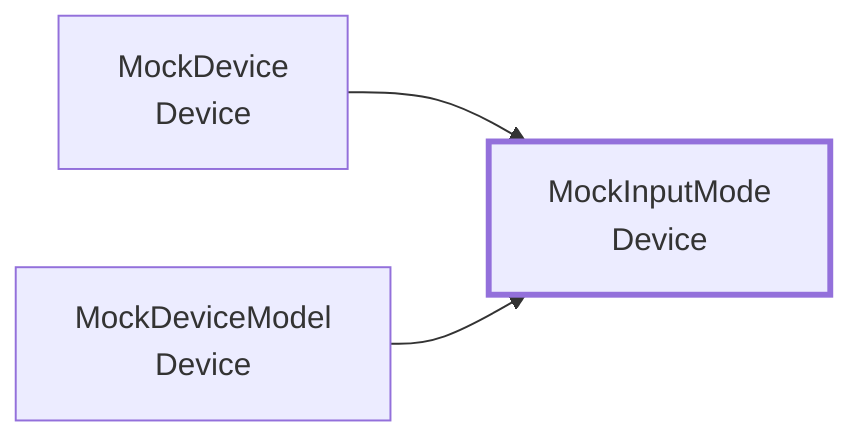

<!-- このページは tools/api_doc/build_md.py が作ります。手で直さないでください。 -->
[入口](README.md) ・ [設計の考え方](design.md) ・ [つながりの図](diagrams.md) ・ [やりたいこと別の手順](recipes.md) ・ [ガイド](guide.md)

# MouthOfGod.Device

触感デバイスの入力です。[`MockDevice`](#t-mockdevice) が、デバイスなしで、Quest のコントローラやキーボードで「噛む・決定する」を代わりにします。実機は、[`IDevice`](Core.md#t-idevice) を実装して `Devices.Register` するだけで差し替わります。

## この機能に関わる決まり（なぜこの形か）

- **[置き場に自分で登録する（組み立て役を置かない）](design.md#d-registry)**: 4 つのフィールドは、4 人が別々に作り、最後に 1 つのシーンへまとめます。
- **[デバイスがなくても、全部が動く](design.md#d-mock)**: 実機のデバイスは、ゲームと並行して作っています。
- **[Play の前に、手作業を要らなくする](design.md#d-noprep)**: 手で入れるつなぎは、付け忘れると動きません。

## 型の一覧

| 役割 | 型 | 説明 |
|---|---|---|
| コンポーネント | [`MockDevice`](#t-mockdevice) | デバイスなしで動かす IDevice。 |
| コンポーネント | [`MockDeviceModel`](#t-mockdevicemodel) | MockDevice の雑な見た目。 |
| 選択肢（enum） | [`MockInputMode`](#t-mockinputmode) | Mock を何で操作するか。 |
| エディタ | [`MockDevicePrefabGenerator`](#t-mockdeviceprefabgenerator) | MockDevice の Prefab を Assets/Resources/Prefabs/Device/ に作る。 |

---

## MockDevice

**コンポーネント**（GameObject に付ける）・ `sealed class` ・ 名前空間 `MouthOfGod.Device` ・ [`Device/MockDevice.cs`](../../Assets/Scripts/Device/MockDevice.cs)
 継承・実装: `MonoBehaviour`、[`IDevice`](Core.md#t-idevice)

デバイスなしで動かす [`IDevice`](Core.md#t-idevice)。Meta Quest のコントローラ（ゲームパッド・キーボードも可）で「噛む・決定する」を代わりにする。噛み始めで Bitten、噛んでいる間は一定間隔で TextureChanged、決定操作で Confirmed。操作の割り当ては Inspector（InputAction）で変えられる。スクリプトで作れる（GetOrCreate）。Play すると自動で用意する。操作のしかたは Input Mode で選ぶ。Any は手とコントローラのどちらでも、Hand は両手のハンドトラッキングだけ、 RightController は右コントローラ 1 本だけ（片手で、噛む・決定する・棒を持つ）。キーボードとゲームパッドは、どのモードでも効く。

### なぜこの形か

- **[置き場に自分で登録する（組み立て役を置かない）](design.md#d-registry)**: 4 つのフィールドは、4 人が別々に作り、最後に 1 つのシーンへまとめます。
- **[デバイスがなくても、全部が動く](design.md#d-mock)**: 実機のデバイスは、ゲームと並行して作っています。
- **[Play の前に、手作業を要らなくする](design.md#d-noprep)**: 手で入れるつなぎは、付け忘れると動きません。

### つながり

- この型を使う所: [`MockDeviceModel`](#t-mockdevicemodel)、[`MockDevicePrefabGenerator`](#t-mockdeviceprefabgenerator)
- この型が使う型: [`Devices`](Core.md#t-devices)、[`IDevice`](Core.md#t-idevice)、[`MockDeviceModel`](#t-mockdevicemodel)、[`MockInputMode`](#t-mockinputmode)、[`TextureId`](Core.md#t-textureid)

### Inspector（7 項目）

| 項目 | 型 | 既定値 | 説明 |
|---|---|---|---|
| Texture Ids | `string[]` | `{ "placeholder-a", "placeholder-b", "placeholder-c", "placeholder-d", "placeholder-e", "placeholder-f" }` | 噛んでいる間に順に切り替わる食感 ID。既定はプレースホルダー。実際の ID に差し替える。Play 中に変えても反映されない |
| Switch Interval Seconds | `float` | 1.5 | 食感が切り替わる間隔（秒）。暫定。Play 中に変えても反映されない |
| Input Mode | `MockInputMode` | Any | 操作のしかた。Any: 手・コントローラのどちらでも。Hand: 両手のハンドトラッキング（右手で棒を持ち、左手を握って噛み、左手のつまみで決定）。RightController: 右コントローラ 1 本（棒は右コントローラに付いたまま、右トリガーで噛み、右 A ボタンで決定）。キーボードとゲームパッドは、どのモードでも効く。Play 中に変えてもよい |
| Bite Action | `InputAction` | `new InputAction("Bite", InputActionType.Button, "<XRController>{RightHand}/triggerPressed")` | 噛む操作（押している間が噛んでいる間）。Inspector でバインドを変えられる。暫定: Quest 右トリガー / 左手を握る（ハンドトラッキング） / Space / ゲームパッド A |
| Confirm Action | `InputAction` | `new InputAction("Confirm", InputActionType.Button, "<XRController>{RightHand}/primaryButton")` | 決定操作。Inspector でバインドを変えられる。暫定: Quest 右 A ボタン / 左手のつまみ（ハンドトラッキング） / Enter / ゲームパッド Start。実機の「ハードのボタン 1 つ」の代わり |
| Log Events | `bool` | オン | 噛む・食感・決定を Console に出す（受け取る側がまだ無くても、動いているか分かるように） |
| Content Percent | `float` | 0 | デバイスの内容量（0〜100 %）。先端に表示する。Inspector で動かして試せる |

### メンバー（8）

| 種類 | メンバー | 説明 |
|---|---|---|
| イベント | `Action<TextureId> TextureChanged` | 食感が変わった（新しい食感を運ぶ）。Current を更新してから出す。噛み始めは Bitten の直後に、最初の食感で出す（前と同じ食感でも出す）。噛むのをやめても None では出さない。（[`IDevice`](Core.md#t-idevice) の説明） |
| イベント | `Action<TextureId> Confirmed` | 決定した。決定したときの食感（Current）を運ぶ。噛む前の決定なら [`TextureId`](Core.md#t-textureid).None。（[`IDevice`](Core.md#t-idevice) の説明） |
| イベント | `Action Bitten` | 噛み始めた。噛み始めるたびに 1 回出す（噛んでいる間は出さない）。（[`IDevice`](Core.md#t-idevice) の説明） |
| プロパティ | `float ContentPercent` | デバイスの内容量（0〜100 %）。見た目（[`MockDeviceModel`](#t-mockdevicemodel)）が読む。 |
| プロパティ | `MockInputMode InputMode` | 操作のしかた。見た目（[`MockDeviceModel`](#t-mockdevicemodel)）も、これに合わせて棒を持つ。 |
| プロパティ | `TextureId Current` | いまの食感。まだ噛んでいなければ [`TextureId`](Core.md#t-textureid).None。噛むのをやめても、最後の食感が残る。（[`IDevice`](Core.md#t-idevice) の説明） |
| プロパティ | `bool IsBiting` | 噛んでいる間（噛む操作を押している間）。見た目（[`MockDeviceModel`](#t-mockdevicemodel)）が読む。 |
| メソッド | `static MockDevice GetOrCreate()` | シーン内の MockDevice を返す。無ければ、Prefab があれば Prefab から、無ければスクリプトで作る（既定の操作割り当て付き）。Prefab にしておくと、Inspector で変えた設定（操作の割り当て・間隔・食感 ID）が残る。 |

---

## MockDeviceModel

**コンポーネント**（GameObject に付ける）・ `sealed class` ・ 名前空間 `MouthOfGod.Device` ・ [`Device/MockDeviceModel.cs`](../../Assets/Scripts/Device/MockDeviceModel.cs)
 継承・実装: `MonoBehaviour`
 属性: `[RequireComponent(typeof(MockDevice))]`

[`MockDevice`](#t-mockdevice) の雑な見た目。細長い棒で、先端に内容量（%）を出す。手（Quest のハンドトラッキング）を握ると、手に付いて保持される。離すとその場に残る。[`MockDevice`](#t-mockdevice) の Input Mode が RightController のときは、握らなくても、右コントローラ（RightHandAnchor）に付いたままにする（片手で操作するため）。Hand のときは手の握りだけ、Any のときは手の握り・右グリップ・G キーのどれでも持つ。見た目だけで、[`IDevice`](Core.md#t-idevice) のイベントには関わらない。

### なぜこの形か

- **[デバイスがなくても、全部が動く](design.md#d-mock)**: 実機のデバイスは、ゲームと並行して作っています。

### つながり

- この型を使う所: [`MockDevice`](#t-mockdevice)、[`MockDevicePrefabGenerator`](#t-mockdeviceprefabgenerator)
- この型が使う型: [`MockDevice`](#t-mockdevice)、[`MockInputMode`](#t-mockinputmode)、[`TextureId`](Core.md#t-textureid)

### Inspector（5 項目）

| 項目 | 型 | 既定値 | 説明 |
|---|---|---|---|
| Hand Anchor | `Transform` | なし | 手の位置。空なら、シーン内の RightHandAnchor（OVRCameraRig）を探す |
| Grasp Threshold | `float` | 0.8 | 握りの強さ（0〜1）。この値以上で握ったことにする。暫定 |
| Grasp Action | `InputAction` | `new InputAction("Grasp", InputActionType.Value, "<HandInteraction>{RightHand}/graspValue")` | 握る操作（float）。Inspector でバインドを変えられる。暫定: OpenXR Hand Interaction の右手 graspValue / Quest 右グリップ |
| Length | `float` | 0.2 | 棒の長さ（m）。見た目を作るときに使う |
| Label | `TextMesh` | なし | 先端の内容量（%）の表示。Prefab に入っていればそれを使う。空なら Play 時に見た目を作る |

---

## MockInputMode

**選択肢（enum）**（決まった値の中から選ぶ）・ `enum` ・ 名前空間 `MouthOfGod.Device` ・ [`Device/MockInputMode.cs`](../../Assets/Scripts/Device/MockInputMode.cs)

Mock を何で操作するか。キーボードとゲームパッドは、どのモードでも効く。

### つながり

- この型を使う所: [`MockDevice`](#t-mockdevice)、[`MockDeviceModel`](#t-mockdevicemodel)

### 値

| 値 | 意味 |
|---|---|
| `Any` | 手・コントローラのどちらでも（両方の割り当てが効く） |
| `Hand` | ハンドトラッキングの両手: 右手を握って棒を持つ、左手を握って噛む、左手のつまみで決定 |
| `RightController` | 右コントローラ 1 本: 棒は右コントローラに付いたまま、右トリガーで噛む、右 A ボタンで決定 |

---

## エディタ専用・試験用

### MockDevicePrefabGenerator

`Device/Editor/MockDevicePrefabGenerator.cs`（エディタ）

MockDevice の Prefab を Assets/Resources/Prefabs/Device/ に作る。1 回実行して、できた Prefab をコミットする。Play すると、MockDevice はこの Prefab から作られる（Inspector で変えた設定が残る）。既にある Prefab は上書きしない。

- メニュー: `MouthOfGod/Device/Create MockDevice Prefab`
