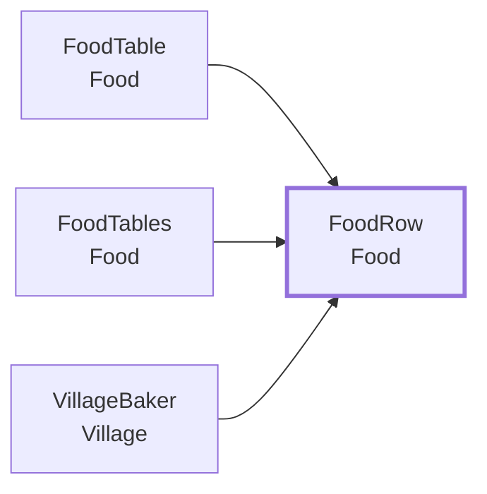
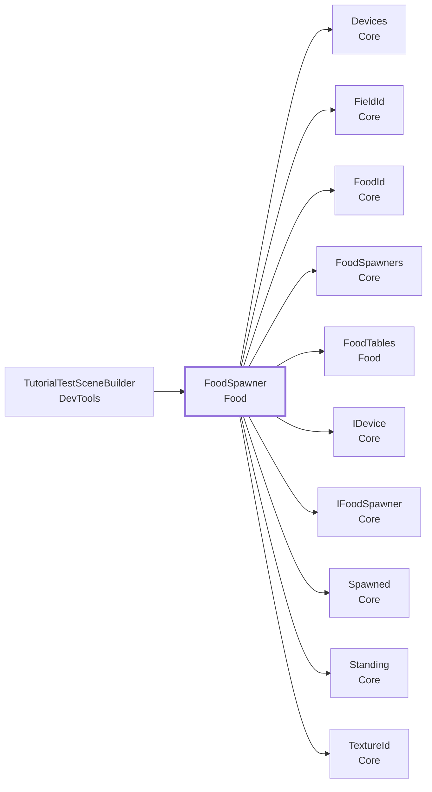
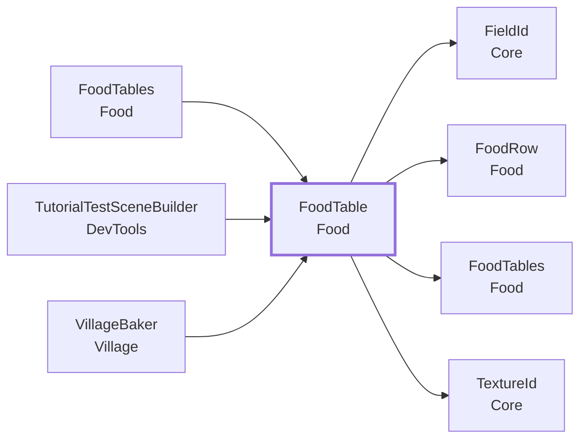
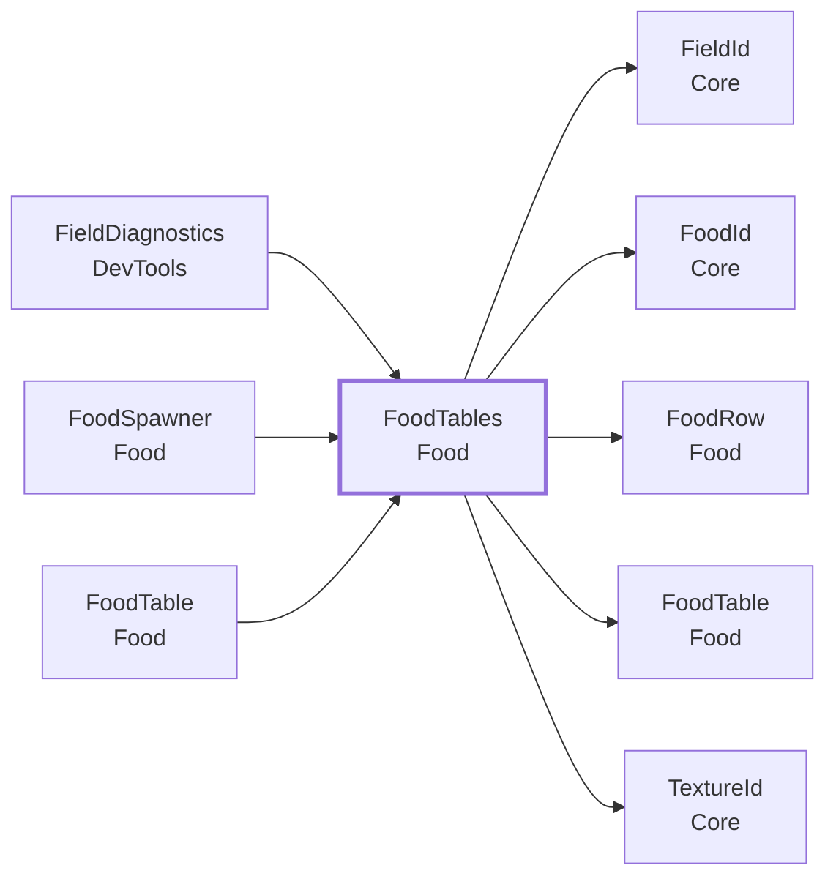

<!-- このページは tools/api_doc/build_md.py が作ります。手で直さないでください。 -->
[入口](README.md) ・ [設計の考え方](design.md) ・ [つながりの図](diagrams.md) ・ [やりたいこと別の手順](recipes.md) ・ [ガイド](guide.md)

# MouthOfGod.Food

食感から食べ物を引いて、生み、前へ飛ばします。「食感 → 食べ物」の表は、全フィールド共通の表（`Field Id` が空）と、フィールドごとの表に分けます。

## この機能に関わる決まり（なぜこの形か）

- **[作業の単位と、ファイルの単位をそろえる](design.md#d-files)**: シーンや Prefab は、Git でマージできないからです。
- **[置き場に自分で登録する（組み立て役を置かない）](design.md#d-registry)**: 4 つのフィールドは、4 人が別々に作り、最後に 1 つのシーンへまとめます。
- **[食感 → 食べ物の対応は、Prefab に付ける表で持つ](design.md#d-foodtable)**: 食感の数は、これからのテストで変わります。
- **[生まれた物は、体験者が狙って飛ばす](design.md#d-aim)**: 狙いを定めて飛ばすことが、この体験の遊びだからです。

## 型の一覧

| 役割 | 型 | 説明 |
|---|---|---|
| コンポーネント | [`FoodSpawner`](#t-foodspawner) | デバイスで決定した食感から、食べ物を引いて生み、前へ飛ばす。 |
| コンポーネント | [`FoodTable`](#t-foodtable) | 「食感 → 食べ物の Prefab」の表。 |
| static（置き場・計算） | [`FoodTables`](#t-foodtables) | いまシーンにある FoodTable の置き場。 |
| データ | [`FoodRow`](#t-foodrow) | FoodTable の 1 行。 |
| エディタ | [`FoodIconGenerator`](#t-foodicongenerator) | 食べ物の Prefab を、遠近のあるカメラで斜め前から写し、背景が透明な PNG にする。 |
| エディタ | [`FoodPrefabFitter`](#t-foodprefabfitter) | 手で作った食べ物の Prefab（FoodPrefabGenerator を通っていないもの）の大きさを、その場で合わせる。 |
| エディタ | [`FoodPrefabGenerator`](#t-foodprefabgenerator) | 食べ物の Prefab を、素材（FBX）から Assets/Resources/Prefabs/Food/ に作る。 |

---

## FoodRow

**データ**（値を運ぶ型）・ `struct` ・ 名前空間 `MouthOfGod.Food` ・ [`Food/FoodRow.cs`](../../Assets/Scripts/Food/FoodRow.cs)

[`FoodTable`](#t-foodtable) の 1 行。「この食感のとき、この食べ物が生まれる」。

Inspector では、配列や List の 1 要素として見えます（`[Serializable]`）。

### なぜこの形か

- **[食感 → 食べ物の対応は、Prefab に付ける表で持つ](design.md#d-foodtable)**: 食感の数は、これからのテストで変わります。

### つながり

- この型を使う所: [`FoodTable`](#t-foodtable)、[`FoodTables`](#t-foodtables)、[`VillageBaker`](Village.md#t-villagebaker)

### この型を使う手順

- [新しい食べ物を足す](recipes.md#r-add-food)

### Inspector（2 項目）

| 項目 | 型 | 既定値 | 説明 |
|---|---|---|---|
| Texture | `string` | 空 | 食感の ID。デバイスが出す食感と同じ文字にする（大文字小文字は区別する）。空の行は使われない |
| Food | `GameObject` | なし | この食感で生まれる食べ物の Prefab。Prefab のファイル名が、食べ物の ID（FoodId）になる |

### メンバー（1）

| 種類 | メンバー | 説明 |
|---|---|---|
| コンストラクタ | `FoodRow(string texture, GameObject food)` | （説明はコードにありません） |

---

## FoodSpawner

**コンポーネント**（GameObject に付ける）・ `sealed class` ・ 名前空間 `MouthOfGod.Food` ・ [`Food/FoodSpawner.cs`](../../Assets/Scripts/Food/FoodSpawner.cs)
 継承・実装: `MonoBehaviour`、[`IFoodSpawner`](Core.md#t-ifoodspawner)

デバイスで決定した食感から、食べ物を引いて生み、前へ飛ばす。食感が決まったとき（Confirmed）に、Resolve で Prefab を引き、Spawn Point の位置に生む。

### なぜこの形か

- **[置き場に自分で登録する（組み立て役を置かない）](design.md#d-registry)**: 4 つのフィールドは、4 人が別々に作り、最後に 1 つのシーンへまとめます。
- **[食感 → 食べ物の対応は、Prefab に付ける表で持つ](design.md#d-foodtable)**: 食感の数は、これからのテストで変わります。
- **[生まれた物は、体験者が狙って飛ばす](design.md#d-aim)**: 狙いを定めて飛ばすことが、この体験の遊びだからです。

### しくみ・注意

- デバイスは Core の `WhenReady` で受け取る。Mock か実機かは知らない。
- 飛ばす: `Launch Speed` が 0 より大きく、生んだ食べ物に Rigidbody があれば、`Spawn Point` の前向きに初速を与える。そのあとの動きは、食べ物の Rigidbody（Mass など）と物理しだい。
  体験者は、顔を向けて狙いを定め、欲しがっている人のところへ飛ばす。どこに届いたかは、落ちた所の DeliveryZone（Village）が決める。
- `Food Parent` を入れると、生んだ食べ物をその子にする（位置と向きは Spawn Point のまま）。
- 生んだ食べ物には、どの食べ物かを渡す [`IFoodItem`](Core.md#t-ifooditem)（`FoodItemTag`）を付ける。
- 「体験者の前のフィールド」は、Core の `Field` を読む。`CurrentField` に関数を入れたときは、そちらを使う（テストや、別の決め方を試すとき）。
- 有効になると、自分で Core の [`FoodSpawners`](Core.md#t-foodspawners) に登録する。チュートリアルや影の UI は、そこから受け取る。
- 間違えたとき（欲しい物と違う食べ物が届いたとき）の反応は、ここにはない。届いた知らせ（`Received`）を受ける側が足す。

### つながり

- この型を使う所: [`TutorialTestSceneBuilder`](DevTools.md#t-tutorialtestscenebuilder)
- この型が使う型: [`Devices`](Core.md#t-devices)、[`FieldId`](Core.md#t-fieldid)、[`FoodId`](Core.md#t-foodid)、[`FoodSpawners`](Core.md#t-foodspawners)、[`FoodTables`](#t-foodtables)、[`IDevice`](Core.md#t-idevice)、[`IFoodSpawner`](Core.md#t-ifoodspawner)、[`Spawned`](Core.md#t-spawned)、[`Standing`](Core.md#t-standing)、[`TextureId`](Core.md#t-textureid)

### この型を使う手順

- [新しい食べ物を足す](recipes.md#r-add-food)

### Inspector（3 項目）

| 項目 | 型 | 既定値 | 説明 |
|---|---|---|---|
| Spawn Point | `Transform` | なし | 食べ物が生まれる位置と向き（口の位置。MouthAnchor を置いたら、ここに入れる）。空なら、このオブジェクトの位置と向き |
| Food Parent | `Transform` | なし | 生んだ食べ物を、この子として置く（Hierarchy が散らからない・まとめて消せる）。位置と向きは Spawn Point のまま。空なら、シーンの直下 |
| Launch Speed | `float` | 2 | 生んだ食べ物に、Spawn Point の前向きに与える初速（m/s）。0 以下、または食べ物に Rigidbody がなければ、与えない。そのあとの動きは、食べ物の Rigidbody（Mass など）しだい |

### メンバー（5）

| 種類 | メンバー | 説明 |
|---|---|---|
| イベント | `Action<Spawned> Spawned` | 食べ物を生んだ直後に、1 回出る。 |
| プロパティ | `Func<FieldId> CurrentField { get; set; }` | 体験者の前のフィールドを返す関数。入れたときだけ、Field の代わりに使う。空のままなら、Core の Field（立っている場所。どこにも立っていなければ共通の表だけ）。 |
| プロパティ | `Transform FoodParent` | 生んだ食べ物の置き場（親）。空ならシーンの直下。 |
| メソッド | `GameObject Preview(TextureId texture)` | 食感から、生まれる食べ物の Prefab を引くだけ。生まない。チュートリアルで、噛んでいる間に、その食感で生まれる物の影を見せるときに使う。引けなければ null。 |
| メソッド | `GameObject Spawn(TextureId texture)` | 食感から食べ物を引いて、1 つ生む。生んだ食べ物を返す。食感が空（噛む前の決定）なら、何もせず null。引けなければ、警告を出して null。 |

---

## FoodTable

**コンポーネント**（GameObject に付ける）・ `sealed class` ・ 名前空間 `MouthOfGod.Food` ・ [`Food/FoodTable.cs`](../../Assets/Scripts/Food/FoodTable.cs)
 継承・実装: `MonoBehaviour`

「食感 → 食べ物の Prefab」の表。Field Id が空なら全フィールド共通の表、フィールドの ID（village / mountain / sea / grassland）なら、そのフィールドの専用の表。専用の表は、そのフィールドの Prefab に付ける。有効になると、自分で [`FoodTables`](#t-foodtables) に登録する。

### なぜこの形か

- **[作業の単位と、ファイルの単位をそろえる](design.md#d-files)**: シーンや Prefab は、Git でマージできないからです。
- **[食感 → 食べ物の対応は、Prefab に付ける表で持つ](design.md#d-foodtable)**: 食感の数は、これからのテストで変わります。

### しくみ・注意

- 共通の表は、なくてもよい。なければ、専用の表にない食感は何も生まれない。
- 同じ食感の行が重なったら、先の行を使う。
- 引くのは `Resolve`。この表だけを引くときは `Find`。

### つながり

- この型を使う所: [`FoodTables`](#t-foodtables)、[`TutorialTestSceneBuilder`](DevTools.md#t-tutorialtestscenebuilder)、[`VillageBaker`](Village.md#t-villagebaker)
- この型が使う型: [`FieldId`](Core.md#t-fieldid)、[`FoodRow`](#t-foodrow)、[`FoodTables`](#t-foodtables)、[`TextureId`](Core.md#t-textureid)

### この型を使う手順

- [新しい食べ物を足す](recipes.md#r-add-food)

### Inspector（2 項目）

| 項目 | 型 | 既定値 | 説明 |
|---|---|---|---|
| Field Id | `string` | 空 | 空なら全フィールド共通の表。専用の表は、フィールドの ID（village / mountain / sea / grassland）。そのフィールドの FieldStages の Field Id と同じ文字にする |
| Rows | `FoodRow[]` | 空 | 食感の ID と、生まれる食べ物の Prefab。食感の段階の順に並べる。足す・消すだけで、食感の数を変えられる |

### メンバー（5）

| 種類 | メンバー | 説明 |
|---|---|---|
| プロパティ | `FieldId Field` | この表のフィールド。空なら共通の表。 |
| プロパティ | `bool IsDefault` | 全フィールド共通の表か。 |
| プロパティ | `IReadOnlyList<FoodRow> Rows` | （説明はコードにありません） |
| メソッド | `void Configure(string fieldId, params FoodRow[] rows)` | コードから表を作る（テストや補助ツール用）。有効なら、登録し直す。 |
| メソッド | `GameObject Find(TextureId texture)` | この表だけを引く。行がない、食感が空、または Prefab が空なら null。同じ食感の行が重なっているときは、先の行を使う。 |

### メニュー

- 右クリック: `対応一覧を出す`

---

## FoodTables

**static（置き場・計算）**（コードから直接呼ぶ）・ `static class` ・ 名前空間 `MouthOfGod.Food` ・ [`Food/FoodTables.cs`](../../Assets/Scripts/Food/FoodTables.cs)

いまシーンにある [`FoodTable`](#t-foodtable) の置き場。表は有効になると自分で Register する。食べ物は Resolve で引く（そのフィールドの表、なければ共通の表）。

### なぜこの形か

- **[食感 → 食べ物の対応は、Prefab に付ける表で持つ](design.md#d-foodtable)**: 食感の数は、これからのテストで変わります。

### しくみ・注意

- 共通の表（Field Id が空）は 1 つだけ。同じフィールドの表も 1 つだけ。重なったら、警告して登録しない。
- 共通の表はなくてもよい（なければ、専用の表だけで引く）。
- static なので、Play のたびに空にする。
- すべてメインスレッドから呼ぶ。

### つながり

- この型を使う所: [`FieldDiagnostics`](DevTools.md#t-fielddiagnostics)、[`FoodSpawner`](#t-foodspawner)、[`FoodTable`](#t-foodtable)
- この型が使う型: [`FieldId`](Core.md#t-fieldid)、[`FoodId`](Core.md#t-foodid)、[`FoodRow`](#t-foodrow)、[`FoodTable`](#t-foodtable)、[`TextureId`](Core.md#t-textureid)

### この型を使う手順

- [新しい食べ物を足す](recipes.md#r-add-food)

### メンバー（6）

| 種類 | メンバー | 説明 |
|---|---|---|
| メソッド | `static bool Register(FoodTable table)` | 表を登録する。空 ID の表がすでにある、または同じフィールドの表がすでにあるなら、登録せずに警告を出して false。同じ表を 2 回登録しても 1 つ。 |
| メソッド | `static void Unregister(FoodTable table)` | 登録を外す。登録されていなければ何もしない。 |
| メソッド | `static GameObject Resolve(FieldId field, TextureId texture)` | 食感から、生まれる食べ物の Prefab を引く。そのフィールドの表 → 共通の表 → null の順。フィールドが空、または専用の表がないフィールドは、共通の表だけで引く。食感が空なら null。 |
| メソッド | `static FoodId IdOf(GameObject prefab)` | 食べ物の ID。Prefab のファイル名。 |
| メソッド | `static IReadOnlyList<string> Validate()` | 表の食い違いを集める。無ければ空。共通の表がないことは、食い違いに入れない。フィールドの欲しい物（[`FieldStep`](Village.md#t-fieldstep)）との突き合わせは、Food が Village を参照できないため、ここではしない。 |
| メソッド | `static string Describe()` | 登録されている表の一覧（フィールド × 食感）。専用の表にない食感は、共通の表の食べ物に「(共通)」を付けて出す。 |

---

## エディタ専用・試験用

### FoodIconGenerator

`Food/Editor/FoodIconGenerator.cs`（エディタ）

食べ物の Prefab を、遠近のあるカメラで斜め前から写し、背景が透明な PNG にする。村人の吹き出しのアイコンに使う。Assets/Resources/Prefabs/Food/ のすべての Prefab から、Assets/Resources/Icons/Food/<食べ物の ID>.png を作る。1 回実行して、できた PNG をコミットする（Play 時には使わない）。既にある PNG は上書きしない。手で描いたアイコンを同じ名前で置けば、そちらが使われる。作り直すときは、Project で食べ物の Prefab を選び、右クリックの「MouthOfGod/Food/Generate Icon From Selected」を使う（上書きする）。

- メニュー: `MouthOfGod/Food/Generate Icons`
- メニュー: `Assets/MouthOfGod/Food/Generate Icon From Selected`

### FoodPrefabFitter

`Food/Editor/FoodPrefabFitter.cs`（エディタ）

手で作った食べ物の Prefab（FoodPrefabGenerator を通っていないもの）の大きさを、その場で合わせる。一番長い辺が目標の長さ（m）になるよう、一番上の大きさを同じ倍率で変える。GUID も Mass などの設定も変わらない。すでに目標どおりの Prefab は、何もしない（何度実行しても同じ）。食べ物を飛ばして見やすい大きさは、FoodPrefabGenerator の Sources と同じ考えで、長さは仮。

- メニュー: `MouthOfGod/Food/Fit Prefab Sizes`

### FoodPrefabGenerator

`Food/Editor/FoodPrefabGenerator.cs`（エディタ）

食べ物の Prefab を、素材（FBX）から Assets/Resources/Prefabs/Food/ に作る。1 回実行して、できた Prefab をコミットする（Play 時には使わない）。既にある Prefab は上書きしない。Prefab のファイル名が食べ物の ID（FoodId）になるので、村の欲しい物（FieldStep の Food）と同じ小文字にする。素材の置き場所は docs/quaternius-assets.md。

- メニュー: `MouthOfGod/Food/Generate Prefabs`
- メニュー: `MouthOfGod/Food/Regenerate Prefabs (Overwrite)`
