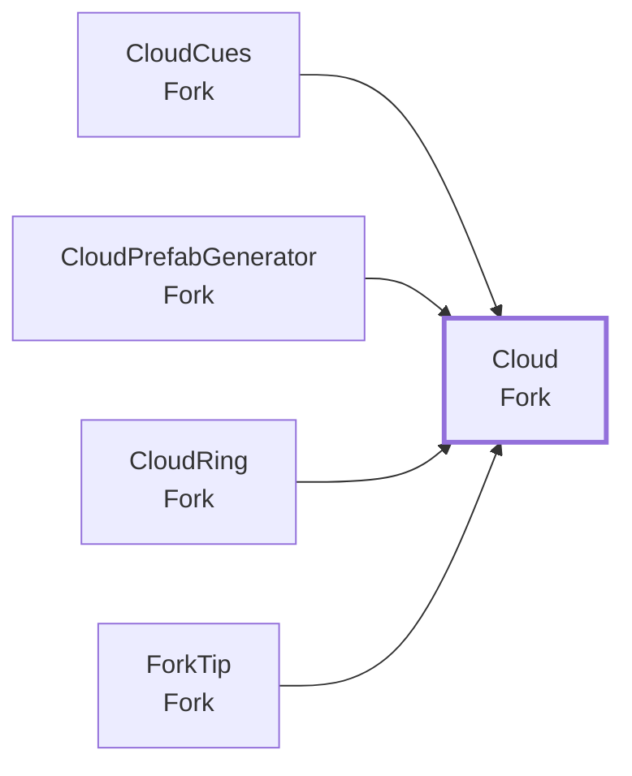
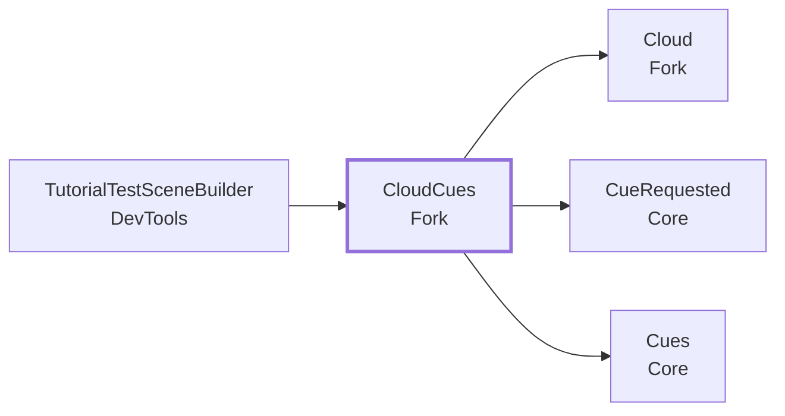
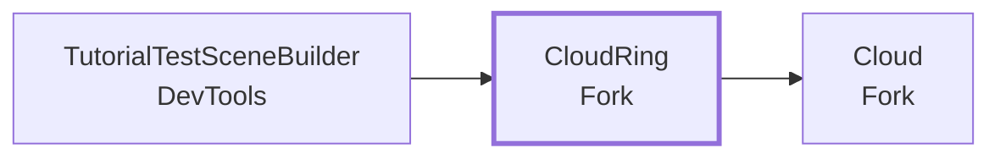
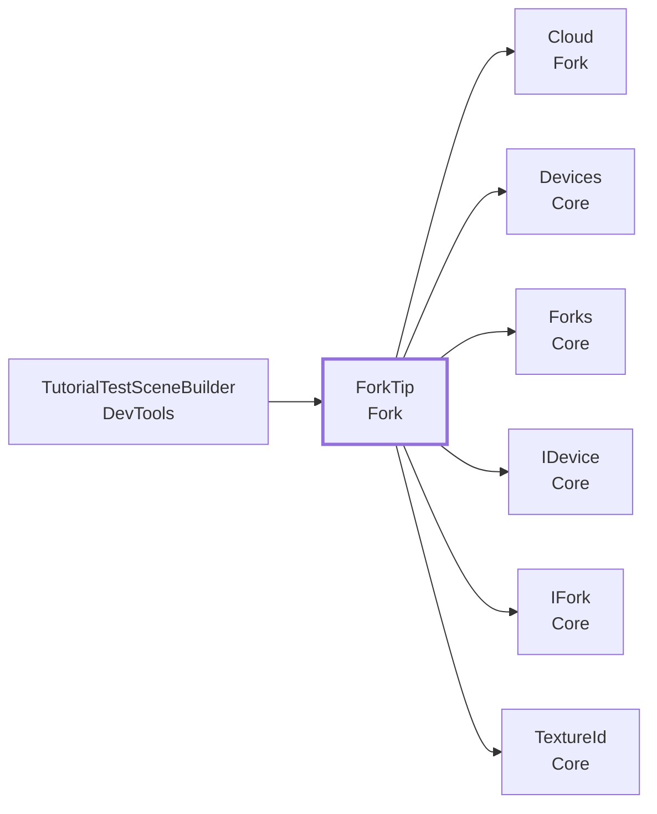

<!-- このページは tools/api_doc/build_md.py が作ります。手で直さないでください。 -->
[入口](README.md) ・ [設計の考え方](design.md) ・ [つながりの図](diagrams.md) ・ [やりたいこと別の手順](recipes.md) ・ [ガイド](guide.md)

# MouthOfGod.Fork

体験者が持つフォークです。雲を刺し、口に含み、決定で食べ終えるまでの状態を持ちます。

## この機能に関わる決まり（なぜこの形か）

- **[置き場に自分で登録する（組み立て役を置かない）](design.md#d-registry)**: 4 つのフィールドは、4 人が別々に作り、最後に 1 つのシーンへまとめます。
- **[チュートリアルは合図を出し、見せ方は受け手が決める](design.md#d-cues)**: チュートリアルの担当者は流れだけを、フィールドの担当者は見せ方だけを直せるようにするためです。

## 型の一覧

| 役割 | 型 | 説明 |
|---|---|---|
| コンポーネント | [`Cloud`](#t-cloud) | フォークで刺せる雲。 |
| コンポーネント | [`CloudCues`](#t-cloudcues) | 雲の合図（Cues）を受けて、雲に見せる。 |
| コンポーネント | [`CloudRing`](#t-cloudring) | 体験者の前に、雲（Cloud）を半円状に浮かべる。 |
| コンポーネント | [`ForkTip`](#t-forktip) | 体験者が持つフォークの先。 |
| エディタ | [`CloudPrefabGenerator`](#t-cloudprefabgenerator) | 雲の Prefab を、白い球を重ねて Assets/Resources/Prefabs/Fork/Cloud.prefab に作る。 |

---

## Cloud

**コンポーネント**（GameObject に付ける）・ `sealed class` ・ 名前空間 `MouthOfGod.Fork` ・ [`Fork/Cloud.cs`](../../Assets/Scripts/Fork/Cloud.cs)
 継承・実装: `MonoBehaviour`

フォークで刺せる雲。当たり判定（Collider）と一緒に、雲の見た目に付ける。刺されると、見た目と当たり判定を隠し、Respawn Seconds たったら戻る。

### しくみ・注意

光らせる・近くへ寄せるなどの見せ方は、ここには書かない。合図（Cues）を受ける側が足す。
当たり判定は、起動時にトリガーにする。体験者が口から飛ばした物が、手前の雲に当たって跳ね返らないようにするため。

### つながり

- この型を使う所: [`CloudCues`](#t-cloudcues)、[`CloudPrefabGenerator`](#t-cloudprefabgenerator)、[`CloudRing`](#t-cloudring)、[`ForkTip`](#t-forktip)

### Inspector（1 項目）

| 項目 | 型 | 既定値 | 説明 |
|---|---|---|---|
| Respawn Seconds | `float` | 3 | 刺されてから、また刺せるようになるまでの秒数。仮の値 |

### メンバー（2）

| 種類 | メンバー | 説明 |
|---|---|---|
| プロパティ | `bool IsAvailable` | いま刺せる（隠れていない）。 |
| メソッド | `void Take()` | 刺された。隠して、時間がたったら戻す。 |

---

## CloudCues

**コンポーネント**（GameObject に付ける）・ `sealed class` ・ 名前空間 `MouthOfGod.Fork` ・ [`Fork/CloudCues.cs`](../../Assets/Scripts/Fork/CloudCues.cs)
 継承・実装: `MonoBehaviour`

雲の合図（[`Cues`](Core.md#t-cues)）を受けて、雲に見せる。[`CloudRing`](#t-cloudring) と同じオブジェクトに付ける（その子の雲を使う）。

### なぜこの形か

- **[チュートリアルは合図を出し、見せ方は受け手が決める](design.md#d-cues)**: チュートリアルの担当者は流れだけを、フィールドの担当者は見せ方だけを直せるようにするためです。

### しくみ・注意

- `cloud.glow`: 体験者の正面にいちばん近い雲を 1 つ選び、色と大きさを脈打たせて光らせる。
- `cloud.approach`: 光らせた雲を、体験者の頭のほうへ寄せる。光らせた雲がなければ、先に 1 つ選ぶ。
- `cloud.calm`: 光を消し、寄せた雲を元の位置へ戻す。
- 光らせた雲が刺されて隠れたら、光と寄せをやめる（戻ってきたときは、ふつうの雲）。
- 雲の位置は CloudRing が毎フレーム決める。寄せる分は、そのあと（LateUpdate）で足す。

### つながり

- この型を使う所: [`TutorialTestSceneBuilder`](DevTools.md#t-tutorialtestscenebuilder)
- この型が使う型: [`Cloud`](#t-cloud)、[`CueRequested`](Core.md#t-cuerequested)、[`Cues`](Core.md#t-cues)

### Inspector（11 項目）

| 項目 | 型 | 既定値 | 説明 |
|---|---|---|---|
| Cloud Root | `Transform` | なし | 雲を探す親。空なら、このオブジェクト（CloudRing）の子から探す |
| **合図の名前** | | | |
| Glow Cue | `string` | `"cloud.glow"` | 雲を 1 つ光らせる合図 |
| Approach Cue | `string` | `"cloud.approach"` | 光る雲を体験者の近くへ寄せる合図 |
| Calm Cue | `string` | `"cloud.calm"` | 光を消し、雲を戻す合図 |
| **光らせ方** | | | |
| Glow Color | `Color` | (1, 0.85, 0.4) | 光るときの色。元の色とこの色のあいだを行き来する |
| Pulse Scale | `float` | 0.15 | 大きさの脈の幅。0.15 なら、元の 1〜1.15 倍のあいだで脈打つ |
| Pulse Per Second | `float` | 1.2 | 1 秒に脈打つ回数 |
| **寄せ方** | | | |
| Approach Meters | `float` | 0.2 | 頭のほうへ寄せる距離（m） |
| Min Head Distance | `float` | 0.25 | 寄せても、頭からこの距離（m）より近くにはしない |
| Approach Seconds | `float` | 1.5 | 寄せきるまでの秒数 |
| Return Seconds | `float` | 1 | 元の位置へ戻りきるまでの秒数 |

---

## CloudRing

**コンポーネント**（GameObject に付ける）・ `sealed class` ・ 名前空間 `MouthOfGod.Fork` ・ [`Fork/CloudRing.cs`](../../Assets/Scripts/Fork/CloudRing.cs)
 継承・実装: `MonoBehaviour`

体験者の前に、雲（[`Cloud`](#t-cloud)）を半円状に浮かべる。体験者が歩くと、ついて来る。シーンのどこか 1 か所に置く。雲の Prefab は Resources/Prefabs/Fork/[`Cloud`](#t-cloud)（メニュー「MouthOfGod/Fork/Generate [`Cloud`](#t-cloud) Prefab」で作る）。

### しくみ・注意

- どこに、いくつ浮かべるかは、まだ決まっていない（シナリオブックの未決事項）。数・半径・高さは仮の値で、Inspector で変えられる。
- 体験者の位置は Main Camera。向きは、置いたときの頭の向きで決め、そのあとは回らない（首を振るたびに雲が動かないように）。

### つながり

- この型を使う所: [`TutorialTestSceneBuilder`](DevTools.md#t-tutorialtestscenebuilder)
- この型が使う型: [`Cloud`](#t-cloud)

### Inspector（7 項目）

| 項目 | 型 | 既定値 | 説明 |
|---|---|---|---|
| Cloud Prefab | `Cloud` | なし | 雲の Prefab。空なら Resources/Prefabs/Fork/Cloud を使う |
| Count | `int` | `5` | 浮かべる雲の数。仮の値 |
| Radius | `float` | 0.45 | 頭から雲までの水平の距離（m）。腕を伸ばして届く所。仮の値 |
| Height | `float` | -0.3 | 頭から見た雲の高さ（m）。マイナスで頭より下。仮の値 |
| Spread Degrees | `float` | 120 | 雲を並べる角度の幅（度）。正面を中心に、この幅に並べる。360 で体験者を囲む |
| Bob Amplitude | `float` | 0.02 | 上下にゆれる幅（m） |
| Follow Speed | `float` | 2 | 体験者について来る速さ。大きいほど早く追いつく |

---

## ForkTip

**コンポーネント**（GameObject に付ける）・ `sealed class` ・ 名前空間 `MouthOfGod.Fork` ・ [`Fork/ForkTip.cs`](../../Assets/Scripts/Fork/ForkTip.cs)
 継承・実装: `MonoBehaviour`、[`IFork`](Core.md#t-ifork)

体験者が持つフォークの先。雲（[`Cloud`](#t-cloud)）に触れたら刺したとし、口に近づいたら口に入ったとする。フォークの先の位置に置く。位置の取り方は知らない。手（ハンドトラッキング）や AprilTag からフォークの位置を推定する部品が、このオブジェクトか親を動かす。有効になると、自分で [`Forks`](Core.md#t-forks) に登録する。

### なぜこの形か

- **[置き場に自分で登録する（組み立て役を置かない）](design.md#d-registry)**: 4 つのフィールドは、4 人が別々に作り、最後に 1 つのシーンへまとめます。

### しくみ・注意

- 刺す: 先の小さな当たり判定（トリガー）が、[`Cloud`](#t-cloud) の当たり判定に入ったとき。
- 口: 先と口の位置の距離で決める。口の位置は `Mouth`。空なら、Main Camera から `Mouth Offset` だけずらした所。
- かけらは、デバイスで決定したときになくなる（食べ物が生まれるのと同じとき）。
- Quest がなくても試せるように、キーで「刺す」「口に入れる（押している間）」を代わりにできる。展示では使わない。

### つながり

- この型を使う所: [`TutorialTestSceneBuilder`](DevTools.md#t-tutorialtestscenebuilder)
- この型が使う型: [`Cloud`](#t-cloud)、[`Devices`](Core.md#t-devices)、[`Forks`](Core.md#t-forks)、[`IDevice`](Core.md#t-idevice)、[`IFork`](Core.md#t-ifork)、[`TextureId`](Core.md#t-textureid)

### Inspector（9 項目）

| 項目 | 型 | 既定値 | 説明 |
|---|---|---|---|
| Mouth | `Transform` | なし | 口の位置。FoodSpawner の Spawn Point と同じ MouthAnchor を入れる。空なら、Main Camera から Mouth Offset だけずらした所 |
| Mouth Offset | `Vector3` | (0, -0.1, 0.1) | Mouth が空のときに使う、Main Camera から見た口の位置（m）。仮の値 |
| Mouth Enter Radius | `float` | 0.06 | 先と口の距離がこれ以下になったら、口に入ったとする（m）。仮の値 |
| Mouth Exit Radius | `float` | 0.09 | 口に入ったあと、これより離れたら出たとする（m）。境目で入る・出るをくり返さないよう、Enter より少し大きくする。仮の値 |
| Tip Radius | `float` | 0.02 | 先の当たり判定の半径（m）。雲に触れたかを見る |
| Loaded Piece | `GameObject` | なし | 刺した雲のかけらの見た目。刺している間だけ表示する。空なら何も出さない |
| Pierce Action | `InputAction` | `new InputAction("Pierce", InputActionType.Button, "<Keyboard>/p")` | Quest なしで試すときの「刺す」。展示では使わない |
| Mouth Action | `InputAction` | `new InputAction("Mouth", InputActionType.Button, "<Keyboard>/m")` | Quest なしで試すときの「口に入れる」（押している間）。M キーのほか、ハンドトラッキングで右手を握っている間も、口の中にあることにする。展示では使わない |
| Log Events | `bool` | オン | 刺す・口・食べたを Console に出す |

### メンバー（6）

| 種類 | メンバー | 説明 |
|---|---|---|
| イベント | `Action Pierced` | 雲を刺した（かけらが付いた）。かけらが付いている間は、もう一度は出ない。（[`IFork`](Core.md#t-ifork) の説明） |
| イベント | `Action MouthEntered` | 先が口に入った。（[`IFork`](Core.md#t-ifork) の説明） |
| イベント | `Action MouthLeft` | 先が口から出た。（[`IFork`](Core.md#t-ifork) の説明） |
| イベント | `Action Emptied` | かけらがなくなった（決定して、食べ物が生まれたとき）。（[`IFork`](Core.md#t-ifork) の説明） |
| プロパティ | `bool IsLoaded` | 先に雲のかけらが付いている。（[`IFork`](Core.md#t-ifork) の説明） |
| プロパティ | `bool InMouth` | 先が口の中にある。（[`IFork`](Core.md#t-ifork) の説明） |

---

## エディタ専用・試験用

### CloudPrefabGenerator

`Fork/Editor/CloudPrefabGenerator.cs`（エディタ）

雲の Prefab を、白い球を重ねて Assets/Resources/Prefabs/Fork/Cloud.prefab に作る。1 回実行して、できた Prefab をコミットする（Play 時には使わない）。既にある Prefab は上書きしない。素材の雲が無いので仮の見た目にしている。素材ができたら、この Prefab の見た目だけを差し替える（Cloud と当たり判定は残す）。

- メニュー: `MouthOfGod/Fork/Generate Cloud Prefab`
