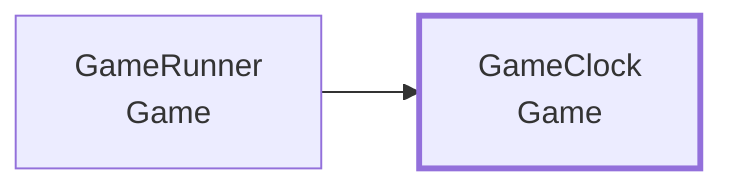
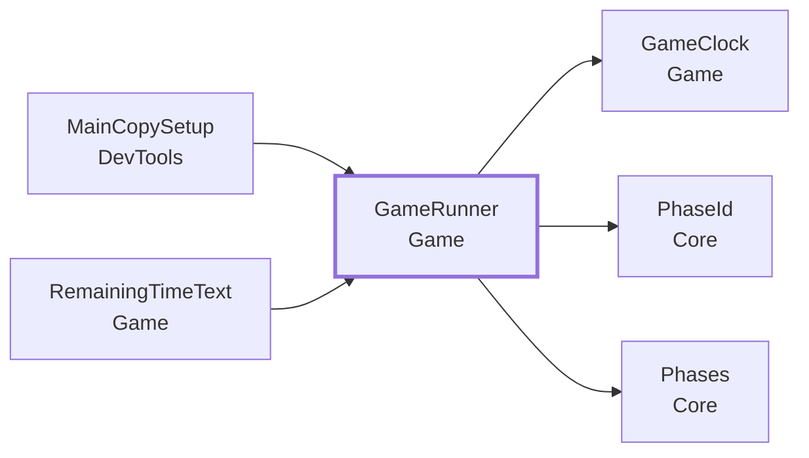
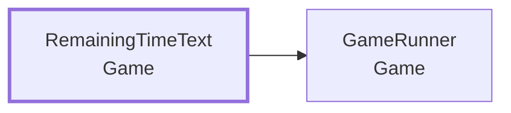

<!-- このページは tools/api_doc/build_md.py が作ります。手で直さないでください。 -->
[入口](README.md) ・ [設計の考え方](design.md) ・ [つながりの図](diagrams.md) ・ [やりたいこと別の手順](recipes.md) ・ [ガイド](guide.md)

# MouthOfGod.Game

本編の進行です。チュートリアルが終わったら本編を始め、制限時間が来たら終わらせます。

## この機能に関わる決まり（なぜこの形か）

- **[中央の進行役を作らない](design.md#d-nocenter)**: 進行役が全部を持つと、何かを足すたびに、全員がその 1 つのファイルを直します。
- **[計算は Unity から切り離して、テストできるようにする](design.md#d-pure)**: Quest をかぶらずに、Play もせずに、EditMode のテストで正しさを確かめられるからです。

## 型の一覧

| 役割 | 型 | 説明 |
|---|---|---|
| コンポーネント | [`GameRunner`](#t-gamerunner) | 本編の進行役。 |
| コンポーネント | [`RemainingTimeText`](#t-remainingtimetext) | GameRunner の残り秒を、指定した TMP_Text に書く最小の表示部品。 |
| クラス | [`GameClock`](#t-gameclock) | 本編の制限時間の時計。 |

---

## GameClock

**クラス**（コードから new して使う）・ `sealed class` ・ 名前空間 `MouthOfGod.Game` ・ [`Game/GameClock.cs`](../../Assets/Scripts/Game/GameClock.cs)

本編の制限時間の時計。Unity に依存しない（Tick に経過秒を渡して進める）。

### なぜこの形か

- **[計算は Unity から切り離して、テストできるようにする](design.md#d-pure)**: Quest をかぶらずに、Play もせずに、EditMode のテストで正しさを確かめられるからです。

### しくみ・注意

- 残り秒、残り `CountdownSeconds` 秒以下か、時間切れか、を持つ。
- `CountdownStarted` と `TimeUp` は、それぞれ 1 回だけ出る。時間切れのあとに Tick しても、何も出ない。
- `RemainingChanged` は、切り上げた残り秒（120.0〜119.01 秒なら 120）が変わったときに出る。
- 一度に大きく進めても、カウントダウン開始 → 残り秒 → 時間切れの順に、出すべきものは出る。

### つながり

- この型を使う所: [`GameRunner`](#t-gamerunner)

### メンバー（11）

| 種類 | メンバー | 説明 |
|---|---|---|
| コンストラクタ | `GameClock(float totalSeconds)` | （説明はコードにありません） |
| イベント | `Action<int> RemainingChanged` | 切り上げた残り秒が変わった（新しい残り秒を運ぶ）。 |
| イベント | `Action CountdownStarted` | 残りが CountdownSeconds 秒以下になった（1 回だけ）。 |
| イベント | `Action TimeUp` | 時間切れになった（1 回だけ）。 |
| プロパティ | `float TotalSeconds { get; }` | （説明はコードにありません） |
| プロパティ | `float Remaining` | 残り秒（0 以上）。 |
| プロパティ | `int RemainingWholeSeconds` | 切り上げた残り秒。UI に出す数。 |
| プロパティ | `bool IsCountdown` | 残り CountdownSeconds 秒以下（時間切れも含む）。 |
| プロパティ | `bool IsTimeUp` | （説明はコードにありません） |
| 定数 | `const float CountdownSeconds` | カウントダウンを始める残り秒。 |
| メソッド | `void Tick(float deltaSeconds)` | 経過秒だけ進める。0 以下の値と、時間切れのあとの呼び出しは何もしない。 |

---

## GameRunner

**コンポーネント**（GameObject に付ける）・ `sealed class` ・ 名前空間 `MouthOfGod.Game` ・ [`Game/GameRunner.cs`](../../Assets/Scripts/Game/GameRunner.cs)
 継承・実装: `MonoBehaviour`

本編の進行役。チュートリアルが終わったら本編（場面 main-game）を始め、制限時間が来たら終わらせる（場面 game-over）。時間の計算は [`GameClock`](#t-gameclock)。ここは Unity とつなぐだけ。

### なぜこの形か

- **[中央の進行役を作らない](design.md#d-nocenter)**: 進行役が全部を持つと、何かを足すたびに、全員がその 1 つのファイルを直します。

### しくみ・注意

- チュートリアルとの接続は「場面を見る」案（A）にした。チュートリアルは全部終わると場面を空に戻すので、
  `Changed` で「`afterPhase`（既定 deliver）のあとに場面が空になった」を見て `Begin` する。
  Tutorial の型を参照せず、手でつなぐ設定も要らない（Play するだけで動く）。UnityEvent で手つなぎする案（B）は、Play 後の手作業が残るので選ばなかった。
  最後のチュートリアルの場面名を変えたら、`afterPhase` を合わせる（docs/progress-keys.md）。
- 本編を始めるときに、フィールドは初期化しない（チュートリアルで戻した村をそのまま使う。Restart は体験の終わりで呼ぶ側が決める）。
- 時間切れで、出ている欲しい物や飛んでいる食べ物は消さない（Core にそれをする手段が無い）。
- 制限時間の既定 120 秒は仮。

### つながり

- この型を使う所: [`MainCopySetup`](DevTools.md#t-maincopysetup)、[`RemainingTimeText`](#t-remainingtimetext)
- この型が使う型: [`GameClock`](#t-gameclock)、[`PhaseId`](Core.md#t-phaseid)、[`Phases`](Core.md#t-phases)

### この型を使う手順

- [本編で欲しい物を出す](recipes.md#r-open-request)

### Inspector（2 項目）

| 項目 | 型 | 既定値 | 説明 |
|---|---|---|---|
| Time Limit Seconds | `float` | 120 | 本編の制限時間（秒）。120 は仮の値 |
| After Phase | `string` | `"deliver"` | この場面が終わって場面が空になったら、本編を始める（最後のチュートリアルの場面名。空にすると自動では始めない） |

### メンバー（6）

| 種類 | メンバー | 説明 |
|---|---|---|
| イベント | `Action<int> RemainingChanged` | 残り秒（切り上げ）が変わった。本編の開始時にも最初の値を出す。 |
| イベント | `Action CountdownStarted` | 残り 10 秒以下になった（カウントダウン開始。1 回）。 |
| イベント | `Action TimeUp` | 時間切れ（1 回）。場面を game-over にしてから出す。 |
| プロパティ | `bool IsRunning` | 本編が動いている。 |
| プロパティ | `float Remaining` | 残り秒。本編が始まる前は制限時間。 |
| メソッド | `void Begin()` | 本編を始める（場面を main-game にして、時計を動かす）。動いている間に呼ぶと、はじめからやり直す。 |

---

## RemainingTimeText

**コンポーネント**（GameObject に付ける）・ `sealed class` ・ 名前空間 `MouthOfGod.Game` ・ [`Game/RemainingTimeText.cs`](../../Assets/Scripts/Game/RemainingTimeText.cs)
 継承・実装: `MonoBehaviour`

[`GameRunner`](#t-gamerunner) の残り秒を、指定した TMP_Text に書く最小の表示部品。置き場所と見た目は、シーンを組む人が決める。

### つながり

- この型が使う型: [`GameRunner`](#t-gamerunner)

### Inspector（2 項目）

| 項目 | 型 | 既定値 | 説明 |
|---|---|---|---|
| Text | `TMP_Text` | なし | 残り秒を書く先 |
| Runner | `GameRunner` | なし | 残り秒を知らせる本編の進行役 |
