<!-- このページは tools/api_doc/build_md.py が作ります。手で直さないでください。 -->
[入口](README.md) ・ [設計の考え方](design.md) ・ [つながりの図](diagrams.md) ・ [やりたいこと別の手順](recipes.md) ・ [ガイド](guide.md)

# MouthOfGod.Miko

巫女です。浮いて、体験者の方を向き、しゃべり、表情を変え、指さし、体験者についてきます。身振りは Animator が担当します。

## この機能に関わる決まり（なぜこの形か）

- **[作業の単位と、ファイルの単位をそろえる](design.md#d-files)**: シーンや Prefab は、Git でマージできないからです。
- **[チュートリアルは合図を出し、見せ方は受け手が決める](design.md#d-cues)**: チュートリアルの担当者は流れだけを、フィールドの担当者は見せ方だけを直せるようにするためです。
- **[チュートリアルは 1 本ずつ Prefab にし、セリフもその中に持つ](design.md#d-tutprefab)**: チュートリアルは、担当者が並行して作ります。
- **[計算は Unity から切り離して、テストできるようにする](design.md#d-pure)**: Quest をかぶらずに、Play もせずに、EditMode のテストで正しさを確かめられるからです。

## 型の一覧

| 役割 | 型 | 説明 |
|---|---|---|
| コンポーネント | [`MikoCueReceiver`](#t-mikocuereceiver) | 合図（Cues）のうち、名前が miko. で始まるものを受けて、巫女に身振りをさせる。 |
| コンポーネント | [`MikoFace`](#t-mikoface) | 巫女の表情を切り替える。 |
| コンポーネント | [`MikoFloat`](#t-mikofloat) | 巫女を、人が宙に浮いているように見せる。 |
| コンポーネント | [`MikoLineBook`](#t-mikolinebook) | 巫女のセリフの一覧。 |
| コンポーネント | [`MikoMover`](#t-mikomover) | 巫女を動かす。 |
| コンポーネント | [`MikoPointer`](#t-mikopointer) | 指さしの腕を、指さし先の方へ向ける。 |
| コンポーネント | [`MikoSpeech`](#t-mikospeech) | 巫女にしゃべらせる。 |
| データ | [`MikoLine`](#t-mikoline) | 巫女のセリフ 1 つ。 |
| 選択肢（enum） | [`MikoExpression`](#t-mikoexpression) | 表情。 |
| 選択肢（enum） | [`MikoEye`](#t-mikoeye) | 目の形（Miko_Eyes.png の絵の順番）。 |
| 選択肢（enum） | [`MikoMode`](#t-mikomode) | 巫女の居場所の決め方。 |
| クラス | [`MikoLineQueue`](#t-mikolinequeue) | しゃべっている間に来たセリフの順番待ち。 |
| エディタ | [`MikoPrefabGenerator`](#t-mikoprefabgenerator) | 巫女の Prefab と、身振りのアニメーション（浮いて待つ・指さす）を、Assets/Resources/Prefabs/Miko/ に作る。 |

---

## MikoCueReceiver

**コンポーネント**（GameObject に付ける）・ `sealed class` ・ 名前空間 `MouthOfGod.Miko` ・ [`Miko/MikoCueReceiver.cs`](../../Assets/Scripts/Miko/MikoCueReceiver.cs)
 継承・実装: `MonoBehaviour`

合図（[`Cues`](Core.md#t-cues)）のうち、名前が miko. で始まるものを受けて、巫女に身振りをさせる。受けた合図は、すべて Console に出す。

### なぜこの形か

- **[チュートリアルは合図を出し、見せ方は受け手が決める](design.md#d-cues)**: チュートリアルの担当者は流れだけを、フィールドの担当者は見せ方だけを直せるようにするためです。

### つながり

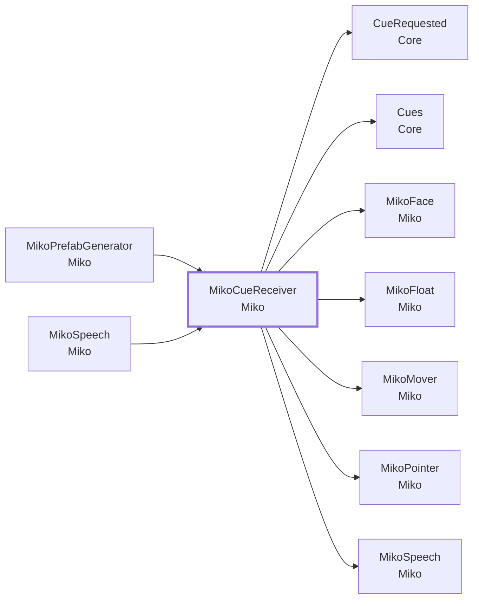

- この型を使う所: [`MikoPrefabGenerator`](#t-mikoprefabgenerator)、[`MikoSpeech`](#t-mikospeech)
- この型が使う型: [`CueRequested`](Core.md#t-cuerequested)、[`Cues`](Core.md#t-cues)、[`MikoFace`](#t-mikoface)、[`MikoFloat`](#t-mikofloat)、[`MikoMover`](#t-mikomover)、[`MikoPointer`](#t-mikopointer)、[`MikoSpeech`](#t-mikospeech)

### Inspector（3 項目）

| 項目 | 型 | 既定値 | 説明 |
|---|---|---|---|
| Animator | `Animator` | なし |  |
| Point Target | `Transform` | なし | 指さす先の既定。セリフに指さす物が無いときに使う |
| Point Look Seconds | `float` | 3 | 指さしたあと、その方を向いている時間 |

### メンバー（2）

| 種類 | メンバー | 説明 |
|---|---|---|
| メソッド | `void PointAt(Transform target)` | target の方を向いて、指さしをする。target が空なら、既定の先（Point Target）を使う。 |
| メソッド | `void Point()` | 指さしをする。 |

### メニュー

- 右クリック: `Point`

---

## MikoExpression

**選択肢（enum）**（決まった値の中から選ぶ）・ `enum` ・ 名前空間 `MouthOfGod.Miko` ・ [`Miko/MikoFace.cs`](../../Assets/Scripts/Miko/MikoFace.cs)

表情。左右の目の形の組み合わせ。

### つながり

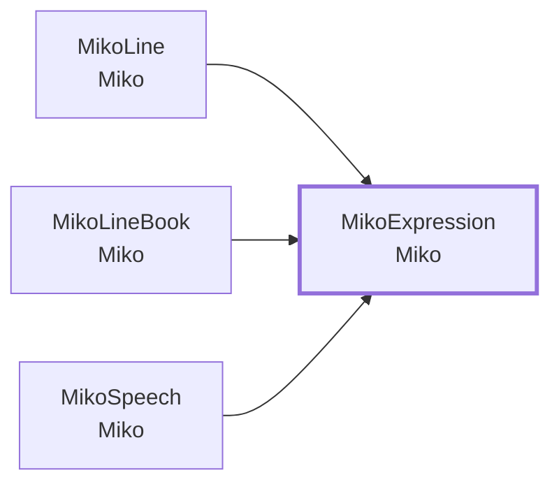

- この型を使う所: [`MikoLine`](#t-mikoline)、[`MikoLineBook`](#t-mikolinebook)、[`MikoSpeech`](#t-mikospeech)

### 値

| 値 | 意味 |
|---|---|
| `Normal` | ●● |
| `Happy` | ^^ |
| `Squint` | ＞＜ |
| `Love` | ♡♡ |
| `Sleep` | ーー |
| `Wink` | ー・ |
| `Tired` | ∪∪ |

---

## MikoEye

**選択肢（enum）**（決まった値の中から選ぶ）・ `enum` ・ 名前空間 `MouthOfGod.Miko` ・ [`Miko/MikoFace.cs`](../../Assets/Scripts/Miko/MikoFace.cs)

目の形（Miko_Eyes.png の絵の順番）。

### 値

| 値 | 意味 |
|---|---|
| `Open` |  |
| `Line` |  |
| `Happy` |  |
| `Gt` |  |
| `Lt` |  |
| `Heart` |  |
| `Dot` |  |
| `Sleepy` |  |

---

## MikoFace

**コンポーネント**（GameObject に付ける）・ `sealed class` ・ 名前空間 `MouthOfGod.Miko` ・ [`Miko/MikoFace.cs`](../../Assets/Scripts/Miko/MikoFace.cs)
 継承・実装: `MonoBehaviour`

巫女の表情を切り替える。目は、顔に貼った 2 枚の板（Quad）に、絵（8 コマ）の 1 コマを映して変える。表情が Normal のときは、ときどきまばたきをする。

### つながり

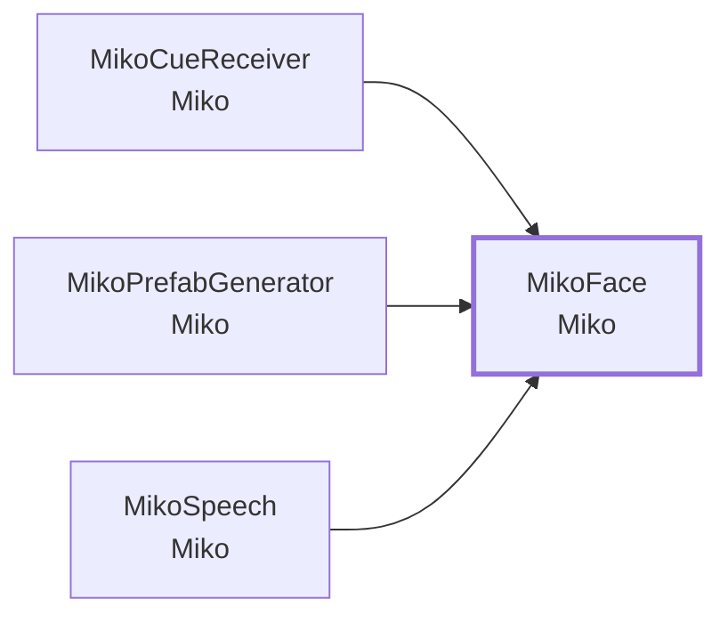

- この型を使う所: [`MikoCueReceiver`](#t-mikocuereceiver)、[`MikoPrefabGenerator`](#t-mikoprefabgenerator)、[`MikoSpeech`](#t-mikospeech)

### Inspector（5 項目）

| 項目 | 型 | 既定値 | 説明 |
|---|---|---|---|
| Viewer Left Eye | `Renderer` | なし | 見ている人から見て左の目 |
| Viewer Right Eye | `Renderer` | なし |  |
| Expression | `MikoExpression` | Normal |  |
| Blink Interval | `Vector2` | (2.5, 5) | まばたきの間隔（秒） |
| Blink Seconds | `float` | 0.12 |  |

### メンバー（3）

| 種類 | メンバー | 説明 |
|---|---|---|
| プロパティ | `MikoExpression Expression` | （説明はコードにありません） |
| メソッド | `void Set(MikoExpression value)` | 表情を変える。 |
| メソッド | `bool Set(string name)` | 名前（normal / happy / squint / love / sleep / wink / tired）で変える。分からない名前なら false。 |

### メニュー

- 右クリック: `表情: ふつう`
- 右クリック: `表情: にっこり`
- 右クリック: `表情: ＞＜`
- 右クリック: `表情: ♡♡`
- 右クリック: `表情: ーー`
- 右クリック: `表情: ー・`
- 右クリック: `表情: ∪∪`

---

## MikoFloat

**コンポーネント**（GameObject に付ける）・ `sealed class` ・ 名前空間 `MouthOfGod.Miko` ・ [`Miko/MikoFloat.cs`](../../Assets/Scripts/Miko/MikoFloat.cs)
 継承・実装: `MonoBehaviour`

巫女を、人が宙に浮いているように見せる。ゆっくり上下に揺れ、プレイヤー（メインカメラ）の方を向く。動かすのは、このコンポーネントが付いた一番上のオブジェクトだけ。身振りは Animator が担当する。居場所（揺れの中心）は Anchor で、[`MikoMover`](#t-mikomover) が動かす。

### つながり

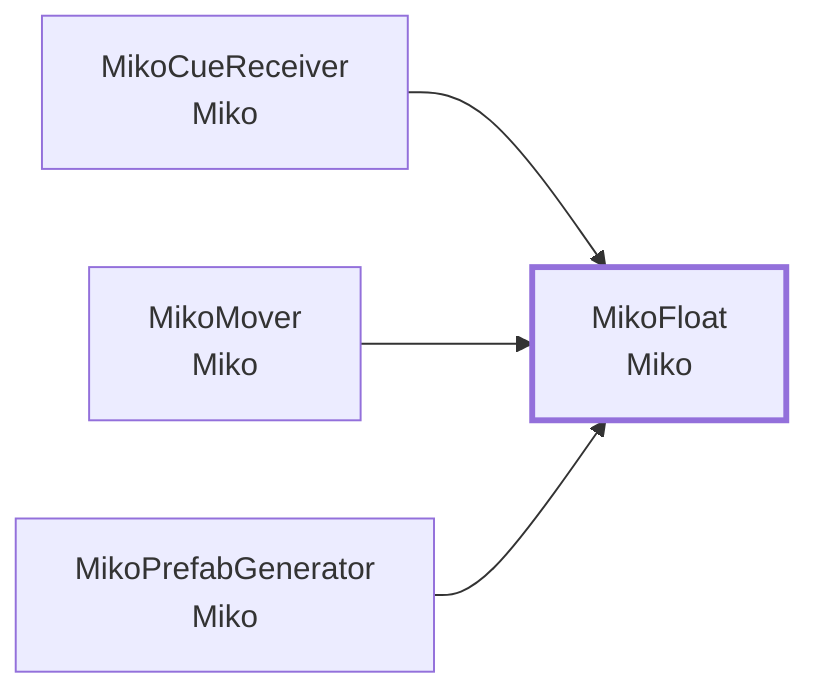

- この型を使う所: [`MikoCueReceiver`](#t-mikocuereceiver)、[`MikoMover`](#t-mikomover)、[`MikoPrefabGenerator`](#t-mikoprefabgenerator)

### Inspector（3 項目）

| 項目 | 型 | 既定値 | 説明 |
|---|---|---|---|
| Amplitude | `float` | 0.01 | 上下の揺れの幅（m） |
| Period | `float` | 2.5 | 揺れの周期（秒） |
| Turn Speed | `float` | 180 | 向きを変える速さ（度 / 秒） |

### メンバー（2）

| 種類 | メンバー | 説明 |
|---|---|---|
| プロパティ | `Vector3 Anchor` | 揺れの中心（世界座標）。 |
| プロパティ | `Transform LookAt { get; set; }` | 向く相手。空なら、プレイヤー（メインカメラ）の方を向く。 |

---

## MikoLine

**データ**（値を運ぶ型）・ `sealed class` ・ 名前空間 `MouthOfGod.Miko` ・ [`Miko/MikoLine.cs`](../../Assets/Scripts/Miko/MikoLine.cs)

巫女のセリフ 1 つ。合図 miko.say.<id> で出る。シーンの Miko の [`MikoSpeech`](#t-mikospeech) に並べる。

Inspector では、配列や List の 1 要素として見えます（`[Serializable]`）。

### なぜこの形か

- **[チュートリアルは 1 本ずつ Prefab にし、セリフもその中に持つ](design.md#d-tutprefab)**: チュートリアルは、担当者が並行して作ります。

### つながり

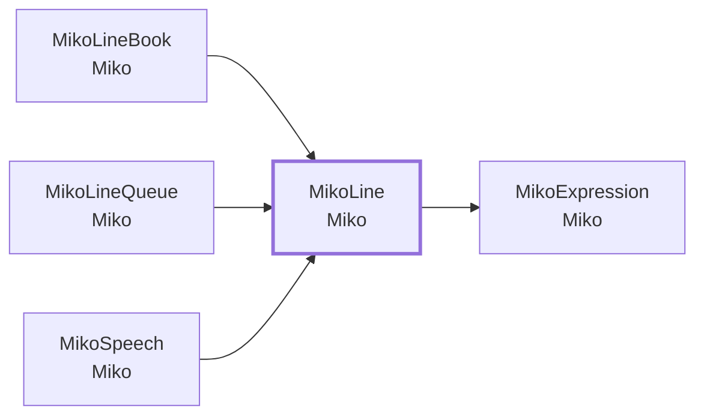

- この型を使う所: [`MikoLineBook`](#t-mikolinebook)、[`MikoLineQueue`](#t-mikolinequeue)、[`MikoSpeech`](#t-mikospeech)
- この型が使う型: [`MikoExpression`](#t-mikoexpression)

### Inspector（10 項目）

| 項目 | 型 | 既定値 | 説明 |
|---|---|---|---|
| Id | `string` | 空 |  |
| Text | `string` | 空 |  |
| Voice | `AudioClip` | なし | 空なら、字幕だけ出す |
| Change Expression | `bool` | オフ |  |
| Expression | `MikoExpression` | なし |  |
| Point | `bool` | オフ | しゃべりはじめに指さしをする |
| Point Target | `Transform` | なし | 指さす物。空なら、MikoCueReceiver の Point Target（それも空なら向きを変えない） |
| Move To | `Transform` | なし | しゃべりはじめに、この場所へ飛んで行く。空なら、動かない |
| Speak After Move | `bool` | オフ | 入れると、着いてからしゃべる。外すと、動きながらしゃべる |
| Seconds | `float` | 0 | 字幕を出している長さ。0 なら、音声の長さか文字数から決まる |

---

## MikoLineBook

**コンポーネント**（GameObject に付ける）・ `sealed class` ・ 名前空間 `MouthOfGod.Miko` ・ [`Miko/MikoLineBook.cs`](../../Assets/Scripts/Miko/MikoLineBook.cs)
 継承・実装: `MonoBehaviour`

巫女のセリフの一覧。文・声・指さす物を、セリフごとに入れる。[`MikoSpeech`](#t-mikospeech) が、合図 miko.say.<id> の id で引く。

### なぜこの形か

- **[作業の単位と、ファイルの単位をそろえる](design.md#d-files)**: シーンや Prefab は、Git でマージできないからです。
- **[チュートリアルは 1 本ずつ Prefab にし、セリフもその中に持つ](design.md#d-tutprefab)**: チュートリアルは、担当者が並行して作ります。

### しくみ・注意

- 置き場所は 2 つある。巫女の共通のセリフは、Prefab の Miko の子（LineBook）に置く。
  チュートリアルなど場面ごとのセリフは、その場面のオブジェクトに置く。担当者が、自分の場面のセリフだけを直せるようにするため。
- 有効な LineBook は、シーンのどこにあっても引ける（`FindAny`）。id はシーン全体で重ならないようにする。重なると、警告を出す。
- 指さす物はシーンの物なので、シーンに置いた LineBook で入れる。

### つながり

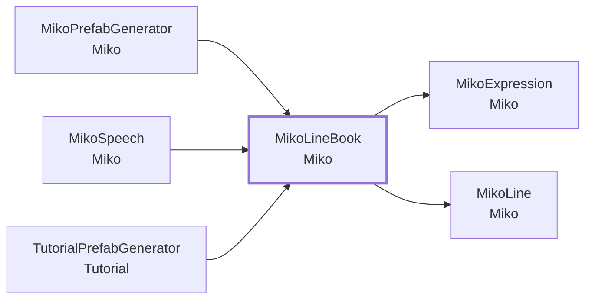

- この型を使う所: [`MikoPrefabGenerator`](#t-mikoprefabgenerator)、[`MikoSpeech`](#t-mikospeech)、[`TutorialPrefabGenerator`](Tutorial.md#t-tutorialprefabgenerator)
- この型が使う型: [`MikoExpression`](#t-mikoexpression)、[`MikoLine`](#t-mikoline)

### この型を使う手順

- [新しいチュートリアルを足す](recipes.md#r-tutorial-new)

### Inspector（1 項目）

| 項目 | 型 | 既定値 | 説明 |
|---|---|---|---|
| Lines | `List<MikoLine>` | 空 |  |

### メンバー（3）

| 種類 | メンバー | 説明 |
|---|---|---|
| プロパティ | `IEnumerable<string> Ids` | この一覧の id。 |
| メソッド | `MikoLine Find(string id)` | id のセリフを探す。無ければ null。 |
| メソッド | `static MikoLine FindAny(string id)` | 有効なすべての LineBook から、id のセリフを探す。先に有効になった LineBook を先に見る。無ければ null。 |

---

## MikoLineQueue

**クラス**（コードから new して使う）・ `sealed class` ・ 名前空間 `MouthOfGod.Miko` ・ [`Miko/MikoLineQueue.cs`](../../Assets/Scripts/Miko/MikoLineQueue.cs)

しゃべっている間に来たセリフの順番待ち。新しいセリフだけを 1 つ残す（古い待ちは捨てる）。早く進める体験者でも、いま起きたことへの反応（「Splendid!」など）が、古いセリフに遅れないようにするため。

### なぜこの形か

- **[計算は Unity から切り離して、テストできるようにする](design.md#d-pure)**: Quest をかぶらずに、Play もせずに、EditMode のテストで正しさを確かめられるからです。

### つながり

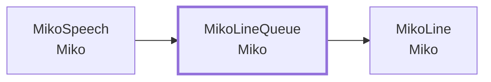

- この型を使う所: [`MikoSpeech`](#t-mikospeech)
- この型が使う型: [`MikoLine`](#t-mikoline)

### メンバー（5）

| 種類 | メンバー | 説明 |
|---|---|---|
| プロパティ | `bool HasWaiting` | （説明はコードにありません） |
| メソッド | `void Enqueue(MikoLine line)` | 待たせる。すでに待っているセリフがあれば、捨てて置き換える。 |
| メソッド | `MikoLine Dequeue()` | 待っているセリフを返して、空にする。無ければ null。 |
| メソッド | `void Clear()` | （説明はコードにありません） |
| メソッド | `static float CutAt(float hideAt, float shownAt, float minShowSeconds, float now)` | いま出ているセリフを、いつ切り上げるか。出しはじめから minShowSeconds 秒は見せる。もともとの終わりの時刻（hideAt）より遅くはしない。 |

---

## MikoMode

**選択肢（enum）**（決まった値の中から選ぶ）・ `enum` ・ 名前空間 `MouthOfGod.Miko` ・ [`Miko/MikoMover.cs`](../../Assets/Scripts/Miko/MikoMover.cs)

巫女の居場所の決め方。

### つながり

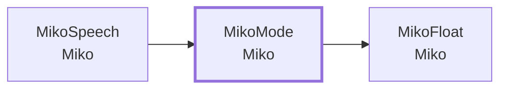

- この型を使う所: [`MikoSpeech`](#t-mikospeech)
- この型が使う型: [`MikoFloat`](#t-mikofloat)

### 値

| 値 | 意味 |
|---|---|
| `Stay` | いまの場所にいる |
| `Go` | 指定の場所（Transform）へ行って、着いたら Stay になる |
| `Follow` | プレイヤーのそばについてくる |

---

## MikoMover

**コンポーネント**（GameObject に付ける）・ `sealed class` ・ 名前空間 `MouthOfGod.Miko` ・ [`Miko/MikoMover.cs`](../../Assets/Scripts/Miko/MikoMover.cs)
 継承・実装: `MonoBehaviour`
 属性: `[RequireComponent(typeof(MikoFloat))]`

巫女を動かす。開発者が決めた場所へ行くか、プレイヤーについてくるか、その場にいるかを切り替える。

### つながり

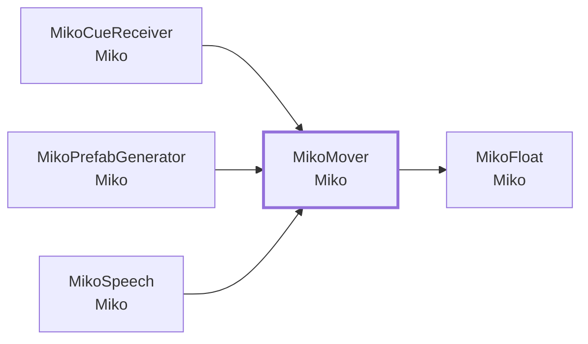

- この型を使う所: [`MikoCueReceiver`](#t-mikocuereceiver)、[`MikoPrefabGenerator`](#t-mikoprefabgenerator)、[`MikoSpeech`](#t-mikospeech)
- この型が使う型: [`MikoFloat`](#t-mikofloat)

### Inspector（11 項目）

| 項目 | 型 | 既定値 | 説明 |
|---|---|---|---|
| Mode | `MikoMode` | Stay |  |
| Move Speed | `float` | 0.75 | Go のときの速さ（m / 秒） |
| **Follow** | | | |
| Follow Distance | `float` | 1.2 | プレイヤーの前、この距離 |
| Follow Side | `float` | 0.5 | プレイヤーの右、この距離（負で左） |
| Follow Height | `float` | -0.15 | 目の高さから、この高さ |
| Follow Speed | `float` | 2.5 | 追いつく速さ（m / 秒） |
| Follow Dead Zone | `float` | 0.4 | 目標から横にこの距離までは、動かない |
| Follow Pitch | `float` | 0.6 | 顔の上下の向きを取り入れる割合（0 で水平、1 で顔の向きどおり） |
| Follow Height Speed | `float` | 3 | 高さを追いつく速さ（m / 秒） |
| Follow Height Dead Zone | `float` | 0.08 | 目標から高さにこの距離までは、動かない |
| **なめらかさ** | | | |
| Smooth Time | `float` | 0.45 | 目標に追いつくまでの目安（秒）。大きいほど、ゆったり動く |

### メンバー（4）

| 種類 | メンバー | 説明 |
|---|---|---|
| プロパティ | `MikoMode Mode` | （説明はコードにありません） |
| メソッド | `void Stay()` | その場にいる。 |
| メソッド | `void Follow()` | プレイヤーについてくる。 |
| メソッド | `void GoTo(Transform goal)` | 目印へ行く。着いたら、その場にいる。 |

---

## MikoPointer

**コンポーネント**（GameObject に付ける）・ `sealed class` ・ 名前空間 `MouthOfGod.Miko` ・ [`Miko/MikoPointer.cs`](../../Assets/Scripts/Miko/MikoPointer.cs)
 継承・実装: `MonoBehaviour`

指さしの腕を、指さし先の方へ向ける。アニメーションの腕は「前やや上」に決まっているので、 Animator のあとで、右腕を指さし先へ回す。体の向きは [`MikoFloat`](#t-mikofloat) が合わせる。

### つながり

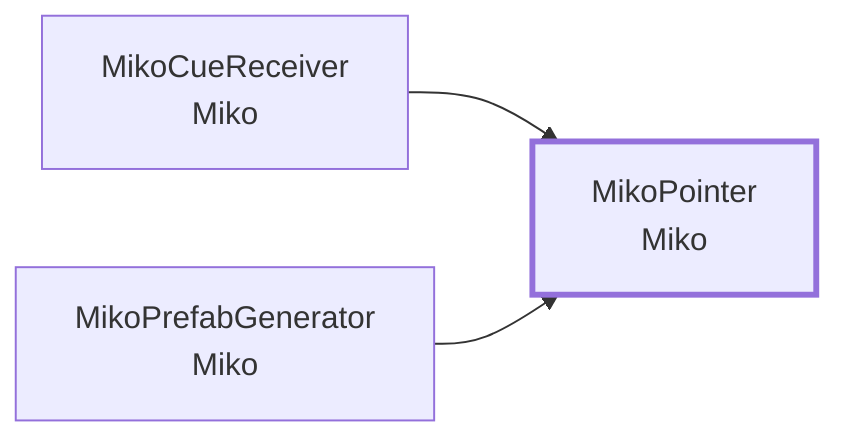

- この型を使う所: [`MikoCueReceiver`](#t-mikocuereceiver)、[`MikoPrefabGenerator`](#t-mikoprefabgenerator)

### メンバー（1）

| 種類 | メンバー | 説明 |
|---|---|---|
| メソッド | `void Begin(Transform target)` | target へ向けて指さす。アニメーションを始める合図と同時に呼ぶ。 |

---

## MikoSpeech

**コンポーネント**（GameObject に付ける）・ `sealed class` ・ 名前空間 `MouthOfGod.Miko` ・ [`Miko/MikoSpeech.cs`](../../Assets/Scripts/Miko/MikoSpeech.cs)
 継承・実装: `MonoBehaviour`

巫女にしゃべらせる。セリフの一覧（[`MikoLineBook`](#t-mikolinebook)）から id で引いて、字幕を出し、音声を鳴らし、表情と指さしをつける。字幕は、見ている人の視線の少し下に出す。頭を回す・見下ろすと、ゆっくり追う。台のミニチュアより手前に置き、ほかの物に隠れないように描く。

### つながり

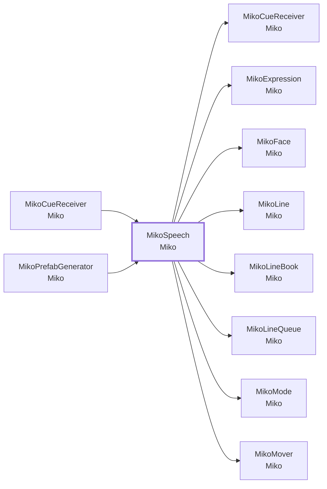

- この型を使う所: [`MikoCueReceiver`](#t-mikocuereceiver)、[`MikoPrefabGenerator`](#t-mikoprefabgenerator)
- この型が使う型: [`MikoCueReceiver`](#t-mikocuereceiver)、[`MikoExpression`](#t-mikoexpression)、[`MikoFace`](#t-mikoface)、[`MikoLine`](#t-mikoline)、[`MikoLineBook`](#t-mikolinebook)、[`MikoLineQueue`](#t-mikolinequeue)、[`MikoMode`](#t-mikomode)、[`MikoMover`](#t-mikomover)

### Inspector（12 項目）

| 項目 | 型 | 既定値 | 説明 |
|---|---|---|---|
| Voice Source | `AudioSource` | なし |  |
| Font | `Font` | なし | 空なら、Unity 組み込みのフォント（英語向け）。日本語を出すときは指定する |
| Subtitle Distance Meters | `float` | 0.7 | 見ている人から字幕までの距離（m）。台のミニチュア（およそ 0.9 m 先）より手前にする |
| Seconds Per Character | `float` | 0.06 | 字幕の長さ（秒）= 文字数 × この値 + 余白。Seconds が 0 で、音声もないときに使う。英語を読む速さの目安 |
| Subtitle Padding Seconds | `float` | 1.5 | 字幕の長さの余白（秒）。読み始めるまでの間 |
| Min Subtitle Seconds | `float` | 2 | 字幕の長さの下限（秒）。短いセリフでも、これだけは出す |
| Min Show Seconds | `float` | 1 | 言っている最中に次のセリフが来たとき、いまのセリフを最低これだけ（秒）は見せてから、次のセリフに移る |
| Subtitle Below Gaze | `float` | 12 | 視線より、この角度だけ下に出す（度）。見ている物を字幕でふさがないため |
| Pitch Range | `Vector2` | (-55, 10) | 見下ろす・見上げるのに合わせて、字幕の上下を追う範囲（度。下が負）。台を見下ろしても字幕が視界に入るようにする |
| Subtitle Width Meters | `float` | 0.55 | 字幕の幅（m）。文字の大きさも、幅に合わせて変わる |
| Follow Speed | `float` | 3 | 頭を回したとき、字幕が追いかける速さ |
| Always On Top | `bool` | オン | 入れると、字幕をほかの物より前に描く（村や雲に埋もれない） |

### メンバー（3）

| 種類 | メンバー | 説明 |
|---|---|---|
| プロパティ | `bool IsSpeaking` | （説明はコードにありません） |
| メソッド | `bool Say(string id)` | id のセリフをしゃべる。見つからなければ false。 |
| メソッド | `void Hush()` | しゃべるのをやめて、字幕を消す。順番待ちのセリフも捨てる。 |

### メニュー

- 右クリック: `テスト: 最初のセリフ`

---

## エディタ専用・試験用

### MikoPrefabGenerator

`Miko/Editor/MikoPrefabGenerator.cs`（エディタ）

巫女の Prefab と、身振りのアニメーション（浮いて待つ・指さす）を、Assets/Resources/Prefabs/Miko/ に作る。素材は Assets/ArtisticResources/ThirdParty/Miko-san.fbx（Generic）。骨の名前と、取り込んだ骨の位置から、向きと左右を調べて作る。軸の値は決め打ちしない。何度実行してもよい。Prefab とクリップは同じ場所に上書きするので、GUID は変わらない。

- メニュー: `MouthOfGod/Miko/Generate Prefab`
