<!-- このページは tools/api_doc/build_md.py が作ります。手で直さないでください。 -->
[入口](README.md) ・ [設計の考え方](design.md) ・ [つながりの図](diagrams.md) ・ [やりたいこと別の手順](recipes.md) ・ [ガイド](guide.md)

# MouthOfGod.Tracking

AprilTag とハンドトラッキングで、位置を合わせます。ほかの機能には、`Transform` と追跡中かどうかだけを渡します。

## この機能に関わる決まり（なぜこの形か）

- **[Play の前に、手作業を要らなくする](design.md#d-noprep)**: 手で入れるつなぎは、付け忘れると動きません。
- **[計算は Unity から切り離して、テストできるようにする](design.md#d-pure)**: Quest をかぶらずに、Play もせずに、EditMode のテストで正しさを確かめられるからです。
- **[共有シーンは 1 つにし、動画も同じシーンで流す](design.md#d-scene)**: シーンを分けると、重ねて読み込む仕組み、シーンの間の位置合わせ、他の人のシーンと合わせる手間が要ります。

## 型の一覧

| 役割 | 型 | 説明 |
|---|---|---|
| コンポーネント | [`AprilTagDetectionService`](#t-apriltagdetectionservice) | パススルーカメラの RGB フレームから AprilTag を検出し、ワールド座標の姿勢を IAprilTagSource として公開する。 |
| コンポーネント | [`AprilTagPlace`](#t-apriltagplace) | 指定した ID の AprilTag の位置に、対象の Transform（既定は自分自身）を合わせる。 |
| コンポーネント | [`AprilTagRecalibrateInput`](#t-apriltagrecalibrateinput) | タグの位置の取り直しを、アプリ内の入力で行う。 |
| コンポーネント | [`HandHeldPose`](#t-handheldpose) | 手（ハンドトラッキング）の位置に、オフセットを足して、手に持ったものの先の位置に自分を動かす。 |
| 設定アセット | [`AprilTagSettings`](#t-apriltagsettings) | AprilTag 検出の設定。 |
| static（置き場・計算） | [`AprilTagGeometry`](#t-apriltaggeometry) | カメラの内部パラメータの換算と、座標変換。 |
| データ | [`AprilTagObservation`](#t-apriltagobservation) | ある 1 フレームで検出された AprilTag 1 枚分の結果。 |
| データ | [`ImageIntrinsics`](#t-imageintrinsics) | 現在の画像（ピクセル）に換算した内部パラメータ。 |
| interface | [`IAprilTagSource`](#t-iapriltagsource) | AprilTag の検出結果の供給元。 |
| クラス | [`HandHeldTip`](#t-handheldtip) | 手の姿勢から、手に持ったもの（フォークなど）の先の姿勢を出す。 |
| クラス | [`PoseCalibrator`](#t-posecalibrator) | 複数の観測を集め、外れ値を除いて平均した 1 つの姿勢を返す。 |
| クラス | [`PoseTracker`](#t-posetracker) | 1 枚のタグの追跡状態。 |

---

## AprilTagDetectionService

**コンポーネント**（GameObject に付ける）・ `sealed class` ・ 名前空間 `MouthOfGod.Tracking` ・ [`Tracking/AprilTagDetectionService.cs`](../../Assets/Scripts/Tracking/AprilTagDetectionService.cs)
 継承・実装: `MonoBehaviour`、[`IAprilTagSource`](#t-iapriltagsource)
 属性: `[RequireComponent(typeof(PassthroughCameraAccess))]` `[DefaultExecutionOrder(-50)]`

パススルーカメラの RGB フレームから AprilTag を検出し、ワールド座標の姿勢を [`IAprilTagSource`](#t-iapriltagsource) として公開する。シーンに 1 つだけ存在する（[`AprilTagPlace`](#t-apriltagplace) が必要なときに自動で作るので、手で置かなくてよい）。カメラの読み出しと検出は重いため、タグごとではなくここで 1 回だけ行い、各 [`AprilTagPlace`](#t-apriltagplace) が結果を共有する。設定は [`AprilTagSettings`](#t-apriltagsettings)（Resources/[`AprilTagSettings`](#t-apriltagsettings).asset）から読む。

### なぜこの形か

- **[Play の前に、手作業を要らなくする](design.md#d-noprep)**: 手で入れるつなぎは、付け忘れると動きません。

### つながり

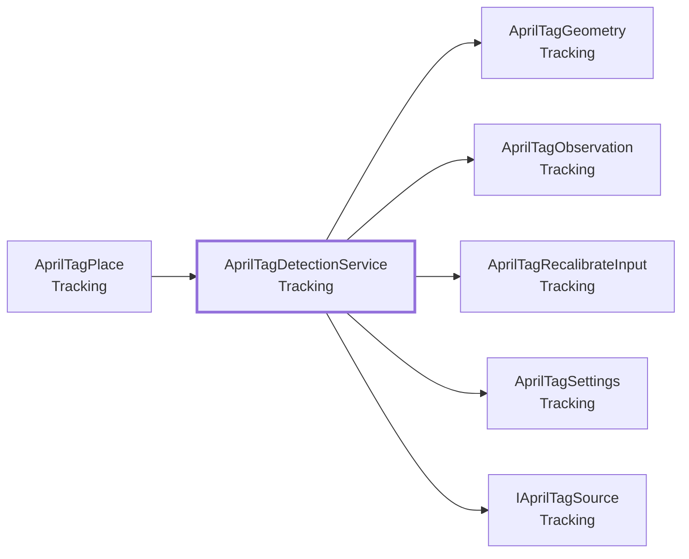

- この型を使う所: [`AprilTagPlace`](#t-apriltagplace)
- この型が使う型: [`AprilTagGeometry`](#t-apriltaggeometry)、[`AprilTagObservation`](#t-apriltagobservation)、[`AprilTagRecalibrateInput`](#t-apriltagrecalibrateinput)、[`AprilTagSettings`](#t-apriltagsettings)、[`IAprilTagSource`](#t-iapriltagsource)

### メンバー（3）

| 種類 | メンバー | 説明 |
|---|---|---|
| イベント | `Action<IReadOnlyList<AprilTagObservation>> ObservationsUpdated` | 検出のたびに呼ばれる。引数のリストは次回の検出で再利用されるため、保持しないこと。検出したタグが 0 枚のときは呼ばれない。（[`IAprilTagSource`](#t-iapriltagsource) の説明） |
| メソッド | `static AprilTagDetectionService GetOrCreate()` | シーンにあればそれを、なければ作って返す。[`AprilTagPlace`](#t-apriltagplace) が使うので、手で置く必要はない。 |
| メソッド | `bool TryGetLatest(int tagId, out AprilTagObservation observation)` | 指定 ID の、最後に検出した結果を返す。まだ検出していなければ false。（[`IAprilTagSource`](#t-iapriltagsource) の説明） |

---

## AprilTagGeometry

**static（置き場・計算）**（コードから直接呼ぶ）・ `static class` ・ 名前空間 `MouthOfGod.Tracking` ・ [`Tracking/AprilTagGeometry.cs`](../../Assets/Scripts/Tracking/AprilTagGeometry.cs)

カメラの内部パラメータの換算と、座標変換。Unity のオブジェクトに依存しない純粋な計算。

### なぜこの形か

- **[計算は Unity から切り離して、テストできるようにする](design.md#d-pure)**: Quest をかぶらずに、Play もせずに、EditMode のテストで正しさを確かめられるからです。

### つながり

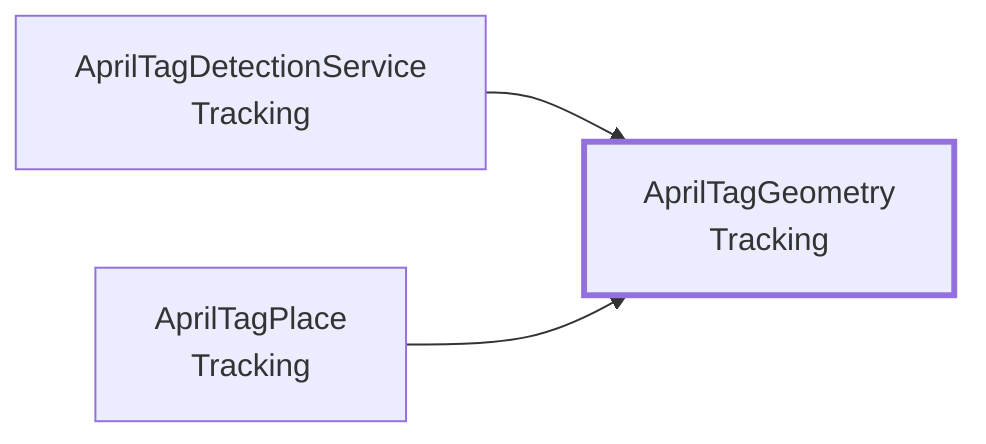

- この型を使う所: [`AprilTagDetectionService`](#t-apriltagdetectionservice)、[`AprilTagPlace`](#t-apriltagplace)

### メンバー（8）

| 種類 | メンバー | 説明 |
|---|---|---|
| メソッド | `static ImageIntrinsics ToImageIntrinsics( Vector2 sensorFocalLength, Vector2 sensorPrincipalPoint, Vector2Int sensorResolution, Vector2Int imageResolution)` | センサー基準の内部パラメータを、現在の画像解像度の基準に換算する。画像は、センサーを中央でクロップして縮小したもの（Meta の PassthroughCameraAccess と同じ扱い）。 |
| メソッド | `static float VerticalFovRadians(float focalLengthY, int imageHeight)` | AprilTag ライブラリに渡す、垂直方向の画角（ラジアン）。ライブラリは画素が正方形で主点が画像中央にあると仮定する。 |
| メソッド | `static Pose CameraLocalToWorld(Pose cameraWorldPose, Vector3 localPosition, Quaternion localRotation)` | カメラのローカル座標で得たタグの姿勢を、ワールド座標に直す。 |
| メソッド | `static Quaternion AlignNormalToVertical(Quaternion rotation, Vector3 localNormalAxis)` | タグの法線（タグ座標の localNormalAxis 軸）が鉛直になるように、傾きだけを取り除く。法線まわりの回転（水平なタグなら向き）は変えない。法線が上向きなら上、下向きなら下に揃える。水平な面に置いたタグ向け。壁など、法線が水平なタグには使わない。 |
| メソッド | `static Pose ApplyOffsets(Pose tag, Vector3 localPosition, Vector3 localEuler, Vector3 worldEuler)` | タグの姿勢に、オフセットを足した、対象の姿勢を求める。基準の向きは「ワールド軸の回転 × タグの回転」。ワールドの回転を 0 にすれば、タグの向きそのまま。位置のオフセットとローカルのオイラー角は、この基準の座標系で足す。そのため、ワールドの回転は、タグの位置を軸に全体を回す。 |
| メソッド | `static Pose AlignRigToTarget(Pose rig, Pose observed, Pose desired, bool alignYaw)` | 観測したタグの姿勢を、シーンの基準の姿勢に重ねるために、リグ（ユーザー側）を動かした後の姿勢を求める。動かすのは、位置と、鉛直軸まわりの向き（alignYaw のとき）だけ。傾きは変えない（VR の水平線が傾かないように）。「タグから見たリグの位置」を、動かす前後で変えない。つまり、シーン空間でのユーザーの姿勢 = 基準の姿勢 × 観測したタグの姿勢の逆 × ワールドでのユーザーの姿勢。 |
| メソッド | `static float YawDelta(Quaternion from, Quaternion to)` | from から to へ、鉛直軸まわりに回す角度（度）。前（Z）が鉛直に近いときは、右（X）で比べる。 |
| メソッド | `static bool IsValidRotation(Quaternion rotation)` | 回転が (0,0,0,0)（未取得）でないか。 |

---

## AprilTagObservation

**データ**（値を運ぶ型）・ `struct` ・ 名前空間 `MouthOfGod.Tracking` ・ [`Tracking/AprilTagObservation.cs`](../../Assets/Scripts/Tracking/AprilTagObservation.cs)

ある 1 フレームで検出された AprilTag 1 枚分の結果。ワールド座標。

### つながり

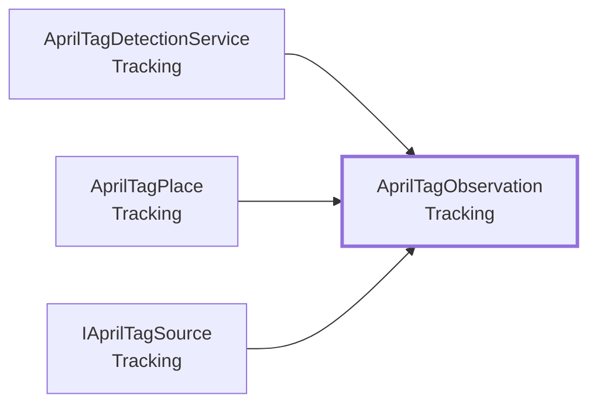

- この型を使う所: [`AprilTagDetectionService`](#t-apriltagdetectionservice)、[`AprilTagPlace`](#t-apriltagplace)、[`IAprilTagSource`](#t-iapriltagsource)

### メンバー（4）

| 種類 | メンバー | 説明 |
|---|---|---|
| コンストラクタ | `AprilTagObservation(int id, Pose worldPose, double receivedAt)` | （説明はコードにありません） |
| プロパティ | `int Id { get; }` | （説明はコードにありません） |
| プロパティ | `Pose WorldPose { get; }` | タグ中心のワールド座標での位置と向き。向きの軸は AprilTag ライブラリの規約に従う。 |
| プロパティ | `double ReceivedAt { get; }` | 結果を受け取った時刻（realtimeSinceStartupAsDouble）。見失い判定に使う。 |

---

## AprilTagPlace

**コンポーネント**（GameObject に付ける）・ `sealed class` ・ 名前空間 `MouthOfGod.Tracking` ・ [`Tracking/AprilTagPlace.cs`](../../Assets/Scripts/Tracking/AprilTagPlace.cs)
 継承・実装: `MonoBehaviour`

指定した ID の AprilTag の位置に、対象の Transform（既定は自分自身）を合わせる。他の機能が必要とするのは、この Transform（子にするか、位置を読む）と、 追跡中かどうか（IsTracked、Found、Lost）だけ。タグを見失っても、Transform は最後の位置に残る。表示の切り替えなどは、イベントを受けた側で行う。2 つの動作がある。追従（既定）: 見えている間、観測に合わせて動かす（平滑化あり）。測って固定（_lockAfterCalibration）: 観測を集めて平均した位置に置き、以後は動かさない。タグが動かないなら、こちらが最も安定する。取り直すときは Recalibrate。

### なぜこの形か

- **[共有シーンは 1 つにし、動画も同じシーンで流す](design.md#d-scene)**: シーンを分けると、重ねて読み込む仕組み、シーンの間の位置合わせ、他の人のシーンと合わせる手間が要ります。

### つながり

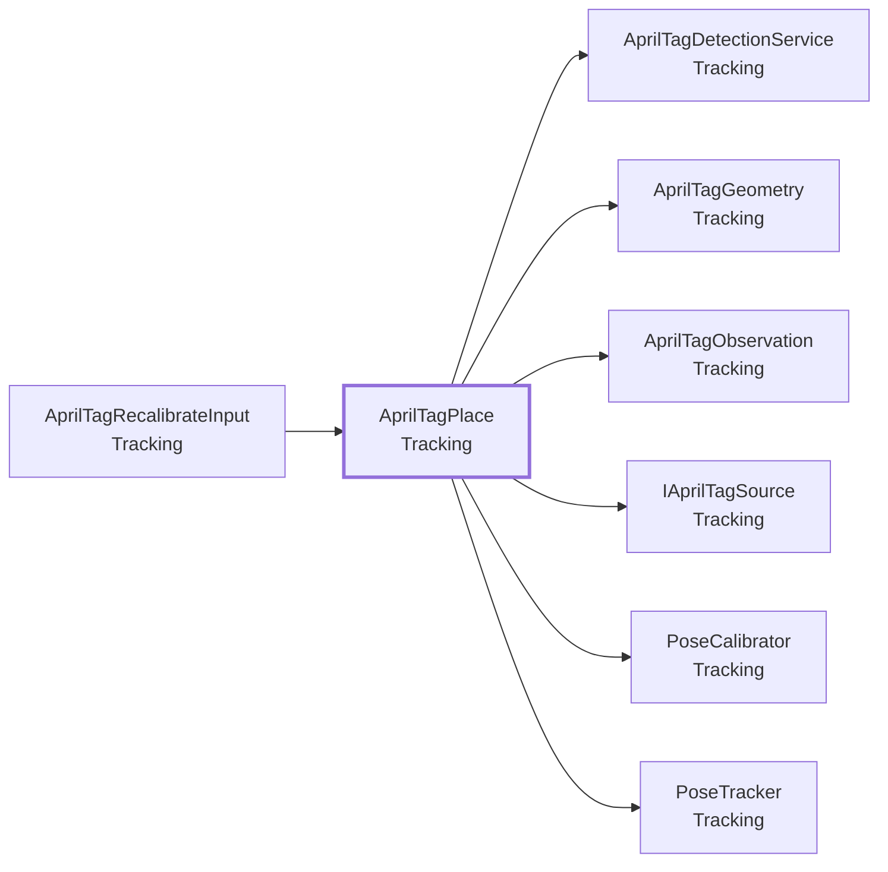

- この型を使う所: [`AprilTagRecalibrateInput`](#t-apriltagrecalibrateinput)
- この型が使う型: [`AprilTagDetectionService`](#t-apriltagdetectionservice)、[`AprilTagGeometry`](#t-apriltaggeometry)、[`AprilTagObservation`](#t-apriltagobservation)、[`IAprilTagSource`](#t-iapriltagsource)、[`PoseCalibrator`](#t-posecalibrator)、[`PoseTracker`](#t-posetracker)

### Inspector（15 項目）

| 項目 | 型 | 既定値 | 説明 |
|---|---|---|---|
| **Tag** | | | |
| Tag Id | `int` | 0 |  |
| **Target** | | | |
| Target | `Transform` | なし | 動かす対象。空なら、このコンポーネントが付いた GameObject 自身。 |
| Follow Rotation | `bool` | オン |  |
| Local Position Offset | `Vector3` | なし | タグのローカル座標でのオフセット（メートル）。 |
| Local Euler Offset | `Vector3` | なし |  |
| World Euler Offset | `Vector3` | なし | ワールド軸での回転オフセット（度）。タグの位置を軸に、全体を回す。タグの座標系ではなく、ワールドの軸で指定する（Y が鉛直軸まわりの向き）。位置とローカルのオフセットは、回したあとの向きで足す。 |
| **Stabilization: tilt** | | | |
| Keep Normal Vertical | `bool` | オフ | タグの法線を鉛直に揃え、傾き（ピッチ・ロール）を捨てる。水平な面（机・床）に置いたタグ用。壁のタグではオフにする。 |
| Tag Normal Axis | `Vector3` | `Vector3.forward` | タグ座標での、タグ面に垂直な軸。Marker の薄い板が、タグに貼り付く向きの軸（既定は Z）。 |
| **Stabilization: lock** | | | |
| Lock After Calibration | `bool` | オフ | オンにすると、観測を集めて平均した位置に置き、以後は動かさない（追従しない）。タグが動かない前提。 |
| Calibration Samples | `int` | `20` | 固定する前に集める観測の数。検出は 1 秒に十数回なので、20 でおよそ 1〜2 秒。 |
| Calibration Position Outlier Meters | `float` | 0.02 | 位置の中央値からこの距離（メートル）より離れた観測を、外れ値として捨てる。 |
| Calibration Angle Outlier Degrees | `float` | 10 | 平均の向きからこの角度（度）より離れた観測を、外れ値として捨てる。 |
| **Alignment** | | | |
| Align Rig Instead | `bool` | オフ | オンにすると、対象を動かす代わりに、OVRCameraRig（ユーザー側）を動かして、観測したタグを、対象のいまのワールド姿勢に重ねる。Terrain のように回せないものが子にあるときに使う。固定モード（Lock After Calibration）と Keep Normal Vertical を、自動で有効にする。リグは、位置と鉛直軸まわりの向きだけ動かす（傾きは変えない）。対象の向きは Y が上、前（Z）が水平になるようにし、タグの向きとの差は Local Euler Offset で合わせる。固定が終わったときに 1 回だけ合わせ、取り直すとまた合わせる。 |
| **Stabilization: follow mode** | | | |
| Smoothing Seconds | `float` | 0.1 | 平滑化の時定数（秒）。大きいほどなめらかだが、遅れる。0 で平滑化しない。固定モードでは使わない。 |
| Lost Timeout Seconds | `float` | 0.5 | この時間、タグが見えなければ見失ったとみなす（秒）。固定モードでは使わない。 |

### メンバー（8）

| 種類 | メンバー | 説明 |
|---|---|---|
| イベント | `Action Found` | （説明はコードにありません） |
| イベント | `Action Lost` | （説明はコードにありません） |
| プロパティ | `int TagId` | （説明はコードにありません） |
| プロパティ | `bool IsTracked` | 追従モードでは、いまタグが見えているか。固定モードでは、位置が固定済みか。 |
| プロパティ | `bool IsCalibrating` | 固定モードで、観測を集めている最中か。 |
| プロパティ | `float CalibrationProgress` | 固定モードの進み具合（0〜1）。 |
| メソッド | `static void RecalibrateAll()` | シーン内の、固定モードのすべての AprilTagPlace を取り直す。 |
| メソッド | `void Recalibrate()` | 固定した位置を捨てて、観測を集め直す。集め終わるまで、対象は直前の位置に残る。追従モードでは何もしない。 |

### メニュー

- 右クリック: `Recalibrate`

---

## AprilTagRecalibrateInput

**コンポーネント**（GameObject に付ける）・ `sealed class` ・ 名前空間 `MouthOfGod.Tracking` ・ [`Tracking/AprilTagRecalibrateInput.cs`](../../Assets/Scripts/Tracking/AprilTagRecalibrateInput.cs)
 継承・実装: `MonoBehaviour`

タグの位置の取り直しを、アプリ内の入力で行う。Quest の**左**コントローラーの Y ボタンを長押し（スタッフの操作）、またはキーボードの R キー（開発中）。[`AprilTagDetectionService`](#t-apriltagdetectionservice) が自動で付ける。固定モードの [`AprilTagPlace`](#t-apriltagplace) すべてを取り直す。

### しくみ・注意

右手の A ボタンは体験者の「決定」（MockDevice）、左の X 長押しはスタッフの「飛ばす」（シナリオブック）に使うので、ぶつからない左の Y の長押しにした。

### つながり

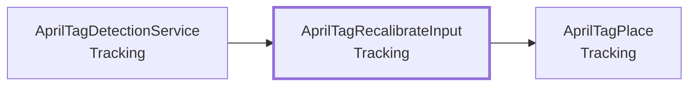

- この型を使う所: [`AprilTagDetectionService`](#t-apriltagdetectionservice)
- この型が使う型: [`AprilTagPlace`](#t-apriltagplace)

### Inspector（1 項目）

| 項目 | 型 | 既定値 | 説明 |
|---|---|---|---|
| Hold Seconds | `float` | 2 | 左の Y ボタンを、この秒数押し続けると取り直す |

---

## AprilTagSettings

**設定アセット**（Project に置くアセット）・ `sealed class` ・ 名前空間 `MouthOfGod.Tracking` ・ [`Tracking/AprilTagSettings.cs`](../../Assets/Scripts/Tracking/AprilTagSettings.cs)
 継承・実装: `ScriptableObject`
 属性: `[CreateAssetMenu(fileName = ResourceName, menuName = "MouthOfGod/Tracking/AprilTag Settings")]`

AprilTag 検出の設定。Assets/Resources/AprilTagSettings.asset があれば、それを使う。なければコードの既定値で動く。シーンやオブジェクトに値を入れる必要はなく、変更は、このアセット（ファイル）の差分として残る。

### なぜこの形か

- **[Play の前に、手作業を要らなくする](design.md#d-noprep)**: 手で入れるつなぎは、付け忘れると動きません。

### つながり

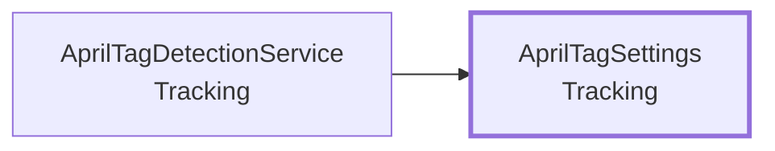

- この型を使う所: [`AprilTagDetectionService`](#t-apriltagdetectionservice)

### Inspector（5 項目）

| 項目 | 型 | 既定値 | 説明 |
|---|---|---|---|
| Tag Size Meters | `float` | 0.075 | タグの一辺の長さ（メートル）。tagStandard41h12 では、黒い枠の**内側の縁**で囲まれた正方形（5 マス分）の一辺。1 マスの一辺 × 5。 |
| Decimation | `int` | `2` | 検出時に画像を縮小する倍率。大きいほど速いが、遠くのタグを検出しにくくなる。 |
| Min Detect Interval Seconds | `float` | 0.05 | 検出の最小間隔（秒）。0 でカメラの新しいフレームごとに検出する。 |
| Log Stats | `bool` | オン | 検出回数・処理時間・検出した ID を、一定間隔でログに出す。 |
| Stats Interval Seconds | `float` | 2 |  |

### メンバー（7）

| 種類 | メンバー | 説明 |
|---|---|---|
| プロパティ | `float TagSizeMeters` | （説明はコードにありません） |
| プロパティ | `int Decimation` | （説明はコードにありません） |
| プロパティ | `float MinDetectIntervalSeconds` | （説明はコードにありません） |
| プロパティ | `bool LogStats` | （説明はコードにありません） |
| プロパティ | `float StatsIntervalSeconds` | （説明はコードにありません） |
| 定数 | `const string ResourceName` | （説明はコードにありません） |
| メソッド | `static AprilTagSettings Load()` | アセットがあればそれを、なければ既定値のインスタンスを返す。 |

---

## HandHeldPose

**コンポーネント**（GameObject に付ける）・ `sealed class` ・ 名前空間 `MouthOfGod.Tracking` ・ [`Tracking/HandHeldPose.cs`](../../Assets/Scripts/Tracking/HandHeldPose.cs)
 継承・実装: `MonoBehaviour`

手（ハンドトラッキング）の位置に、オフセットを足して、手に持ったものの先の位置に自分を動かす。フォークなら、[`ForkTip`](Fork.md#t-forktip) のオブジェクトか、その親に付ける。[`ForkTip`](Fork.md#t-forktip) は位置の取り方を知らないので、これを付けるだけでつながる。手は OVRCameraRig の手のアンカー（RightHandAnchor）から読む。コントローラで動かしても同じ動きになるが、握る位置が違うので、オフセットは手で測り直す。

### しくみ・注意

- オフセットの測り直し: 先を口に当てて、C キー（開発中）。口の位置は、頭から `Mouth Offset` だけずらした所（[`ForkTip`](Fork.md#t-forktip) の既定と同じ）。
  Quest の手で押せる入力は、まだ決めていない。
- 手の追跡が途切れたら、アンカーが止まるので、最後の位置に残る。

### つながり

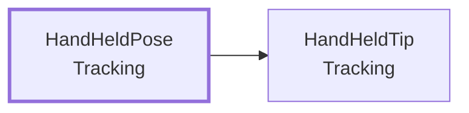

- この型が使う型: [`HandHeldTip`](#t-handheldtip)

### Inspector（6 項目）

| 項目 | 型 | 既定値 | 説明 |
|---|---|---|---|
| Tip Offset | `Vector3` | (0, 0, 0.15) | 手の座標系での、先の位置（m）。手の前（+Z）に 15 cm。仮の値。口に当てて C キーで測り直せる |
| Smoothing Seconds | `float` | 0.05 | 手のぶれをならす時定数（秒）。大きいほど滑らかだが遅れる。0 でならさない。仮の値 |
| Use Right Hand | `bool` | オン | true なら右手、false なら左手 |
| Mouth Offset | `Vector3` | (0, -0.1, 0.1) | 測り直すときの、頭から見た口の位置（m）。ForkTip の Mouth Offset と同じ値にする。仮の値 |
| Calibrate Action | `InputAction` | `new InputAction("CalibrateTip", InputActionType.Button, "<Keyboard>/c")` | 先を口に当てて、オフセットを測り直す。開発中の入力 |
| Log Events | `bool` | オン | 測り直した結果を Console に出す |

### メンバー（1）

| 種類 | メンバー | 説明 |
|---|---|---|
| プロパティ | `Vector3 TipOffset` | 手の座標系での、いまの先の位置（m）。 |

---

## HandHeldTip

**クラス**（コードから new して使う）・ `sealed class` ・ 名前空間 `MouthOfGod.Tracking` ・ [`Tracking/HandHeldTip.cs`](../../Assets/Scripts/Tracking/HandHeldTip.cs)

手の姿勢から、手に持ったもの（フォークなど）の先の姿勢を出す。先は「手の座標系でのオフセット」で表し、手の向きに合わせて回る。先を口に当てた姿勢からオフセットを測り直せる（Calibrate）。Unity のオブジェクトに依存しない（[`HandHeldPose`](#t-handheldpose) が使う）。

### なぜこの形か

- **[計算は Unity から切り離して、テストできるようにする](design.md#d-pure)**: Quest をかぶらずに、Play もせずに、EditMode のテストで正しさを確かめられるからです。

### つながり

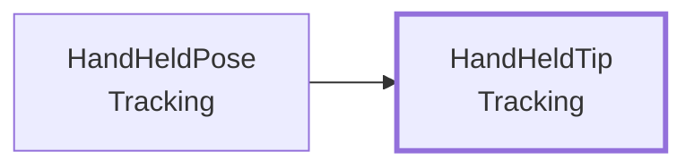

- この型を使う所: [`HandHeldPose`](#t-handheldpose)

### メンバー（7）

| 種類 | メンバー | 説明 |
|---|---|---|
| コンストラクタ | `HandHeldTip(Vector3 localOffset, float smoothingSeconds)` | （説明はコードにありません） |
| プロパティ | `Vector3 LocalOffset` | 手の座標系での、先の位置（m）。 |
| プロパティ | `Pose Current` | 平滑化後の先の姿勢。Update を呼ぶ前は単位姿勢。 |
| メソッド | `static Pose Compute(Pose hand, Vector3 localOffset)` | 手の姿勢から、オフセットだけ離れた先の姿勢を求める。向きは手と同じ。 |
| メソッド | `static Vector3 SolveOffset(Pose hand, Vector3 worldPoint)` | 先が、いまの手から見てワールドの worldPoint にあるときの、オフセットを求める。 |
| メソッド | `Pose Update(Pose hand, float deltaTime)` | 手の姿勢を受け取り、平滑化した先の姿勢を返す。最初の 1 回と、測り直した直後は、補間せずその位置に置く。 |
| メソッド | `void Calibrate(Pose hand, Vector3 worldPoint)` | 先がいま worldPoint（たとえば口の位置）にあるとして、オフセットを測り直す。 |

---

## IAprilTagSource

**interface**（機能どうしの約束）・ `interface` ・ 名前空間 `MouthOfGod.Tracking` ・ [`Tracking/IAprilTagSource.cs`](../../Assets/Scripts/Tracking/IAprilTagSource.cs)

AprilTag の検出結果の供給元。検出の実装（実機のカメラ、擬似実装など）を差し替えられるようにする。

### つながり

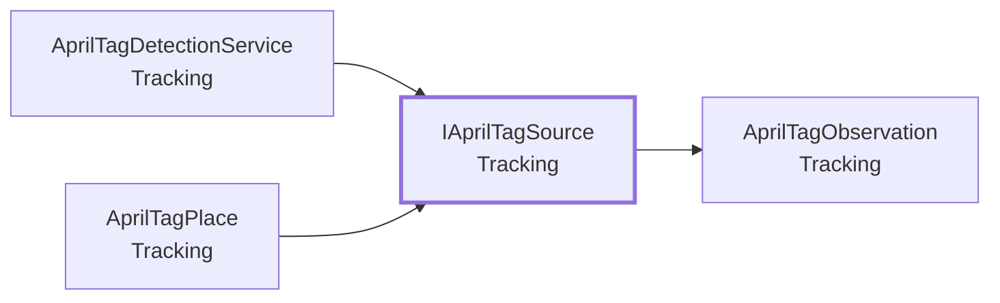

- この型を使う所: [`AprilTagDetectionService`](#t-apriltagdetectionservice)、[`AprilTagPlace`](#t-apriltagplace)
- この型が使う型: [`AprilTagObservation`](#t-apriltagobservation)

### メンバー（2）

| 種類 | メンバー | 説明 |
|---|---|---|
| イベント | `Action<IReadOnlyList<AprilTagObservation>> ObservationsUpdated` | 検出のたびに呼ばれる。引数のリストは次回の検出で再利用されるため、保持しないこと。検出したタグが 0 枚のときは呼ばれない。 |
| メソッド | `bool TryGetLatest(int tagId, out AprilTagObservation observation)` | 指定 ID の、最後に検出した結果を返す。まだ検出していなければ false。 |

---

## ImageIntrinsics

**データ**（値を運ぶ型）・ `struct` ・ 名前空間 `MouthOfGod.Tracking` ・ [`Tracking/AprilTagGeometry.cs`](../../Assets/Scripts/Tracking/AprilTagGeometry.cs)
 [`AprilTagGeometry`](#t-apriltaggeometry) の中の型

現在の画像（ピクセル）に換算した内部パラメータ。原点は左下、y は上向き（Unity のテクスチャと同じ）。

### メンバー（3）

| 種類 | メンバー | 説明 |
|---|---|---|
| コンストラクタ | `ImageIntrinsics(Vector2 focalLength, Vector2 principalPoint)` | （説明はコードにありません） |
| プロパティ | `Vector2 FocalLength { get; }` | （説明はコードにありません） |
| プロパティ | `Vector2 PrincipalPoint { get; }` | （説明はコードにありません） |

---

## PoseCalibrator

**クラス**（コードから new して使う）・ `sealed class` ・ 名前空間 `MouthOfGod.Tracking` ・ [`Tracking/PoseCalibrator.cs`](../../Assets/Scripts/Tracking/PoseCalibrator.cs)

複数の観測を集め、外れ値を除いて平均した 1 つの姿勢を返す。タグが動かない前提で、位置を「測って固定する」ために使う。Unity のオブジェクトに依存しない。

### なぜこの形か

- **[計算は Unity から切り離して、テストできるようにする](design.md#d-pure)**: Quest をかぶらずに、Play もせずに、EditMode のテストで正しさを確かめられるからです。

### つながり

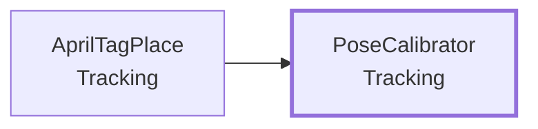

- この型を使う所: [`AprilTagPlace`](#t-apriltagplace)

### メンバー（7）

| 種類 | メンバー | 説明 |
|---|---|---|
| コンストラクタ | `PoseCalibrator(int requiredSamples, float maxPositionOutlierMeters, float maxAngleOutlierDegrees)` | （説明はコードにありません） |
| プロパティ | `int Count` | （説明はコードにありません） |
| プロパティ | `int RequiredSamples` | （説明はコードにありません） |
| プロパティ | `bool IsComplete` | （説明はコードにありません） |
| メソッド | `void Reset()` | （説明はコードにありません） |
| メソッド | `void Add(Pose sample)` | サンプルを足す。必要な数が集まったあとは無視する。 |
| メソッド | `bool TryGetResult(out Pose result)` | 集めたサンプルの平均を返す。サンプルが 1 つもなければ false。 |

---

## PoseTracker

**クラス**（コードから new して使う）・ `sealed class` ・ 名前空間 `MouthOfGod.Tracking` ・ [`Tracking/PoseTracker.cs`](../../Assets/Scripts/Tracking/PoseTracker.cs)

1 枚のタグの追跡状態。観測を受け取り、平滑化した姿勢と「追跡中か」を管理する。見つかった（Found）／一定時間見えなくなった（Lost）をイベントで通知する。

### なぜこの形か

- **[計算は Unity から切り離して、テストできるようにする](design.md#d-pure)**: Quest をかぶらずに、Play もせずに、EditMode のテストで正しさを確かめられるからです。

### つながり

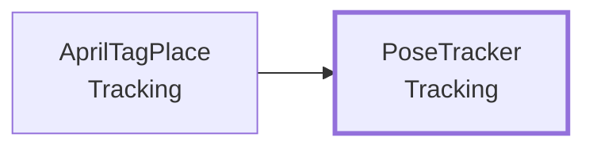

- この型を使う所: [`AprilTagPlace`](#t-apriltagplace)

### メンバー（7）

| 種類 | メンバー | 説明 |
|---|---|---|
| コンストラクタ | `PoseTracker(float smoothingSeconds, float lostTimeoutSeconds)` | （説明はコードにありません） |
| イベント | `Action Found` | （説明はコードにありません） |
| イベント | `Action Lost` | （説明はコードにありません） |
| プロパティ | `bool IsTracked` | （説明はコードにありません） |
| プロパティ | `Pose Current` | 平滑化後の姿勢。見失っても最後の値を保つ。 |
| メソッド | `void Observe(Pose pose, double now)` | （説明はコードにありません） |
| メソッド | `void Tick(double now, float deltaTime)` | （説明はコードにありません） |
