<!-- このページは tools/api_doc/build_md.py が作ります。手で直さないでください。 -->
[入口](README.md) ・ [設計の考え方](design.md) ・ [つながりの図](diagrams.md) ・ [やりたいこと別の手順](recipes.md) ・ [ガイド](guide.md)

# MouthOfGod.Tutorial

プロローグとチュートリアル 1〜4 を進めます。1 チュートリアル = 1 つの [`TutorialScript`](#t-tutorialscript)（人形劇スクリプト）を、[`TutorialRunner`](#t-tutorialrunner) が順に動かします。

## この機能に関わる決まり（なぜこの形か）

- **[作業の単位と、ファイルの単位をそろえる](design.md#d-files)**: シーンや Prefab は、Git でマージできないからです。
- **[中央の進行役を作らない](design.md#d-nocenter)**: 進行役が全部を持つと、何かを足すたびに、全員がその 1 つのファイルを直します。
- **[チュートリアルは合図を出し、見せ方は受け手が決める](design.md#d-cues)**: チュートリアルの担当者は流れだけを、フィールドの担当者は見せ方だけを直せるようにするためです。
- **[チュートリアルは、コルーチンの人形劇スクリプトで書く](design.md#d-puppet)**: チュートリアルは約 8 分の一本道です。
- **[チュートリアルは 1 本ずつ Prefab にし、セリフもその中に持つ](design.md#d-tutprefab)**: チュートリアルは、担当者が並行して作ります。
- **[チュートリアルの間の引き継ぎは、名前だけで行う](design.md#d-memory)**: T3 のコードが「T2 では」と書くと、T2 を直したときに T3 が壊れます。
- **[共有シーンは 1 つにし、動画も同じシーンで流す](design.md#d-scene)**: シーンを分けると、重ねて読み込む仕組み、シーンの間の位置合わせ、他の人のシーンと合わせる手間が要ります。

## 型の一覧

| 役割 | 型 | 説明 |
|---|---|---|
| コンポーネント | [`PrologueVideo`](#t-prologuevideo) | プロローグ（シナリオブック S1）。 |
| コンポーネント | [`T1Fork`](#t-t1fork) | チュートリアル 1「フォークの使い方」（シナリオブック S3）。 |
| コンポーネント | [`T2Spawn`](#t-t2spawn) | チュートリアル 2「物が生まれる」（シナリオブック S4。 |
| コンポーネント | [`T3Recognize`](#t-t3recognize) | チュートリアル 3「食感で変わる・欲しい物」（シナリオブック S5。 |
| コンポーネント | [`T4Deliver`](#t-t4deliver) | チュートリアル 4「届ける」（シナリオブック S6）。 |
| コンポーネント | [`TutorialRunner`](#t-tutorialrunner) | 子の TutorialScript（人形劇スクリプト）を、Hierarchy の並び順に 1 つずつ動かす。 |
| コンポーネント | [`TutorialScript`](#t-tutorialscript) | 人形劇スクリプトの土台。 |
| コンポーネント | [`VideoScreen`](#t-videoscreen) | VR で動画を見せる画面。 |
| 待ち（yield return） | [`AnyWait`](#t-anywait) | 渡した待ちのうち、どれかが終わるのを待つ。 |
| 待ち（yield return） | [`ConfirmWait`](#t-confirmwait) | デバイスで決定する（Confirmed）のを待つ。 |
| 待ち（yield return） | [`DeliveryWait`](#t-deliverywait) | フィールドに物が届くのを待つ。 |
| 待ち（yield return） | [`ForkWait`](#t-forkwait) | フォークで雲を刺すのを待つ（Pierce）。 |
| 待ち（yield return） | [`SpawnWait`](#t-spawnwait) | 食べ物が生まれるのを待つ（Spawned）。 |
| 待ち（yield return） | [`StandWait`](#t-standwait) | 体験者が、あるフィールドの前に立つのを待つ（Standing）。 |
| 待ち（yield return） | [`TextureChangeWait`](#t-texturechangewait) | 噛んでいる間に、食感が count 回切り替わるのを待つ（TextureChanged）。 |
| 待ち（yield return） | [`TutorialWait`](#t-tutorialwait) | 人形劇スクリプトで yield return して待つもの。 |
| 選択肢（enum） | [`ForkGoal`](#t-forkgoal) | ForkWait が待つもの。 |
| 選択肢（enum） | [`TutorialEvent`](#t-tutorialevent) | TutorialHistory が記録すること。 |
| クラス | [`TutorialHistory`](#t-tutorialhistory) | チュートリアルが始まってから、体験者がしたことの記録。 |
| クラス | [`TutorialMemory`](#t-tutorialmemory) | チュートリアルのあいだで引き継ぐ「覚えたこと」。 |
| エディタ | [`TutorialPrefabGenerator`](#t-tutorialprefabgenerator) | プロローグとチュートリアル 1〜4 の Prefab を、Assets/Resources/Prefabs/Tutorial/ に作る。 |
| 試験用 | [`OpenAllRequestsAfterTutorial`](#t-openallrequestsaftertutorial) | チュートリアルが終わったら、すべてのフィールドに、欲しい物をいっぺんに出す仮のスクリプト。 |
| 試験用 | [`TutorialAutoStart`](#t-tutorialautostart) | Play を始めてしばらくしたら、同じ GameObject の TutorialRunner を動かす。 |
| 試験用 | [`VillageTutorialProbe`](#t-villagetutorialprobe) | 村だけで、チュートリアルを進める仕組みが動くか確かめる仮のスクリプト。 |

---

## AnyWait

**待ち（yield return）**（人形劇スクリプトで yield return する）・ `sealed class` ・ 名前空間 `MouthOfGod.Tutorial` ・ [`Tutorial/TutorialWait.cs`](../../Assets/Scripts/Tutorial/TutorialWait.cs)
 継承・実装: `CustomYieldInstruction`

渡した待ちのうち、どれかが終わるのを待つ。終わったら、ほかの待ちは取り消す。終わったあとの Index が、最初に終わった待ちの番号（0 から）。同じフレームに複数が終わったときは、先に渡したほうを選ぶ。

### なぜこの形か

- **[チュートリアルは、コルーチンの人形劇スクリプトで書く](design.md#d-puppet)**: チュートリアルは約 8 分の一本道です。

### つながり

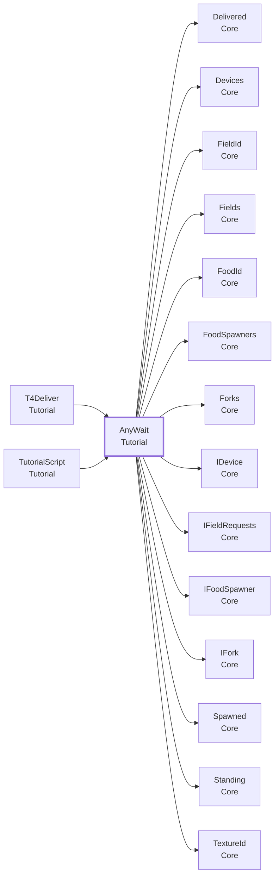

- この型を使う所: [`T4Deliver`](#t-t4deliver)、[`TutorialScript`](#t-tutorialscript)
- この型が使う型: [`Delivered`](Core.md#t-delivered)、[`Devices`](Core.md#t-devices)、[`FieldId`](Core.md#t-fieldid)、[`Fields`](Core.md#t-fields)、[`FoodId`](Core.md#t-foodid)、[`FoodSpawners`](Core.md#t-foodspawners)、[`Forks`](Core.md#t-forks)、[`IDevice`](Core.md#t-idevice)、[`IFieldRequests`](Core.md#t-ifieldrequests)、[`IFoodSpawner`](Core.md#t-ifoodspawner)、[`IFork`](Core.md#t-ifork)、[`Spawned`](Core.md#t-spawned)、[`Standing`](Core.md#t-standing)、[`TextureId`](Core.md#t-textureid)

### この型を使う手順

- [チュートリアルの中で、イベントを待つ・使う](recipes.md#r-tutorial-event)

### メンバー（3）

| 種類 | メンバー | 説明 |
|---|---|---|
| プロパティ | `int Index` | 最初に終わった待ちの番号。まだなら -1。 |
| プロパティ | `TutorialWait Winner` | 最初に終わった待ち。まだなら null。 |
| プロパティ | `override bool keepWaiting` | （説明はコードにありません） |

---

## ConfirmWait

**待ち（yield return）**（人形劇スクリプトで yield return する）・ `sealed class` ・ 名前空間 `MouthOfGod.Tutorial` ・ [`Tutorial/TutorialWait.cs`](../../Assets/Scripts/Tutorial/TutorialWait.cs)
 継承・実装: [`TutorialWait`](#t-tutorialwait)

デバイスで決定する（Confirmed）のを待つ。噛む前の決定（食感が空）は数えない。終わったあとの Result が、決定したときの食感。時間切れなら空。

### なぜこの形か

- **[チュートリアルは、コルーチンの人形劇スクリプトで書く](design.md#d-puppet)**: チュートリアルは約 8 分の一本道です。

### つながり

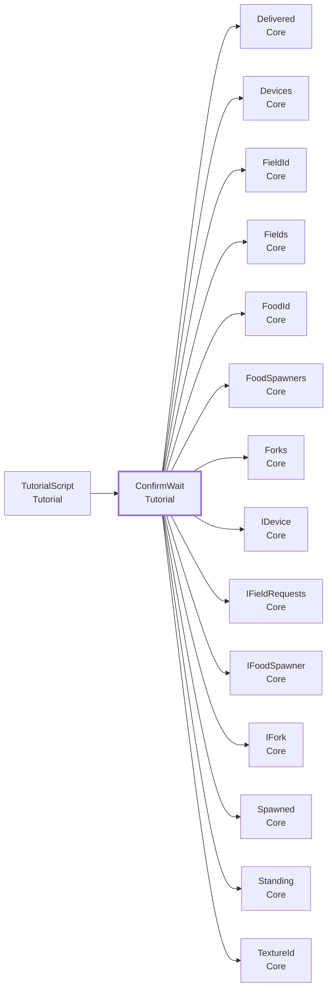

- この型を使う所: [`TutorialScript`](#t-tutorialscript)
- この型が使う型: [`Delivered`](Core.md#t-delivered)、[`Devices`](Core.md#t-devices)、[`FieldId`](Core.md#t-fieldid)、[`Fields`](Core.md#t-fields)、[`FoodId`](Core.md#t-foodid)、[`FoodSpawners`](Core.md#t-foodspawners)、[`Forks`](Core.md#t-forks)、[`IDevice`](Core.md#t-idevice)、[`IFieldRequests`](Core.md#t-ifieldrequests)、[`IFoodSpawner`](Core.md#t-ifoodspawner)、[`IFork`](Core.md#t-ifork)、[`Spawned`](Core.md#t-spawned)、[`Standing`](Core.md#t-standing)、[`TextureId`](Core.md#t-textureid)

### この型を使う手順

- [チュートリアルの中で、イベントを待つ・使う](recipes.md#r-tutorial-event)

### メンバー（2）

| 種類 | メンバー | 説明 |
|---|---|---|
| プロパティ | `TextureId Result` | （説明はコードにありません） |
| メソッド | `protected override void Unsubscribe()` | （説明はコードにありません） |

---

## DeliveryWait

**待ち（yield return）**（人形劇スクリプトで yield return する）・ `sealed class` ・ 名前空間 `MouthOfGod.Tutorial` ・ [`Tutorial/TutorialWait.cs`](../../Assets/Scripts/Tutorial/TutorialWait.cs)
 継承・実装: [`TutorialWait`](#t-tutorialwait)

フィールドに物が届くのを待つ。only を指定すれば、そのフィールドへの届きだけ。指定しなければ、どこへ届いてもよい。終わったあとの Result で、何がどこへ届いたか（Kind で正しいか）が分かる。時間切れなら null。

### なぜこの形か

- **[チュートリアルは、コルーチンの人形劇スクリプトで書く](design.md#d-puppet)**: チュートリアルは約 8 分の一本道です。

### つながり

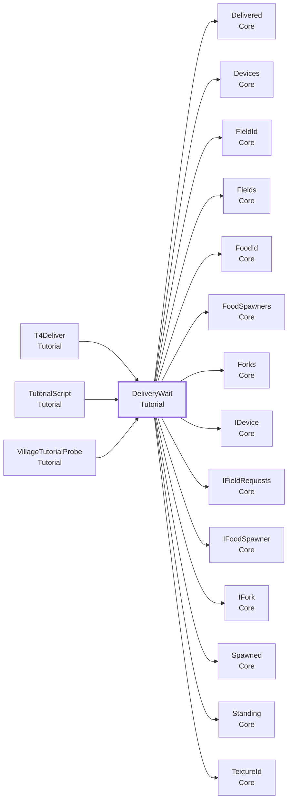

- この型を使う所: [`T4Deliver`](#t-t4deliver)、[`TutorialScript`](#t-tutorialscript)、[`VillageTutorialProbe`](#t-villagetutorialprobe)
- この型が使う型: [`Delivered`](Core.md#t-delivered)、[`Devices`](Core.md#t-devices)、[`FieldId`](Core.md#t-fieldid)、[`Fields`](Core.md#t-fields)、[`FoodId`](Core.md#t-foodid)、[`FoodSpawners`](Core.md#t-foodspawners)、[`Forks`](Core.md#t-forks)、[`IDevice`](Core.md#t-idevice)、[`IFieldRequests`](Core.md#t-ifieldrequests)、[`IFoodSpawner`](Core.md#t-ifoodspawner)、[`IFork`](Core.md#t-ifork)、[`Spawned`](Core.md#t-spawned)、[`Standing`](Core.md#t-standing)、[`TextureId`](Core.md#t-textureid)

### この型を使う手順

- [チュートリアルの中で、イベントを待つ・使う](recipes.md#r-tutorial-event)

### メンバー（2）

| 種類 | メンバー | 説明 |
|---|---|---|
| プロパティ | `Delivered? Result` | （説明はコードにありません） |
| メソッド | `protected override void Unsubscribe()` | （説明はコードにありません） |

---

## ForkGoal

**選択肢（enum）**（決まった値の中から選ぶ）・ `enum` ・ 名前空間 `MouthOfGod.Tutorial` ・ [`Tutorial/TutorialWait.cs`](../../Assets/Scripts/Tutorial/TutorialWait.cs)

[`ForkWait`](#t-forkwait) が待つもの。

### つながり

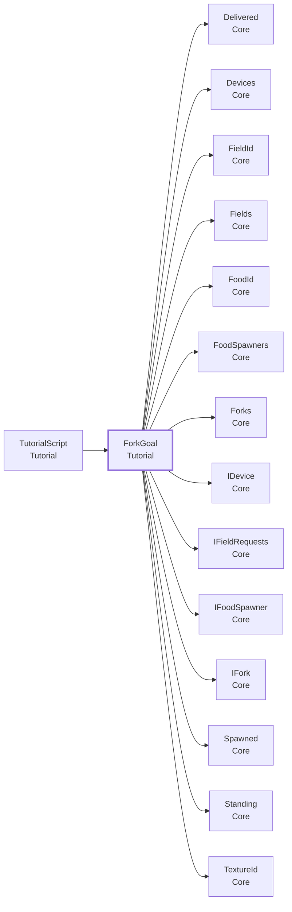

- この型を使う所: [`TutorialScript`](#t-tutorialscript)
- この型が使う型: [`Delivered`](Core.md#t-delivered)、[`Devices`](Core.md#t-devices)、[`FieldId`](Core.md#t-fieldid)、[`Fields`](Core.md#t-fields)、[`FoodId`](Core.md#t-foodid)、[`FoodSpawners`](Core.md#t-foodspawners)、[`Forks`](Core.md#t-forks)、[`IDevice`](Core.md#t-idevice)、[`IFieldRequests`](Core.md#t-ifieldrequests)、[`IFoodSpawner`](Core.md#t-ifoodspawner)、[`IFork`](Core.md#t-ifork)、[`Spawned`](Core.md#t-spawned)、[`Standing`](Core.md#t-standing)、[`TextureId`](Core.md#t-textureid)

### 値

| 値 | 意味 |
|---|---|
| `Pierce` | 雲を刺して、先にかけらが付いた。 |
| `Mouth` | かけらが付いた先を、口に含んだ。 |

---

## ForkWait

**待ち（yield return）**（人形劇スクリプトで yield return する）・ `sealed class` ・ 名前空間 `MouthOfGod.Tutorial` ・ [`Tutorial/TutorialWait.cs`](../../Assets/Scripts/Tutorial/TutorialWait.cs)
 継承・実装: [`TutorialWait`](#t-tutorialwait)

フォークで雲を刺すのを待つ（Pierce）。または、雲のかけらが付いたフォークの先を、口に含むのを待つ（Mouth）。待ち始めたときに、もうその状態なら、すぐ終わる。

### なぜこの形か

- **[チュートリアルは、コルーチンの人形劇スクリプトで書く](design.md#d-puppet)**: チュートリアルは約 8 分の一本道です。

### つながり

- この型を使う所: [`T2Spawn`](#t-t2spawn)、[`TutorialScript`](#t-tutorialscript)
- この型が使う型: [`Delivered`](Core.md#t-delivered)、[`Devices`](Core.md#t-devices)、[`FieldId`](Core.md#t-fieldid)、[`Fields`](Core.md#t-fields)、[`FoodId`](Core.md#t-foodid)、[`FoodSpawners`](Core.md#t-foodspawners)、[`Forks`](Core.md#t-forks)、[`IDevice`](Core.md#t-idevice)、[`IFieldRequests`](Core.md#t-ifieldrequests)、[`IFoodSpawner`](Core.md#t-ifoodspawner)、[`IFork`](Core.md#t-ifork)、[`Spawned`](Core.md#t-spawned)、[`Standing`](Core.md#t-standing)、[`TextureId`](Core.md#t-textureid)

### この型を使う手順

- [チュートリアルの中で、イベントを待つ・使う](recipes.md#r-tutorial-event)

### メンバー（1）

| 種類 | メンバー | 説明 |
|---|---|---|
| メソッド | `protected override void Unsubscribe()` | （説明はコードにありません） |

---

## PrologueVideo

**コンポーネント**（GameObject に付ける）・ `sealed class` ・ 名前空間 `MouthOfGod.Tutorial` ・ [`Tutorial/PrologueVideo.cs`](../../Assets/Scripts/Tutorial/PrologueVideo.cs)
 継承・実装: [`TutorialScript`](#t-tutorialscript)

プロローグ（シナリオブック S1）。導入の動画を [`VideoScreen`](#t-videoscreen) で流し、終わったら「立ち上がって、スタッフの指示を聞いて」と伝える。[`TutorialRunner`](#t-tutorialrunner) の最初の子に置く。終わると、次のチュートリアル 1 へ進む。

### なぜこの形か

- **[作業の単位と、ファイルの単位をそろえる](design.md#d-files)**: シーンや Prefab は、Git でマージできないからです。
- **[チュートリアルは、コルーチンの人形劇スクリプトで書く](design.md#d-puppet)**: チュートリアルは約 8 分の一本道です。
- **[チュートリアルは 1 本ずつ Prefab にし、セリフもその中に持つ](design.md#d-tutprefab)**: チュートリアルは、担当者が並行して作ります。
- **[共有シーンは 1 つにし、動画も同じシーンで流す](design.md#d-scene)**: シーンを分けると、重ねて読み込む仕組み、シーンの間の位置合わせ、他の人のシーンと合わせる手間が要ります。

### しくみ・注意

- シーンは切り替えない。同じシーンの中で流すので、XR リグと AprilTag の位置合わせ、村がそのまま残る。
- 動画が無い・読み込めないときは、警告を出してすぐ次へ進む（体験を止めない）。
- 動画は、途中でスキップできる。スキップのキー（既定は K）を押すと、動画をフェードして消し、巫女のセリフへ進む。展示では、スタッフが PC のキーボードで押す。
出す合図:
- `prologue.start`: 動画を流し始める前。暗くする・BGM を止めるなどを、受ける側が足す
- `prologue.end`: 動画が終わった
- `miko.say.prologue-stand-up`: "Please stand up and follow the booth staff."（立ち上がり、ブース担当者の指示を聞いてください）

### つながり

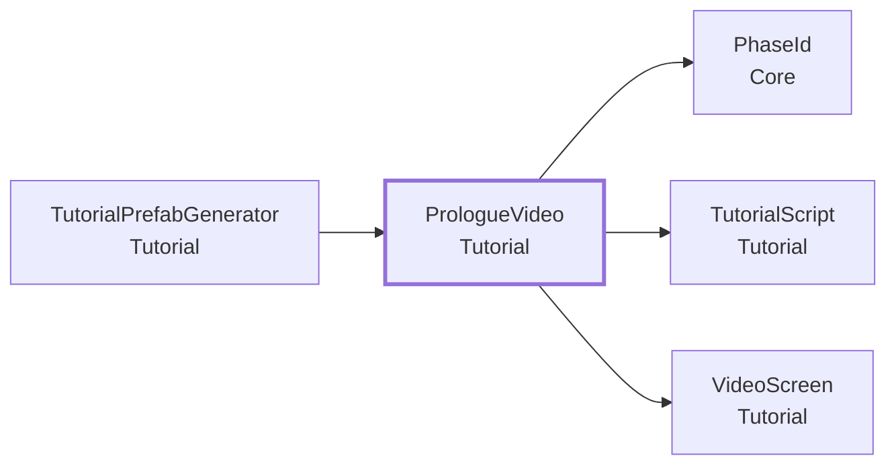

- この型を使う所: [`TutorialPrefabGenerator`](#t-tutorialprefabgenerator)
- この型が使う型: [`PhaseId`](Core.md#t-phaseid)、[`TutorialScript`](#t-tutorialscript)、[`VideoScreen`](#t-videoscreen)

### Inspector（7 項目）

| 項目 | 型 | 既定値 | 説明 |
|---|---|---|---|
| Screen | `VideoScreen` | なし | 動画を流す画面。空なら、このオブジェクトか子の VideoScreen |
| Delay Before Seconds | `float` | 1.5 | 動画を流し始める前に待つ秒数。Quest をかぶった直後に、目が慣れるまで待つ |
| Start Cue | `string` | `"prologue.start"` | 動画を流す前に出す合図。空なら出さない |
| End Cue | `string` | `"prologue.end"` | 動画が終わったあとに出す合図。空なら出さない |
| Stand Up Line | `string` | `"prologue-stand-up"` | 動画のあとに言わせるセリフの id（巫女の LineBook）。空なら言わない |
| Hold After Seconds | `float` | 4 | セリフのあと、次へ進むまでの秒数 |
| Skip Action | `InputAction` | `new InputAction("SkipVideo", InputActionType.Button, "<Keyboard>/k")` | 動画を飛ばすキー。動画を流している間だけ効く。スタッフが PC のキーボードで押す |

### メンバー（3）

| 種類 | メンバー | 説明 |
|---|---|---|
| プロパティ | `override PhaseId Phase` | （説明はコードにありません） |
| メソッド | `override IEnumerator Play()` | （説明はコードにありません） |
| メソッド | `protected override void OnAborted()` | （説明はコードにありません） |

---

## SpawnWait

**待ち（yield return）**（人形劇スクリプトで yield return する）・ `sealed class` ・ 名前空間 `MouthOfGod.Tutorial` ・ [`Tutorial/TutorialWait.cs`](../../Assets/Scripts/Tutorial/TutorialWait.cs)
 継承・実装: [`TutorialWait`](#t-tutorialwait)

食べ物が生まれるのを待つ（[`Spawned`](Core.md#t-spawned)）。only を指定すれば、その食べ物だけ。指定しなければ、何が生まれてもよい。終わったあとの Result で、何が生まれたかが分かる。時間切れなら null。

### なぜこの形か

- **[チュートリアルは、コルーチンの人形劇スクリプトで書く](design.md#d-puppet)**: チュートリアルは約 8 分の一本道です。

### つながり

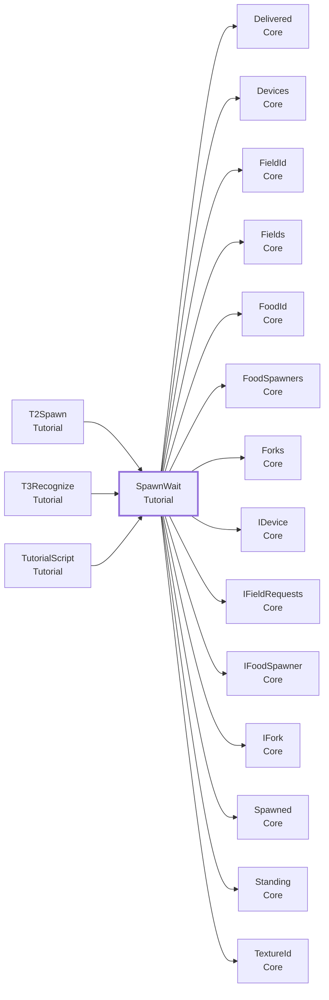

- この型を使う所: [`T2Spawn`](#t-t2spawn)、[`T3Recognize`](#t-t3recognize)、[`TutorialScript`](#t-tutorialscript)
- この型が使う型: [`Delivered`](Core.md#t-delivered)、[`Devices`](Core.md#t-devices)、[`FieldId`](Core.md#t-fieldid)、[`Fields`](Core.md#t-fields)、[`FoodId`](Core.md#t-foodid)、[`FoodSpawners`](Core.md#t-foodspawners)、[`Forks`](Core.md#t-forks)、[`IDevice`](Core.md#t-idevice)、[`IFieldRequests`](Core.md#t-ifieldrequests)、[`IFoodSpawner`](Core.md#t-ifoodspawner)、[`IFork`](Core.md#t-ifork)、[`Spawned`](Core.md#t-spawned)、[`Standing`](Core.md#t-standing)、[`TextureId`](Core.md#t-textureid)

### この型を使う手順

- [チュートリアルの中で、イベントを待つ・使う](recipes.md#r-tutorial-event)

### メンバー（2）

| 種類 | メンバー | 説明 |
|---|---|---|
| プロパティ | `Spawned? Result` | （説明はコードにありません） |
| メソッド | `protected override void Unsubscribe()` | （説明はコードにありません） |

---

## StandWait

**待ち（yield return）**（人形劇スクリプトで yield return する）・ `sealed class` ・ 名前空間 `MouthOfGod.Tutorial` ・ [`Tutorial/TutorialWait.cs`](../../Assets/Scripts/Tutorial/TutorialWait.cs)
 継承・実装: [`TutorialWait`](#t-tutorialwait)

体験者が、あるフィールドの前に立つのを待つ（[`Standing`](Core.md#t-standing)）。field を空にすると、どこかのフィールドの前に立てばよい。待ち始めたときに、もうその場所に立っていれば、すぐ終わる。

### なぜこの形か

- **[チュートリアルは、コルーチンの人形劇スクリプトで書く](design.md#d-puppet)**: チュートリアルは約 8 分の一本道です。

### つながり

- この型を使う所: [`T1Fork`](#t-t1fork)、[`TutorialScript`](#t-tutorialscript)
- この型が使う型: [`Delivered`](Core.md#t-delivered)、[`Devices`](Core.md#t-devices)、[`FieldId`](Core.md#t-fieldid)、[`Fields`](Core.md#t-fields)、[`FoodId`](Core.md#t-foodid)、[`FoodSpawners`](Core.md#t-foodspawners)、[`Forks`](Core.md#t-forks)、[`IDevice`](Core.md#t-idevice)、[`IFieldRequests`](Core.md#t-ifieldrequests)、[`IFoodSpawner`](Core.md#t-ifoodspawner)、[`IFork`](Core.md#t-ifork)、[`Spawned`](Core.md#t-spawned)、[`Standing`](Core.md#t-standing)、[`TextureId`](Core.md#t-textureid)

### この型を使う手順

- [チュートリアルの中で、イベントを待つ・使う](recipes.md#r-tutorial-event)

### メンバー（1）

| 種類 | メンバー | 説明 |
|---|---|---|
| メソッド | `protected override void Unsubscribe()` | （説明はコードにありません） |

---

## T1Fork

**コンポーネント**（GameObject に付ける）・ `sealed class` ・ 名前空間 `MouthOfGod.Tutorial` ・ [`Tutorial/T1Fork.cs`](../../Assets/Scripts/Tutorial/T1Fork.cs)
 継承・実装: [`TutorialScript`](#t-tutorialscript)

チュートリアル 1「フォークの使い方」（シナリオブック S3）。雲を刺す → 口に含む → 食感が切り替わる → ボタンで決定する、の順に進める。

### なぜこの形か

- **[作業の単位と、ファイルの単位をそろえる](design.md#d-files)**: シーンや Prefab は、Git でマージできないからです。
- **[チュートリアルは、コルーチンの人形劇スクリプトで書く](design.md#d-puppet)**: チュートリアルは約 8 分の一本道です。
- **[チュートリアルは 1 本ずつ Prefab にし、セリフもその中に持つ](design.md#d-tutprefab)**: チュートリアルは、担当者が並行して作ります。

### しくみ・注意

流れ:
0. （Stand Field が空でなければ）足あとの印を出し、その場所に立つのを待つ。時間がたったら、立たなくても進む（ブースではキーを打てないため）。
1. 雲を光らせ、刺すのを待つ。Hint 秒たっても刺せなければ、光る雲を近くへ寄せる。
2. 口に含むのを待つ。Hint 秒たったら、巫女がくり返す。Alert 秒たったら、スタッフに知らせる印を出す。
3. 食感が Texture Changes 回切り替わるのを待つ。
4. ボタンを光らせ、決定するのを待つ。Hint 秒たったら、ボタンを強く光らせる。
5. 雲とボタンの光を消し、"Good." と言う。どの段もあきらめずに終わったときだけ、`fork-learned` を覚える。
どの待ちにも Give Up 秒（0 なら待ち続ける）があり、過ぎたら次の段へ進む。体験が止まらないようにするため。

出す合図（名前は Inspector で変えられる。空にすると出さない）:
- `<Stand Field>.footprint`: 立つ場所の足あとの印を出す
- `cloud.glow`: 雲を 1 つ光らせる（CloudCues が受ける）
- `cloud.approach`: 光る雲を体験者の近くへ寄せる（CloudCues が受ける）
- `cloud.calm`: 雲の光を消し、寄せた雲を戻す（CloudCues が受ける）
- `staff.alert`: スタッフに、体験者が困っていると知らせる
- `device.button.glow` / `device.button.glow-strong` / `device.button.glow-off`: ボタンの位置を光らせる・強く光らせる・消す
- `miko.say.<id>`: 巫女のセリフ（下の表。文はシーンの LineBook に書く）

セリフ（id: 英語。日本語は参考訳）:
- `t1-pierce`: "Take the fork in your hand. Pierce that glowing cloud."（手のフォークで、あの光る雲を刺してみよ。）
- `t1-mouth`: "Now bring it to your mouth."（では、それを口に含むのじゃ。）
- `t1-mouth-again`: "Bring it to your mouth."（口に含むのじゃ。）
- `t1-changing`: "Keep it in your mouth. Feel it? The texture keeps changing."（含んだままでおれ。味わいが移ろうであろう？）
- `t1-button`: "When it feels right, press the button."（これだと思うたら、ボタンを押すのじゃ。）
- `t1-good`: "Good."（うむ、よいぞ。）

### つながり

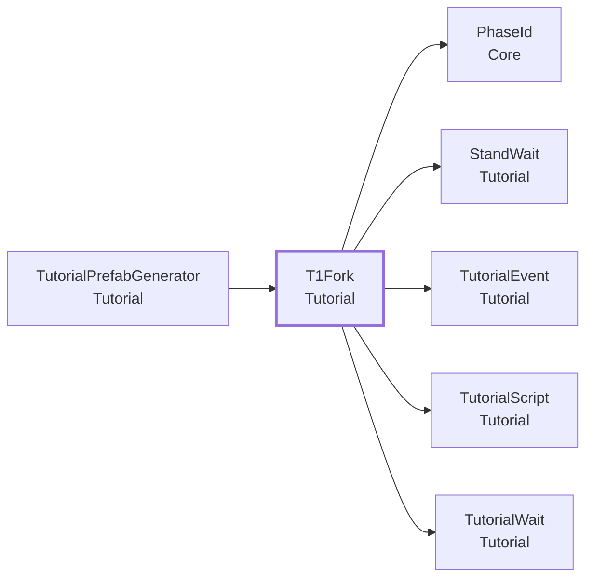

- この型を使う所: [`TutorialPrefabGenerator`](#t-tutorialprefabgenerator)
- この型が使う型: [`PhaseId`](Core.md#t-phaseid)、[`StandWait`](#t-standwait)、[`TutorialEvent`](#t-tutorialevent)、[`TutorialScript`](#t-tutorialscript)、[`TutorialWait`](#t-tutorialwait)

### Inspector（28 項目）

| 項目 | 型 | 既定値 | 説明 |
|---|---|---|---|
| **0. 立つ場所** | | | |
| Stand Field | `string` | 空 | 最初に立ってもらうフィールドの名前。空なら、この段を飛ばす（チュートリアル 1 は、どこに立っていても遊べる） |
| Stand Cue Suffix | `string` | `".footprint"` | 立つ場所の印の合図の後ろ半分。Stand Field のあとに付けて出す（village.footprint）。空なら出さない |
| Stand Line | `string` | 空 | 立つ場所を案内するセリフの id。空なら言わない |
| Stand Give Up Seconds | `float` | 15 | この秒数たっても立たなければ、そのまま進む。0 なら立つまで待ち続ける |
| **1. 雲を刺す** | | | |
| Pierce Glow Cue | `string` | `"cloud.glow"` | 雲を 1 つ光らせる合図。空なら出さない |
| Pierce Line | `string` | `"t1-pierce"` | 刺すように言うセリフの id。Take the fork in your hand. Pierce that glowing cloud. |
| Pierce Hint Seconds | `float` | 10 | この秒数たっても刺せなければ、ヒントの合図を出す。0 ならヒントなし |
| Pierce Hint Cue | `string` | `"cloud.approach"` | 刺せないときのヒントの合図（光る雲を近くへ寄せる）。空なら出さない |
| Pierce Give Up Seconds | `float` | 45 | この秒数たっても刺せなければ、次へ進む。0 なら待ち続ける |
| **2. 口に含む** | | | |
| Mouth Line | `string` | `"t1-mouth"` | 口に含むように言うセリフの id。Now bring it to your mouth. |
| Mouth Hint Seconds | `float` | 10 | この秒数たっても含まなければ、もう一度言う。0 ならくり返さない |
| Mouth Hint Line | `string` | `"t1-mouth-again"` | くり返すセリフの id。Bring it to your mouth. |
| Mouth Alert Seconds | `float` | 20 | この秒数たっても含まなければ、スタッフに知らせる合図を出す（待ち始めからの秒数）。0 なら出さない |
| Mouth Alert Cue | `string` | `"staff.alert"` | スタッフに知らせる合図。空なら出さない |
| Mouth Give Up Seconds | `float` | 45 | この秒数たっても含まなければ、次へ進む。0 なら待ち続ける |
| **3. 食感が切り替わる** | | | |
| Changing Line | `string` | `"t1-changing"` | 含んだままでいるように言うセリフの id。Keep it in your mouth. Feel it? The texture keeps changing. |
| Texture Changes | `int` | `3` | 食感が何回切り替わったら進むか |
| Changing Give Up Seconds | `float` | 30 | この秒数たっても切り替わりきらなければ、次へ進む。0 なら待ち続ける |
| **4. ボタンで決定する** | | | |
| Button Glow Cue | `string` | `"device.button.glow"` | ボタンの位置を光らせる合図。空なら出さない |
| Button Line | `string` | `"t1-button"` | ボタンを押すように言うセリフの id。When it feels right, press the button. |
| Button Hint Seconds | `float` | 10 | この秒数たっても押さなければ、ヒントの合図を出す。0 ならヒントなし |
| Button Hint Cue | `string` | `"device.button.glow-strong"` | 押さないときのヒントの合図（ボタンを強く光らせる）。空なら出さない |
| Button Give Up Seconds | `float` | 45 | この秒数たっても押さなければ、次へ進む。0 なら待ち続ける |
| **5. 終わり** | | | |
| Calm Cue | `string` | `"cloud.calm"` | 雲の光を消し、寄せた雲を戻す合図。空なら出さない |
| Button Off Cue | `string` | `"device.button.glow-off"` | ボタンの光を消す合図。空なら出さない |
| Good Line | `string` | `"t1-good"` | ほめるセリフの id。Good. |
| End Hold Seconds | `float` | 2 | ほめたあと、次のチュートリアルへ進むまでの秒数（セリフを聞き終わるまで） |
| **間** | | | |
| Beat Pause Seconds | `float` | 0.5 | 段と段のあいだの秒数。できた直後に次のセリフを重ねないため |

### メンバー（2）

| 種類 | メンバー | 説明 |
|---|---|---|
| プロパティ | `override PhaseId Phase` | （説明はコードにありません） |
| メソッド | `override IEnumerator Play()` | （説明はコードにありません） |

---

## T2Spawn

**コンポーネント**（GameObject に付ける）・ `sealed class` ・ 名前空間 `MouthOfGod.Tutorial` ・ [`Tutorial/T2Spawn.cs`](../../Assets/Scripts/Tutorial/T2Spawn.cs)
 継承・実装: [`TutorialScript`](#t-tutorialscript)

チュートリアル 2「物が生まれる」（シナリオブック S4。場面 spawn）。口に含んだ食感で、口から物が生まれることを見せる。【参考】この流れは、担当者が作り直すときの参考です（#317・#318 で、かぶって試しながら調整する）。霞の中の影（shadow.* の合図と [`FoodShadow`](UI.md#t-foodshadow)）は、試しに入れたものです。影は実装しないことになったので（#277）、使わなくてかまいません。使わないときは、Inspector で shadow の合図の名前を空にします。

### なぜこの形か

- **[作業の単位と、ファイルの単位をそろえる](design.md#d-files)**: シーンや Prefab は、Git でマージできないからです。
- **[チュートリアルは、コルーチンの人形劇スクリプトで書く](design.md#d-puppet)**: チュートリアルは約 8 分の一本道です。
- **[チュートリアルは 1 本ずつ Prefab にし、セリフもその中に持つ](design.md#d-tutprefab)**: チュートリアルは、担当者が並行して作ります。

### しくみ・注意

流れ:
1. お供え物のリンゴを目の前に浮かべ、雲を光らせ、影を出し始める。雲を刺して、口に含むのを待つ（待ちきれないと、ヒントをくり返す）。
2. 「リンゴの影を待て」と言い、何かが生まれるのを待つ。目当ての食べ物（既定 `apple`）なら次へ。
   ほかの物なら「それも恵みじゃ。だが今はリンゴを」と言って、もう一度待つ。決めた回数外したら、影を強く見せる。
3. お供え物と影を消し、「見よ、恵みが生まれたぞ」と言う。`food-born` と `texture-shadow-seen` を覚える。

出す合図（Inspector で名前を変えられる。空にすると出さない）:
- `offering.show` / `offering.hide`: お供え物のリンゴを見せる・消す。`Offering` に物を入れれば、このスクリプトも直接出し入れする。
- `cloud.glow`: 雲を光らせる。
- `shadow.show` / `shadow.emphasize` / `shadow.hide`: 影を出す・強く見せる・消す（UI の FoodShadow が受ける）。
- `miko.say.<id>`: 巫女のセリフ（`Say`）。

セリフ（英文はシーンの Miko の LineBook に書く。ここは既定の id と、そこに入れる文）:
- `t2-remember`: "Remember the apple the villagers offered? Pierce a cloud and put it in your mouth."
- `t2-remember-short`: "Remember the apple the villagers offered? Try it again." （`fork-learned` を覚えているときに使う）
- `t2-hint-pierce`: "Pierce a cloud with your fork."
- `t2-hint-mouth`: "Bring it to your mouth."
- `t2-wait-apple`: "As the feel changes, so does the blessing. Wait for the apple."
- `t2-wrong`: "That too is a blessing — but now, the apple."
- `t2-born`: "Look! A blessing is born from your mouth! Remember that feel."

ブースで止まらないように、あきらめる時間（`Give Up Seconds`）を過ぎたら、生まれていなくても先へ進む。
そのときは `t2-born` を言わず、見たことだけを覚える（何か生まれていれば `food-born`、口に含んでいれば `texture-shadow-seen`）。

### つながり

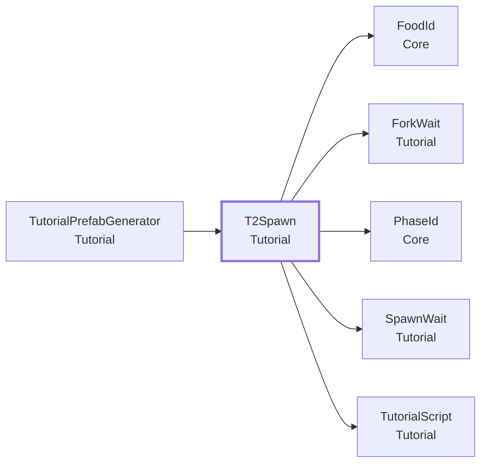

- この型を使う所: [`TutorialPrefabGenerator`](#t-tutorialprefabgenerator)
- この型が使う型: [`FoodId`](Core.md#t-foodid)、[`ForkWait`](#t-forkwait)、[`PhaseId`](Core.md#t-phaseid)、[`SpawnWait`](#t-spawnwait)、[`TutorialScript`](#t-tutorialscript)

### Inspector（23 項目）

| 項目 | 型 | 既定値 | 説明 |
|---|---|---|---|
| **食べ物** | | | |
| Target Food | `string` | `"apple"` | 生んでほしい食べ物の ID。これが生まれたら成功 |
| Misses Before Emphasize | `int` | `3` | 目当て以外を何回生んだら、影を強く見せるか（0 なら強くしない） |
| **お供え物** | | | |
| Offering | `GameObject` | なし | 目の前に浮かべるお供え物のリンゴ。入れれば、始めに表示し、終わりに隠す。空なら合図だけ出す |
| **時間（秒）** | | | |
| Pierce Hint Seconds | `float` | 10 | 雲を刺さないとき、刺すヒントをくり返す間隔（0 ならくり返さない） |
| Mouth Hint Seconds | `float` | 10 | 口に含まないとき、含むヒントをくり返す間隔（0 ならくり返さない） |
| Spawn Hint Seconds | `float` | 20 | 何も生まれないとき、「リンゴの影を待て」をくり返す間隔（0 ならくり返さない） |
| Give Up Seconds | `float` | 90 | 始めてからこの秒数がたったら、生まれていなくても先へ進む（ブースで止まらないように）。0 なら、いつまでも待つ |
| Born Delay Seconds | `float` | 0.5 | 目当ての物が生まれてから、「見よ」と言うまでの間（物が落ちるのを見せる） |
| End Pause Seconds | `float` | 4 | 最後のセリフのあと、次のチュートリアルへ進むまでの間（セリフを聞き終える時間） |
| **セリフの id（Miko の LineBook の Id。空なら言わない）** | | | |
| Remember Line | `string` | `"t2-remember"` | 最初の語り。「供えたリンゴを覚えておるか。雲を刺して、口に含んでみよ」 |
| Remember Short Line | `string` | `"t2-remember-short"` | チュートリアル 1 を済ませた（fork-learned）ときの、短い最初の語り。空なら Remember Line を使う |
| Pierce Hint Line | `string` | `"t2-hint-pierce"` | 雲を刺さないときのヒント。「フォークで雲を刺すのじゃ」 |
| Mouth Hint Line | `string` | `"t2-hint-mouth"` | 口に含まないときのヒント。「口に含むのじゃ」 |
| Wait Apple Line | `string` | `"t2-wait-apple"` | 口に含んだあと。「歯ざわりが変われば、生まれる物も変わる。リンゴの影が見えたら、そこじゃ」 |
| Wrong Line | `string` | `"t2-wrong"` | ほかの物が生まれたとき。「それも恵みじゃ。だが今はリンゴを」 |
| Born Line | `string` | `"t2-born"` | 目当ての物が生まれたとき。「見よ、そなたの口から恵みが生まれたぞ！」 |
| Give Up Line | `string` | 空 | あきらめて先へ進むときのセリフ（空なら言わない） |
| **合図の名前（空なら出さない）** | | | |
| Offering Show Cue | `string` | `"offering.show"` | お供え物のリンゴを見せる |
| Offering Hide Cue | `string` | `"offering.hide"` | お供え物のリンゴを消す |
| Cloud Glow Cue | `string` | `"cloud.glow"` | 雲を光らせる |
| Shadow Show Cue | `string` | `"shadow.show"` | 影を出し始める（UI の FoodShadow が受ける） |
| Shadow Emphasize Cue | `string` | `"shadow.emphasize"` | 外し続けたとき、影を強く見せる |
| Shadow Hide Cue | `string` | `"shadow.hide"` | 影を消す |

### メンバー（3）

| 種類 | メンバー | 説明 |
|---|---|---|
| プロパティ | `override PhaseId Phase` | （説明はコードにありません） |
| メソッド | `override IEnumerator Play()` | （説明はコードにありません） |
| メソッド | `protected override void OnAborted()` | （説明はコードにありません） |

---

## T3Recognize

**コンポーネント**（GameObject に付ける）・ `sealed class` ・ 名前空間 `MouthOfGod.Tutorial` ・ [`Tutorial/T3Recognize.cs`](../../Assets/Scripts/Tutorial/T3Recognize.cs)
 継承・実装: [`TutorialScript`](#t-tutorialscript)

チュートリアル 3「食感で変わる・欲しい物」（シナリオブック S5。場面 recognize）。海の村人が魚を欲しがる吹き出しを見せ、体験者に、魚の食感を思い出して魚を生ませる。【参考】この流れは、担当者が作り直すときの参考です（#317・#318 で、かぶって試しながら調整する）。霞の中の影（shadow.* の合図と [`FoodShadow`](UI.md#t-foodshadow)）は、試しに入れたものです。影は実装しないことになったので（#277）、使わなくてかまいません。使わないときは、Inspector で shadow の合図の名前を空にします。

### なぜこの形か

- **[作業の単位と、ファイルの単位をそろえる](design.md#d-files)**: シーンや Prefab は、Git でマージできないからです。
- **[チュートリアルは、コルーチンの人形劇スクリプトで書く](design.md#d-puppet)**: チュートリアルは約 8 分の一本道です。
- **[チュートリアルは 1 本ずつ Prefab にし、セリフもその中に持つ](design.md#d-tutprefab)**: チュートリアルは、担当者が並行して作ります。

### しくみ・注意

流れ:
1. 海（`requestField`）に、魚（`requestFood`）の欲しい物を出す（`Fields.Find(海).Open(魚)`。吹き出しは UI が出す）。
   海を光らせ、巫女が「海の者が困っておる」と言う。フィールドが無い・出せないときは、警告を出して先へ進む。
2. 霞の影を出す（T2 で影を見ていれば薄く）。雲を光らせ、巫女が「魚はどの歯ざわりであったか」と聞く。
   魚が生まれるまで待つ。違う物が生まれたら「それではない」と言い、何回か外したら影を強める。
3. 影を消し、巫女が「恵みは立つ場所に落ちる。魚は海のもの」と言う。`request-seen` を覚える。

海の欲しい物は、出したまま終える（チュートリアル 4 で海に届ける）。ここでは Expire しない。

出す合図（Inspector で変えられる。空にすると出さない）:
- `<requestField>.glow`（例 `sea.glow`）: 欲しがっているフィールドを光らせる。
- `shadow.show`: 霞の影を、ふつうの濃さで出す（T2 で影を見ていないとき）。
- `shadow.faint`: 霞の影を、S4 より薄く出す（覚えたこと `texture-shadow-seen` があるとき）。
- `shadow.emphasize`: 何回か外したので、影をはっきり出す。
- `shadow.hide`: 影を消す。
- `cloud.glow`: 刺す雲を光らせる。

巫女のセリフ（合図 `miko.say.<id>`。中身はシーンの Miko の LineBook に書く）:
- `t3-troubled`: "Oh, the people by the sea are troubled. They want fish."
- `t3-which-feel`: "Pierce a new cloud. Which feel was the fish?"
- `t3-wrong`: "Not that one. Which feel was the fish?"（台本に無いので仮）
- `t3-fish-here`: "That's the fish — but blessings fall where you stand. Fish belong in the sea."

魚・海は仮の割り当て（村 → リンゴ、海 → 魚）。決まったら Inspector で変える。

### つながり

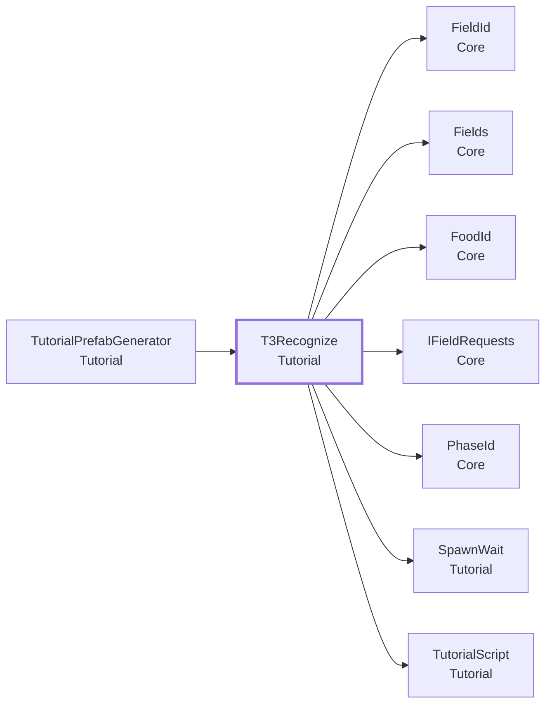

- この型を使う所: [`TutorialPrefabGenerator`](#t-tutorialprefabgenerator)
- この型が使う型: [`FieldId`](Core.md#t-fieldid)、[`Fields`](Core.md#t-fields)、[`FoodId`](Core.md#t-foodid)、[`IFieldRequests`](Core.md#t-ifieldrequests)、[`PhaseId`](Core.md#t-phaseid)、[`SpawnWait`](#t-spawnwait)、[`TutorialScript`](#t-tutorialscript)

### Inspector（17 項目）

| 項目 | 型 | 既定値 | 説明 |
|---|---|---|---|
| **欲しい物** | | | |
| Request Field | `string` | `"sea"` | 欲しい物を出すフィールドの ID（village / mountain / sea / grassland）。光らせる合図は「<この ID>.glow」になる |
| Request Food | `string` | `"fish"` | 欲しがる食べ物の ID。これが生まれたら先へ進む |
| **合図（空にすると出さない）** | | | |
| Field Glow Suffix | `string` | `"glow"` | フィールドを光らせる合図の、フィールド ID の後ろの部分。「glow」なら「sea.glow」を出す。空にすると出さない |
| Shadow Faint Cue | `string` | `"shadow.faint"` | 影を薄く出す合図。T2 で影を見た（texture-shadow-seen）ときに出す |
| Shadow Show Cue | `string` | `"shadow.show"` | 影をふつうに出す合図。T2 で影を見ていないときに出す |
| Shadow Emphasize Cue | `string` | `"shadow.emphasize"` | 何回か外したときに、影をはっきり出す合図 |
| Shadow Hide Cue | `string` | `"shadow.hide"` | 影を消す合図。魚が生まれたら出す |
| Cloud Glow Cue | `string` | `"cloud.glow"` | 刺す雲を光らせる合図 |
| **巫女のセリフ（LineBook の id。空にすると言わない）** | | | |
| Troubled Line | `string` | `"t3-troubled"` | Oh, the people by the sea are troubled. They want fish.（おや、海の者が困っておる。魚が欲しいようじゃ。） |
| Which Feel Line | `string` | `"t3-which-feel"` | Pierce a new cloud. Which feel was the fish?（新しい雲を刺してみよ。魚は、どの歯ざわりであったかの？） |
| Wrong Line | `string` | `"t3-wrong"` | 違う物が生まれたときのセリフ（仮: Not that one. Which feel was the fish?） |
| Fish Here Line | `string` | `"t3-fish-here"` | That's the fish — but blessings fall where you stand. Fish belong in the sea.（うむ、魚じゃ。だが恵みは、そなたの立つ場所に落ちる。魚は海のものじゃ。） |
| **間と時間切れ** | | | |
| Pause After Troubled Seconds | `float` | 3 | 「海の者が困っておる」のあと、次のセリフまで待つ秒数 |
| Pause Before Fish Here Seconds | `float` | 1.5 | 魚が生まれたあと、「魚は海のもの」と言うまで待つ秒数（魚が落ちて跳ねるのを見せる間） |
| Pause At End Seconds | `float` | 4 | 最後のセリフのあと、次のチュートリアルへ進むまで待つ秒数 |
| Misses Before Emphasize | `int` | `2` | この回数だけ違う物が生まれたら、影をはっきり出す（shadow.emphasize）。0 なら出さない |
| Give Up Seconds | `float` | 60 | 魚が生まれるのを待つ秒数。過ぎたら、あきらめて先へ進む（ブースで止まらないため）。0 なら、ずっと待つ |

### メンバー（2）

| 種類 | メンバー | 説明 |
|---|---|---|
| プロパティ | `override PhaseId Phase` | （説明はコードにありません） |
| メソッド | `override IEnumerator Play()` | （説明はコードにありません） |

---

## T4Deliver

**コンポーネント**（GameObject に付ける）・ `sealed class` ・ 名前空間 `MouthOfGod.Tutorial` ・ [`Tutorial/T4Deliver.cs`](../../Assets/Scripts/Tutorial/T4Deliver.cs)
 継承・実装: [`TutorialScript`](#t-tutorialscript)

チュートリアル 4「届ける」（シナリオブック S6）。届け先は、体験者が立っている場所で決まることを覚えてもらう。欲しがっているフィールド（既定は海）の前まで歩き、そこで欲しい物（既定は魚）を生み出すと終わる。

### なぜこの形か

- **[作業の単位と、ファイルの単位をそろえる](design.md#d-files)**: シーンや Prefab は、Git でマージできないからです。
- **[チュートリアルは、コルーチンの人形劇スクリプトで書く](design.md#d-puppet)**: チュートリアルは約 8 分の一本道です。
- **[チュートリアルは 1 本ずつ Prefab にし、セリフもその中に持つ](design.md#d-tutprefab)**: チュートリアルは、担当者が並行して作ります。

### しくみ・注意

流れ:
1. 準備。目当てのフィールドの欲しい物が出ていなければ、Open(食べ物) で出す（チュートリアル 3 を外しても、これだけで動くように）。
   フィールドがシーンに無ければ、警告を出して、このチュートリアルを終える（止まらない）。
2. フィールドを光らせ、足あとの印を出し、巫女をついて来させて「海の前まで歩き、そこで魚を生み出す」と言う。
   その後は、どこかに物が届くのを待つ。目当てのフィールドに、欲しがっていた物が届いたら成功。
   - 目当ての前に立ったら、足あとの印を消し、「ここで生み出す」と言う。
   - よそのフィールドに届いたら、「ここではない」と言う。足あとの印をもう一度出す。
   - 目当てのフィールドに、違う物が届いたら、指示をもう一度言う。
   - どちらの場合も、届いたフィールドは自分でがっかりする（DeliveryFx）。届いた物は霞のように消える（DeliveryZone）。
   - しばらく何も届かなければ、指示をもう一度言う。
   - あきらめる時間を過ぎたら、成功しないまま 4 へ進む（ブースを止めない）。
3. 成功したら、「見事じゃ」と言う。フィールドは自分で喜ぶ（ステップが済み、DeliveryFx が粒と音を出す）。
4. 光と足あとの印を消し、巫女をとどまらせて、締めのセリフを言う。成功したときだけ、`delivered-by-standing` を覚える。

出す合図（フィールド名は Inspector の Field。接尾辞を空にした合図は出さない）:
- `<field>.glow` / `<field>.glow-off`: 目当てのフィールドを光らせる / 光を消す。
- `<field>.footprint` / `<field>.footprint-off`: 目当てのフィールドの前の床に、足あとの印を出す / 消す。
- `<field>.cheer` / `<届いたフィールド>.shake-head`: 既定では出さない。届いたときの反応（喜ぶ・がっかりする）は、
  フィールドの DeliveryFx が、チュートリアルでも本編でも同じように出すため。演出を足したいときだけ、接尾辞を入れる。
- `miko.follow` / `miko.stay`: 巫女が体験者についてくる / その場にとどまる。

セリフ（`miko.say.<id>`。中身はシーンの Miko の LineBook に書く）:
- `t4-walk`: "Walk to the sea, and create the fish there."
- `t4-here`: "Now, create it here."
- `t4-not-here`: "Not here — go to the place that glows."
- `t4-splendid`: "Splendid!"
- `t4-true-god`: "Find what each place needs, go there, and create it. Now you are a true god."

### つながり

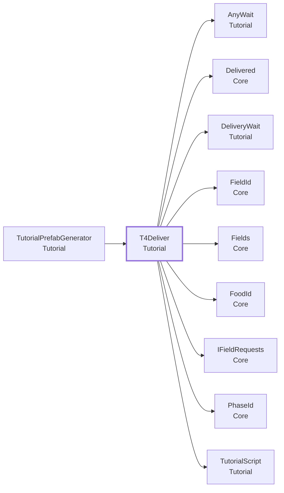

- この型を使う所: [`TutorialPrefabGenerator`](#t-tutorialprefabgenerator)
- この型が使う型: [`AnyWait`](#t-anywait)、[`Delivered`](Core.md#t-delivered)、[`DeliveryWait`](#t-deliverywait)、[`FieldId`](Core.md#t-fieldid)、[`Fields`](Core.md#t-fields)、[`FoodId`](Core.md#t-foodid)、[`IFieldRequests`](Core.md#t-ifieldrequests)、[`PhaseId`](Core.md#t-phaseid)、[`TutorialScript`](#t-tutorialscript)

### Inspector（20 項目）

| 項目 | 型 | 既定値 | 説明 |
|---|---|---|---|
| **届け先** | | | |
| Field | `string` | `"sea"` | 届けてもらうフィールドの ID（village / mountain / sea / grassland）。合図の名前の頭にも使う |
| Food | `string` | `"fish"` | 届けてもらう物の ID。このフィールドが欲しがっていなければ、始めに Open で欲しがらせる |
| **セリフ（巫女の LineBook の Id。空なら言わない）** | | | |
| Walk Line | `string` | `"t4-walk"` | 指示。「Walk to the sea, and create the fish there.」。しばらく届かないときも、くり返す |
| Here Line | `string` | `"t4-here"` | 目当てのフィールドの前に立ったとき。「Now, create it here.」 |
| Not Here Line | `string` | `"t4-not-here"` | よそのフィールドに届いたとき。「Not here — go to the place that glows.」 |
| Wrong Food Line | `string` | `"t4-walk"` | 目当てのフィールドに、違う物が届いたとき。既定は指示のくり返し |
| Splendid Line | `string` | `"t4-splendid"` | 正しく届いたとき。「Splendid!」 |
| True God Line | `string` | `"t4-true-god"` | 締め。「Find what each place needs, go there, and create it. Now you are a true god.」 |
| **合図（フィールドの ID のあとに付ける接尾辞。空なら出さない）** | | | |
| Glow Suffix | `string` | `"glow"` | 目当てのフィールドを光らせる（<field>.glow） |
| Glow Off Suffix | `string` | `"glow-off"` | 光を消す（<field>.glow-off）。最後に出す |
| Footprint Suffix | `string` | `"footprint"` | 目当てのフィールドの前に、足あとの印を出す（<field>.footprint） |
| Footprint Off Suffix | `string` | `"footprint-off"` | 足あとの印を消す（<field>.footprint-off）。前に立ったときと、最後に出す |
| Cheer Suffix | `string` | 空 | 正しく届いたフィールドに出す合図（<field>.cheer）。空なら出さない。届いたときの反応は、フィールドの DeliveryFx が出すので、ふつうは空のまま |
| Shake Head Suffix | `string` | 空 | 違う場所・違う物が届いたフィールドに出す合図（<届いたフィールド>.shake-head）。空なら出さない。ふつうは空のまま（DeliveryFx が反応する） |
| **巫女の合図（空なら出さない）** | | | |
| Miko Follow Cue | `string` | `"miko.follow"` | 指示を出すときに、巫女を体験者についてこさせる |
| Miko Stay Cue | `string` | `"miko.stay"` | 締めのセリフの前に、巫女をその場にとどまらせる |
| **時間（秒）** | | | |
| Hint Seconds | `float` | 15 | この秒数のあいだ何も届かなければ、指示をもう一度言う。0 なら言わない |
| Give Up Seconds | `float` | 60 | この秒数たっても正しく届かなければ、あきらめて締めへ進む。0 ならいつまでも待つ |
| Pause After Splendid | `float` | 2 | 「Splendid!」のあと、締めのセリフまでの間 |
| Pause After True God | `float` | 5 | 締めのセリフのあと、次の場面へ進むまでの間 |

### メンバー（2）

| 種類 | メンバー | 説明 |
|---|---|---|
| プロパティ | `override PhaseId Phase` | （説明はコードにありません） |
| メソッド | `override IEnumerator Play()` | （説明はコードにありません） |

---

## TextureChangeWait

**待ち（yield return）**（人形劇スクリプトで yield return する）・ `sealed class` ・ 名前空間 `MouthOfGod.Tutorial` ・ [`Tutorial/TutorialWait.cs`](../../Assets/Scripts/Tutorial/TutorialWait.cs)
 継承・実装: [`TutorialWait`](#t-tutorialwait)

噛んでいる間に、食感が count 回切り替わるのを待つ（TextureChanged）。待ち始めてからの回数を数える。噛み始めの最初の食感も 1 回に数える。待ち始める前の回数（先回りした分）を already で渡せる。

### なぜこの形か

- **[チュートリアルは、コルーチンの人形劇スクリプトで書く](design.md#d-puppet)**: チュートリアルは約 8 分の一本道です。

### つながり

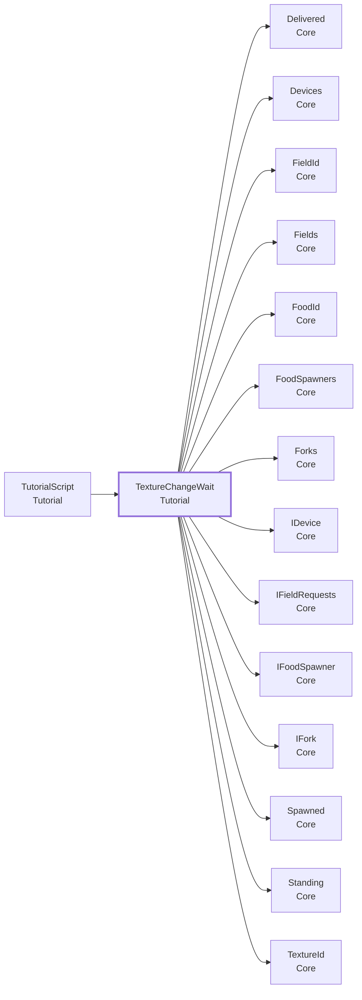

- この型を使う所: [`TutorialScript`](#t-tutorialscript)
- この型が使う型: [`Delivered`](Core.md#t-delivered)、[`Devices`](Core.md#t-devices)、[`FieldId`](Core.md#t-fieldid)、[`Fields`](Core.md#t-fields)、[`FoodId`](Core.md#t-foodid)、[`FoodSpawners`](Core.md#t-foodspawners)、[`Forks`](Core.md#t-forks)、[`IDevice`](Core.md#t-idevice)、[`IFieldRequests`](Core.md#t-ifieldrequests)、[`IFoodSpawner`](Core.md#t-ifoodspawner)、[`IFork`](Core.md#t-ifork)、[`Spawned`](Core.md#t-spawned)、[`Standing`](Core.md#t-standing)、[`TextureId`](Core.md#t-textureid)

### この型を使う手順

- [チュートリアルの中で、イベントを待つ・使う](recipes.md#r-tutorial-event)

### メンバー（2）

| 種類 | メンバー | 説明 |
|---|---|---|
| プロパティ | `int Changes` | 食感が切り替わった回数（先回りした分を含む）。 |
| メソッド | `protected override void Unsubscribe()` | （説明はコードにありません） |

---

## TutorialEvent

**選択肢（enum）**（決まった値の中から選ぶ）・ `enum` ・ 名前空間 `MouthOfGod.Tutorial` ・ [`Tutorial/TutorialHistory.cs`](../../Assets/Scripts/Tutorial/TutorialHistory.cs)

[`TutorialHistory`](#t-tutorialhistory) が記録すること。

### つながり

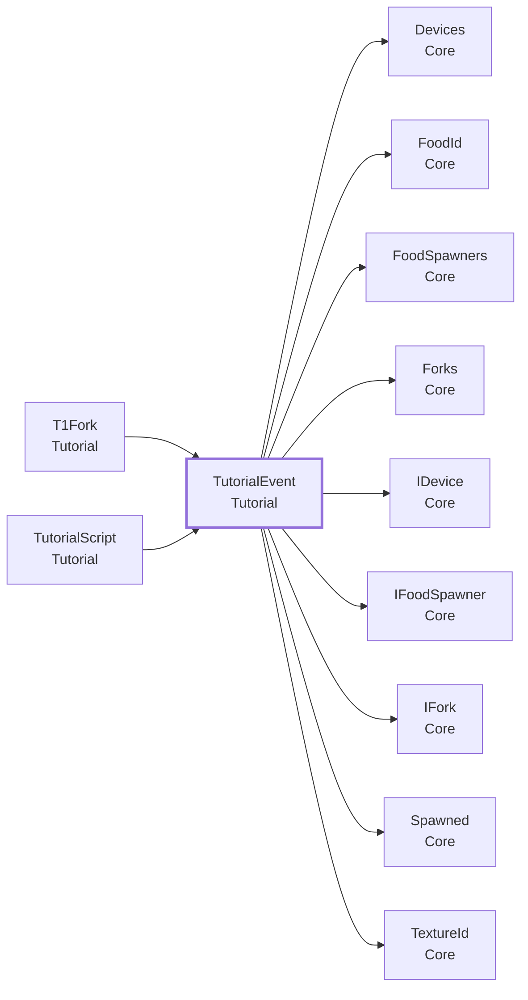

- この型を使う所: [`T1Fork`](#t-t1fork)、[`TutorialScript`](#t-tutorialscript)
- この型が使う型: [`Devices`](Core.md#t-devices)、[`FoodId`](Core.md#t-foodid)、[`FoodSpawners`](Core.md#t-foodspawners)、[`Forks`](Core.md#t-forks)、[`IDevice`](Core.md#t-idevice)、[`IFoodSpawner`](Core.md#t-ifoodspawner)、[`IFork`](Core.md#t-ifork)、[`Spawned`](Core.md#t-spawned)、[`TextureId`](Core.md#t-textureid)

### 値

| 値 | 意味 |
|---|---|
| `Pierced` | 雲を刺した。 |
| `MouthEntered` | かけらの付いた先を、口に含んだ。 |
| `TextureChanged` | 食感が変わった（噛み始めの最初の食感も含む）。 |
| `Confirmed` | 食感を選んで決定した。 |
| `Spawned` | 食べ物が生まれた。 |

---

## TutorialHistory

**クラス**（コードから new して使う）・ `sealed class` ・ 名前空間 `MouthOfGod.Tutorial` ・ [`Tutorial/TutorialHistory.cs`](../../Assets/Scripts/Tutorial/TutorialHistory.cs)
 継承・実装: `IDisposable`

チュートリアルが始まってから、体験者がしたことの記録。待ちが、先回りした操作も数えるために使う。たとえば「刺して」と言う前に刺していたら、刺すのを待つ待ちは、すぐ終わる。

### しくみ・注意

- 記録するのは、刺した・かけらの付いた先を口に含んだ・食感が変わった・決定した（食感あり）・食べ物が生まれた、の 5 つ。
- 待ちは、まだ使われていない記録を数える。待ちが終わると、その種類の記録は、そこまで使ったことにする（同じ操作で 2 回進まない）。
- [`TutorialRunner`](#t-tutorialrunner) が、チュートリアル 1 つごとに作り、終わったら `Dispose` する。前のチュートリアルの操作は数えない。

### つながり

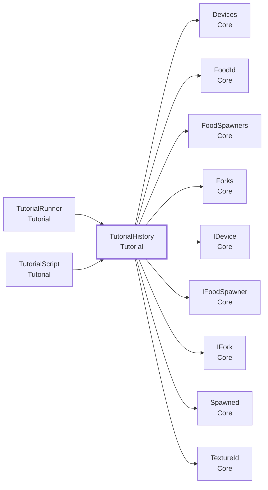

- この型を使う所: [`TutorialRunner`](#t-tutorialrunner)、[`TutorialScript`](#t-tutorialscript)
- この型が使う型: [`Devices`](Core.md#t-devices)、[`FoodId`](Core.md#t-foodid)、[`FoodSpawners`](Core.md#t-foodspawners)、[`Forks`](Core.md#t-forks)、[`IDevice`](Core.md#t-idevice)、[`IFoodSpawner`](Core.md#t-ifoodspawner)、[`IFork`](Core.md#t-ifork)、[`Spawned`](Core.md#t-spawned)、[`TextureId`](Core.md#t-textureid)

### メンバー（4）

| 種類 | メンバー | 説明 |
|---|---|---|
| コンストラクタ | `TutorialHistory()` | （説明はコードにありません） |
| メソッド | `int Pending(TutorialEvent kind)` | kind の、まだ使われていない記録の数。 |
| メソッド | `void UseAll(TutorialEvent kind)` | kind の記録を、今までの分すべて使ったことにする。 |
| メソッド | `void Dispose()` | 記録をやめ、聞くのをやめる。 |

---

## TutorialMemory

**クラス**（コードから new して使う）・ `sealed class` ・ 名前空間 `MouthOfGod.Tutorial` ・ [`Tutorial/TutorialMemory.cs`](../../Assets/Scripts/Tutorial/TutorialMemory.cs)

チュートリアルのあいだで引き継ぐ「覚えたこと」。名前（文字列）だけを持つ。[`TutorialRunner`](#t-tutorialrunner) が 1 つ持ち、人形劇スクリプトに渡す。T3 は、T2 のことではなく、名前だけを見る。

### なぜこの形か

- **[チュートリアルの間の引き継ぎは、名前だけで行う](design.md#d-memory)**: T3 のコードが「T2 では」と書くと、T2 を直したときに T3 が壊れます。

### しくみ・注意

- 名前は「事実」にする（`texture-mapping-learned`）。特定のチュートリアルを指す名前（`t2-done`）は避ける。
- 名前の一覧は docs/progress-keys.md に書く。一覧にない名前を、コードに書かない。
- 値を持たせるのは、必要になってから。
- `Begin` で空にする（次の体験者に引き継がない）。

### つながり

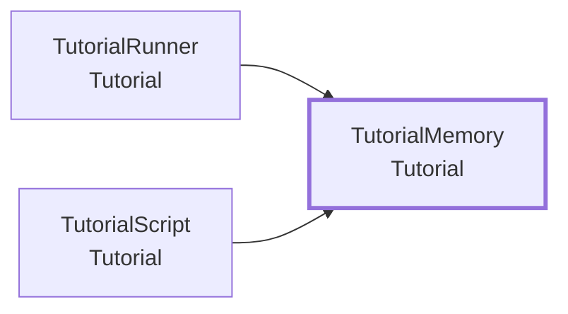

- この型を使う所: [`TutorialRunner`](#t-tutorialrunner)、[`TutorialScript`](#t-tutorialscript)

### この型を使う手順

- [チュートリアルの中で、イベントを待つ・使う](recipes.md#r-tutorial-event)

### メンバー（4）

| 種類 | メンバー | 説明 |
|---|---|---|
| プロパティ | `int Count` | （説明はコードにありません） |
| メソッド | `bool Has(string key)` | 覚えているか。名前が空なら false。 |
| メソッド | `void Set(string key)` | 覚える。名前が空なら何もしない。 |
| メソッド | `void Clear()` | 覚えていることを、すべて忘れる。 |

---

## TutorialRunner

**コンポーネント**（GameObject に付ける）・ `sealed class` ・ 名前空間 `MouthOfGod.Tutorial` ・ [`Tutorial/TutorialRunner.cs`](../../Assets/Scripts/Tutorial/TutorialRunner.cs)
 継承・実装: `MonoBehaviour`

子の [`TutorialScript`](#t-tutorialscript)（人形劇スクリプト）を、Hierarchy の並び順に 1 つずつ動かす。どのチュートリアルでも同じコード。動かしている間は、[`Phases`](Core.md#t-phases) を各スクリプトの場面にする。

### なぜこの形か

- **[中央の進行役を作らない](design.md#d-nocenter)**: 進行役が全部を持つと、何かを足すたびに、全員がその 1 つのファイルを直します。
- **[チュートリアルは、コルーチンの人形劇スクリプトで書く](design.md#d-puppet)**: チュートリアルは約 8 分の一本道です。
- **[チュートリアルは 1 本ずつ Prefab にし、セリフもその中に持つ](design.md#d-tutprefab)**: チュートリアルは、担当者が並行して作ります。
- **[チュートリアルの間の引き継ぎは、名前だけで行う](design.md#d-memory)**: T3 のコードが「T2 では」と書くと、T2 を直したときに T3 が壊れます。

### しくみ・注意

- 動かすのは `Begin` を呼んだときから。いつ呼ぶか（台の前に立ったとき、など）は、呼ぶ側が決める。
- 無効なスクリプト（enabled を外した、または非アクティブ）は飛ばす。特定のチュートリアルだけを試すときに使う。
- スクリプトで例外が出たら、そのスクリプトだけをやめて、次へ進む。
- 全部終わったら `Finished` を出し、場面を空に戻す。次の場面（本編など）は、`Finished` を受けた側が決める。
- 覚えたこと（`Memory`）は、`Begin` で空にする。
- `Skip` は、チュートリアルを飛ばして「全部終わった」ことにする。動いている途中でも、始める前でも呼べる。
  場面を `skipPhase`（既定 deliver。本編の GameRunner が待つ場面）にしてから空に戻すので、本編が普通に始まる。

### つながり

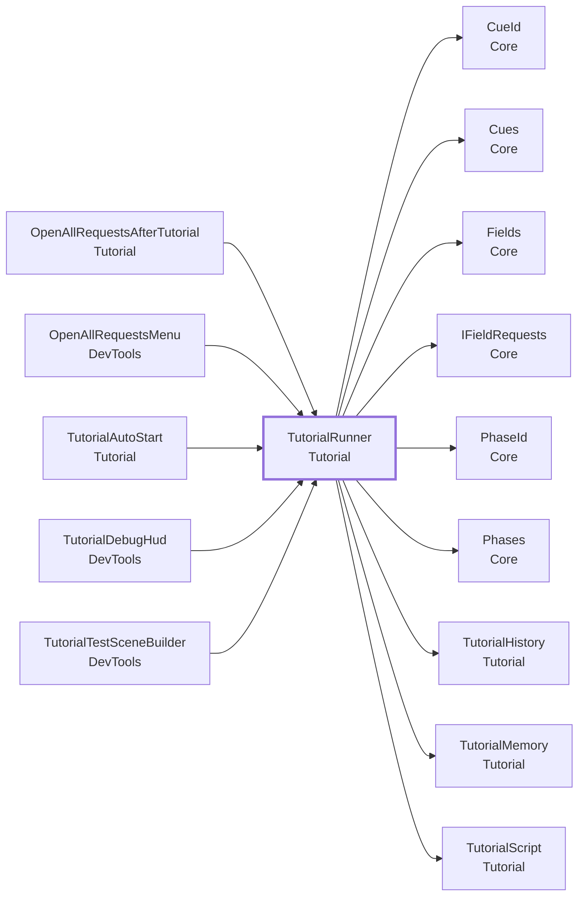

- この型を使う所: [`OpenAllRequestsAfterTutorial`](#t-openallrequestsaftertutorial)、[`OpenAllRequestsMenu`](DevTools.md#t-openallrequestsmenu)、[`TutorialAutoStart`](#t-tutorialautostart)、[`TutorialDebugHud`](DevTools.md#t-tutorialdebughud)、[`TutorialTestSceneBuilder`](DevTools.md#t-tutorialtestscenebuilder)
- この型が使う型: [`CueId`](Core.md#t-cueid)、[`Cues`](Core.md#t-cues)、[`Fields`](Core.md#t-fields)、[`IFieldRequests`](Core.md#t-ifieldrequests)、[`PhaseId`](Core.md#t-phaseid)、[`Phases`](Core.md#t-phases)、[`TutorialHistory`](#t-tutorialhistory)、[`TutorialMemory`](#t-tutorialmemory)、[`TutorialScript`](#t-tutorialscript)

### この型を使う手順

- [新しいチュートリアルを足す](recipes.md#r-tutorial-new)

### Inspector（5 項目）

| 項目 | 型 | 既定値 | 説明 |
|---|---|---|---|
| Begin On Start | `bool` | オフ | 入れると、Play を始めたときに自動で Begin する。入れないときは、呼ぶ側（台の前に立った、など）が Begin を呼ぶ |
| Wait Until Worn | `bool` | オン | Begin On Start のとき、Quest をかぶるまで待ってから始める。かぶっているかが分からない（エディタなど）ときは、待たない |
| Begin Delay Seconds | `float` | 0 | Begin On Start のとき、始めるまで待つ秒数 |
| Skip On Start | `bool` | オフ | 入れると、Play を始めたときにチュートリアルを飛ばして、本編を始める（Begin On Start より優先）。試験用 |
| Skip Phase | `string` | `"deliver"` | Skip したときに、一度だけ入る場面。最後のチュートリアルの場面名（GameRunner の After Phase と同じ）にする |

### メンバー（9）

| 種類 | メンバー | 説明 |
|---|---|---|
| イベント | `Action<PhaseId> ScriptStarted` | スクリプトを動かし始めた（その場面の名前を運ぶ）。 |
| イベント | `Action<PhaseId> ScriptFinished` | スクリプトが終わった（例外でやめた場合も含む）。 |
| イベント | `Action Finished` | 全部のスクリプトが終わった。Stop でやめたときは出ない。 |
| プロパティ | `TutorialMemory Memory { get; }` | チュートリアルのあいだで引き継ぐ、覚えたこと。 |
| プロパティ | `bool IsRunning` | 動いているか。 |
| プロパティ | `bool HasFinished` | 全部のスクリプトが終わったか（Skip で飛ばした場合も含む）。Begin で false に戻る。Stop でやめたときは false のまま。 |
| メソッド | `bool Begin()` | 最初から動かす。すでに動いていれば、警告して false。 |
| メソッド | `void Skip()` | チュートリアルを飛ばして、全部終わった扱いにする。動いていれば止め、村を最初に戻し、 合図の後片付け（巫女をとどまらせる・光と足あとを消す）をして、場面を skipPhase から空へ進め、Finished を出す。 |
| メソッド | `void Stop()` | 途中でやめる。待ちを外し、場面を空に戻す。動いていなければ何もしない。 |

### メニュー

- 右クリック: `Begin`
- 右クリック: `Stop`
- 右クリック: `Skip`

---

## TutorialScript

**コンポーネント**（GameObject に付ける）・ `abstract class` ・ 名前空間 `MouthOfGod.Tutorial` ・ [`Tutorial/TutorialScript.cs`](../../Assets/Scripts/Tutorial/TutorialScript.cs)
 継承・実装: `MonoBehaviour`

人形劇スクリプトの土台。チュートリアル 1 つにつき、これを継いだクラスを 1 つ書く（T1.cs … T4.cs）。流れ（合図を出す、待つ、分岐する）をコルーチンで書く。見せ方は、合図を受けるフィールドや UI が決める。

### なぜこの形か

- **[作業の単位と、ファイルの単位をそろえる](design.md#d-files)**: シーンや Prefab は、Git でマージできないからです。
- **[チュートリアルは合図を出し、見せ方は受け手が決める](design.md#d-cues)**: チュートリアルの担当者は流れだけを、フィールドの担当者は見せ方だけを直せるようにするためです。
- **[チュートリアルは、コルーチンの人形劇スクリプトで書く](design.md#d-puppet)**: チュートリアルは約 8 分の一本道です。
- **[チュートリアルの間の引き継ぎは、名前だけで行う](design.md#d-memory)**: T3 のコードが「T2 では」と書くと、T2 を直したときに T3 が壊れます。

### しくみ・注意

- 書くのは「いつ、何の合図を出すか」と「何を待つか」だけ。フィールドの中身は知らない（Core の [`Cues`](Core.md#t-cues) と、各種の知らせだけを使う）。
- そのチュートリアルにしかない物（浮かぶお供え物のリンゴ、影など）は、このクラスの `[SerializeField]` に持たせてよい。
- [`TutorialRunner`](#t-tutorialrunner) の子に置く。Hierarchy の並び順に動く。無効（enabled を外す）にすると、飛ばされる。
- 例外が出たら、このチュートリアルだけをやめて、次へ進む（体験が止まらない）。

### つながり

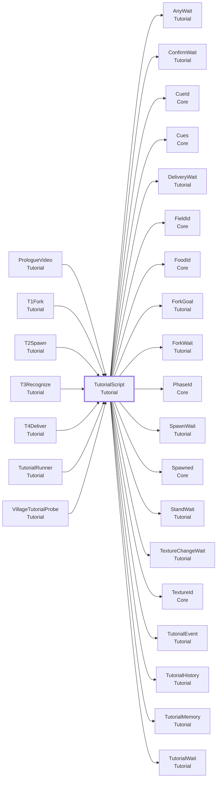

- この型を使う所: [`PrologueVideo`](#t-prologuevideo)、[`T1Fork`](#t-t1fork)、[`T2Spawn`](#t-t2spawn)、[`T3Recognize`](#t-t3recognize)、[`T4Deliver`](#t-t4deliver)、[`TutorialRunner`](#t-tutorialrunner)、[`VillageTutorialProbe`](#t-villagetutorialprobe)
- この型が使う型: [`AnyWait`](#t-anywait)、[`ConfirmWait`](#t-confirmwait)、[`CueId`](Core.md#t-cueid)、[`Cues`](Core.md#t-cues)、[`DeliveryWait`](#t-deliverywait)、[`FieldId`](Core.md#t-fieldid)、[`FoodId`](Core.md#t-foodid)、[`ForkGoal`](#t-forkgoal)、[`ForkWait`](#t-forkwait)、[`PhaseId`](Core.md#t-phaseid)、[`SpawnWait`](#t-spawnwait)、[`Spawned`](Core.md#t-spawned)、[`StandWait`](#t-standwait)、[`TextureChangeWait`](#t-texturechangewait)、[`TextureId`](Core.md#t-textureid)、[`TutorialEvent`](#t-tutorialevent)、[`TutorialHistory`](#t-tutorialhistory)、[`TutorialMemory`](#t-tutorialmemory)、[`TutorialWait`](#t-tutorialwait)

### この型を使う手順

- [チュートリアルの中で、イベントを待つ・使う](recipes.md#r-tutorial-event)
- [新しいチュートリアルを足す](recipes.md#r-tutorial-new)

### メンバー（17）

| 種類 | メンバー | 説明 |
|---|---|---|
| プロパティ | `abstract PhaseId Phase { get; }` | このチュートリアルの場面の名前（fork、spawn など）。動いているあいだ Current になる。番号は使わない。 |
| プロパティ | `protected TutorialMemory Memory` | 前のチュートリアルで覚えたこと。[`TutorialRunner`](#t-tutorialrunner) が渡す。 |
| プロパティ | `protected TutorialHistory History` | このチュートリアルが始まってから、体験者がしたことの記録。先回りした操作を数えるのに使う。 |
| メソッド | `abstract IEnumerator Play()` | 流れを書く。yield return で待つ。 |
| メソッド | `protected bool AlreadyDone(TutorialEvent kind)` | kind の操作が、先回りして（まだ待ちに使われずに）残っているか。先回りした段のセリフを飛ばすときに使う。 |
| メソッド | `protected void Cue(string cue)` | 合図を出す。見せ方は、受けた側が決める。 |
| メソッド | `protected DeliveryWait WaitForDelivery(string field = "", float timeoutSeconds = 0f)` | フィールドに物が届くのを待つ。field を空にすると、どこへ届いてもよい。timeoutSeconds が 0 なら、時間切れはない。 |
| メソッド | `protected ConfirmWait WaitForConfirm(float timeoutSeconds = 0f)` | デバイスで決定するのを待つ。先に決定していれば、すぐ終わる。timeoutSeconds が 0 なら、時間切れはない。 |
| メソッド | `protected ForkWait WaitForPierce(float timeoutSeconds = 0f)` | フォークで雲を刺すのを待つ。もう刺していれば（先に刺していれば）、すぐ終わる。timeoutSeconds が 0 なら、時間切れはない。 |
| メソッド | `protected ForkWait WaitForMouth(float timeoutSeconds = 0f)` | 雲のかけらが付いたフォークの先を、口に含むのを待つ。もう含んでいれば（先に含んでいれば）、すぐ終わる。timeoutSeconds が 0 なら、時間切れはない。 |
| メソッド | `protected SpawnWait WaitForSpawn(string food = "", float timeoutSeconds = 0f)` | 食べ物が生まれるのを待つ。food を空にすると、何が生まれてもよい。先に生まれていれば、すぐ終わる。timeoutSeconds が 0 なら、時間切れはない。 |
| メソッド | `protected TextureChangeWait WaitForTextureChanges(int count, float timeoutSeconds = 0f)` | 噛んでいる間に、食感が count 回切り替わるのを待つ。先に切り替わった分も数える。timeoutSeconds が 0 なら、時間切れはない。 |
| メソッド | `protected StandWait WaitForStanding(string field = "", float timeoutSeconds = 0f)` | 体験者が、そのフィールドの前に立つのを待つ。field を空にすると、どこでもよい。もう立っていれば、すぐ終わる。timeoutSeconds が 0 なら、時間切れはない。 |
| メソッド | `protected void Say(string lineId)` | 巫女にセリフを言わせる（合図 miko.say.<id>）。id が空なら何もしない。セリフの中身は、シーンの Miko の LineBook に書く。 |
| メソッド | `protected AnyWait WaitForAny(params TutorialWait[] waits)` | 渡した待ちのうち、どれかが終わるのを待つ。終わったら、ほかは取り消す。 |
| メソッド | `protected virtual void OnAborted()` | 途中でやめられた（Stop）。流している動画を止めるなど、後片付けを書く。最後まで進んだときは呼ばれない。 |
| メソッド | `protected virtual void OnDestroy()` | （説明はコードにありません） |

---

## TutorialWait

**待ち（yield return）**（人形劇スクリプトで yield return する）・ `abstract class` ・ 名前空間 `MouthOfGod.Tutorial` ・ [`Tutorial/TutorialWait.cs`](../../Assets/Scripts/Tutorial/TutorialWait.cs)
 継承・実装: `CustomYieldInstruction`

人形劇スクリプトで yield return して待つもの。待っているあいだだけ、Core の知らせを聞く。条件が満たされるか、時間切れになるか、Cancel されると終わり、聞くのをやめる。

### なぜこの形か

- **[チュートリアルは、コルーチンの人形劇スクリプトで書く](design.md#d-puppet)**: チュートリアルは約 8 分の一本道です。

### つながり

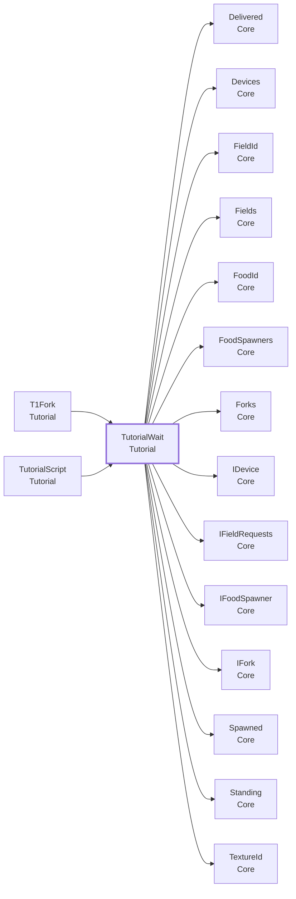

- この型を使う所: [`T1Fork`](#t-t1fork)、[`TutorialScript`](#t-tutorialscript)
- この型が使う型: [`Delivered`](Core.md#t-delivered)、[`Devices`](Core.md#t-devices)、[`FieldId`](Core.md#t-fieldid)、[`Fields`](Core.md#t-fields)、[`FoodId`](Core.md#t-foodid)、[`FoodSpawners`](Core.md#t-foodspawners)、[`Forks`](Core.md#t-forks)、[`IDevice`](Core.md#t-idevice)、[`IFieldRequests`](Core.md#t-ifieldrequests)、[`IFoodSpawner`](Core.md#t-ifoodspawner)、[`IFork`](Core.md#t-ifork)、[`Spawned`](Core.md#t-spawned)、[`Standing`](Core.md#t-standing)、[`TextureId`](Core.md#t-textureid)

### この型を使う手順

- [チュートリアルの中で、イベントを待つ・使う](recipes.md#r-tutorial-event)

### メンバー（7）

| 種類 | メンバー | 説明 |
|---|---|---|
| コンストラクタ | `protected TutorialWait(float timeoutSeconds, Func<float> clock)` | （説明はコードにありません） |
| プロパティ | `bool IsDone` | 終わったか（条件が満たされた、時間切れ、取り消しのどれか）。 |
| プロパティ | `bool TimedOut` | 時間切れで終わったか。 |
| プロパティ | `override bool keepWaiting` | （説明はコードにありません） |
| メソッド | `void Cancel()` | 待つのをやめる。聞くのもやめる。終わっていれば何もしない。 |
| メソッド | `protected void Complete()` | （説明はコードにありません） |
| メソッド | `protected abstract void Unsubscribe()` | （説明はコードにありません） |

---

## VideoScreen

**コンポーネント**（GameObject に付ける）・ `sealed class` ・ 名前空間 `MouthOfGod.Tutorial` ・ [`Tutorial/VideoScreen.cs`](../../Assets/Scripts/Tutorial/VideoScreen.cs)
 継承・実装: `MonoBehaviour`

VR で動画を見せる画面。体験者の正面の空間に、視界をほぼ覆う大きな画面を置いて流す（頭には付けない）。流している間は、周りを暗い球で囲み、村やミニチュアを見せない。プロローグ（[`PrologueVideo`](#t-prologuevideo)）が使う。エンディングなど、ほかの場面でも使える。

### なぜこの形か

- **[共有シーンは 1 つにし、動画も同じシーンで流す](design.md#d-scene)**: シーンを分けると、重ねて読み込む仕組み、シーンの間の位置合わせ、他の人のシーンと合わせる手間が要ります。

### しくみ・注意

VR 酔いを避けるための決まり:
- 画面は空間に固定する。頭を少し回しても動かない。大きく向きを変えたときだけ、ゆっくり正面へ回り込む（Recenter）。
  頭に付けた画面は、頭と一緒に動くので酔いやすい。そのため、画面いっぱいに見せるときも、頭には付けない。
- 画面の大きさは、水平と縦の視野の角度で決める（初期値: 3 m 先に水平 80 度・縦 55 度まで。Quest の視野は水平におよそ 100〜110 度だが、端は見えにくい）。
- 暗い球と画面は、ほかのどの物よりも手前に描く。近くにあるミニチュアも隠れる。
- 出し入れは、フェードで行う。視界を急に暗くしない。
- 読み込みに失敗したとき・動画が無いときは、警告を出してすぐ終わる。体験を止めない。
シーンは切り替えない。同じシーンの中で流すので、XR リグと AprilTag の位置合わせが残る。

### つながり

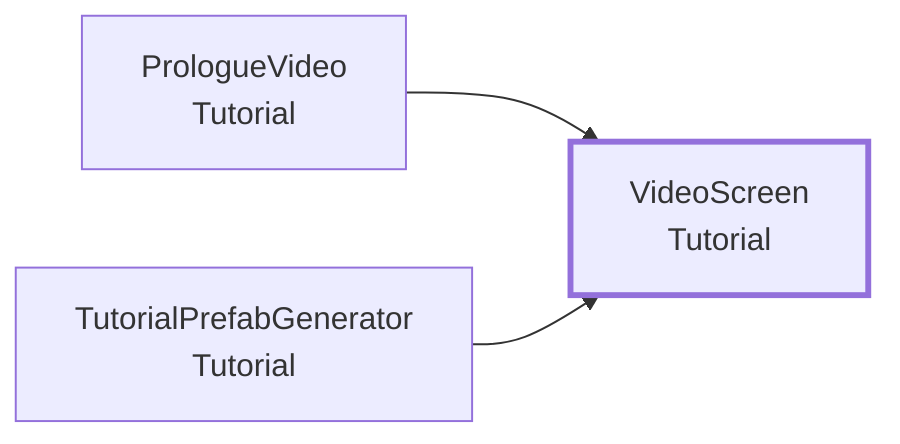

- この型を使う所: [`PrologueVideo`](#t-prologuevideo)、[`TutorialPrefabGenerator`](#t-tutorialprefabgenerator)

### Inspector（18 項目）

| 項目 | 型 | 既定値 | 説明 |
|---|---|---|---|
| **動画** | | | |
| Clip | `VideoClip` | なし | 流す動画。Clip と File のどちらかを入れる。両方あれば Clip を使う |
| Streaming Assets File | `string` | 空 | StreamingAssets の中の動画ファイル名（例: prologue.mp4）。大きい動画はこちらに置く。Clip が空のときに使う |
| Volume | `float` | 1 | 音量（0〜1）。動画の音は、頭の位置によらず、そのまま鳴る |
| Prepare Timeout Seconds | `float` | 10 | 読み込みを待つ最長の秒数。過ぎたら、流さずに終わる |
| Max Seconds | `float` | 0 | 流す最長の秒数。0 なら、動画の終わりまで。動画が終わらないときの保険 |
| **置き方** | | | |
| Head | `Transform` | なし | 頭の位置と向き。空なら Main Camera |
| Distance | `float` | 3 | 頭から画面までの距離（m） |
| View Degrees | `float` | 80 | 画面の幅を、水平の視野の角度（度）で決める。Quest の視野（水平 100〜110 度）は、端が見えにくいので、80 でほぼ視界いっぱいに収まる。高さは動画の縦横比で決まる |
| Max Vertical Degrees | `float` | 55 | 画面の高さを、縦の視野の角度（度）で抑える。縦長の動画でも、画面が上下にはみ出さないようにする |
| Height Offset | `float` | -0.1 | 画面の中心を、目の高さからずらす量（m）。負なら下 |
| Recenter Angle | `float` | 50 | 頭の向きがこの角度より大きくずれたら、画面を正面へ回り込ませる（度）。0 なら回り込まない |
| Recenter Speed | `float` | 1.5 | 回り込む速さ（1 秒あたりの割合） |
| **見え方** | | | |
| Dark Surround | `bool` | オン | 流している間、周りを暗い球で囲み、村やミニチュアを見せない |
| Surround Color | `Color` | `Color.black` | 周りの球の色 |
| Screen Material | `Material` | なし | 画面のマテリアル。空なら UI/Default で作る。色（_Color / _BaseColor）の透明度でフェードする |
| Fade Seconds | `float` | 1 | 出す・消すときのフェードの秒数 |
| Hide While Playing | `GameObject[]` | 空 | 動画を流している間だけ隠す物（村など）。終わったら元に戻す |
| Show While Playing | `GameObject[]` | 空 | 動画を流している間だけ出す物（暗い背景など）。終わったら隠す |

### メンバー（5）

| 種類 | メンバー | 説明 |
|---|---|---|
| プロパティ | `bool IsBusy` | 流している（読み込み・フェードの間も含む）。 |
| プロパティ | `bool HasVideo` | 流せる動画が入っているか。 |
| メソッド | `void Play()` | 動画を流し始める。終わるまで IsBusy が true。もう流していれば何もしない。 |
| メソッド | `void Skip()` | 途中でやめる（フェードして消す）。流していなければ何もしない。 |
| メソッド | `CustomYieldInstruction PlayAndWait()` | 流し始め、終わるまで待つ。yield return で使う。 |

### メニュー

- 右クリック: `Skip`

---

## エディタ専用・試験用

### OpenAllRequestsAfterTutorial

`Tutorial/Sandbox/OpenAllRequestsAfterTutorial.cs`（試験用）

チュートリアルが終わったら、すべてのフィールドに、欲しい物をいっぺんに出す仮のスクリプト。吹き出しが出るか、フィールドの設定に抜けがないかを確かめるために使う。本編（Game）ができたら消す。

- メニュー: `Open Now`

### TutorialAutoStart

`Tutorial/Sandbox/TutorialAutoStart.cs`（試験用）

Play を始めてしばらくしたら、同じ GameObject の TutorialRunner を動かす。試験用。

### TutorialPrefabGenerator

`Tutorial/Editor/TutorialPrefabGenerator.cs`（エディタ）

プロローグとチュートリアル 1〜4 の Prefab を、Assets/Resources/Prefabs/Tutorial/ に作る。メニュー「MouthOfGod/Tutorial/Generate Tutorial Prefabs」。1 回実行して、できた Prefab をコミットする（Play 時には使わない）。既にある Prefab は上書きしない（担当者が直した所を消さないため）。

- メニュー: `MouthOfGod/Tutorial/Generate Tutorial Prefabs`

### VillageTutorialProbe

`Tutorial/Sandbox/VillageTutorialProbe.cs`（試験用）

村だけで、チュートリアルを進める仕組みが動くか確かめる仮のスクリプト。本番の T1〜T4 ができたら消す。村の欲しい物を 1 つずつ出し、食べ物が届くのを待つ。3 つ届くか、時間切れで終わる。
