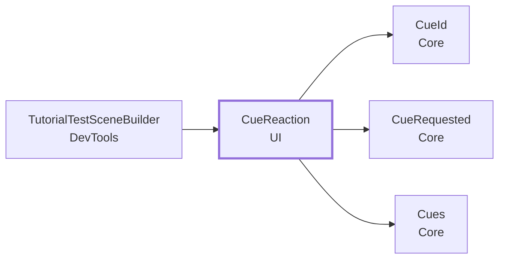
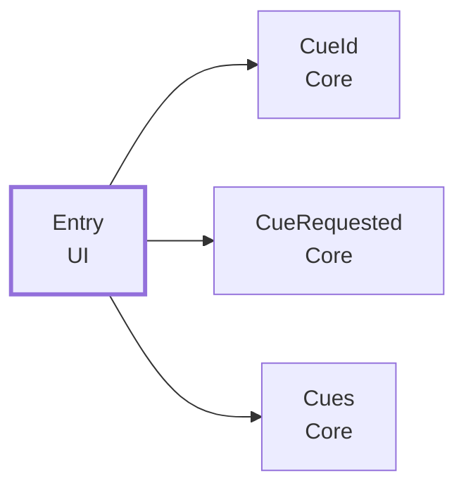
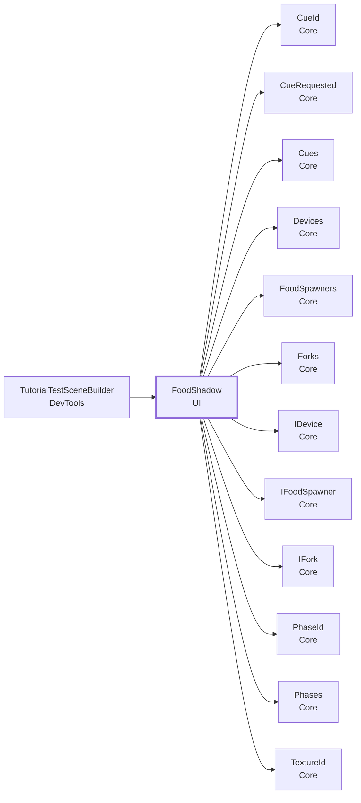
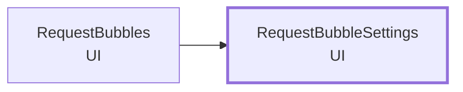
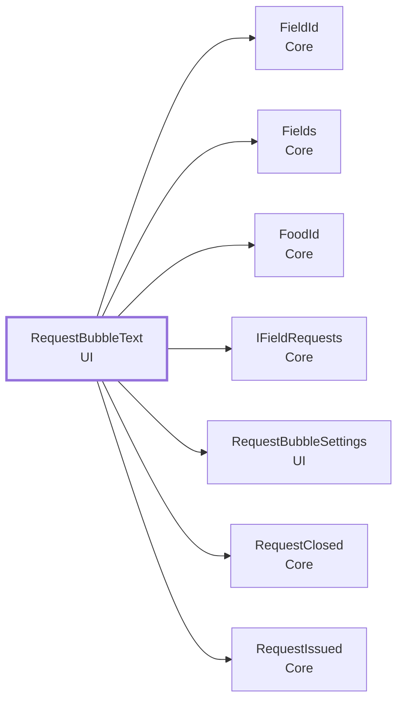
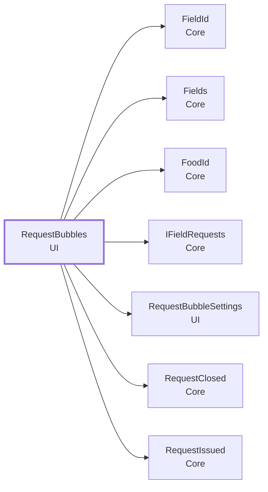
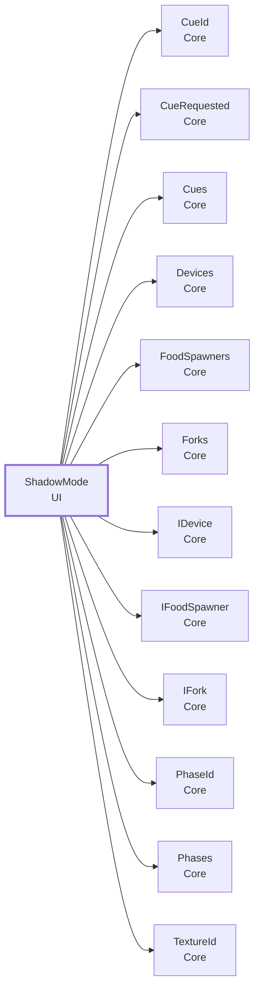

<!-- このページは tools/api_doc/build_md.py が作ります。手で直さないでください。 -->
[入口](README.md) ・ [設計の考え方](design.md) ・ [つながりの図](diagrams.md) ・ [やりたいこと別の手順](recipes.md) ・ [ガイド](guide.md)

# MouthOfGod.UI

表示の部品です。Core のイベントと合図を受けます。

## この機能に関わる決まり（なぜこの形か）

- **[チュートリアルは合図を出し、見せ方は受け手が決める](design.md#d-cues)**: チュートリアルの担当者は流れだけを、フィールドの担当者は見せ方だけを直せるようにするためです。
- **[1 つのフィールドに、欲しい物を同時に複数出す](design.md#d-multi)**: 1 つの場所にいる何人かが、それぞれ別の物を欲しがるほうが、ゲームとして面白いからです（10/20 の判断）。
- **[Play の前に、手作業を要らなくする](design.md#d-noprep)**: 手で入れるつなぎは、付け忘れると動きません。

## 型の一覧

| 役割 | 型 | 説明 |
|---|---|---|
| コンポーネント | [`CueReaction`](#t-cuereaction) | 合図（Requested）を受けて、物を出す・消す・UnityEvent を呼ぶ。 |
| コンポーネント | [`FoodShadow`](#t-foodshadow) | 口に含んでいる間、「いまの食感なら生まれる物」の影（シルエット）を、霞の中に見せる（シナリオブック S4・S5）。 |
| コンポーネント | [`RequestBubbles`](#t-requestbubbles) | 村人の欲しい物を、頭の上の吹き出しで見せる（#59・#270）。 |
| 設定アセット | [`RequestBubbleSettings`](#t-requestbubblesettings) | 村人の吹き出しの見た目の設定。 |
| static（置き場・計算） | [`RequestBubbleText`](#t-requestbubbletext) | 吹き出しに出す文字を作る純粋な部品（Unity に依存しない）。 |
| データ | [`Entry`](#t-entry) | 1 つの合図への反応。 |
| 選択肢（enum） | [`ShadowMode`](#t-shadowmode) | 影の見せ方。 |

---

## CueReaction

**コンポーネント**（GameObject に付ける）・ `sealed class` ・ 名前空間 `MouthOfGod.UI` ・ [`UI/CueReaction.cs`](../../Assets/Scripts/UI/CueReaction.cs)
 継承・実装: `MonoBehaviour`

合図（Requested）を受けて、物を出す・消す・UnityEvent を呼ぶ。コードを書かずに、Inspector だけで合図に反応できる。例: sea.glow で光る物を出す、village.cheer で村人の Animator を呼ぶ、staff.alert でスタッフ向けの表示を出す。

### なぜこの形か

- **[チュートリアルは合図を出し、見せ方は受け手が決める](design.md#d-cues)**: チュートリアルの担当者は流れだけを、フィールドの担当者は見せ方だけを直せるようにするためです。

### しくみ・注意

- 合図の名前は、大文字小文字を区別して、そのまま比べる。同じ合図の行がいくつあっても、すべて動く。
- `Seconds` が 0 より大きい行は、その秒数のあとに元に戻す（出した物を消し、消した物を出す）。戻す前に同じ合図が来たら、そこから数え直す。
- このコンポーネントを付けた物は、消さない（Hide に入れない）。無効になると、合図を受けず、元に戻す予定も止まる。

### つながり

- この型を使う所: [`TutorialTestSceneBuilder`](DevTools.md#t-tutorialtestscenebuilder)
- この型が使う型: [`CueId`](Core.md#t-cueid)、[`CueRequested`](Core.md#t-cuerequested)、[`Cues`](Core.md#t-cues)

### この型を使う手順

- [困っている生き物（例: 猫）を、元気にする](recipes.md#r-creature-mood)
- [合図に反応させる](recipes.md#r-react-cue)

### メンバー（1）

| 種類 | メンバー | 説明 |
|---|---|---|
| プロパティ | `IReadOnlyList<Entry> Entries` | 反応の一覧。 |

---

## Entry

**データ**（値を運ぶ型）・ `sealed class` ・ 名前空間 `MouthOfGod.UI` ・ [`UI/CueReaction.cs`](../../Assets/Scripts/UI/CueReaction.cs)
 [`CueReaction`](#t-cuereaction) の中の型

1 つの合図への反応。

Inspector では、配列や List の 1 要素として見えます（`[Serializable]`）。

### つながり

- この型が使う型: [`CueId`](Core.md#t-cueid)、[`CueRequested`](Core.md#t-cuerequested)、[`Cues`](Core.md#t-cues)

### Inspector（9 項目）

| 項目 | 型 | 既定値 | 説明 |
|---|---|---|---|
| Cue | `string` | 空 | 受ける合図の名前（例: sea.glow、village.cheer、device.button.glow） |
| Show | `GameObject[]` | 空 | 合図で出す物 |
| Hide | `GameObject[]` | 空 | 合図で消す物 |
| Seconds | `float` | 0 | 0 なら、そのまま。0 より大きければ、その秒数のあとに元に戻す（Show を消し、Hide を出す） |
| On Cue | `UnityEvent` | 空 | 合図で呼ぶもの（音、Animator のトリガー、パーティクルなど） |
| Cue | `string` | `> cue` |  |
| Seconds | `float` | `> seconds` |  |
| On Cue | `UnityEvent` | `> onCue` |  |
| Entries | `Entry[]` | 空 | 合図ごとの反応。上から順に動く |

### メンバー（1）

| 種類 | メンバー | 説明 |
|---|---|---|
| コンストラクタ | `Entry()` | （説明はコードにありません） |

---

## FoodShadow

**コンポーネント**（GameObject に付ける）・ `sealed class` ・ 名前空間 `MouthOfGod.UI` ・ [`UI/FoodShadow.cs`](../../Assets/Scripts/UI/FoodShadow.cs)
 継承・実装: `MonoBehaviour`

口に含んでいる間、「いまの食感なら生まれる物」の影（シルエット）を、霞の中に見せる（シナリオブック S4・S5）。合図で出し入れする。【参考】試しに作った部品です。影は実装しないことになったので（#277）、体験の機能としては使いません。チュートリアル 2・3 の参考の流れが、合図を出しているだけです。

### なぜこの形か

- **[チュートリアルは合図を出し、見せ方は受け手が決める](design.md#d-cues)**: チュートリアルの担当者は流れだけを、フィールドの担当者は見せ方だけを直せるようにするためです。

### しくみ・注意

- 受ける合図: `shadow.show`（出す）、`shadow.faint`（薄く出す）、`shadow.emphasize`（強く出す）、`shadow.hide`（消す）。名前は Inspector で変えられる。
- 出している間は、`TextureChanged` のたびに `Preview` で Prefab を引き、その形の影を `Anchor` に出す。
  `Anchor` が空なら、Camera.main の前（`Camera Offset`）に出す。
- 影は、Prefab の見た目（MeshRenderer・SkinnedMeshRenderer の形）だけを写して作る。スクリプト・当たり判定・Rigidbody は持たない（生まれた物と同じ動きをしない）。
  Prefab ごとに 1 つ作って、使い回す。
- `Only While In Mouth` を入れると、フォーク（[`Forks`](Core.md#t-forks)）があるときは、かけらの付いた先を口に含んでいる間だけ出す。フォークが無ければ、この条件は見ない。
- 場面が空（チュートリアルが終わった・止めた）になったら、消す（`Hide When Phase Ends`）。消し忘れで本編に影が残らないように。
- 参照するのは Core だけ。シーンに 1 つ置く。

### つながり

- この型を使う所: [`TutorialTestSceneBuilder`](DevTools.md#t-tutorialtestscenebuilder)
- この型が使う型: [`CueId`](Core.md#t-cueid)、[`CueRequested`](Core.md#t-cuerequested)、[`Cues`](Core.md#t-cues)、[`Devices`](Core.md#t-devices)、[`FoodSpawners`](Core.md#t-foodspawners)、[`Forks`](Core.md#t-forks)、[`IDevice`](Core.md#t-idevice)、[`IFoodSpawner`](Core.md#t-ifoodspawner)、[`IFork`](Core.md#t-ifork)、[`PhaseId`](Core.md#t-phaseid)、[`Phases`](Core.md#t-phases)、[`TextureId`](Core.md#t-textureid)

### Inspector（20 項目）

| 項目 | 型 | 既定値 | 説明 |
|---|---|---|---|
| **出す場所** | | | |
| Anchor | `Transform` | なし | 影を出す場所（霞の位置など）。空なら、Camera.main の前に出す |
| Camera Offset | `Vector3` | (0, -0.05, 0.35) | Anchor が空のとき、カメラから見た位置（右・上・前、メートル） |
| Size | `float` | 0.12 | 影のいちばん長い辺の長さ（メートル）。食べ物の大きさがばらばらでも、同じくらいに見せる。0 なら Prefab の大きさのまま |
| **見た目** | | | |
| Shadow Material | `Material` | なし | 影に使うマテリアル（透明にできるもの。URP の Unlit で Surface Type を Transparent にしたものなど）。空なら Sprites/Default で作る |
| Color | `Color` | (0.12, 0.1, 0.2, 1) | 影の色。透明度は下の 3 つで決める |
| Normal Alpha | `float` | 0.55 | shadow.show のときの濃さ（0 = 見えない、1 = 不透明） |
| Faint Alpha | `float` | 0.2 | shadow.faint のときの濃さ |
| Emphasize Alpha | `float` | 0.9 | shadow.emphasize のときの濃さ（脈打つときの最も濃いところ） |
| Pulse Per Second | `float` | 1.5 | shadow.emphasize のとき、1 秒に何回脈打つか |
| Pulse Depth | `float` | 0.5 | shadow.emphasize のとき、脈打つ深さ（0 = 脈打たない、1 = 消えるところまで薄くなる） |
| Emphasize Scale | `float` | 1.2 | shadow.emphasize のときの大きさの倍率 |
| Spin Degrees Per Second | `float` | 30 | ゆっくり回る速さ（度/秒）。0 なら回らない |
| Bob Height | `float` | 0.005 | 上下にゆれる幅（メートル）。0 ならゆれない |
| Bob Per Second | `float` | 0.5 | 上下にゆれる速さ（1 秒に何回） |
| **出す条件** | | | |
| Only While In Mouth | `bool` | オン | 入れると、フォークがあるときは、かけらの付いた先を口に含んでいる間だけ出す（口から出したら消す） |
| Hide When Phase Ends | `bool` | オン | 入れると、場面が空になったとき（チュートリアルが終わった・止めた）に消す |
| **受ける合図の名前** | | | |
| Show Cue | `string` | `"shadow.show"` | 影を出す |
| Faint Cue | `string` | `"shadow.faint"` | 影を薄く出す |
| Emphasize Cue | `string` | `"shadow.emphasize"` | 影を強く出す |
| Hide Cue | `string` | `"shadow.hide"` | 影を消す |

### メンバー（1）

| 種類 | メンバー | 説明 |
|---|---|---|
| プロパティ | `ShadowMode Mode` | いまの見せ方。 |

---

## RequestBubbleSettings

**設定アセット**（Project に置くアセット）・ `sealed class` ・ 名前空間 `MouthOfGod.UI` ・ [`UI/RequestBubbleSettings.cs`](../../Assets/Scripts/UI/RequestBubbleSettings.cs)
 継承・実装: `ScriptableObject`
 属性: `[CreateAssetMenu(fileName = ResourceName, menuName = "MouthOfGod/UI/Request Bubble Settings")]`

村人の吹き出しの見た目の設定。Assets/Resources/RequestBubbleSettings.asset があれば、それを使う。なければコードの既定値で動く。Project でアセットを選び、Inspector で値を直す。Play 中に直しても、すぐ吹き出しに効き、Play を止めても値は残る。変更は、このアセット（ファイル）の差分として残るので、誰が直しても PR で見える。

### なぜこの形か

- **[Play の前に、手作業を要らなくする](design.md#d-noprep)**: 手で入れるつなぎは、付け忘れると動きません。

### つながり

- この型を使う所: [`RequestBubbles`](#t-requestbubbles)

### Inspector（9 項目）

| 項目 | 型 | 既定値 | 説明 |
|---|---|---|---|
| Size | `float` | 0.07 | 吹き出し全体の大きさ（ワールドでの倍率）。1 で、アイコンの一辺が約 1.2 m。ミニチュアに合わせて直す |
| Height | `float` | 0.15 | 村人の頭の目印（Anchor）から、吹き出しの中心までの高さ（m） |
| Background Opacity | `float` | 0.75 | 背景としっぽの不透明度。下げると、吹き出しの後ろの物が透けて見える。アイコンと文字は透けない |
| Closed Hold Seconds | `float` | 0.6 | 届いたとき・届かずに終わったとき、色を変えて残す秒数。0 ですぐ消える |
| Corner Radius | `float` | 0.25 | 角の丸み（吹き出しの中の大きさ。アイコンの一辺が 1.2） |
| Icon Padding | `float` | 0.08 | アイコンと吹き出しの縁のあいだ（吹き出しの中の大きさ） |
| Open Color | `Color` | (1, 0.95, 0.7) | 欲しい物が出ているときの背景の色（不透明度は Background Opacity で決まる） |
| Resolved Color | `Color` | (0.6, 0.95, 0.6) | 届いたときの背景の色 |
| Unresolved Color | `Color` | (0.8, 0.8, 0.8) | 届かずに終わったときの背景の色 |

### メンバー（11）

| 種類 | メンバー | 説明 |
|---|---|---|
| プロパティ | `float Size` | （説明はコードにありません） |
| プロパティ | `float Height` | （説明はコードにありません） |
| プロパティ | `float BackgroundOpacity` | （説明はコードにありません） |
| プロパティ | `float ClosedHoldSeconds` | （説明はコードにありません） |
| プロパティ | `float CornerRadius` | （説明はコードにありません） |
| プロパティ | `float IconPadding` | （説明はコードにありません） |
| プロパティ | `Color OpenColor` | （説明はコードにありません） |
| プロパティ | `Color ResolvedColor` | （説明はコードにありません） |
| プロパティ | `Color UnresolvedColor` | （説明はコードにありません） |
| 定数 | `const string ResourceName` | （説明はコードにありません） |
| メソッド | `static RequestBubbleSettings Load()` | アセットがあればそれを、なければ既定値のインスタンスを返す。 |

---

## RequestBubbleText

**static（置き場・計算）**（コードから直接呼ぶ）・ `static class` ・ 名前空間 `MouthOfGod.UI` ・ [`UI/RequestBubbles.cs`](../../Assets/Scripts/UI/RequestBubbles.cs)

吹き出しに出す文字を作る純粋な部品（Unity に依存しない）。

### つながり

- この型が使う型: [`FieldId`](Core.md#t-fieldid)、[`Fields`](Core.md#t-fields)、[`FoodId`](Core.md#t-foodid)、[`IFieldRequests`](Core.md#t-ifieldrequests)、[`RequestBubbleSettings`](#t-requestbubblesettings)、[`RequestClosed`](Core.md#t-requestclosed)、[`RequestIssued`](Core.md#t-requestissued)

### メンバー（5）

| 種類 | メンバー | 説明 |
|---|---|---|
| プロパティ | `static Func<FoodId, string> NameLookup { get; set; }` | 吹き出しの文字を引く所。差し替えると、名前の引き方が変わる（食べ物のデータ（アイコン付き）へ移るときの入口）。null を入れると、いつもの DisplayName に戻る。Play のたびに戻る。static なのは、Play で自動で置かれる吹き出し（外から手が届かない）にも効かせるため。 |
| メソッド | `static string DisplayName(FoodId food)` | [`FoodId`](Core.md#t-foodid) から英語の表示名を作る（"fish" → "Fish"、"sea_bass" → "Sea bass"）。空 ID は "?"。 |
| メソッド | `static string Resolve(FoodId food)` | 差し替えた引き方（NameLookup）で名前を引く。無い・空の文字が返ったときは DisplayName。 |
| メソッド | `static string Resolve(FoodId food, Func<FoodId, string> lookup)` | （説明はコードにありません） |
| メソッド | `static string IconPath(FoodId food)` | 食べ物のアイコンの Resources の場所（"Icons/Food/fish"）。アイコンは、Food のメニュー「MouthOfGod/Food/Generate Icons」で作る。ファイル名が食べ物の ID なのは、食べ物の Prefab と同じ決まり。空 ID は null。 |

---

## RequestBubbles

**コンポーネント**（GameObject に付ける）・ `class` ・ 名前空間 `MouthOfGod.UI` ・ [`UI/RequestBubbles.cs`](../../Assets/Scripts/UI/RequestBubbles.cs)
 継承・実装: `MonoBehaviour`

村人の欲しい物を、頭の上の吹き出しで見せる（#59・#270）。食べ物のアイコンがあれば絵を、無ければ英語の名前を出す。Play で自動で置かれるので、手で置かなくてよい。[`Fields`](Core.md#t-fields) のフィールドの Issued で Anchor の上に出し、Closed で消す（届いたか・待ちきれなかったかで色を変えて、少しだけ見せてから消す）。Village の型は参照しない。Prefab もシーンも使わず、子の物をコードで作る。遠くの村人への気づき方（見えない位置の村人をどう知らせるか）は別 Issue。

### なぜこの形か

- **[1 つのフィールドに、欲しい物を同時に複数出す](design.md#d-multi)**: 1 つの場所にいる何人かが、それぞれ別の物を欲しがるほうが、ゲームとして面白いからです（10/20 の判断）。
- **[Play の前に、手作業を要らなくする](design.md#d-noprep)**: 手で入れるつなぎは、付け忘れると動きません。

### つながり

- この型が使う型: [`FieldId`](Core.md#t-fieldid)、[`Fields`](Core.md#t-fields)、[`FoodId`](Core.md#t-foodid)、[`IFieldRequests`](Core.md#t-ifieldrequests)、[`RequestBubbleSettings`](#t-requestbubblesettings)、[`RequestClosed`](Core.md#t-requestclosed)、[`RequestIssued`](Core.md#t-requestissued)

---

## ShadowMode

**選択肢（enum）**（決まった値の中から選ぶ）・ `enum` ・ 名前空間 `MouthOfGod.UI` ・ [`UI/FoodShadow.cs`](../../Assets/Scripts/UI/FoodShadow.cs)

影の見せ方。[`FoodShadow`](#t-foodshadow) が合図で切り替える。

### つながり

- この型が使う型: [`CueId`](Core.md#t-cueid)、[`CueRequested`](Core.md#t-cuerequested)、[`Cues`](Core.md#t-cues)、[`Devices`](Core.md#t-devices)、[`FoodSpawners`](Core.md#t-foodspawners)、[`Forks`](Core.md#t-forks)、[`IDevice`](Core.md#t-idevice)、[`IFoodSpawner`](Core.md#t-ifoodspawner)、[`IFork`](Core.md#t-ifork)、[`PhaseId`](Core.md#t-phaseid)、[`Phases`](Core.md#t-phases)、[`TextureId`](Core.md#t-textureid)

### 値

| 値 | 意味 |
|---|---|
| `Hidden` | 出さない。 |
| `Normal` | ふつうの濃さで出す（チュートリアル 2）。 |
| `Faint` | 薄く出す（チュートリアル 3）。 |
| `Emphasize` | 強く、脈打つように出す（外し続けたとき）。 |
