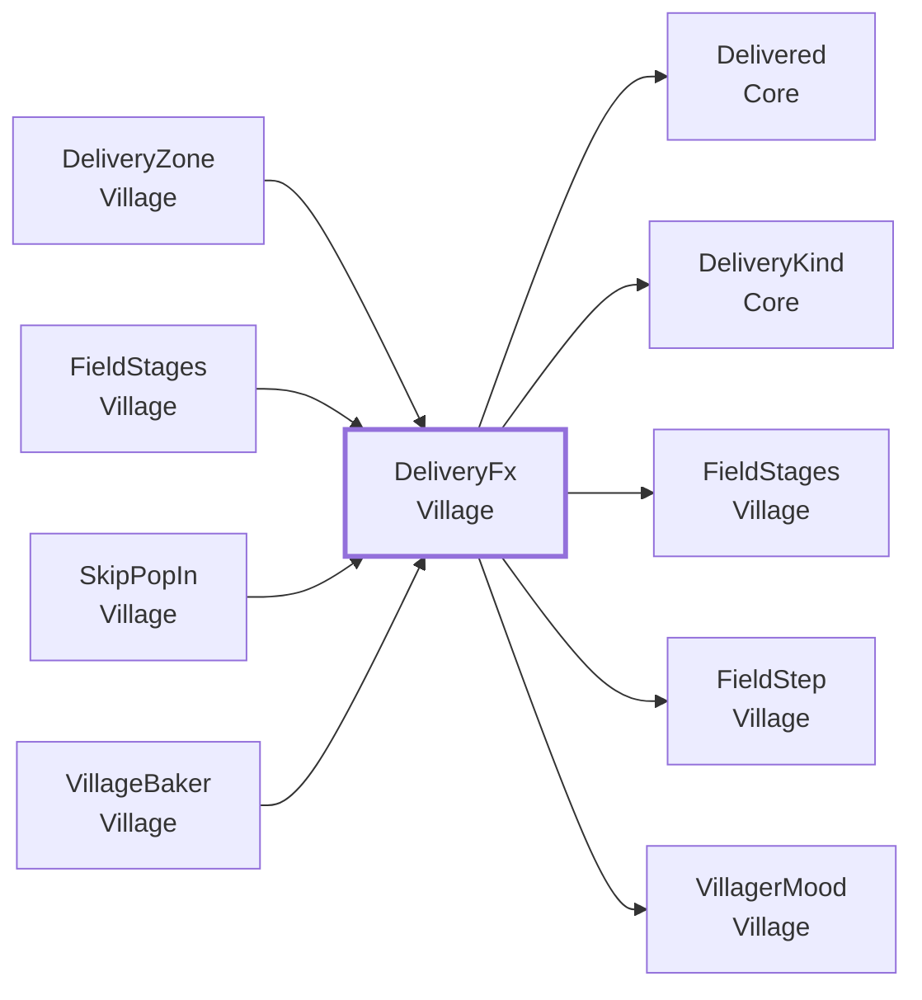
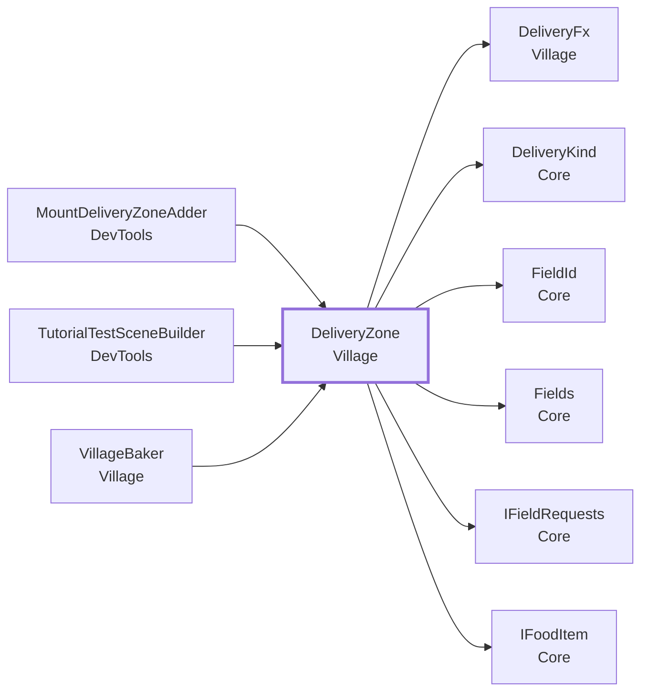
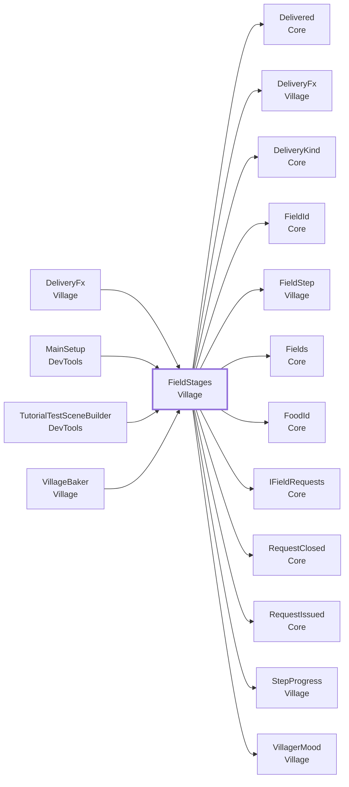
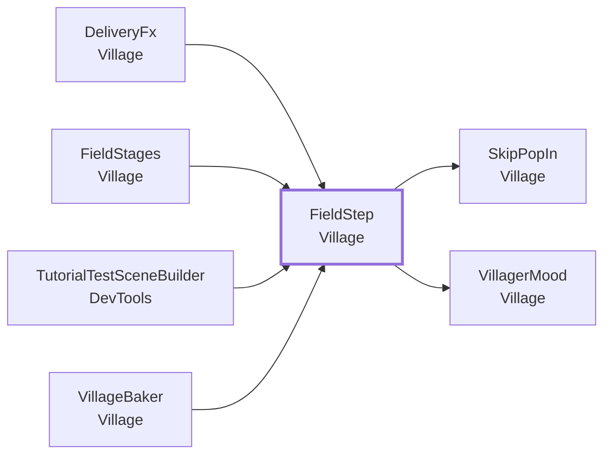
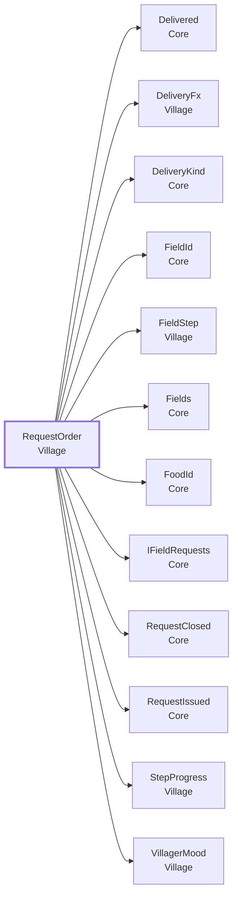
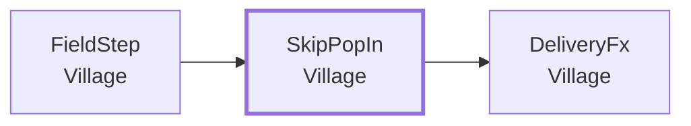
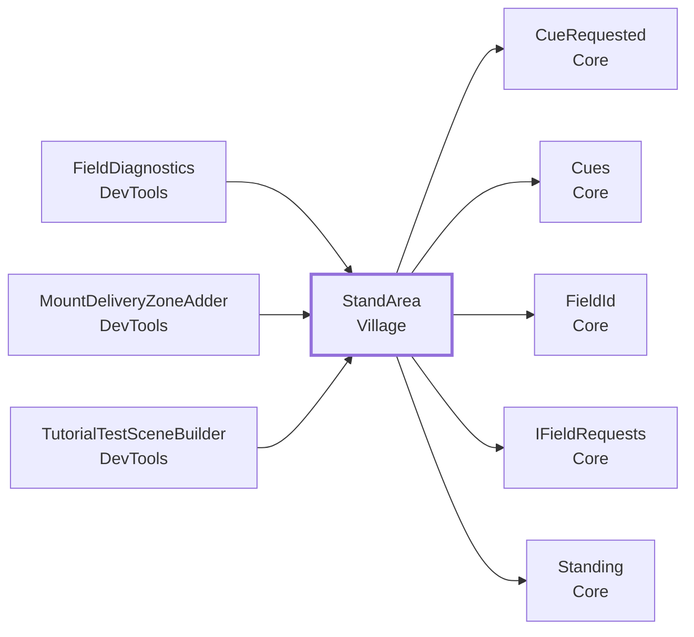
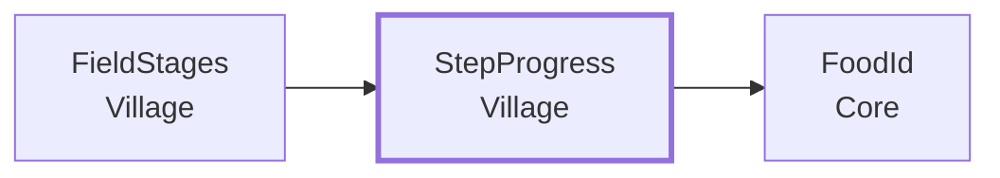
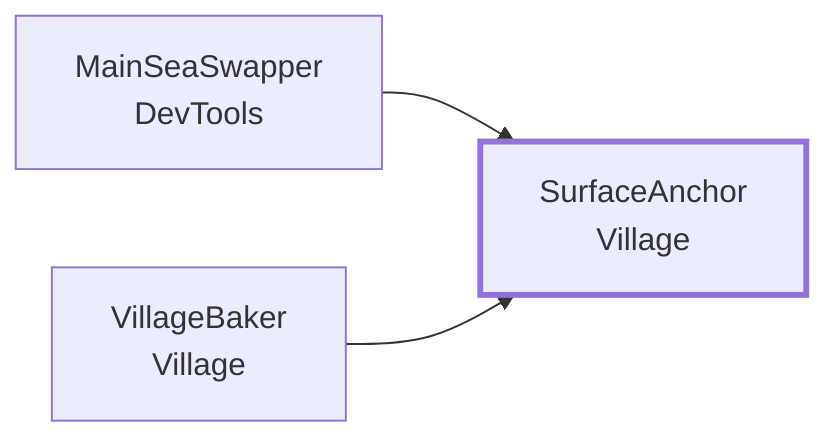
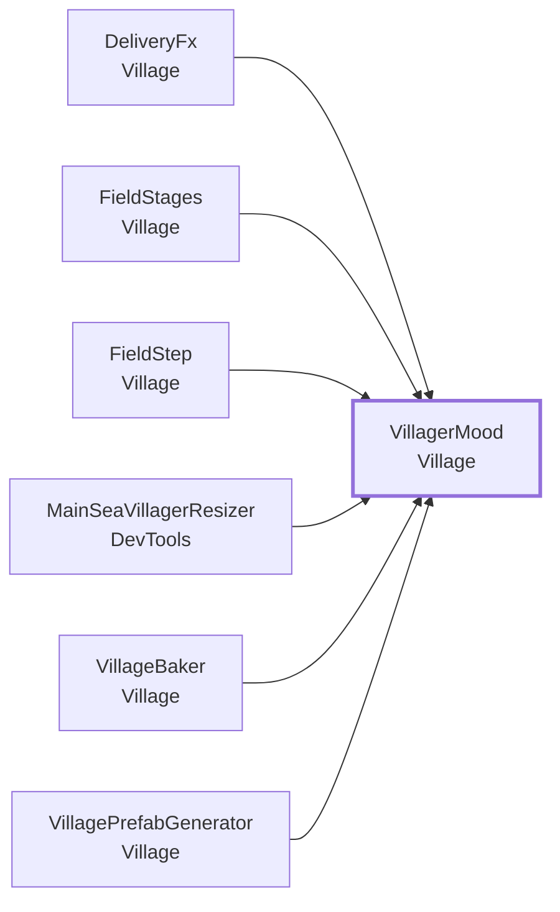

<!-- このページは tools/api_doc/build_md.py が作ります。手で直さないでください。 -->
[入口](README.md) ・ [設計の考え方](design.md) ・ [つながりの図](diagrams.md) ・ [やりたいこと別の手順](recipes.md) ・ [ガイド](guide.md)

# MouthOfGod.Village

フィールド（村・山・海・草原）の見た目の戻り方と、欲しい物です。物が落ちた場所の判定、届いたときの反応、立つ場所の判定も、ここにあります。

## この機能に関わる決まり（なぜこの形か）

- **[作業の単位と、ファイルの単位をそろえる](design.md#d-files)**: シーンや Prefab は、Git でマージできないからです。
- **[置き場に自分で登録する（組み立て役を置かない）](design.md#d-registry)**: 4 つのフィールドは、4 人が別々に作り、最後に 1 つのシーンへまとめます。
- **[チュートリアルは合図を出し、見せ方は受け手が決める](design.md#d-cues)**: チュートリアルの担当者は流れだけを、フィールドの担当者は見せ方だけを直せるようにするためです。
- **[フィールドの戻り方は Hierarchy の並びで持ち、いつ出すかは Game・Tutorial が決める](design.md#d-steps)**: 4 つのフィールドを別々の人が作り、それでも全体が調和して動くようにするためです。
- **[何が届いても受け取り、何が届いたかを知らせる](design.md#d-receive)**: 体験者は、頼まれていない物も投げてきます。
- **[1 つのフィールドに、欲しい物を同時に複数出す](design.md#d-multi)**: 1 つの場所にいる何人かが、それぞれ別の物を欲しがるほうが、ゲームとして面白いからです（10/20 の判断）。
- **[生まれた物は、体験者が狙って飛ばす](design.md#d-aim)**: 狙いを定めて飛ばすことが、この体験の遊びだからです。
- **[Play の前に、手作業を要らなくする](design.md#d-noprep)**: 手で入れるつなぎは、付け忘れると動きません。
- **[計算は Unity から切り離して、テストできるようにする](design.md#d-pure)**: Quest をかぶらずに、Play もせずに、EditMode のテストで正しさを確かめられるからです。
- **[共有シーンは 1 つにし、動画も同じシーンで流す](design.md#d-scene)**: シーンを分けると、重ねて読み込む仕組み、シーンの間の位置合わせ、他の人のシーンと合わせる手間が要ります。

## 型の一覧

| 役割 | 型 | 説明 |
|---|---|---|
| コンポーネント | [`DeliveryFx`](#t-deliveryfx) | 物が届いたときの、フィールドの標準の反応。 |
| コンポーネント | [`DeliveryZone`](#t-deliveryzone) | 食べ物が落ちる場所。 |
| コンポーネント | [`FieldStages`](#t-fieldstages) | フィールド（山・海・草原・村）の戻り方と欲しい物。 |
| コンポーネント | [`FieldStep`](#t-fieldstep) | フィールドの戻り方の 1 段（ステップ）。 |
| コンポーネント | [`SkipPopIn`](#t-skippopin) | ステップの子の物を、このスクリプトで「ぽんっ」と出さないようにする印。 |
| コンポーネント | [`StandArea`](#t-standarea) | 体験者が、そのフィールドの前に立っているかを判定する場所。 |
| コンポーネント | [`SurfaceAnchor`](#t-surfaceanchor) | フィールドの Prefab の一番上に付ける。 |
| コンポーネント | [`VillagerMood`](#t-villagermood) | 村人の気持ち。 |
| 選択肢（enum） | [`RequestOrder`](#t-requestorder) |  |
| クラス | [`StepProgress`](#t-stepprogress) | フィールド 1 つの、ステップ（戻り方の 1 段）の進み具合。 |
| エディタ | [`VillageBaker`](#t-villagebaker) | 下書きの配置（VillageLayout）から、村のフィールドの Prefab（Village.prefab）を作る。 |
| エディタ | [`VillageField`](#t-villagefield) |  |
| エディタ | [`VillageFxGenerator`](#t-villagefxgenerator) | 村の演出（煙・喜びの粒）の Prefab を、Assets/Resources/Prefabs/Village/ に作る。 |
| エディタ | [`VillageItem`](#t-villageitem) | フィールドの 1 つの置き物（下書き）。 |
| エディタ | [`VillageLayout`](#t-villagelayout) | 村の配置の下書き。 |
| エディタ | [`VillagePrefabGenerator`](#t-villageprefabgenerator) | 村の置き物の Prefab を、素材（FBX）から Assets/Resources/Prefabs/Village/ に作る。 |
| エディタ | [`VillageStep`](#t-villagestep) | 戻り方の 1 段（下書き）。 |

---

## DeliveryFx

**コンポーネント**（GameObject に付ける）・ `sealed class` ・ 名前空間 `MouthOfGod.Village` ・ [`Village/DeliveryFx.cs`](../../Assets/Scripts/Village/DeliveryFx.cs)
 継承・実装: `MonoBehaviour`

物が届いたときの、フィールドの標準の反応。[`FieldStages`](#t-fieldstages) と同じ物に付ける（無ければ [`FieldStages`](#t-fieldstages) が自分で付ける）。何も入れなくても、標準の反応が出る。見た目を変えたいときだけ、Inspector で差し替える。

### なぜこの形か

- **[何が届いても受け取り、何が届いたかを知らせる](design.md#d-receive)**: 体験者は、頼まれていない物も投げてきます。
- **[Play の前に、手作業を要らなくする](design.md#d-noprep)**: 手で入れるつなぎは、付け忘れると動きません。

### しくみ・注意

- 欲しい物が届いた（ステップが済んだ）: 助かった村人の頭の上に喜びの粒を出し、音を 2D で鳴らす。村人の喜ぶ動きは [`VillagerMood`](#t-villagermood) が出す。
- 違う物が届いた（頼まれていない物・よその物。どちらも同じ反応）: 困っている村人に、Animator のトリガー（`Missed Trigger`）を送り、がっかりした音を鳴らす。
- 粒と音を空にしておくと、Resources の標準の物を使う（粒: Prefabs/Village/Fx_Joy、音: Sounds/Village/Done と Missed）。
  動きを変えるときは、村人の Animator Controller の、このトリガーで入るステートの Motion を差し替える。コードは直さない。
  トリガーを持たない Animator（動物など）には、何もしない。
- 届いた物そのものの消え方（違う物は霞のように消える）は、[`DeliveryZone`](#t-deliveryzone) が受け持つ。
- `Fx Parent` を入れると、粒・煙・出現の星を、その子として出す。
- 独自の反応を足すときは、On Requested / On Missed に、つなぐ。

### つながり

- この型を使う所: [`DeliveryZone`](#t-deliveryzone)、[`FieldStages`](#t-fieldstages)、[`SkipPopIn`](#t-skippopin)、[`VillageBaker`](#t-villagebaker)
- この型が使う型: [`Delivered`](Core.md#t-delivered)、[`DeliveryKind`](Core.md#t-deliverykind)、[`FieldStages`](#t-fieldstages)、[`FieldStep`](#t-fieldstep)、[`VillagerMood`](#t-villagermood)

### この型を使う手順

- [困っている生き物（例: 猫）を、元気にする](recipes.md#r-creature-mood)

### Inspector（8 項目）

| 項目 | 型 | 既定値 | 説明 |
|---|---|---|---|
| **欲しい物が届いたとき** | | | |
| Joy | `ParticleSystem` | なし | 助かった村人の頭の上に出す粒。一度だけ出して、終わると自分で消える（Stop Action を Destroy にする）。空なら Resources/Prefabs/Village/Fx_Joy |
| Done Clip | `AudioClip` | なし | ステップが済んだときの音（短い物）。空なら Resources/Sounds/Village/Done |
| On Requested | `UnityEvent` | 空 | 欲しい物が届いたときに、ほかに呼ぶもの |
| **違う物が届いたとき** | | | |
| Missed Trigger | `string` | MissedTrigger | 困っている村人の Animator に送るトリガーの名前。Animator Controller に、この名前のトリガーが無ければ何もしない |
| Missed Clip | `AudioClip` | なし | 違う物が届いたときの音。空なら Resources/Sounds/Village/Missed |
| On Missed | `UnityEvent` | 空 | 違う物が届いたときに、ほかに呼ぶもの |
| **置き場** | | | |
| Fx Parent | `Transform` | なし | このフィールドの効果（喜びの粒・消える煙・出現の星）を、この子として出す。空なら、シーンの直下 |
| **音** | | | |
| Volume | `float` | 0.6 |  |

### メンバー（1）

| 種類 | メンバー | 説明 |
|---|---|---|
| プロパティ | `Transform FxParent` | 効果の置き場（親）。空ならシーンの直下。[`DeliveryZone`](#t-deliveryzone)・PopInEffect の効果もここに出る。 |

---

## DeliveryZone

**コンポーネント**（GameObject に付ける）・ `sealed class` ・ 名前空間 `MouthOfGod.Village` ・ [`Village/DeliveryZone.cs`](../../Assets/Scripts/Village/DeliveryZone.cs)
 継承・実装: `MonoBehaviour`
 属性: `[RequireComponent(typeof(Collider))]`

食べ物が落ちる場所。フィールドの上に置き、食べ物が入ったら、そのフィールドの Receive を呼ぶ。Collider（Is Trigger）と一緒に付ける。頼まれた物かどうかは、フィールドが判断する。ここでは判断しない。

### なぜこの形か

- **[何が届いても受け取り、何が届いたかを知らせる](design.md#d-receive)**: 体験者は、頼まれていない物も投げてきます。
- **[生まれた物は、体験者が狙って飛ばす](design.md#d-aim)**: 狙いを定めて飛ばすことが、この体験の遊びだからです。

### しくみ・注意

- 食べ物は、Core の [`IFoodItem`](Core.md#t-ifooditem) で読む。Food のコードは使わない。
- 届けるフィールドは、`Field Id` に書いた ID（[`Fields`](Core.md#t-fields) から引く）。空なら、親にあるフィールド（FieldStages）。
- 1 つの食べ物は、1 回しか届けない（残した物が、もう一度入っても数えない）。
- 届けたあとの食べ物は、頼まれた物（Requested）なら消す。それ以外は残す。どちらも Inspector で変えられる。

### つながり

- この型を使う所: [`MountDeliveryZoneAdder`](DevTools.md#t-mountdeliveryzoneadder)、[`TutorialTestSceneBuilder`](DevTools.md#t-tutorialtestscenebuilder)、[`VillageBaker`](#t-villagebaker)
- この型が使う型: [`DeliveryFx`](#t-deliveryfx)、[`DeliveryKind`](Core.md#t-deliverykind)、[`FieldId`](Core.md#t-fieldid)、[`Fields`](Core.md#t-fields)、[`IFieldRequests`](Core.md#t-ifieldrequests)、[`IFoodItem`](Core.md#t-ifooditem)

### Inspector（6 項目）

| 項目 | 型 | 既定値 | 説明 |
|---|---|---|---|
| Field Id | `string` | 空 | 届けるフィールドの ID（village など）。空なら、親にあるフィールド（FieldStages）に届ける |
| Consume Requested | `bool` | オン | 頼まれた物が届いたら、その食べ物を消す |
| Consume Others | `bool` | オフ | 頼まれていない物（同じ物の 2 つ目や、よその物）が届いたら、その食べ物をすぐ消す。Vanish Others より先に効く |
| Vanish Others | `bool` | オン | 頼まれていない物が届いたら、煙を出して、だんだん小さくして消す（霞のように消える）。外すと、フィールドに残る |
| Vanish Seconds | `float` | 1 | 消えるまでの秒数 |
| Vanish Fx | `GameObject` | なし | 消えるときに出す物（煙など）。空なら Resources/Prefabs/Village/Fx_Smoke |

### メンバー（1）

| 種類 | メンバー | 説明 |
|---|---|---|
| メソッド | `bool Deliver(Component other)` | 入った物が食べ物なら、フィールドに届ける。届けたら true。食べ物でない・もう届けた・届け先のフィールドが見つからないときは、何もせず false。 |

---

## FieldStages

**コンポーネント**（GameObject に付ける）・ `sealed class` ・ 名前空間 `MouthOfGod.Village` ・ [`Village/FieldStages.cs`](../../Assets/Scripts/Village/FieldStages.cs)
 継承・実装: `MonoBehaviour`、[`IFieldRequests`](Core.md#t-ifieldrequests)

フィールド（山・海・草原・村）の戻り方と欲しい物。フィールドの一番上の物に 1 つ付ける。戻り方は、下にある [`FieldStep`](#t-fieldstep) を Hierarchy の並び順に使う（番号は持たない）。有効になると Core の [`Fields`](Core.md#t-fields) に自分を登録する。本編（Game）とチュートリアル（Tutorial）は、そこから [`IFieldRequests`](Core.md#t-ifieldrequests) として受け取り、 欲しい物を出す（Open）。いつ出すかは、ここでは決めない（docs/requests.md）。

### なぜこの形か

- **[作業の単位と、ファイルの単位をそろえる](design.md#d-files)**: シーンや Prefab は、Git でマージできないからです。
- **[置き場に自分で登録する（組み立て役を置かない）](design.md#d-registry)**: 4 つのフィールドは、4 人が別々に作り、最後に 1 つのシーンへまとめます。
- **[フィールドの戻り方は Hierarchy の並びで持ち、いつ出すかは Game・Tutorial が決める](design.md#d-steps)**: 4 つのフィールドを別々の人が作り、それでも全体が調和して動くようにするためです。
- **[何が届いても受け取り、何が届いたかを知らせる](design.md#d-receive)**: 体験者は、頼まれていない物も投げてきます。
- **[1 つのフィールドに、欲しい物を同時に複数出す](design.md#d-multi)**: 1 つの場所にいる何人かが、それぞれ別の物を欲しがるほうが、ゲームとして面白いからです（10/20 の判断）。
- **[Play の前に、手作業を要らなくする](design.md#d-noprep)**: 手で入れるつなぎは、付け忘れると動きません。

### つながり

- この型を使う所: [`DeliveryFx`](#t-deliveryfx)、[`MainSetup`](DevTools.md#t-mainsetup)、[`TutorialTestSceneBuilder`](DevTools.md#t-tutorialtestscenebuilder)、[`VillageBaker`](#t-villagebaker)
- この型が使う型: [`Delivered`](Core.md#t-delivered)、[`DeliveryFx`](#t-deliveryfx)、[`DeliveryKind`](Core.md#t-deliverykind)、[`FieldId`](Core.md#t-fieldid)、[`FieldStep`](#t-fieldstep)、[`Fields`](Core.md#t-fields)、[`FoodId`](Core.md#t-foodid)、[`IFieldRequests`](Core.md#t-ifieldrequests)、[`RequestClosed`](Core.md#t-requestclosed)、[`RequestIssued`](Core.md#t-requestissued)、[`StepProgress`](#t-stepprogress)、[`VillagerMood`](#t-villagermood)

### この型を使う手順

- [困っている生き物（例: 猫）を、元気にする](recipes.md#r-creature-mood)

### Inspector（3 項目）

| 項目 | 型 | 既定値 | 説明 |
|---|---|---|---|
| Field Id | `string` | 空 | フィールドの ID（docs/fields.md）。village / mountain / sea / grassland のどれか。空のままだと、本編などにつながらない（Play の始めに警告） |
| Request Order | `RequestOrder` | InOrder | 欲しい物を出す順番。InOrder: Steps の並び順。Random: まだのステップからランダム |
| Max Open Requests | `int` | `2` | このフィールドに、同時に出せる欲しい物の数。別々の村人が、それぞれ別の物を欲しがれる。仮の値。全体で同時にいくつ出すかは、本編（Game）が決める |

### メンバー（23）

| 種類 | メンバー | 説明 |
|---|---|---|
| イベント | `Action<RequestIssued> Issued` | （説明はコードにありません） |
| イベント | `Action<RequestClosed> Closed` | 欲しい物が終わった。届いて解決した（Resolved = true）か、Expire やリセットで終わった（false）。（[`IFieldRequests`](Core.md#t-ifieldrequests) の説明） |
| イベント | `Action<Delivered> Received` | 物が届いた（Receive のたびに 1 回）。採点はこれを数える。Requested のときは Closed の後に出る。（[`IFieldRequests`](Core.md#t-ifieldrequests) の説明） |
| イベント | `Action<FieldStep> StepDone` | ステップが済んだとき（済んだステップ）。Closed の後に出る。フィールドごとの独自の演出を、ここから足せる。 |
| イベント | `Action Restarted` | はじめ（全部まだ）に戻したとき。 |
| プロパティ | `string FieldId` | フィールドの ID。有効な間に変えると、[`Fields`](Core.md#t-fields) に登録し直す（空・重なりの確かめもやり直す）。 |
| プロパティ | `FieldId Field` | （説明はコードにありません） |
| プロパティ | `IReadOnlyList<FieldStep> Steps` | （説明はコードにありません） |
| プロパティ | `int DoneCount` | （説明はコードにありません） |
| プロパティ | `bool IsFullyRecovered` | （説明はコードにありません） |
| プロパティ | `bool IsOpen` | 欲しい物が 1 つ以上出ている（吹き出しが出ている）。（[`IFieldRequests`](Core.md#t-ifieldrequests) の説明） |
| プロパティ | `bool CanOpen` | 次の欲しい物を出せる（出ている数が上限より少なく、まだ出していない欲しい物が残っている）。すっかり戻ったフィールドは false。（[`IFieldRequests`](Core.md#t-ifieldrequests) の説明） |
| プロパティ | `FoodId Current` | 出ている欲しい物のうち、一番古いもの（出ていなければ [`FoodId`](Core.md#t-foodid).None）。 |
| プロパティ | `int OpenCount` | 出ている欲しい物の数。 |
| プロパティ | `int MaxOpenRequests` | 同時に出せる欲しい物の数。Play の前に決める（出し始めたあとに変えても、効かない）。 |
| プロパティ | `RequestOrder Order` | （説明はコードにありません） |
| メソッド | `bool IsDone(FieldStep step)` | （説明はコードにありません） |
| メソッド | `bool Open()` | 次の欲しい物を出す（Issued）。上限まで出ている・出せる物が残っていないなら false。 |
| メソッド | `bool Open(FoodId food)` | その物を欲しがる、まだ済んでいないステップを出す（並び順によらない。チュートリアル用）。出せなければ false。 |
| メソッド | `DeliveryKind Receive(FoodId food)` | 物が届いた。何が届いても受け取り、何だったかを返す。Received を 1 回出す。欲しがっていた物（Requested）なら、ステップを済ませ（見た目が変わる）、Closed（Resolved = true）→ Received → StepDone の順に出す。このフィールドの物（Own）・よその物（Foreign）なら、フィールドは戻らず、Received だけ出す（反応は受けた側が足す）。物が落ちた場所を決める所（[`DeliveryZone`](#t-deliveryzone)）が [`IFieldRequests`](Core.md#t-ifieldrequests) 越しに呼ぶ。 |
| メソッド | `void Expire()` | 出ている欲しい物を、すべて届かないまま終える（出した順に Closed）。 |
| メソッド | `void Expire(int request)` | その番号の欲しい物だけを、届かないまま終える。出ていなければ何もしない。 |
| メソッド | `void Restart()` | はじめ（全部まだ）に戻す。出ていた欲しい物も終える（体験の終わりのリセット）。 |

### メニュー

- 右クリック: `Open Next Want`
- 右クリック: `Deliver Wanted Food`
- 右クリック: `Deliver Foreign Food (test)`
- 右クリック: `Complete Next Step`
- 右クリック: `Restart`

---

## FieldStep

**コンポーネント**（GameObject に付ける）・ `sealed class` ・ 名前空間 `MouthOfGod.Village` ・ [`Village/FieldStep.cs`](../../Assets/Scripts/Village/FieldStep.cs)
 継承・実装: `MonoBehaviour`

フィールドの戻り方の 1 段（ステップ）。[`FieldStages`](#t-fieldstages) の下の Steps に、空のオブジェクトを作って付ける。Hierarchy の並び順が、ステップの順番（番号はどこにも書かない。足す・挟む・消す・並べ替えるは Hierarchy の操作だけ）。- このオブジェクトの子: ステップが済むと出る物（芽、羊など）。- hideWhenDone: ステップが済むと消える物（枯れた茎など。どこに置いてあってもよい）。- helped: このステップで困りごとが解ける人。1 人目の頭の上に吹き出しを出す。子の物に自分のスクリプトを付ければ、出たとき（OnEnable）に動き出せる。フィールドごとの独自の演出はそこに書く。

### なぜこの形か

- **[作業の単位と、ファイルの単位をそろえる](design.md#d-files)**: シーンや Prefab は、Git でマージできないからです。
- **[フィールドの戻り方は Hierarchy の並びで持ち、いつ出すかは Game・Tutorial が決める](design.md#d-steps)**: 4 つのフィールドを別々の人が作り、それでも全体が調和して動くようにするためです。

### つながり

- この型を使う所: [`DeliveryFx`](#t-deliveryfx)、[`FieldStages`](#t-fieldstages)、[`TutorialTestSceneBuilder`](DevTools.md#t-tutorialtestscenebuilder)、[`VillageBaker`](#t-villagebaker)
- この型が使う型: [`SkipPopIn`](#t-skippopin)、[`VillagerMood`](#t-villagermood)

### この型を使う手順

- [困っている生き物（例: 猫）を、元気にする](recipes.md#r-creature-mood)
- [新しい食べ物を足す](recipes.md#r-add-food)

### Inspector（5 項目）

| 項目 | 型 | 既定値 | 説明 |
|---|---|---|---|
| Food | `string` | 空 | 欲しい物の FoodId（食べ物のデータの ID）。空なら欲しい物は出さない（開発中の右クリックメニューでだけ済ませられる） |
| Helped | `VillagerMood[]` | 空 | このステップで困りごとが解ける人。1 人目の頭の上に吹き出しを出す。全部のステップが済むと元気になる |
| Hide When Done | `GameObject[]` | 空 | このステップが済むと消える物 |
| Pop In | `bool` | オン | 子の物が出るとき、小さい所から「ぽんっ」と大きくする。物を置くだけで効く。出方を自分で作る物には、SkipPopIn を付ける。全部やめるなら外す |
| On Done | `UnityEvent` | 空 | このステップが済んだとき（音・光など）。Inspector からつなぐ |

### メンバー（6）

| 種類 | メンバー | 説明 |
|---|---|---|
| プロパティ | `string Food` | （説明はコードにありません） |
| プロパティ | `IReadOnlyList<VillagerMood> Helped` | （説明はコードにありません） |
| プロパティ | `IReadOnlyList<GameObject> HideWhenDone` | （説明はコードにありません） |
| プロパティ | `Transform Anchor` | 吹き出しの場所。1 人目の頭の上の印、無ければその人、誰もいなければこのステップ。 |
| メソッド | `void SetHelped(params VillagerMood[] villagers)` | （説明はコードにありません） |
| メソッド | `void SetHideWhenDone(params GameObject[] objects)` | （説明はコードにありません） |

---

## RequestOrder

**選択肢（enum）**（決まった値の中から選ぶ）・ `enum` ・ 名前空間 `MouthOfGod.Village` ・ [`Village/FieldStages.cs`](../../Assets/Scripts/Village/FieldStages.cs)
 [`FieldStages`](#t-fieldstages) の中の型

### つながり

- この型が使う型: [`Delivered`](Core.md#t-delivered)、[`DeliveryFx`](#t-deliveryfx)、[`DeliveryKind`](Core.md#t-deliverykind)、[`FieldId`](Core.md#t-fieldid)、[`FieldStep`](#t-fieldstep)、[`Fields`](Core.md#t-fields)、[`FoodId`](Core.md#t-foodid)、[`IFieldRequests`](Core.md#t-ifieldrequests)、[`RequestClosed`](Core.md#t-requestclosed)、[`RequestIssued`](Core.md#t-requestissued)、[`StepProgress`](#t-stepprogress)、[`VillagerMood`](#t-villagermood)

### 値

| 値 | 意味 |
|---|---|
| `InOrder` |  |
| `Random` |  |

---

## SkipPopIn

**コンポーネント**（GameObject に付ける）・ `sealed class` ・ 名前空間 `MouthOfGod.Village` ・ [`Village/PopInEffect.cs`](../../Assets/Scripts/Village/PopInEffect.cs)
 継承・実装: `MonoBehaviour`

ステップの子の物を、このスクリプトで「ぽんっ」と出さないようにする印。付けた物は、出るときに拡大しない。自分のスクリプトで出方を作る物（OnEnable で大きさを動かす物など）に付ける。

### つながり

- この型を使う所: [`FieldStep`](#t-fieldstep)
- この型が使う型: [`DeliveryFx`](#t-deliveryfx)

---

## StandArea

**コンポーネント**（GameObject に付ける）・ `sealed class` ・ 名前空間 `MouthOfGod.Village` ・ [`Village/StandArea.cs`](../../Assets/Scripts/Village/StandArea.cs)
 継承・実装: `MonoBehaviour`
 属性: `[assembly: InternalsVisibleTo("MouthOfGod.Village.Tests")]`

体験者が、そのフィールドの前に立っているかを判定する場所。フィールドごとに 1 つ置く。頭が箱に入ったら Core の Set を呼び、出たら Leave を呼ぶ。立っている場所は、チュートリアルの案内と、そのフィールド専用の食べ物の表を選ぶのに使う。物がどこに届くかは、落ちた所（[`DeliveryZone`](#t-deliveryzone)）で決まる。

### なぜこの形か

- **[置き場に自分で登録する（組み立て役を置かない）](design.md#d-registry)**: 4 つのフィールドは、4 人が別々に作り、最後に 1 つのシーンへまとめます。
- **[チュートリアルは合図を出し、見せ方は受け手が決める](design.md#d-cues)**: チュートリアルの担当者は流れだけを、フィールドの担当者は見せ方だけを直せるようにするためです。
- **[生まれた物は、体験者が狙って飛ばす](design.md#d-aim)**: 狙いを定めて飛ばすことが、この体験の遊びだからです。

### しくみ・注意

- 箱は、このオブジェクトのローカル座標で持つ。台ごと動いても（AprilTag で合わせても）ついてくる。
- 出るときだけ、箱を `Margin` だけ広げて判定する。境目で、入る・出るをくり返さない。
- 箱が重なっているときは、あとから入った場所が勝つ。そこを出たとき、まだ入っている場所があれば、そちらに戻る。
- フィールドは `Field Id`。空なら、親にあるフィールド（FieldStages）。
- 床の印（`Footprint`）は、合図 `<field>.footprint` で出し、`<field>.footprint-off` で消す。
- ヘッドセットなしで試すときは、右クリックの「Stand Here」「Leave」を使う。

### つながり

- この型を使う所: [`FieldDiagnostics`](DevTools.md#t-fielddiagnostics)、[`MountDeliveryZoneAdder`](DevTools.md#t-mountdeliveryzoneadder)、[`TutorialTestSceneBuilder`](DevTools.md#t-tutorialtestscenebuilder)
- この型が使う型: [`CueRequested`](Core.md#t-cuerequested)、[`Cues`](Core.md#t-cues)、[`FieldId`](Core.md#t-fieldid)、[`IFieldRequests`](Core.md#t-ifieldrequests)、[`Standing`](Core.md#t-standing)

### Inspector（10 項目）

| 項目 | 型 | 既定値 | 説明 |
|---|---|---|---|
| Field Id | `string` | 空 | このフィールドの ID（village など）。空なら、親にあるフィールド（FieldStages）の ID |
| Center | `Vector3` | (0, 1, 0) | 立つ場所の箱の中心（このオブジェクトのローカル座標） |
| Size | `Vector3` | (0.8, 2, 0.6) | 立つ場所の箱の大きさ（このオブジェクトのローカル座標）。台の 1 辺の前に、体験者が立つ広さにする |
| Ignore Height | `bool` | オン | 高さを見ない（床の上の広さだけで判定する）。しゃがんでも、背が高くても、同じに扱う |
| Margin | `float` | 0.1 | 出たと判定するまでの余白（ローカル座標の長さ）。境目で、入る・出るをくり返さないようにする |
| Head | `Transform` | なし | 体験者の頭。空なら、Main Camera |
| Footprint | `GameObject` | なし | 床の印（足あと）。合図 <field>.footprint で出し、<field>.footprint-off で消す。空でもよい |
| Hide Footprint On Arrive | `bool` | オン | 体験者が立ったら、床の印を消す |
| Hide Footprint At Start | `bool` | オン | Play の始めに、床の印を消しておく（合図で出す） |
| Log Events | `bool` | オン | 立った・離れたを Console に出す |

### メンバー（2）

| 種類 | メンバー | 説明 |
|---|---|---|
| プロパティ | `FieldId Field` | この場所のフィールド。Field Id が空なら、親のフィールド。見つからなければ None。 |
| プロパティ | `bool IsInside` | 頭が、いまこの場所に入っているか。 |

### メニュー

- 右クリック: `Stand Here`
- 右クリック: `Leave`

---

## StepProgress

**クラス**（コードから new して使う）・ `sealed class` ・ 名前空間 `MouthOfGod.Village` ・ [`Village/StepProgress.cs`](../../Assets/Scripts/Village/StepProgress.cs)

フィールド 1 つの、ステップ（戻り方の 1 段）の進み具合。Unity に依存しない（テストできる）。ステップごとに欲しい物が 1 つあり、届くとそのステップが済む。済んだかはステップごとに持つ（番号で数えない）。同時に出せる欲しい物は MaxOpen まで。次に出すのは、まだ済んでおらず、出てもいない最初のステップ（NextIndex）。

### なぜこの形か

- **[フィールドの戻り方は Hierarchy の並びで持ち、いつ出すかは Game・Tutorial が決める](design.md#d-steps)**: 4 つのフィールドを別々の人が作り、それでも全体が調和して動くようにするためです。
- **[1 つのフィールドに、欲しい物を同時に複数出す](design.md#d-multi)**: 1 つの場所にいる何人かが、それぞれ別の物を欲しがるほうが、ゲームとして面白いからです（10/20 の判断）。
- **[計算は Unity から切り離して、テストできるようにする](design.md#d-pure)**: Quest をかぶらずに、Play もせずに、EditMode のテストで正しさを確かめられるからです。

### つながり

- この型を使う所: [`FieldStages`](#t-fieldstages)
- この型が使う型: [`FoodId`](Core.md#t-foodid)

### メンバー（23）

| 種類 | メンバー | 説明 |
|---|---|---|
| コンストラクタ | `StepProgress(IReadOnlyList<FoodId> wants, int maxOpen = 1)` | （説明はコードにありません） |
| プロパティ | `int Count` | （説明はコードにありません） |
| プロパティ | `int MaxOpen { get; }` | 同時に出せる欲しい物の数。 |
| プロパティ | `IReadOnlyList<int> OpenIndices` | 出ている欲しい物のステップ。出した順（古い順）。 |
| プロパティ | `int OpenIndex` | 出ている欲しい物のうち、一番古いもののステップ。出ていなければ -1。 |
| プロパティ | `bool IsOpen` | （説明はコードにありません） |
| プロパティ | `FoodId Current` | 出ている欲しい物のうち、一番古いもの。出ていなければ [`FoodId`](Core.md#t-foodid).None。 |
| プロパティ | `int DoneCount` | （説明はコードにありません） |
| プロパティ | `bool IsComplete` | （説明はコードにありません） |
| プロパティ | `int NextIndex` | 次に出すステップ（まだ済んでおらず、出てもおらず、欲しい物があるもの）。無ければ -1。順番を変えたいときは、ここだけを変える。 |
| プロパティ | `bool CanOpen` | （説明はコードにありません） |
| メソッド | `bool IsOpenAt(int index)` | （説明はコードにありません） |
| メソッド | `FoodId WantOf(int index)` | そのステップの欲しい物。範囲の外なら [`FoodId`](Core.md#t-foodid).None。 |
| メソッド | `bool IsDone(int index)` | （説明はコードにありません） |
| メソッド | `bool TryOpen(out int index, System.Random random = null)` | 次の欲しい物を出す。出せなければ false（index は -1）。random を渡すと、並び順ではなく、出せるステップからランダムに選ぶ。 |
| メソッド | `bool Wants(FoodId food)` | このフィールドのどれかのステップが欲しがる物か（済んだステップも含む）。 |
| メソッド | `bool TryOpen(FoodId food, out int index)` | その物を欲しがる、出せる最初のステップを出す。上限まで出ている・出せるステップが無いなら false（index は -1）。 |
| メソッド | `bool TryResolve(FoodId delivered, out int index)` | 届いた物を、出ている欲しい物のうち、同じ物を欲しがる一番古いものに当てる。当たれば、そのステップを済ませて閉じる（true）。どれにも当たらなければ false（index は -1）。 |
| メソッド | `int Close()` | 出ている欲しい物のうち、一番古いものを、届かないまま閉じる。閉じたステップを返す（出ていなければ -1）。 |
| メソッド | `bool Close(int index)` | そのステップの欲しい物を、届かないまま閉じる。出ていなければ false。 |
| メソッド | `int[] CloseAll()` | 出ている欲しい物を、すべて届かないまま閉じる。閉じたステップを、出した順に返す。 |
| メソッド | `void Complete(int index)` | 欲しい物を通さずに、ステップを済ませる（開発中の確認用）。出ていたら閉じる。 |
| メソッド | `void Reset()` | はじめ（全部まだ）に戻す。出ていた欲しい物も閉じる。 |

---

## SurfaceAnchor

**コンポーネント**（GameObject に付ける）・ `sealed class` ・ 名前空間 `MouthOfGod.Village` ・ [`Village/SurfaceAnchor.cs`](../../Assets/Scripts/Village/SurfaceAnchor.cs)
 継承・実装: `MonoBehaviour`
 属性: `[ExecuteAlways]`

フィールドの Prefab の一番上に付ける。親（シーンの Village などの立方体の地面）の上面に乗せ、親の倍率を打ち消す。シーンの台は (0.54, 0.2, 0.54) のように縦が潰れているので、その子にそのまま置くと中身がゆがむ。これを付けると、Prefab の中は「1 = 1 m」のままになる。編集中もシーンで同じ見た目になる。

### なぜこの形か

- **[共有シーンは 1 つにし、動画も同じシーンで流す](design.md#d-scene)**: シーンを分けると、重ねて読み込む仕組み、シーンの間の位置合わせ、他の人のシーンと合わせる手間が要ります。

### つながり

- この型を使う所: [`MainSeaSwapper`](DevTools.md#t-mainseaswapper)、[`VillageBaker`](#t-villagebaker)

### Inspector（1 項目）

| 項目 | 型 | 既定値 | 説明 |
|---|---|---|---|
| Surface Local Y | `float` | 0.5 | 親のローカルで、乗せる面の高さ。Cube の上面は 0.5 |

---

## VillagerMood

**コンポーネント**（GameObject に付ける）・ `sealed class` ・ 名前空間 `MouthOfGod.Village` ・ [`Village/VillagerMood.cs`](../../Assets/Scripts/Village/VillagerMood.cs)
 継承・実装: `MonoBehaviour`

村人の気持ち。[`FieldStages`](#t-fieldstages) が、この人の名前があるステップ（[`FieldStep`](#t-fieldstep) の Helped）がすべて済むまで「悩む」にする。悩んでいる間: 頭の上に印を出し、肩を落としてゆっくり立つ（Worried）。ときどき、がっくりうなだれる（Slump = Defeat）。うなだれる間隔と長さは人ごとにばらつかせ、全員が同時に動かないようにする（止まって見えないように）。元気: Idle。ステップが済んだときは、元気な人が Victory を 1 回やって喜ぶ。Animator は Villager.controller（[`VillagePrefabGenerator`](#t-villageprefabgenerator) が作る）。村人の Prefab に付いている。

### なぜこの形か

- **[フィールドの戻り方は Hierarchy の並びで持ち、いつ出すかは Game・Tutorial が決める](design.md#d-steps)**: 4 つのフィールドを別々の人が作り、それでも全体が調和して動くようにするためです。

### つながり

- この型を使う所: [`DeliveryFx`](#t-deliveryfx)、[`FieldStages`](#t-fieldstages)、[`FieldStep`](#t-fieldstep)、[`MainSeaVillagerResizer`](DevTools.md#t-mainseavillagerresizer)、[`VillageBaker`](#t-villagebaker)、[`VillagePrefabGenerator`](#t-villageprefabgenerator)

### この型を使う手順

- [困っている生き物（例: 猫）を、元気にする](recipes.md#r-creature-mood)

### Inspector（3 項目）

| 項目 | 型 | 既定値 | 説明 |
|---|---|---|---|
| Worry Mark | `GameObject` | なし | 悩んでいる間だけ見える、頭の上の印 |
| Upright Seconds | `Vector2` | (4, 9) | 体を起こしている時間（秒）の範囲。この間でばらつく |
| Slump Seconds | `Vector2` | (3, 6) | うなだれている時間（秒）の範囲。この間でばらつく |

### メンバー（5）

| 種類 | メンバー | 説明 |
|---|---|---|
| プロパティ | `GameObject WorryMark` | （説明はコードにありません） |
| プロパティ | `bool IsWorried` | （説明はコードにありません） |
| 定数 | `const string MissedTrigger` | 違う物が届いたときに送る、Animator のトリガーの名前（Villager.controller に入っている）。 |
| メソッド | `bool React(string trigger)` | Animator に、その名前のトリガーを送る。Animator Controller にその名前のトリガーが無ければ、何もしないで false。動きを足すときは、Animator Controller にトリガーとステートを足し、ここに名前を渡すだけでよい（コードは直さない）。 |
| メソッド | `void SetWorried(bool worried, bool celebrate)` | 悩むか元気かを決める。celebrate なら、元気な人は喜ぶ（ステップが済んだとき）。[`FieldStages`](#t-fieldstages) が呼ぶ。 |

---

## エディタ専用・試験用

### VillageBaker

`Village/Editor/Draft/VillageBaker.cs`（エディタ）

下書きの配置（VillageLayout）から、村のフィールドの Prefab（Village.prefab）を作る。作った後は Prefab を開いて手で直す。もう一度 Bake すると手で直した分が消えるので、上書きの前に確かめる。できる Prefab の形: Village（FieldStages・SurfaceAnchor。シーンの Village の地面の子に置く）├ 置き物・村人（素材の Prefab のインスタンス。1 = 1 m。はじめからある物）└ Steps ├ 1 Pumpkin（FieldStep: 欲しい物・困りごとが解ける人・消す物）│ └ 済むと出る物 └ 2 Carrot …

- メニュー: `MouthOfGod/Village/Bake Draft Village Prefab`

### VillageField

`Village/Editor/Draft/VillageLayout.cs`（エディタ）

### VillageFxGenerator

`Village/Editor/VillageFxGenerator.cs`（エディタ）

村の演出（煙・喜びの粒）の Prefab を、Assets/Resources/Prefabs/Village/ に作る。粒の絵は Kenney の Particle Pack（CC0）。素材の場所は Assets/ArtisticResources/ThirdParty/Kenney/。既にある Prefab は上書きしない。作り直すときは、消してから実行する。「Generate Prefabs」（VillagePrefabGenerator）からも呼ばれる。Quest で重くならないよう、粒の数を少なくし、衝突・軌跡・ライトは使わない。

- メニュー: `MouthOfGod/Village/Generate Effects`

### VillageItem

`Village/Editor/Draft/VillageLayout.cs`（エディタ）

フィールドの 1 つの置き物（下書き）。Unity に依存しない（テストできる）。

### VillageLayout

`Village/Editor/Draft/VillageLayout.cs`（エディタ）

村の配置の下書き。メニュー MouthOfGod > Village > Bake Draft Village Prefab で、ここから Village.prefab を作る。作った後の配置は Prefab を手で直す（ここは最初の下書きとして残す。Prefab と同じに保つ必要はない）。数字はすべて実物のミニチュアの寸法（メートル）。台は 1.08 m 四方、村はその中の 0.54 m 四方。村らしく見せるための決まり（README「配置の考え方」）: 1. 中心に広場と井戸（目が最初に行く所）。道は広場で交わり、村の外（隣のフィールド）へ抜ける。2. 家は道か広場に正面を向け、少しずつ角度と下がり具合を変える（一直線にそろえない）。3. 北は山に接するので、風車や家畜は置かない（道は北へ延ばさない）。4. 畑・納屋・家畜は外側。家の集まりと畑の間を細い道でつなぐ。5. 外周に木を置いて、村の端をやわらげる。詰め込みすぎず、広場のまわりは空ける。6. 村人は、何かをしている場所にいる。1 か所に集めない。村は届けるたびに少しずつ戻る（README「ステップ」）。はじめは飢饉（畑は枯れ、木は茶色、家は屋根が無く、村人は全員悩む）。どのステップの欲しい物も農作物で、1 ステップに戻るものは、畝 1 本・木 1 本・家 1 軒・村人 1 人: 1 かぼちゃ（畑の入り口の人が元気になる）2 にんじん（井戸の人が元気になる）3 かぶ（畑の中の人が元気になる）4 トマト（戸口の人も元気になり、全員が元気）北（山のフィールド）と東（海のフィールド）の端には、何も置かない・畑を寄せない（隣の景色とぶつけないため）。

### VillagePrefabGenerator

`Village/Editor/VillagePrefabGenerator.cs`（エディタ）

村の置き物の Prefab を、素材（FBX）から Assets/Resources/Prefabs/Village/ に作る。1 回実行して、できた Prefab をコミットする（Play 時には使わない）。既にある Prefab は上書きしない。ただし村人と Villager.controller は、毎回作り直す（悩む動き・印を変えたら反映するため）。素材の置き場所は docs/quaternius-assets.md。

- メニュー: `MouthOfGod/Village/Add Missed To Villager Controller`
- メニュー: `MouthOfGod/Village/Generate Prefabs`

### VillageStep

`Village/Editor/Draft/VillageLayout.cs`（エディタ）

戻り方の 1 段（下書き）。Bake すると FieldStep になる。
