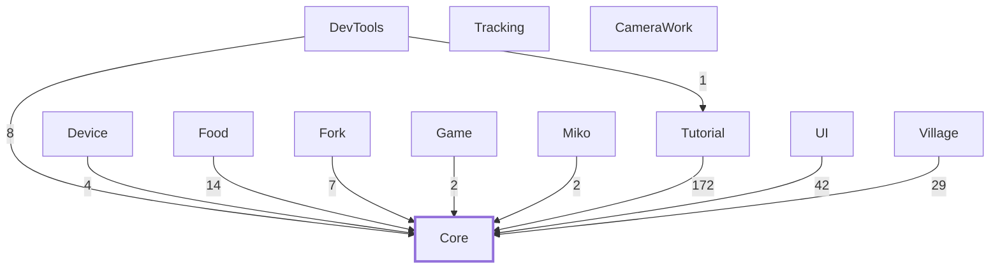
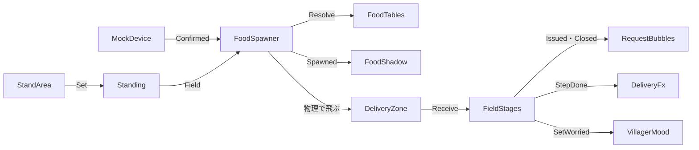
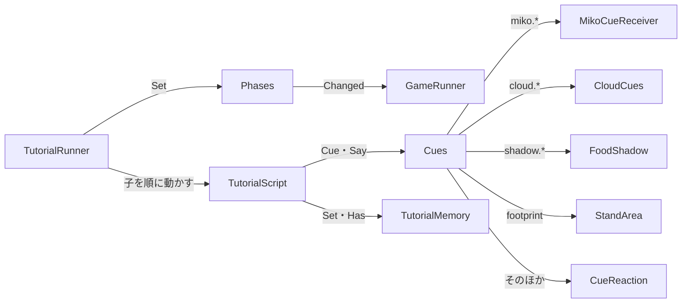

<!-- このページは tools/api_doc/build_md.py が作ります。手で直さないでください。 -->
[入口](README.md) ・ [設計の考え方](design.md) ・ [つながりの図](diagrams.md) ・ [やりたいこと別の手順](recipes.md) ・ [ガイド](guide.md)

# つながりの図

矢印は「呼ぶ・知らせる」向きです。図の中の型は押せません。型のページへは、図の下の一覧から移ります。

## 機能どうしのつながり

実行時の型が、ほかの機能の型を名前で使っている回数です（エディタ専用・試験用の型は数えません）。ほとんどの矢印が Core に向かいます。機能どうしは Core だけを通してつながる決まりだからです（[なぜ](design.md#d-core)）。Tracking と CameraWork は、どの機能ともつながりません。

## 流れ 1: 食べ物を生んで、届けるまで

デバイスで決定すると食べ物が生まれ、体験者が狙って飛ばします。落ちた所の `DeliveryZone` が、そのフィールドに届けます。

図の型: [`MockDevice`](Device.md#t-mockdevice)、[`FoodSpawner`](Food.md#t-foodspawner)、[`FoodTables`](Food.md#t-foodtables)、[`StandArea`](Village.md#t-standarea)、[`Standing`](Core.md#t-standing)、[`FoodShadow`](UI.md#t-foodshadow)、[`DeliveryZone`](Village.md#t-deliveryzone)、[`FieldStages`](Village.md#t-fieldstages)、[`RequestBubbles`](UI.md#t-requestbubbles)、[`DeliveryFx`](Village.md#t-deliveryfx)、[`VillagerMood`](Village.md#t-villagermood)

## 流れ 2: チュートリアルから本編まで

チュートリアルは、合図（`Cues`）を出すだけです。巫女・雲・影・足あとは、合図を受けた側が見せ方を決めます。全部終わると、場面（`Phases`）を見ていた `GameRunner` が本編を始めます。

図の型: [`TutorialRunner`](Tutorial.md#t-tutorialrunner)、[`TutorialScript`](Tutorial.md#t-tutorialscript)、[`Phases`](Core.md#t-phases)、[`GameRunner`](Game.md#t-gamerunner)、[`Cues`](Core.md#t-cues)、[`TutorialMemory`](Tutorial.md#t-tutorialmemory)、[`MikoCueReceiver`](Miko.md#t-mikocuereceiver)、[`CloudCues`](Fork.md#t-cloudcues)、[`FoodShadow`](UI.md#t-foodshadow)、[`StandArea`](Village.md#t-standarea)、[`CueReaction`](UI.md#t-cuereaction)

型ごとの細かい図は、各型の「つながり」にあります。
