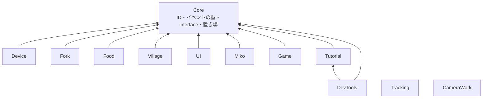
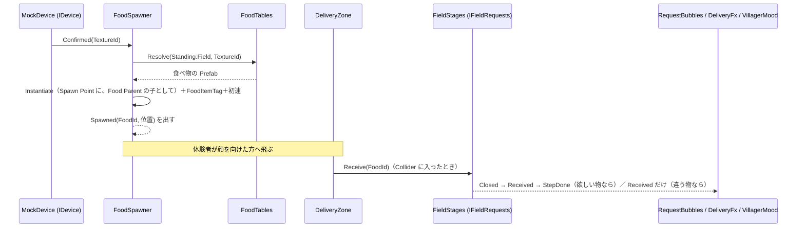
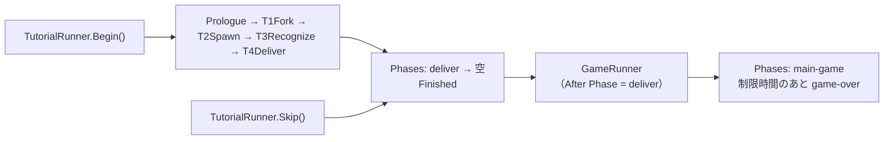

<!-- このページは tools/api_doc/build_md.py が作ります。手で直さないでください。 -->
[入口](README.md) ・ [設計の考え方](design.md) ・ [つながりの図](diagrams.md) ・ [やりたいこと別の手順](recipes.md) ・ [ガイド](guide.md)

# ガイド

## 1. 全体像

### 1.1 層と依存の向き

機能は、`Core` の小さな型・interface・置き場を通してだけつながります。機能どうしは、互いのクラスを参照しません。

- `Tracking` と `CameraWork` は、`Core` も参照しません。どちらの機能も、ほかの機能の型を使いません。
- `DevTools` だけが、`Tutorial` を参照します。[`TutorialDebugHud`](DevTools.md#t-tutorialdebughud) が [`TutorialRunner`](Tutorial.md#t-tutorialrunner) を操作するためです。
- 機能の中の依存の向きは、asmdef の `references` で決まります。`.github/scripts/check_coupling.py` は、`MouthOfGod.<他の機能>` を参照するコードを、警告として PR に出します（止めません）。
- 全機能を参照する組み立て役（Bootstrap）と、中央の進行クラス（`GameManager`）は、置きません（[architecture.md](https://github.com/Fialuxe/MouthOfGod_System/blob/main/docs/architecture.md)）。

### 1.2 アセンブリと名前空間

名前空間は、フォルダ名に合わせて `MouthOfGod.<フォルダ>` です。エディタ専用の部分は、`.Editor` を付けた別のアセンブリです。

| アセンブリ | 名前空間 | 参照する asmdef |
|---|---|---|
| `MouthOfGod.Core` | `MouthOfGod.Core` | なし |
| `MouthOfGod.Device` | `MouthOfGod.Device` | Core、Unity.InputSystem |
| `MouthOfGod.Fork` | `MouthOfGod.Fork` | Core、Unity.InputSystem |
| `MouthOfGod.Food` | `MouthOfGod.Food` | Core |
| `MouthOfGod.Village` | `MouthOfGod.Village` | Core |
| `MouthOfGod.UI` | `MouthOfGod.UI` | Core |
| `MouthOfGod.Miko` | `MouthOfGod.Miko` | Core、UnityEngine.UI |
| `MouthOfGod.Tutorial` | `MouthOfGod.Tutorial`、`MouthOfGod.Tutorial.Sandbox` | Core、Unity.InputSystem |
| `MouthOfGod.Game` | `MouthOfGod.Game` | Core、Unity.TextMeshPro |
| `MouthOfGod.Tracking` | `MouthOfGod.Tracking` | meta.xr.mrutilitykit、Oculus.VR、Unity.InputSystem、AprilTag.Runtime |
| `MouthOfGod.CameraWork` | `MouthOfGod.CameraWork` | なし |
| `MouthOfGod.DevTools` | `MouthOfGod.DevTools` | Core、Tutorial、Unity.InputSystem |
| `MouthOfGod.Device.Editor` | `MouthOfGod.Device.Editor` | Device |
| `MouthOfGod.Fork.Editor` | `MouthOfGod.Fork.Editor` | Fork |
| `MouthOfGod.Food.Editor` | `MouthOfGod.Food.Editor` | Food |
| `MouthOfGod.Village.Editor` | `MouthOfGod.Village.Editor`、`MouthOfGod.Village.Editor.Draft` | Village、Food |
| `MouthOfGod.Miko.Editor` | `MouthOfGod.Miko.Editor` | Miko |
| `MouthOfGod.Tutorial.Editor` | `MouthOfGod.Tutorial.Editor` | Tutorial、Miko |
| `MouthOfGod.CameraWork.Editor` | `MouthOfGod.CameraWork.Editor` | CameraWork |
| `MouthOfGod.DevTools.Editor` | `MouthOfGod.DevTools.Editor` | Core、DevTools、Tutorial、Fork、Food、Village、UI、Miko、Tutorial.Editor |

- テストは、機能ごとに `MouthOfGod.<機能>.Tests`（Editor のみ）です。`Core`・`Device`・`Food`・`Fork`・`Game`・`Tutorial`・`UI`・`CameraWork`・`Village` は、`InternalsVisibleTo` で `internal` をテストに見せています。
- `Tracking` の asmdef は `Core` を参照しません。コードも `MouthOfGod.Core` を使いません。ほかの機能には、`Transform` と追跡中かどうかだけを渡します。

### 1.3 Play のたびに自動で置かれるもの

手でシーンに置かなくても、次のものは Play で現れます。

| 自動で置かれるもの | 条件 | 置く所 |
|---|---|---|
| [`MockDevice`](Device.md#t-mockdevice)（と [`MockDeviceModel`](Device.md#t-mockdevicemodel)） | シーン読み込みのあと、実機のデバイスが先に [`Devices`](Core.md#t-devices) へ登録していなければ | `MockDevice.GetOrCreate`。Prefab `Resources/Prefabs/Device/MockDevice` があればそれ、なければコードで作る。`DontDestroyOnLoad` |
| [`RequestBubbles`](UI.md#t-requestbubbles) | シーン読み込みのあと | 自分で GameObject を作って付く（村人の頭の上の吹き出し） |
| [`AprilTagDetectionService`](Tracking.md#t-apriltagdetectionservice) | [`AprilTagPlace`](Tracking.md#t-apriltagplace) が必要なとき | `AprilTagDetectionService.GetOrCreate` |
| [`AprilTagRecalibrateInput`](Tracking.md#t-apriltagrecalibrateinput) | [`AprilTagDetectionService`](Tracking.md#t-apriltagdetectionservice) が起動したとき | 同じ GameObject に自動で付く |
| [`DeliveryFx`](Village.md#t-deliveryfx) | [`FieldStages`](Village.md#t-fieldstages) を持つ物に付いていないとき | [`FieldStages`](Village.md#t-fieldstages) が自分で付ける |
| `FoodItemTag` | 食べ物を生んだとき | [`FoodSpawner`](Food.md#t-foodspawner) が、生んだ食べ物に付ける |
| `SphereCollider`・`Rigidbody` | [`ForkTip`](Fork.md#t-forktip) に無いとき | [`ForkTip`](Fork.md#t-forktip) が自分に足す |

## 2. 機能どうしのつなぎ方

### 2.1 置き場（Core の static クラス）

機能をまたいで使う「もの」は、自分で置き場に登録します。使う側は、置き場から受け取ります。置き場は static なので、Play のたびに空にします（`RuntimeInitializeOnLoadMethod` の `Reset`）。

| 置き場 | 持つもの | 登録・設定する側 | 受け取る側（例） |
|---|---|---|---|
| [`Devices`](Core.md#t-devices) | [`IDevice`](Core.md#t-idevice)（1 台） | [`MockDevice`](Device.md#t-mockdevice) | [`FoodSpawner`](Food.md#t-foodspawner)、[`FoodShadow`](UI.md#t-foodshadow)、[`ForkTip`](Fork.md#t-forktip)、[`TutorialScript`](Tutorial.md#t-tutorialscript) の待ち、[`TutorialDebugHud`](DevTools.md#t-tutorialdebughud) |
| [`Forks`](Core.md#t-forks) | [`IFork`](Core.md#t-ifork)（1 本） | [`ForkTip`](Fork.md#t-forktip) | [`FoodShadow`](UI.md#t-foodshadow)、[`TutorialScript`](Tutorial.md#t-tutorialscript) の待ち、[`TutorialDebugHud`](DevTools.md#t-tutorialdebughud) |
| [`FoodSpawners`](Core.md#t-foodspawners) | [`IFoodSpawner`](Core.md#t-ifoodspawner)（1 つ） | [`FoodSpawner`](Food.md#t-foodspawner) | [`FoodShadow`](UI.md#t-foodshadow)、[`TutorialScript`](Tutorial.md#t-tutorialscript) の待ち |
| [`Fields`](Core.md#t-fields) | [`IFieldRequests`](Core.md#t-ifieldrequests)（フィールドごと） | [`FieldStages`](Village.md#t-fieldstages) | [`RequestBubbles`](UI.md#t-requestbubbles)、[`DeliveryZone`](Village.md#t-deliveryzone)、[`TutorialRunner`](Tutorial.md#t-tutorialrunner)（Skip）、[`T3Recognize`](Tutorial.md#t-t3recognize)、[`T4Deliver`](Tutorial.md#t-t4deliver)、待ち、[`TutorialDebugHud`](DevTools.md#t-tutorialdebughud) |
| [`Standing`](Core.md#t-standing) | 前に立っているフィールド（[`FieldId`](Core.md#t-fieldid)） | [`StandArea`](Village.md#t-standarea) | [`FoodSpawner`](Food.md#t-foodspawner)（食べ物の表を選ぶ）、[`StandWait`](Tutorial.md#t-standwait)、[`TutorialDebugHud`](DevTools.md#t-tutorialdebughud) |
| [`Phases`](Core.md#t-phases) | いまの場面（[`PhaseId`](Core.md#t-phaseid)） | [`TutorialRunner`](Tutorial.md#t-tutorialrunner)、[`GameRunner`](Game.md#t-gamerunner) | [`GameRunner`](Game.md#t-gamerunner)、[`FoodShadow`](UI.md#t-foodshadow)、[`TutorialScript`](Tutorial.md#t-tutorialscript)、[`TutorialDebugHud`](DevTools.md#t-tutorialdebughud) |
| [`Cues`](Core.md#t-cues) | 合図（[`CueRequested`](Core.md#t-cuerequested)） | `TutorialScript.Cue`、`TutorialRunner.Skip` | [`MikoCueReceiver`](Miko.md#t-mikocuereceiver)、[`CloudCues`](Fork.md#t-cloudcues)、[`FoodShadow`](UI.md#t-foodshadow)、[`StandArea`](Village.md#t-standarea)、[`CueReaction`](UI.md#t-cuereaction)、[`TutorialDebugHud`](DevTools.md#t-tutorialdebughud) |

[`FoodTables`](Food.md#t-foodtables)（Food）は、[`FoodTable`](Food.md#t-foodtable) の置き場です。機能をまたぐ置き場ではなく、Food の内側にあります。

### 2.2 合図（[`Cues`](Core.md#t-cues)）の名前

出す側は、誰が受けるかを知りません。受ける側がいなければ、何も起きません。名前は、機能ごとの決まりに従います。

| 合図の名前 | 受ける所 | 意味 |
|---|---|---|
| `miko.say.<id>` | [`MikoCueReceiver`](Miko.md#t-mikocuereceiver) → [`MikoSpeech`](Miko.md#t-mikospeech) | 巫女がセリフ `<id>` を言う |
| `miko.face.<名前>` | [`MikoCueReceiver`](Miko.md#t-mikocuereceiver) → [`MikoFace`](Miko.md#t-mikoface) | 表情を変える（normal / happy / squint / love / sleep / wink / tired） |
| `miko.point` | [`MikoCueReceiver`](Miko.md#t-mikocuereceiver) | 指さしをする |
| `miko.hush` | [`MikoCueReceiver`](Miko.md#t-mikocuereceiver) → [`MikoSpeech`](Miko.md#t-mikospeech) | しゃべるのをやめる |
| `miko.follow` / `miko.stay` | [`MikoCueReceiver`](Miko.md#t-mikocuereceiver) → [`MikoMover`](Miko.md#t-mikomover) | 体験者についてくる / その場にとどまる |
| `cloud.glow` | [`CloudCues`](Fork.md#t-cloudcues) | 正面にいちばん近い雲を 1 つ光らせる |
| `cloud.approach` | [`CloudCues`](Fork.md#t-cloudcues) | 光る雲を、体験者の近くへ寄せる |
| `cloud.calm` | [`CloudCues`](Fork.md#t-cloudcues) | 光を消し、雲を戻す |
| `shadow.show` / `shadow.faint` / `shadow.emphasize` / `shadow.hide` | [`FoodShadow`](UI.md#t-foodshadow) | 食べ物の影を、ふつうに / 薄く / 強く出す / 消す |
| `<フィールド>.footprint` / `<フィールド>.footprint-off` | [`StandArea`](Village.md#t-standarea) | 床の足あとの印を出す / 消す |
| `<フィールド>.glow` / `<フィールド>.glow-off` | [`CueReaction`](UI.md#t-cuereaction)（Inspector で設定した物） | フィールドを光らせる / 消す |
| `offering.show` / `offering.hide` | [`CueReaction`](UI.md#t-cuereaction)（Inspector で設定した物） | T2 のお供え物を出す / 隠す |
| `device.button.glow` / `device.button.glow-strong` / `device.button.glow-off` | [`CueReaction`](UI.md#t-cuereaction)（Inspector で設定した物） | デバイスのボタンを光らせる / 強く光らせる / 消す |
| `staff.alert` | [`CueReaction`](UI.md#t-cuereaction)（Inspector で設定した物） | スタッフに知らせる |
| `prologue.start` / `prologue.end` | [`CueReaction`](UI.md#t-cuereaction)（Inspector で設定した物） | プロローグの動画の前後 |

- [`CueReaction`](UI.md#t-cuereaction) は、合図の名前ごとに、物を出す・消す・`UnityEvent` を呼ぶ、を Inspector だけで設定できる部品です。コードの外で足せる反応は、これで受けます。
- 合図の名前は、[`TutorialScript`](Tutorial.md#t-tutorialscript) を継いだ各スクリプトの Inspector で変えられます。空にすると、その合図は出しません。
- フィールドの合図は、フィールド名から始めます（`sea.glow`、`village.footprint`）。決まりは [requests.md](https://github.com/Fialuxe/MouthOfGod_System/blob/main/docs/requests.md) にあります。

### 2.3 場面（[`Phases`](Core.md#t-phases)）の名前

`Phases.Current` に入る名前です。番号ではなく、やることを表す名前にします。一覧と決める所は [progress-keys.md](https://github.com/Fialuxe/MouthOfGod_System/blob/main/docs/progress-keys.md) にもあります。

| 名前 | 決める所 | 意味 |
|---|---|---|
| `prologue` | [`PrologueVideo`](Tutorial.md#t-prologuevideo) | 導入の動画 |
| `fork` | [`T1Fork`](Tutorial.md#t-t1fork) | フォークの使い方 |
| `spawn` | [`T2Spawn`](Tutorial.md#t-t2spawn) | 口から物が生まれる |
| `recognize` | [`T3Recognize`](Tutorial.md#t-t3recognize) | 食感で物が変わる・欲しい物を知る |
| `deliver` | [`T4Deliver`](Tutorial.md#t-t4deliver) | 立つ場所で届ける |
| `main-game` | [`GameRunner`](Game.md#t-gamerunner) | 本編（制限時間のあいだ） |
| `game-over` | [`GameRunner`](Game.md#t-gamerunner) | 本編の時間切れ |

### 2.4 流れ 1: 食べ物を生んで、届けるまで

1. デバイスが決定すると、`IDevice.Confirmed` が、そのときの食感を運びます。噛む前の決定（食感が空）は、食べ物を生みません。
2. [`FoodSpawner`](Food.md#t-foodspawner) が `FoodTables.Resolve` で Prefab を引きます。引く順は、立っているフィールドの表、共通の表、なし、です。立っているフィールドは `Standing.Field` です。
3. `Spawn Point` の位置と向きに生みます。`Food Parent` を入れてあれば、その子にします。`FoodItemTag` を付け、`Launch Speed` が 0 より大きく、`Rigidbody` が動く物なら、前向きに初速を与えます。
4. 食べ物は、物理で飛びます。落ちた先の [`DeliveryZone`](Village.md#t-deliveryzone)（`Collider` の Is Trigger）が、[`IFoodItem`](Core.md#t-ifooditem) を読んで、フィールドの `Receive` を呼びます。
5. `FieldStages.Receive` は、[`DeliveryKind`](Core.md#t-deliverykind) を返します。欲しがっていた物（`Requested`）なら、ステップを済ませ、`Closed`（`Resolved = true`）、`Received`、`StepDone` の順に出します。このフィールドの物（`Own`）とよその物（`Foreign`）は、`Received` だけを出します。
6. [`DeliveryFx`](Village.md#t-deliveryfx) は、`StepDone` で喜びの粒と音を出し、`Received` が `Requested` 以外なら、困っている村人にトリガー `Missed` を送り、音を鳴らします。[`RequestBubbles`](UI.md#t-requestbubbles) は、`Closed` で吹き出しを消します。

### 2.5 流れ 2: 欲しい物を出す

- `IFieldRequests.Open()` が、次の欲しい物を出します。出せなければ `false` です（上限まで出ている、ステップが残っていない、など）。
- 出すと `Issued`（[`RequestIssued`](Core.md#t-requestissued)）が出ます。[`RequestBubbles`](UI.md#t-requestbubbles) は、`Anchor`（村人の頭の上の `Transform`）に吹き出しを出します。
- 同じフィールドで、同時に複数出せます。上限は [`FieldStages`](Village.md#t-fieldstages) の Max Open Requests（既定 2）です。欲しい物は、`Request`（番号）で見分けます。
- `Expire()` は、出ている欲しい物を、届かないまま終えます（`Closed` の `Resolved = false`）。`Restart()` は、フィールドを最初に戻します。
- 本編が、いつ・どこに出すかを決めるコードは、まだありません。いまは、[`OpenAllRequestsAfterTutorial`](Tutorial.md#t-openallrequestsaftertutorial)（試験用）が、チュートリアルのあとに、全フィールドへ出せるだけ出します。

### 2.6 流れ 3: チュートリアルから本編へ

- [`TutorialRunner`](Tutorial.md#t-tutorialrunner) は、子の [`TutorialScript`](Tutorial.md#t-tutorialscript) を、Hierarchy の順に 1 つずつ動かします。動かす間、[`Phases`](Core.md#t-phases) を各スクリプトの場面にします。例外が出たスクリプトは、そこでやめて、次へ進みます。
- 全部終わると、[`Phases`](Core.md#t-phases) を空に戻し、`Finished` を出します。
- [`GameRunner`](Game.md#t-gamerunner) は、場面 `deliver` のあとに場面が空になったとき、本編を始めます（After Phase の既定は `deliver`）。[`TutorialRunner`](Tutorial.md#t-tutorialrunner) の型は、参照しません。
- `TutorialRunner.Skip()` は、チュートリアルを飛ばして、全部終わった扱いにします。まず、動いていれば止め、`Memory` を空にし、全フィールドを `Restart` します。次に、`<フィールド>.glow-off`・`<フィールド>.footprint-off`・`miko.stay` の合図を出します。最後に、場面を Skip Phase（既定 `deliver`）から空の場面へ進め、`Finished` を出します。
- Skip で本編が始まるには、シーンに [`GameRunner`](Game.md#t-gamerunner) が必要です。**2026-10-28 に確かめたとき、Main シーンには [`GameRunner`](Game.md#t-gamerunner) がありませんでした**（第 3 章）。

### 2.7 ID の型

| 型 | 中身 | 例 |
|---|---|---|
| [`TextureId`](Core.md#t-textureid) | 食感 | `placeholder-a` |
| [`FoodId`](Core.md#t-foodid) | 食べ物。Prefab のファイル名と同じ | `fish` |
| [`FieldId`](Core.md#t-fieldid) | フィールド（`village` / `mountain` / `sea` / `grassland`） | `sea` |
| [`CueId`](Core.md#t-cueid) | 合図の名前 | `miko.say.t1-pierce` |
| [`PhaseId`](Core.md#t-phaseid) | 場面の名前 | `deliver` |

どれも、文字列を包んだ `readonly struct` です。`null` と空文字は、どちらも空 ID（`None`、`IsEmpty`）です。大文字小文字を区別します。型が違えば、同じ文字列でも別物です。

## 3. 共有シーン Main の姿

`Assets/Scenes/Main.unity` を、2026-10-28 に YAML から読んで計算した結果です。この章は手で書いているので、シーンを直したら古くなります。単位はメートル、座標はワールドです。ミニチュアの台は、`Border_*` の枠で、およそ ±0.6 m 四方です。

### 3.1 位置

| 物 | 位置 (x, y, z) | 備考 |
|---|---|---|
| Main Camera | (-0.27, 1.51, -1.34) | FOV 60。子に `MouthAnchor` (-0.27, 1.43, -1.26)、`ButtonGlow`、`ButtonGlowStrong`、`StaffAlert` |
| Miko | (-1.17, 1.21, 0.26) | 向きは Y 軸 180 度 |
| 村（`Village/Village/Plaza`） | (-0.31, 0.11, -0.30) | 村人・家・畑・木 |
| 山（`MountVer2/mount`） | (-0.27, 0.13, 0.30) | |
| 草原（`Grass/Tree1`） | (0.28, 0.13, 0.39) | `Grass` のルートは (0.27, 0.01, 0.27) |
| 海（`Sea_work`） | (0.31, -0.07, -0.30) | `Terrain_sea` は (0.04, 0.06, -0.57) |
| 立つ場所（[`StandArea`](Village.md#t-standarea)） | 村 (-1.02, -0.06, -1.03)、海 (1.07, -0.16, -0.85)、草原 (0.90, -0.09, 1.17)、山 (-0.93, -0.06, 1.00) | |

### 3.2 Hierarchy とコンポーネント

Main.unity のシーンに直接付いている、このリポジトリのスクリプトです。

| オブジェクト | コンポーネント |
|---|---|
| `Main Camera` | [`DesktopHead`](DevTools.md#t-desktophead) |
| `MinitureBase` | [`AprilTagPlace`](Tracking.md#t-apriltagplace) |
| [`CloudRing`](Fork.md#t-cloudring) | [`CloudRing`](Fork.md#t-cloudring)、[`CloudCues`](Fork.md#t-cloudcues) |
| [`ForkTip`](Fork.md#t-forktip) | [`ForkTip`](Fork.md#t-forktip)、[`HandHeldPose`](Tracking.md#t-handheldpose) |
| `Indicators` | [`CueReaction`](UI.md#t-cuereaction) |
| `DebugHud` | [`TutorialDebugHud`](DevTools.md#t-tutorialdebughud) |
| [`OpenAllRequestsAfterTutorial`](Tutorial.md#t-openallrequestsaftertutorial) | [`OpenAllRequestsAfterTutorial`](Tutorial.md#t-openallrequestsaftertutorial) |

Prefab として置かれている物と、その中のコンポーネントです。

| Prefab の置き場 | 中身 |
|---|---|
| `Resources/Prefabs/Miko/Miko` | `Body` に [`MikoFloat`](Miko.md#t-mikofloat)・[`MikoMover`](Miko.md#t-mikomover)・[`MikoPointer`](Miko.md#t-mikopointer)・[`MikoCueReceiver`](Miko.md#t-mikocuereceiver)・[`MikoFace`](Miko.md#t-mikoface)・[`MikoSpeech`](Miko.md#t-mikospeech)。子の `LineBook` に [`MikoLineBook`](Miko.md#t-mikolinebook) |
| `Resources/Prefabs/Misc/FoodSpawner` | [`FoodSpawner`](Food.md#t-foodspawner)、[`FoodTable`](Food.md#t-foodtable)（共通の表） |
| `Resources/Prefabs/Misc/FoodShadow` | [`FoodShadow`](UI.md#t-foodshadow) |
| `Resources/Prefabs/Misc/TutorialRunner` | [`TutorialRunner`](Tutorial.md#t-tutorialrunner)。Main では、子に `Prologue`・[`T1Fork`](Tutorial.md#t-t1fork)・[`T2Spawn`](Tutorial.md#t-t2spawn)・[`T3Recognize`](Tutorial.md#t-t3recognize)・[`T4Deliver`](Tutorial.md#t-t4deliver) の Prefab が並ぶ（この順がチュートリアルの順） |
| `Resources/Prefabs/Tutorial/<名前>` | [`PrologueVideo`](Tutorial.md#t-prologuevideo)（子に [`VideoScreen`](Tutorial.md#t-videoscreen)）、[`T1Fork`](Tutorial.md#t-t1fork)、[`T2Spawn`](Tutorial.md#t-t2spawn)、[`T3Recognize`](Tutorial.md#t-t3recognize)、[`T4Deliver`](Tutorial.md#t-t4deliver)。どれにも [`MikoLineBook`](Miko.md#t-mikolinebook) が付く |
| `[BuildingBlock] Camera Rig with MouthAnchor` | Meta XR のカメラ装置 |

フィールドの Prefab です。Main では、`Resources/Prefabs/Misc/` の Variant（`Village`、`Grass Variant`、`MountVer2 Variant`）と、`Resources/Prefabs/Sea/Sea_work` を使います。Variant は、元の Prefab に、Main 用の部品（[`StandArea`](Village.md#t-standarea)、[`DeliveryZone`](Village.md#t-deliveryzone) など）を足した物です。

| フィールド | 元の Prefab | ルートのコンポーネント | ステップ（[`FieldStep`](Village.md#t-fieldstep)、順に欲しい物） |
|---|---|---|---|
| 村 `village` | `Resources/Prefabs/Village/Village` | [`FieldStages`](Village.md#t-fieldstages)、[`SurfaceAnchor`](Village.md#t-surfaceanchor)、[`DeliveryFx`](Village.md#t-deliveryfx)、[`DeliveryZone`](Village.md#t-deliveryzone)、[`FoodTable`](Food.md#t-foodtable) | pumpkin、carrot、turnip、tomato |
| 海 `sea` | `Resources/Prefabs/Sea/Sea_work` | [`SurfaceAnchor`](Village.md#t-surfaceanchor)、[`FieldStages`](Village.md#t-fieldstages)、[`FoodTable`](Food.md#t-foodtable)、[`DeliveryZone`](Village.md#t-deliveryzone)、[`DeliveryFx`](Village.md#t-deliveryfx)、[`CueReaction`](UI.md#t-cuereaction) | fish、shell、shrimp |
| 草原 `grassland` | `Resources/Prefabs/Grass/Grass` | [`FieldStages`](Village.md#t-fieldstages)、[`FoodTable`](Food.md#t-foodtable) | chicken、pig、sheep、cow |
| 山 `mountain` | `Resources/Prefabs/Mount/MountVer2` | [`FoodTable`](Food.md#t-foodtable)、[`FieldStages`](Village.md#t-fieldstages)、[`DeliveryZone`](Village.md#t-deliveryzone)、[`DeliveryFx`](Village.md#t-deliveryfx) | mushroom、apple、chestnut |

- 村人は、各フィールドの子に [`VillagerMood`](Village.md#t-villagermood) として置かれます。[`FieldStep`](Village.md#t-fieldstep) の Helped に入れた村人が、そのステップが済むまで悩みます。
- 食べ物の Prefab は、`Resources/Prefabs/Food/` にあります（apple、carrot、chestnut、chicken、cow、fish、mushroom、pig、pumpkin、sheep、shell、shrimp、tomato、turnip）。ファイル名が食べ物の ID です。

### 3.3 Main にまだ無いもの

- [`GameRunner`](Game.md#t-gamerunner) と [`RemainingTimeText`](Game.md#t-remainingtimetext): シーンにも Prefab にもありません。置かないと、チュートリアルが終わっても本編（`main-game`）は始まりません。`TutorialRunner.Skip()` も、同じです。
- 本編まで通して試すときは、Main の写し `Assets/Scenes/Main_Copy.unity` を開き、メニュー `MouthOfGod/Dev/Set Up Main Copy (GameRunner, Max Open Requests)` を 1 回実行します。[`GameRunner`](Game.md#t-gamerunner) が置かれ、全フィールドで欲しい物を全部同時に出せるようになります。
- 自動で置かれる物（1.3 節）は、手で置く必要がありません。

## 付録 A. メニュー一覧

| 種類 | メニュー | 型 |
|---|---|---|
| エディタ | `Assets/MouthOfGod/Food/Generate Icon From Selected` | [`FoodIconGenerator`](Food.md#t-foodicongenerator) |
| エディタ | `MouthOfGod/CameraWork/Add Village Tour` | [`VillageTourBuilder`](CameraWork.md#t-villagetourbuilder) |
| エディタ | `MouthOfGod/CameraWork/Add Village Zoom-Out` | [`VillageTourBuilder`](CameraWork.md#t-villagetourbuilder) |
| エディタ | `MouthOfGod/Dev/Add Delivery Zone To Mount Variant` | [`MountDeliveryZoneAdder`](DevTools.md#t-mountdeliveryzoneadder) |
| エディタ | `MouthOfGod/Dev/Build Tutorial Test Scene` | [`TutorialTestSceneBuilder`](DevTools.md#t-tutorialtestscenebuilder) |
| エディタ | `MouthOfGod/Dev/Fix Main Sea Placement (remove SurfaceAnchor)` | [`MainSeaSwapper`](DevTools.md#t-mainseaswapper) |
| エディタ | `MouthOfGod/Dev/Match Main Sea Villager Height to Village` | [`MainSeaVillagerResizer`](DevTools.md#t-mainseavillagerresizer) |
| エディタ | `MouthOfGod/Dev/Print Field Diagnostics (Play mode)` | [`FieldDiagnostics`](DevTools.md#t-fielddiagnostics) |
| エディタ | `MouthOfGod/Dev/Set Up Main Copy (GameRunner, Max Open Requests)` | [`MainCopySetup`](DevTools.md#t-maincopysetup) |
| エディタ | `MouthOfGod/Dev/Swap Main Sea (Temporal to Sea_work)` | [`MainSeaSwapper`](DevTools.md#t-mainseaswapper) |
| エディタ | `MouthOfGod/Device/Create MockDevice Prefab` | [`MockDevicePrefabGenerator`](Device.md#t-mockdeviceprefabgenerator) |
| エディタ | `MouthOfGod/Food/Fit Prefab Sizes` | [`FoodPrefabFitter`](Food.md#t-foodprefabfitter) |
| エディタ | `MouthOfGod/Food/Generate Icons` | [`FoodIconGenerator`](Food.md#t-foodicongenerator) |
| エディタ | `MouthOfGod/Food/Generate Prefabs` | [`FoodPrefabGenerator`](Food.md#t-foodprefabgenerator) |
| エディタ | `MouthOfGod/Food/Regenerate Prefabs (Overwrite)` | [`FoodPrefabGenerator`](Food.md#t-foodprefabgenerator) |
| エディタ | `MouthOfGod/Fork/Generate Cloud Prefab` | [`CloudPrefabGenerator`](Fork.md#t-cloudprefabgenerator) |
| エディタ | `MouthOfGod/Miko/Generate Prefab` | [`MikoPrefabGenerator`](Miko.md#t-mikoprefabgenerator) |
| エディタ | `MouthOfGod/Tutorial/Generate Tutorial Prefabs` | [`TutorialPrefabGenerator`](Tutorial.md#t-tutorialprefabgenerator) |
| エディタ | `MouthOfGod/Village/Add Missed To Villager Controller` | [`VillagePrefabGenerator`](Village.md#t-villageprefabgenerator) |
| エディタ | `MouthOfGod/Village/Bake Draft Village Prefab` | [`VillageBaker`](Village.md#t-villagebaker) |
| エディタ | `MouthOfGod/Village/Generate Effects` | [`VillageFxGenerator`](Village.md#t-villagefxgenerator) |
| エディタ | `MouthOfGod/Village/Generate Prefabs` | [`VillagePrefabGenerator`](Village.md#t-villageprefabgenerator) |
| 右クリック | `Begin` | [`TutorialRunner`](Tutorial.md#t-tutorialrunner) |
| 右クリック | `Complete Next Step` | [`FieldStages`](Village.md#t-fieldstages) |
| 右クリック | `Deliver Foreign Food (test)` | [`FieldStages`](Village.md#t-fieldstages) |
| 右クリック | `Deliver Wanted Food` | [`FieldStages`](Village.md#t-fieldstages) |
| 右クリック | `Leave` | [`StandArea`](Village.md#t-standarea) |
| 右クリック | `Open Next Want` | [`FieldStages`](Village.md#t-fieldstages) |
| 右クリック | `Open Now` | [`OpenAllRequestsAfterTutorial`](Tutorial.md#t-openallrequestsaftertutorial) |
| 右クリック | `Play` | [`CameraCutPlayer`](CameraWork.md#t-cameracutplayer) |
| 右クリック | `Point` | [`MikoCueReceiver`](Miko.md#t-mikocuereceiver) |
| 右クリック | `Recalibrate` | [`AprilTagPlace`](Tracking.md#t-apriltagplace) |
| 右クリック | `Restart` | [`FieldStages`](Village.md#t-fieldstages) |
| 右クリック | `Skip` | [`TutorialRunner`](Tutorial.md#t-tutorialrunner) |
| 右クリック | `Skip` | [`VideoScreen`](Tutorial.md#t-videoscreen) |
| 右クリック | `Stand Here` | [`StandArea`](Village.md#t-standarea) |
| 右クリック | `Stop` | [`CameraCutPlayer`](CameraWork.md#t-cameracutplayer) |
| 右クリック | `Stop` | [`TutorialRunner`](Tutorial.md#t-tutorialrunner) |
| 右クリック | `テスト: 最初のセリフ` | [`MikoSpeech`](Miko.md#t-mikospeech) |
| 右クリック | `対応一覧を出す` | [`FoodTable`](Food.md#t-foodtable) |
| 右クリック | `表情: ∪∪` | [`MikoFace`](Miko.md#t-mikoface) |
| 右クリック | `表情: ♡♡` | [`MikoFace`](Miko.md#t-mikoface) |
| 右クリック | `表情: にっこり` | [`MikoFace`](Miko.md#t-mikoface) |
| 右クリック | `表情: ふつう` | [`MikoFace`](Miko.md#t-mikoface) |
| 右クリック | `表情: ー・` | [`MikoFace`](Miko.md#t-mikoface) |
| 右クリック | `表情: ーー` | [`MikoFace`](Miko.md#t-mikoface) |
| 右クリック | `表情: ＞＜` | [`MikoFace`](Miko.md#t-mikoface) |

## 付録 B. Resources の置き場所

コードが `Resources.Load` で読む場所です。

| パス | 読む所 | 中身 |
|---|---|---|
| `Resources/Prefabs/Device/MockDevice` | `MockDevice.GetOrCreate` | MockDevice の Prefab |
| `Resources/Prefabs/Fork/Cloud` | [`CloudRing`](Fork.md#t-cloudring) | 雲の Prefab |
| `Resources/Prefabs/Food/<食べ物の ID>` | [`FoodTable`](Food.md#t-foodtable)（Prefab の参照）、`FoodTables.IdOf` | 食べ物の Prefab。ファイル名が食べ物の ID |
| `Resources/Icons/Food/<食べ物の ID>` | `RequestBubbleText.IconPath` | 吹き出しのアイコン |
| `Resources/Prefabs/Village/Fx_Joy`・`Fx_Smoke` | [`DeliveryFx`](Village.md#t-deliveryfx)、[`DeliveryZone`](Village.md#t-deliveryzone)、`PopInEffect` | 喜びの粒・煙 |
| `Resources/Sounds/Village/Done`・`Missed` | [`DeliveryFx`](Village.md#t-deliveryfx) | 欲しい物が届いた音・違う物が届いた音 |
| `Resources/Prefabs/Miko/Miko` | シーンの Miko | 巫女の Prefab |
| `Resources/Prefabs/Tutorial/<名前>` | [`TutorialRunner`](Tutorial.md#t-tutorialrunner) の子 | プロローグと T1〜T4 の Prefab |
| `Resources/AprilTagSettings` | `AprilTagSettings.Load` | AprilTag の設定（無ければコードの既定値） |
| `Resources/RequestBubbleSettings` | `RequestBubbleSettings.Load` | 吹き出しの設定（無ければコードの既定値） |
