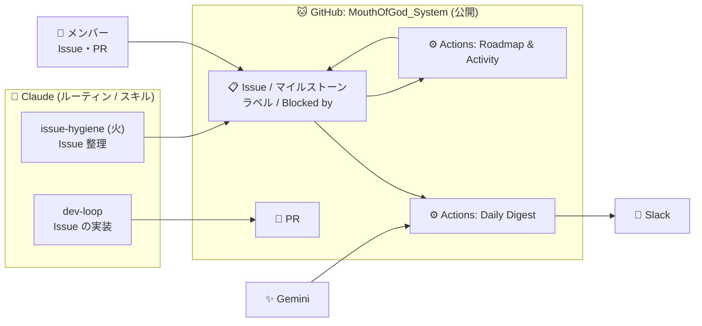

# 仕組みの全体図（何が、どこで、動いているか）

このプロジェクトの運用（Issue の整理、ロードマップ、日次のふりかえり、開発の補助）を支える自動化の全体図です。

> 直す人へ: [仕組みの前提](automation-premise.md)（補助線であって決まりではない。人の負荷を増やさない）

> 2026-10 で終了したため、ミーティングの議事録機能（録音・文字起こし・議題 Issue・議事録の PR）は停止し、削除しました。過去の議事録は `docs/minutes/` に記録として残しています。

## 1. 全体像

## 2. 部品の一覧

| | 部品 | 役割 | 動く場所 | 設定・置き場所 |
|---|---|---|---|---|
| 🐱 | **GitHub（公開）** `MouthOfGod_System` | Issue・マイルストーン・PR・docs・スキル・自動化のコード | GitHub | このリポジトリ |
| ⚙️ | **GitHub Actions** | 下の 7 つのワークフロー（公開リポジトリなので無料） | GitHub のサーバー | `.github/workflows/` |
| 🤖 | **Claude** | Issue 整理（`issue-hygiene`）、Issue の実装（`dev-loop`）、コンフリクトの調査（`merge-check`）、質問の言い直し（`clarify-reply`）、担当候補（`suggest-leading`） | claude.ai のルーティン | `.claude/skills/`、[routines.md](routines.md) |
| ✨ | **Gemini** | 1 日のふりかえりの文章づくり | Actions | `GEMINI_API_KEY_*` |
| 💬 | **Slack** | 日次のふりかえりの送り先 | Slack | `SLACK_WEBHOOK_URL` |

### GitHub Actions の 7 つのワークフロー

| 名前 | いつ動く | 何をする |
|---|---|---|
| **Roadmap & Activity** | Issue・マイルストーンの変化、`main` への push、10 時間おき | ロードマップと活動記録の Issue、README の図を作り直す。小ゴール（`sub-goal`）を自動で閉じる |
| **Daily Digest** | 毎日 22 時ごろ（日本時間） | 今日の変化を Gemini でまとめて Slack に送る |
| **Coupling check** | `Assets/Scripts/**` を触る PR | 機能どうしの直接参照を警告する |
| **API docs check** | `Assets/Scripts/**` を触る PR | API 文書の作り直し忘れを警告する（PR は止めない） |
| **Calendar sync** | 毎日 6:17（日本時間） | チームのカレンダーの 3 週間分の予定を、非公開リポジトリに書く。担当候補づくり（`suggest-leading`）が読む |
| **Claude mention** | コメントに `@claude` が付いたとき | Claude のルーティン（`clarify-reply`）を呼び、言い直しの返信を書かせる |
| **Conflict check** | `main` が進んだとき、PR が更新されたとき | open の PR のコンフリクトを git で調べる。新しくぶつかった PR があれば、Claude のルーティン（`merge-check`）を呼ぶ |

## 3. 1 週間の流れ

| いつ | 何が動く | どこで |
|---|---|---|
| **火** 朝 | 🤖 `issue-hygiene`: 完了済みの Issue を閉じ、重複・担当なし・止まっているものを「Issue 整理（週次）」にまとめる | Claude のルーティン |
| 毎日 | 💬 22 時ごろ、1 日のふりかえりが Slack に届く | Actions + Gemini |
| いつでも | 📋 Issue が変わると、ロードマップと活動記録が自動で作り直される | Actions |

## 4. 止まったらどうなるか

| 止まるもの | 影響 | 代わりに動くもの |
|---|---|---|
| Claude のルーティン | Issue 整理が出ない | 手動で `issue-hygiene` を呼べる |
| Gemini / Slack | 日次のふりかえりが届かない | 本体（Issue・ロードマップ）は影響を受けない |

## 5. 詳しい手順

- 担当の役割、ラベル、「決めること」の Issue の決まり: [CONTRIBUTING.md](../CONTRIBUTING.md)
- コード側（Unity）の設計: [docs/architecture.md](architecture.md)
