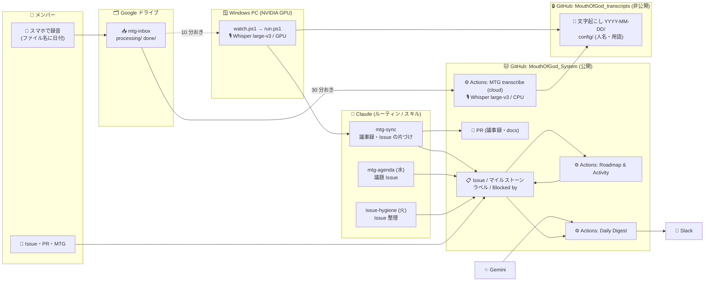
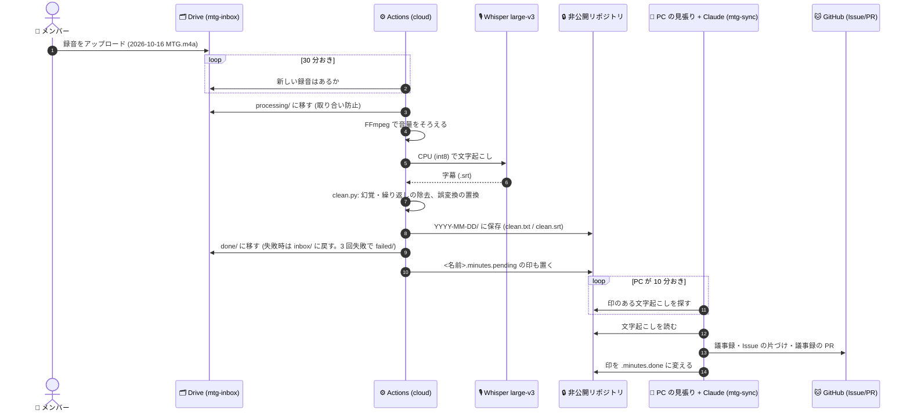
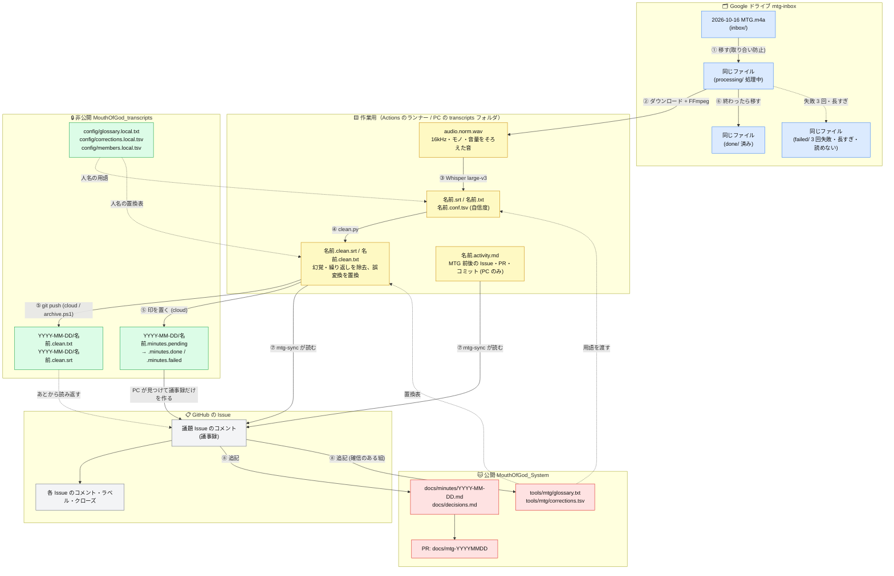
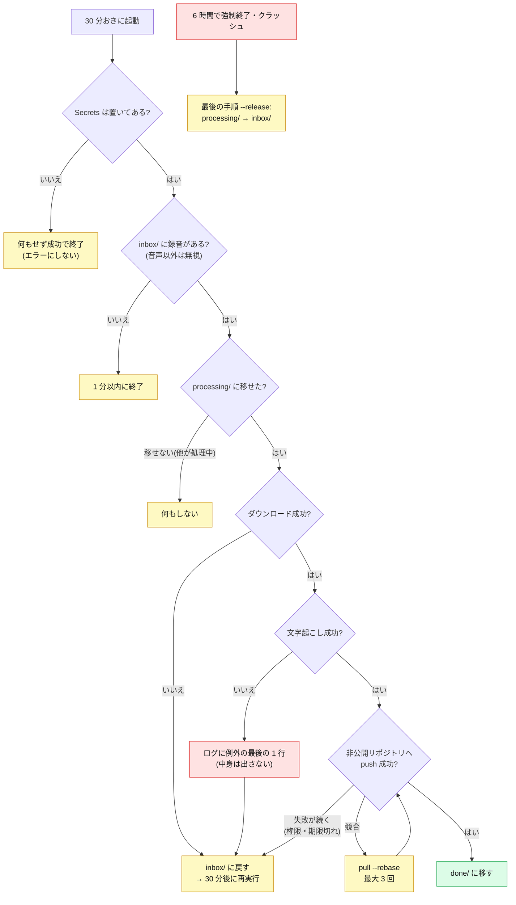

# 仕組みの全体図（何が、どこで、動いているか）

このプロジェクトの運用（Issue の整理、MTG の議題と議事録、ロードマップ、日次のふりかえり）を支える自動化の全体図。**「誰かの PC が動かないと止まる」を減らす**ことを軸に作ってある。

> 直す人へ: [仕組みの前提](automation-premise.md)（補助線であって決まりではない。人の負荷を増やさない）

## 1. 全体像

実線が今動いている道、点線は予備の道（PC）。**文字起こしは、クラウド（Actions）と PC のどちらでも進む**。

## 2. 部品の一覧

| | 部品 | 役割 | 動く場所 | 設定・置き場所 |
|---|---|---|---|---|
| 🐱 | **GitHub（公開）** `MouthOfGod_System` | Issue・マイルストーン・PR・docs・スキル・自動化のコード | GitHub | このリポジトリ |
| 🔒 | **GitHub（非公開）** `MouthOfGod_transcripts` | 文字起こしの保管、人名・用語の設定（`config/`） | GitHub | 招待された人だけ |
| ⚙️ | **GitHub Actions** | 下の 8 つのワークフロー（公開リポジトリなので無料） | GitHub のサーバー | `.github/workflows/` |
| 🗂️ | **Google ドライブ** `mtg-inbox` | 録音の置き場所（`processing/` が処理中、`done/` が済み） | Google | サービスアカウントと共有 |
| 🎙️ | **Whisper large-v3**（faster-whisper） | 録音 → 文字（日本語）。GPU なら速く、CPU なら実時間の約 0.9 倍 | Actions（CPU）/ Windows PC（GPU）/ Mac（確認用） | `tools/mtg/transcribe.py` |
| 🎛️ | **FFmpeg** | 音量をそろえる（小さな声・遠い声を落とさないため） | 同上 | `transcribe.ps1` / `transcribe_cloud.py` |
| 🤖 | **Claude** | 議事録づくり（`mtg-sync`）、議題づくり（`mtg-agenda`）、Issue 整理（`issue-hygiene`）、Issue の実装（`dev-loop`）、コンフリクトの調査（`merge-check`）、質問の言い直し（`clarify-reply`）。一覧は [routines.md](routines.md) | Claude のルーティン（クラウド）/ PC の `claude` | `.claude/skills/` |
| ✨ | **Gemini** | 1 日のふりかえりの文章づくり | Actions | `GEMINI_API_KEY_*` |
| 💬 | **Slack** | 日次のふりかえりの送り先 | Slack | `SLACK_WEBHOOK_URL` |
| 🪟 | **Windows PC** | 録音フォルダの見張り、GPU での文字起こし、`mtg-sync` の実行 | メンバーの PC | `tools/mtg/setup-pc.ps1` |
| 🍎 | **Mac（Apple Silicon）** | 環境の確認と、手で文字起こし（予備）。CPU のみ | メンバーの Mac | `tools/mtg/setup-mac.sh` |

### GitHub Actions の 8 つのワークフロー

| 名前 | いつ動く | 何をする |
|---|---|---|
| **Roadmap & Activity** | Issue・マイルストーンの変化、`main` への push、10 時間おき | ロードマップと活動記録の Issue、README の図を作り直す。小ゴール（`sub-goal`）を自動で閉じる |
| **Daily Digest** | 毎日 22 時ごろ（日本時間） | 今日の変化を Gemini でまとめて Slack に送る |
| **Coupling check** | `Assets/Scripts/**` を触る PR | 機能どうしの直接参照を警告する |
| **MTG transcribe (cloud)** | 30 分おき（Drive に録音があるときだけ処理） | 録音 → 文字起こし → 非公開リポジトリに保存 |
| **Calendar sync** | 毎日 6:17（日本時間） | チームのカレンダーの 3 週間分の予定を、非公開リポジトリに書く。水曜の議題づくりが読む |
| **Claude mention** | コメントに `@claude` が付いたとき | Claude のルーティン（`clarify-reply`）を呼び、言い直しの返信を書かせる |
| **Conflict check** | `main` が進んだとき、PR が更新されたとき | open の PR のコンフリクトを git で調べる。新しくぶつかった PR があれば、Claude のルーティン（`merge-check`）を呼ぶ |
| **MTG tools test** | MTG の自動化のスクリプトを触る PR | 録音・文字起こし・議事録の補助スクリプトが壊れていないかを確かめる |

## 3. 1 週間の流れ

| いつ | 何が動く | どこで |
|---|---|---|
| **火** 朝 | 🤖 `issue-hygiene`: 完了済みの Issue を閉じ、重複・担当なし・止まっているものを「Issue 整理（週次）」にまとめる | Claude のルーティン |
| **水** | 🤖 `mtg-agenda`: 金曜の議題 Issue を作る（前回のアクションの結果、決めることの候補つき） | Claude のルーティン |
| **水** 作業会 | 10 月だけ、水曜にも集まって作業します。会場とオンラインの両方で参加できます | メンバー |
| **金** MTG | 📱 誰かがスマホで録音 → `mtg-inbox` にアップロード（ファイル名に日付） | メンバー |
| 金〜土 | 🎙️ クラウドが録音を見つけて文字起こし（`processing/` → `done/`）、🔒 非公開リポジトリに保存 | Actions |
| 土 | 🤖 `mtg-sync`: 議事録（決定事項・アクション・未解決）、Issue の片づけ、議事録の PR | Claude のルーティン（PC の `run.ps1` は予備） |
| 毎日 | 💬 22 時ごろ、1 日のふりかえりが Slack に届く | Actions + Gemini |
| いつでも | 📋 Issue が変わると、ロードマップと活動記録が自動で作り直される | Actions |

## 4. 録音から議事録まで（詳しい流れ）

## 4.5 ファイルの流れ（1 本の録音が、どのファイルに変わるか）

色: 🟦 Drive、🟨 作業用（その場かぎり。消える）、🟩 非公開リポジトリ、🟥 公開リポジトリ、⬜ GitHub の Issue など。

| ファイル | どこに | 誰が作る | 誰が読む | 残るか |
|---|---|---|---|---|
| `2026-10-16 MTG.m4a`（録音） | Drive の `inbox/` → `processing/` → `done/` | 録音した人 | クラウド / PC の見張り | Drive に残る（共有した人だけ） |
| `audio.norm.wav` | ランナー、または PC の一時フォルダ | FFmpeg（音量の正規化） | Whisper | 終わると消える |
| `名前.srt` `名前.txt` `名前.conf.tsv` | `transcripts/`（作業用、git の対象外） | `transcribe.py` | `clean.py` | 消える（ランナー）/ PC に残る |
| `名前.clean.srt` `名前.clean.txt` | 同上 → 非公開リポジトリの `YYYY-MM-DD/` | `clean.py`、`git push` | `mtg-sync`、メンバー | **非公開リポジトリに残る** |
| `名前.activity.md` | PC の `transcripts/` | `activity.py` | `mtg-sync` | PC に残る |
| `名前.proposal.md`、`run-*.log` | PC の `transcripts/`、`logs/` → Drive の `results/` | 試運転の `mtg-sync`、`watch.ps1` | あなた | Drive に残る |
| `docs/minutes/YYYY-MM-DD.md`、`docs/decisions.md` | 公開リポジトリ（PR 経由） | `mtg-sync` | 全員、`mtg-agenda` | 残る（PR をマージしたとき） |
| `tools/mtg/corrections.tsv` | 公開リポジトリ（PR 経由） | `mtg-sync`（確信のある組だけ） | `clean.py` | 残る |
| `config/*.local.*` | 非公開リポジトリ | 手で書く | `transcribe.py`、`clean.py`、`run.ps1` | 残る（人名はここにだけ置く） |

- **文字起こしの全文が行き着く先は、非公開リポジトリだけ**。公開リポジトリには、要点（議事録・決定事項）だけが PR で入る。
- ⑦ の `mtg-sync` は、クラウドの文字起こしの後にルーティン（API で呼ぶ。Secrets 設定時）が動かす。呼べない・未設定のとき、または 6 時間たっても印が残るときは、PC（`run.ps1`）が引き継ぐ。PC で処理した録音は PC で動く。クラウドで処理した録音は、`.minutes.pending` の印が非公開リポジトリに残り、**PC の見張りが、印のある文字起こしから議事録だけを作る**（`run.ps1 -FromTranscript`）。PC が動かない間は、印がたまり、PC が戻ったときに古い順に処理される。

## 4.6 例外フロー（うまくいかないとき、どうなるか）

### クラウドの文字起こし（Actions）

| 状況 | どうなるか | 人がやること |
|---|---|---|
| Secrets が無い | 何もせず終わる（エラーにならない） | Secrets を置く |
| Drive にテキストなど音声以外がある | 無視する | なし |
| ファイル名に日付が無い、日付が読めない | Drive の更新日（日本時間）を MTG の日付にする | 日付がずれたら、ファイル名に日付を入れて入れ直す |
| 文字起こしの失敗（ライブラリ・モデルの取得など） | ログに例外の最後の 1 行。録音は inbox に戻り、30 分後にやり直す。**3 回失敗すると `failed/` に移して、もう試さない**（ジョブも失敗にして、メールで知らせる） | ログの 1 行を見て原因を直し、録音を `failed/` から `inbox/` に戻す（0 から数え直す） |
| 6 時間を超える・強制終了 | 録音は inbox に戻る（失敗 1 回として数える）。**4 時間より長い録音は、はじめから `failed/` に移す**（6 時間に収まらないので、無駄に動かさない） | 録音を 2 時間くらいに分けて入れ直す |
| 音声として読めない（0 分） | すぐ `failed/` に移す | ファイルを確かめて、入れ直す |
| PC が録音フォルダを処理中（claim が 3 時間以内） | クラウドは何もしない（同じ録音を二重に処理しない） | なし |
| 非公開リポジトリへの push の競合 | `pull --rebase` で最大 3 回やり直す | なし |
| `TRANSCRIPTS_PAT` の期限切れ・権限なし | push に失敗し、録音は inbox に戻る。30 分ごとに失敗が続く | トークンを作り直して Secrets を更新する |
| サービスアカウントの共有が外れた | Drive の一覧の取得に失敗する | `mtg-inbox` を、サービスアカウントと「編集者」で共有し直す |
| 同じ名前の録音を入れ直した | 同じ日付のフォルダに上書きされる（差分があれば新しいコミット） | なし |
| 同時に 2 つ動きそう | 同時に 1 つだけ動く（`concurrency`） | なし |

### Windows PC の見張り（`watch.ps1`）

| 状況 | どうなるか | 人がやること |
|---|---|---|
| 録音が同期の途中 | 60 秒待って、サイズ・時刻が変わる、または開けないなら、次の回（10 分後）に回す | なし |
| ほかの PC の新しい claim（3 時間以内） | 何もしない | なし |
| claim が 3 時間より古い | その PC が止まったとみなして引き継ぐ | なし |
| `processing/` に録音がある（クラウドが処理中） | 何もしない | なし |
| PC がスリープ・電源 OFF | 録音は Drive に残る。起きたあと、次の回で処理する | 電源の設定でスリープしないようにする（`setup-pc.ps1`） |
| `claude`（`mtg-sync`）が失敗 | 警告だけ。クラウドで処理した録音は、`.minutes.pending` が残り、**次の回（10 分後）にやり直す。3 回失敗すると `.minutes.failed`** になって止まる。PC で処理した録音は、文字起こしは保管済みで、録音は `done` に移っている | 3 回失敗したら、原因を直して、`.minutes.failed` を消し、`.minutes.pending` を作り直す（または `claude` で `mtg-sync` を手で動かす） |

### 議事録づくり（`mtg-sync`）

| 状況 | どうなるか |
|---|---|
| 聞き取りが不確か | 本文に「（聞き取り不明）」と書き、「未解決・次回」にも書く。推測で説明しない |
| 閉じる根拠が発言にない | 閉じずに、「未解決・次回」に、何が分かれば閉じられるかを書く |
| 言っていない理由 | 補わない（「理由は MTG では語られなかった」と書く） |
| 議題 Issue が見つからない | 新しく「M/D MTG の議事録」の Issue を作って書く |
| 手順の一部が失敗 | 止まらずに続け、最後の報告に、失敗した手順を書く |
| 試運転 | GitHub には何も書かず、提案書（`*.proposal.md`）だけを作る |

### 特に注意（クラウド → 議事録のつながり）

- クラウドで処理した録音は `done/` に移るので、PC の見張りは録音としては見ない。代わりに、**クラウドが文字起こしと一緒に置く `<名前>.minutes.pending` の印を、PC の見張りが 10 分おきに探して、議事録（`mtg-sync`）だけを作る**。録音と文字起こしは、やり直さない。
- 印の無い古い文字起こしは、対象にならない（昔の分を、もう一度処理しない）。
- PC が 1 台も動かない間は、印がたまる。議事録が遅れるだけで、文字起こしは失われない。

## 5. 何が公開で、何が非公開か

| | 公開リポジトリ | 非公開リポジトリ / Drive / Secrets |
|---|---|---|
| コード・スキル・docs・議事録（要点） | ✅ | |
| **録音そのもの** | ❌ | Drive の `mtg-inbox`（共有した人だけ） |
| **文字起こしの全文** | ❌ | `MouthOfGod_transcripts` |
| 人名・個人情報・用語の設定 | ❌ | `MouthOfGod_transcripts/config/` |
| 鍵 | ❌ | GitHub Secrets（下） |

- 公開リポジトリの Actions のログは誰でも読める。**ログには、日付・件数・時間だけを出し、中身・ファイル名・Drive の ID は出さない**（`transcribe_cloud.py` がそう作ってある）。成果物（artifact）もアップロードしない。
- Secrets（名前だけ）: `GDRIVE_SA_JSON`、`MTG_INBOX_FOLDER_ID`、`TRANSCRIPTS_PAT`（クラウドの文字起こし）、`GEMINI_API_KEY_1`〜`3`、`SLACK_WEBHOOK_URL`（日次のふりかえり）。

## 6. 止まったらどうなるか（属人化の度合い）

| 止まるもの | 影響 | 代わりに動くもの |
|---|---|---|
| 誰かの Windows PC | 見張りとローカルの `mtg-sync` が止まる（クラウドで処理した録音の議事録も、PC が戻るまで待つ） | クラウドが文字起こしを続ける。別の PC も同じ録音フォルダを見張れる（`.mtg-processing.claim` で譲り合い。3 時間で引き継ぎ） |
| 録音する人 | 録音が無い | 誰がスマホで録ってもよい |
| クラウドの文字起こし（Actions） | 録音が `done/` に進まない | PC の見張りが録音を処理する。失敗した録音は inbox に戻り、3 回失敗すると `failed/` に移して人に知らせる |
| Claude のルーティン | 議題・Issue 整理が出ない | 手動で `mtg-agenda` / `issue-hygiene` を呼べる |
| Gemini / Slack | 日次のふりかえりが届かない | 本体（Issue・ロードマップ）は影響を受けない |

## 7. まだつながっていないところ（次の課題）

- ⚠️ 週次の Issue 整理（火）のルーティンは、リポジトリの設定を、ルーティンの画面（claude.ai/code/routines）で足す必要がある。ルーティンの設定と引き継ぎは、[docs/routines.md](routines.md) にまとめてある（ルーティンは、作ったアカウントに紐づく）。
- ⚠️ クラウドの文字起こしの時間は、3 分の録音で測りました。かかった時間は、録音の長さの 0.89 倍でした。1 時間以上の録音は、まだ測っていません。
- 🍎 Mac でできるのは、環境の確認までです。録音フォルダの見張りと議事録づくりは、Windows でしか動きません。

## 8. 詳しい手順

- 録音を処理する PC のセットアップ、クラウドの設定、複数台の運用: [docs/mtg-automation.md](mtg-automation.md)
- 議事録の書き方（ひな形と例）: [docs/templates/minutes-template.md](templates/minutes-template.md)、[docs/templates/minutes-example.md](templates/minutes-example.md)
- 担当の役割、ラベル、「決めること」の Issue の決まり: [CONTRIBUTING.md](../CONTRIBUTING.md)
- コード側（Unity）の設計: [docs/architecture.md](architecture.md)
