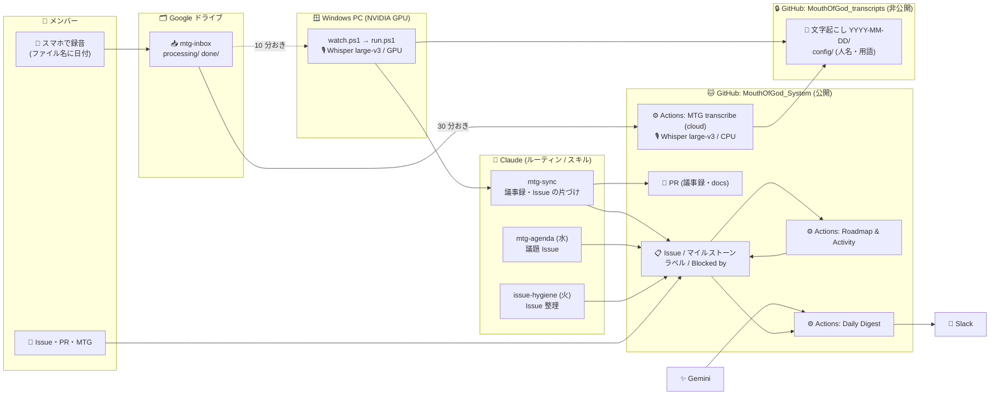
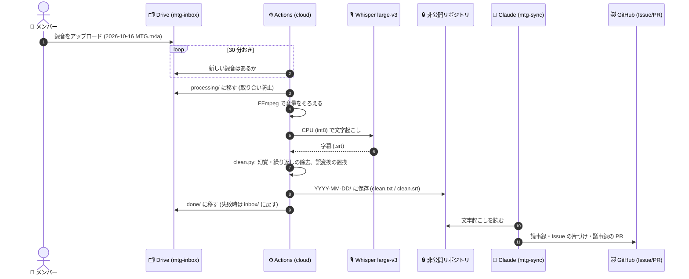

# 仕組みの全体図（何が、どこで、動いているか）

このプロジェクトの運用（Issue の整理、MTG の議題と議事録、ロードマップ、日次のふりかえり）を支える自動化の全体図。**「誰かの PC が動かないと止まる」を減らす**ことを軸に作ってある。

## 1. 全体像

実線が今動いている道、点線は予備の道（PC）。**文字起こしは、クラウド（Actions）と PC のどちらでも進む**。

## 2. 部品の一覧

| | 部品 | 役割 | 動く場所 | 設定・置き場所 |
|---|---|---|---|---|
| 🐱 | **GitHub（公開）** `MouthOfGod_System` | Issue・マイルストーン・PR・docs・スキル・自動化のコード | GitHub | このリポジトリ |
| 🔒 | **GitHub（非公開）** `MouthOfGod_transcripts` | 文字起こしの保管、人名・用語の設定（`config/`） | GitHub | 招待された人だけ |
| ⚙️ | **GitHub Actions** | 下の 4 つのワークフロー（公開リポジトリなので無料） | GitHub のサーバー | `.github/workflows/` |
| 🗂️ | **Google ドライブ** `mtg-inbox` | 録音の置き場所（`processing/` が処理中、`done/` が済み） | Google | サービスアカウントと共有 |
| 🎙️ | **Whisper large-v3**（faster-whisper） | 録音 → 文字（日本語）。GPU なら速く、CPU なら実時間の約 0.9 倍 | Actions（CPU）/ Windows PC（GPU）/ Mac（確認用） | `tools/mtg/transcribe.py` |
| 🎛️ | **FFmpeg** | 音量をそろえる（小さな声・遠い声を落とさないため） | 同上 | `transcribe.ps1` / `transcribe_cloud.py` |
| 🤖 | **Claude** | 議事録づくり（`mtg-sync`）、議題づくり（`mtg-agenda`）、Issue 整理（`issue-hygiene`） | Claude のルーティン（クラウド）/ PC の `claude` | `.claude/skills/` |
| ✨ | **Gemini** | 1 日のふりかえりの文章づくり | Actions | `GEMINI_API_KEY_*` |
| 💬 | **Slack** | 日次のふりかえりの送り先 | Slack | `SLACK_WEBHOOK_URL` |
| 🪟 | **Windows PC** | 録音フォルダの見張り、GPU での文字起こし、`mtg-sync` の実行 | メンバーの PC | `tools/mtg/setup-pc.ps1` |
| 🍎 | **Mac（Apple Silicon）** | 環境の確認と、手で文字起こし（予備）。CPU のみ | メンバーの Mac | `tools/mtg/setup-mac.sh` |

### GitHub Actions の 4 つのワークフロー

| 名前 | いつ動く | 何をする |
|---|---|---|
| **Roadmap & Activity** | Issue・マイルストーンの変化、`main` への push、10 時間おき | ロードマップと活動記録の Issue、README の図を作り直す。小ゴール（`sub-goal`）を自動で閉じる |
| **Daily Digest** | 毎日 22 時ごろ（日本時間） | 今日の変化を Gemini でまとめて Slack に送る |
| **Coupling check** | `Assets/Scripts/**` を触る PR | 機能どうしの直接参照を警告する |
| **MTG transcribe (cloud)** | 30 分おき（Drive に録音があるときだけ処理） | 録音 → 文字起こし → 非公開リポジトリに保存 |

## 3. 1 週間の流れ

| いつ | 何が動く | どこで |
|---|---|---|
| **火** 朝 | 🤖 `issue-hygiene`: 完了済みの Issue を閉じ、重複・担当なし・止まっているものを「Issue 整理（週次）」にまとめる | Claude のルーティン |
| **水** | 🤖 `mtg-agenda`: 金曜の議題 Issue を作る（前回のアクションの結果、決めることの候補つき） | Claude のルーティン |
| **金** MTG | 📱 誰かがスマホで録音 → `mtg-inbox` にアップロード（ファイル名に日付） | メンバー |
| 金〜土 | 🎙️ クラウドが録音を見つけて文字起こし（`processing/` → `done/`）、🔒 非公開リポジトリに保存 | Actions |
| 土 | 🤖 `mtg-sync`: 議事録（決定事項・アクション・未解決）、Issue の片づけ、議事録の PR | Windows PC（`run.ps1`） |
| 毎日 | 💬 22 時ごろ、1 日のふりかえりが Slack に届く | Actions + Gemini |
| いつでも | 📋 Issue が変わると、ロードマップと活動記録が自動で作り直される | Actions |

## 4. 録音から議事録まで（詳しい流れ）

## 5. 何が公開で、何が非公開か

| | 公開リポジトリ | 非公開リポジトリ / Drive / Secrets |
|---|---|---|
| コード・スキル・docs・議事録（要点） | ✅ | |
| **録音そのもの** | ❌ | Drive の `mtg-inbox`（共有した人だけ） |
| **文字起こしの全文** | ❌ | `MouthOfGod_transcripts` |
| 人名・個人情報・用語の設定 | ❌ | `MouthOfGod_transcripts/config/` |
| 鍵 | ❌ | GitHub Secrets（下） |

- 公開リポジトリの Actions のログは誰でも読める。**ログには、日付・件数・時間だけを出し、中身・ファイル名・Drive の ID は出さない**（`transcribe_cloud.py` がそう作ってある）。成果物（artifact）もアップロードしない。
- Secrets（名前だけ）: `GDRIVE_SA_JSON`、`MTG_INBOX_FOLDER_ID`、`TRANSCRIPTS_PAT`（クラウドの文字起こし）、`GEMINI_API_KEY_1`〜`3`、`SLACK_WEBHOOK_URL`（日次のふりかえり）。

## 6. 止まったらどうなるか（属人化の度合い）

| 止まるもの | 影響 | 代わりに動くもの |
|---|---|---|
| 誰かの Windows PC | 見張りとローカルの `mtg-sync` が止まる | クラウドが文字起こしを続ける。別の PC も同じ録音フォルダを見張れる（`.mtg-processing.claim` で譲り合い。3 時間で引き継ぎ） |
| 録音する人 | 録音が無い | 誰がスマホで録ってもよい |
| クラウドの文字起こし（Actions） | 録音が `done/` に進まない | PC の見張り。失敗した録音は inbox に戻る |
| Claude のルーティン | 議題・Issue 整理が出ない | 手動で `mtg-agenda` / `issue-hygiene` を呼べる |
| Gemini / Slack | 日次のふりかえりが届かない | 本体（Issue・ロードマップ）は影響を受けない |

## 7. まだつながっていないところ（次の課題）

- ⚠️ **クラウドで文字起こしした後の `mtg-sync`（議事録づくり）は、まだ PC（`run.ps1`）に依存**している。クラウドは、文字起こしを非公開リポジトリに置くところまで。非公開リポジトリを読めるルーティンで `mtg-sync` を動かせば、全部クラウドになる。
- ⚠️ 週次の Issue 整理（火）のルーティンは、リポジトリの設定を、ルーティンの画面（claude.ai/code/routines）で足す必要がある。
- ⚠️ 長い録音（1 時間以上）でのクラウドの速さは、3 分の録音での実測（0.89 倍）だけ。長い録音の実測は、まだ。
- 🍎 Mac は環境の確認まで（見張りと議事録は Windows のみ）。

## 8. 詳しい手順

- 録音を処理する PC のセットアップ、クラウドの設定、複数台の運用: [docs/mtg-automation.md](mtg-automation.md)
- 議事録の書き方（ひな形と例）: [docs/templates/minutes-template.md](templates/minutes-template.md)、[docs/templates/minutes-example.md](templates/minutes-example.md)
- 担当の役割、ラベル、「決めること」の Issue の決まり: [CONTRIBUTING.md](../CONTRIBUTING.md)
- コード側（Unity）の設計: [docs/architecture.md](architecture.md)
