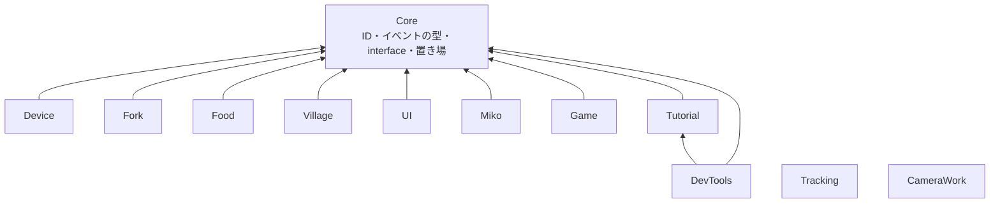
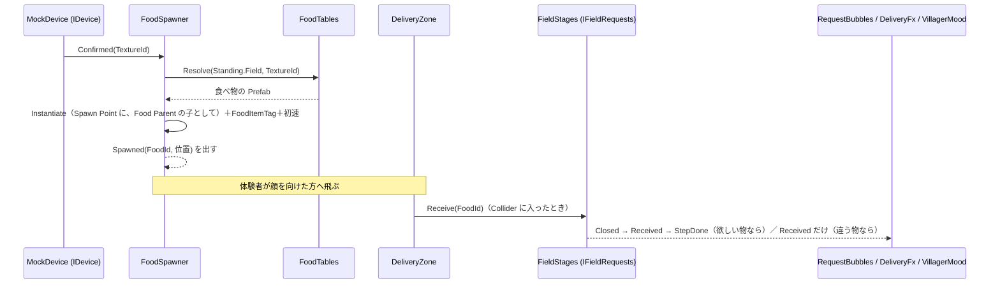
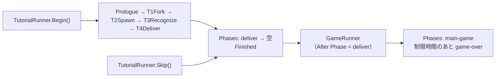

# スクリプト API リファレンス

2026-10-28 時点の `Assets/Scripts` の全スクリプトについて、API・名前空間・Inspector での見え方・機能どうしのつながりをまとめます。

> この文書の「API」「Inspector」の表は、`tools/api_doc/build.py` が C# のコードから作ります。手で直さないでください。直すときは、コードの `///` の説明か `[Tooltip]` を直して、`python3 tools/api_doc/build.py` を実行します。章の説明文は `tools/api_doc/template.md` に書きます。

## この文書の読み方

- 対象は、`main`（`5530138`、マップ仕上げ #346）に、PR #347（カメラのカット再生・チュートリアルのスキップ・置き場・巫女の追従）を重ねた状態です。#347 が入るまでは、`CameraWork` 全体と、`TutorialRunner.Skip`・`FoodSpawner.FoodParent`・`DeliveryFx.FxParent`・`MikoMover` の追従まわりが、`main` にはありません。
- 第 1 章は全体の作りです。第 2 章は、機能どうしがどうつながるかです。第 3 章は、共有シーン Main の中身です。第 4 章は、機能ごとの型の一覧です。付録に、メニューとファイルの置き場所があります。
- 各型の表は、公開されている `public`・`protected` のメンバーだけを載せます。`internal` はテスト用の入口なので載せません。
- 「Inspector」の表は、Unity が Inspector に出す項目です。項目名は、Unity が変数名から作る表示名です。`[Header]` は太字の行で示します。
- 確かめたこと: 型・メンバー・既定値・説明は、コードから機械的に取り出しています。Main シーンの位置は、`Main.unity` と入れ子の Prefab の YAML から計算しました。
- 確かめていないこと: Unity でコンパイルも実行もしていません。Mesh の見た目の大きさは読んでいないので、第 3 章の位置は、オブジェクトの原点です。

## 1. 全体像

### 1.1 層と依存の向き

機能は、`Core` の小さな型・interface・置き場を通してだけつながります。機能どうしは、互いのクラスを参照しません。

- `Tracking` と `CameraWork` は、`Core` も参照しません。どちらの機能も、ほかの機能の型を使いません。
- `DevTools` だけが、`Tutorial` を参照します。`TutorialDebugHud` が `TutorialRunner` を操作するためです。
- 機能の中の依存の向きは、asmdef の `references` で決まります。`.github/scripts/check_coupling.py` は、`MouthOfGod.<他の機能>` を参照するコードを、警告として PR に出します（止めません）。
- 全機能を参照する組み立て役（Bootstrap）と、中央の進行クラス（`GameManager`）は、置きません（[architecture.md](architecture.md)）。

### 1.2 アセンブリと名前空間

名前空間は、フォルダ名に合わせて `MouthOfGod.<フォルダ>` です。エディタ専用の部分は、`.Editor` を付けた別のアセンブリです。

| アセンブリ | 名前空間 | 参照する asmdef |
|---|---|---|
| `MouthOfGod.Core` | `MouthOfGod.Core` | なし |
| `MouthOfGod.Device` | `MouthOfGod.Device` | Core、Unity.InputSystem |
| `MouthOfGod.Fork` | `MouthOfGod.Fork` | Core、Unity.InputSystem |
| `MouthOfGod.Food` | `MouthOfGod.Food` | Core |
| `MouthOfGod.Village` | `MouthOfGod.Village` | Core |
| `MouthOfGod.UI` | `MouthOfGod.UI` | Core |
| `MouthOfGod.Miko` | `MouthOfGod.Miko` | Core、UnityEngine.UI |
| `MouthOfGod.Tutorial` | `MouthOfGod.Tutorial`、`MouthOfGod.Tutorial.Sandbox` | Core、Unity.InputSystem |
| `MouthOfGod.Game` | `MouthOfGod.Game` | Core、Unity.TextMeshPro |
| `MouthOfGod.Tracking` | `MouthOfGod.Tracking` | meta.xr.mrutilitykit、Oculus.VR、Unity.InputSystem、AprilTag.Runtime |
| `MouthOfGod.CameraWork` | `MouthOfGod.CameraWork` | なし |
| `MouthOfGod.DevTools` | `MouthOfGod.DevTools` | Core、Tutorial、Unity.InputSystem |
| `MouthOfGod.Device.Editor` | `MouthOfGod.Device.Editor` | Device |
| `MouthOfGod.Fork.Editor` | `MouthOfGod.Fork.Editor` | Fork |
| `MouthOfGod.Food.Editor` | `MouthOfGod.Food.Editor` | Food |
| `MouthOfGod.Village.Editor` | `MouthOfGod.Village.Editor`、`MouthOfGod.Village.Editor.Draft` | Village、Food |
| `MouthOfGod.Miko.Editor` | `MouthOfGod.Miko.Editor` | Miko |
| `MouthOfGod.Tutorial.Editor` | `MouthOfGod.Tutorial.Editor` | Tutorial、Miko |
| `MouthOfGod.CameraWork.Editor` | `MouthOfGod.CameraWork.Editor` | CameraWork |
| `MouthOfGod.DevTools.Editor` | `MouthOfGod.DevTools.Editor` | Core、DevTools、Tutorial、Fork、Food、Village、UI、Miko、Tutorial.Editor |

- テストは、機能ごとに `MouthOfGod.<機能>.Tests`（Editor のみ）です。`Core`・`Device`・`Food`・`Fork`・`Game`・`Tutorial`・`UI`・`CameraWork`・`Village` は、`InternalsVisibleTo` で `internal` をテストに見せています。
- `Tracking` の asmdef は `Core` を参照しません。コードも `MouthOfGod.Core` を使いません。ほかの機能には、`Transform` と追跡中かどうかだけを渡します。

### 1.3 Play のたびに自動で置かれるもの

手でシーンに置かなくても、次のものは Play で現れます。

| 自動で置かれるもの | 条件 | 置く所 |
|---|---|---|
| `MockDevice`（と `MockDeviceModel`） | シーン読み込みのあと、実機のデバイスが先に `Devices` へ登録していなければ | `MockDevice.GetOrCreate`。Prefab `Resources/Prefabs/Device/MockDevice` があればそれ、なければコードで作る。`DontDestroyOnLoad` |
| `RequestBubbles` | シーン読み込みのあと | 自分で GameObject を作って付く（村人の頭の上の吹き出し） |
| `AprilTagDetectionService` | `AprilTagPlace` が必要なとき | `AprilTagDetectionService.GetOrCreate` |
| `AprilTagRecalibrateInput` | `AprilTagDetectionService` が起動したとき | 同じ GameObject に自動で付く |
| `DeliveryFx` | `FieldStages` を持つ物に付いていないとき | `FieldStages` が自分で付ける |
| `FoodItemTag` | 食べ物を生んだとき | `FoodSpawner` が、生んだ食べ物に付ける |
| `SphereCollider`・`Rigidbody` | `ForkTip` に無いとき | `ForkTip` が自分に足す |

## 2. 機能どうしのつなぎ方

### 2.1 置き場（Core の static クラス）

機能をまたいで使う「もの」は、自分で置き場に登録します。使う側は、置き場から受け取ります。置き場は static なので、Play のたびに空にします（`RuntimeInitializeOnLoadMethod` の `Reset`）。

| 置き場 | 持つもの | 登録・設定する側 | 受け取る側（例） |
|---|---|---|---|
| `Devices` | `IDevice`（1 台） | `MockDevice` | `FoodSpawner`、`FoodShadow`、`ForkTip`、`TutorialScript` の待ち、`TutorialDebugHud` |
| `Forks` | `IFork`（1 本） | `ForkTip` | `FoodShadow`、`TutorialScript` の待ち、`TutorialDebugHud` |
| `FoodSpawners` | `IFoodSpawner`（1 つ） | `FoodSpawner` | `FoodShadow`、`TutorialScript` の待ち |
| `Fields` | `IFieldRequests`（フィールドごと） | `FieldStages` | `RequestBubbles`、`DeliveryZone`、`TutorialRunner`（Skip）、`T3Recognize`、`T4Deliver`、待ち、`TutorialDebugHud` |
| `Standing` | 前に立っているフィールド（`FieldId`） | `StandArea` | `FoodSpawner`（食べ物の表を選ぶ）、`StandWait`、`TutorialDebugHud` |
| `Phases` | いまの場面（`PhaseId`） | `TutorialRunner`、`GameRunner` | `GameRunner`、`FoodShadow`、`TutorialScript`、`TutorialDebugHud` |
| `Cues` | 合図（`CueRequested`） | `TutorialScript.Cue`、`TutorialRunner.Skip` | `MikoCueReceiver`、`CloudCues`、`FoodShadow`、`StandArea`、`CueReaction`、`TutorialDebugHud` |

`FoodTables`（Food）は、`FoodTable` の置き場です。機能をまたぐ置き場ではなく、Food の内側にあります。

### 2.2 合図（`Cues`）の名前

出す側は、誰が受けるかを知りません。受ける側がいなければ、何も起きません。名前は、機能ごとの決まりに従います。

| 合図の名前 | 受ける所 | 意味 |
|---|---|---|
| `miko.say.<id>` | `MikoCueReceiver` → `MikoSpeech` | 巫女がセリフ `<id>` を言う |
| `miko.face.<名前>` | `MikoCueReceiver` → `MikoFace` | 表情を変える（normal / happy / squint / love / sleep / wink / tired） |
| `miko.point` | `MikoCueReceiver` | 指さしをする |
| `miko.hush` | `MikoCueReceiver` → `MikoSpeech` | しゃべるのをやめる |
| `miko.follow` / `miko.stay` | `MikoCueReceiver` → `MikoMover` | 体験者についてくる / その場にとどまる |
| `cloud.glow` | `CloudCues` | 正面にいちばん近い雲を 1 つ光らせる |
| `cloud.approach` | `CloudCues` | 光る雲を、体験者の近くへ寄せる |
| `cloud.calm` | `CloudCues` | 光を消し、雲を戻す |
| `shadow.show` / `shadow.faint` / `shadow.emphasize` / `shadow.hide` | `FoodShadow` | 食べ物の影を、ふつうに / 薄く / 強く出す / 消す |
| `<フィールド>.footprint` / `<フィールド>.footprint-off` | `StandArea` | 床の足あとの印を出す / 消す |
| `<フィールド>.glow` / `<フィールド>.glow-off` | `CueReaction`（Inspector で設定した物） | フィールドを光らせる / 消す |
| `offering.show` / `offering.hide` | `CueReaction`（Inspector で設定した物） | T2 のお供え物を出す / 隠す |
| `device.button.glow` / `device.button.glow-strong` / `device.button.glow-off` | `CueReaction`（Inspector で設定した物） | デバイスのボタンを光らせる / 強く光らせる / 消す |
| `staff.alert` | `CueReaction`（Inspector で設定した物） | スタッフに知らせる |
| `prologue.start` / `prologue.end` | `CueReaction`（Inspector で設定した物） | プロローグの動画の前後 |

- `CueReaction` は、合図の名前ごとに、物を出す・消す・`UnityEvent` を呼ぶ、を Inspector だけで設定できる部品です。コードの外で足せる反応は、これで受けます。
- 合図の名前は、`TutorialScript` を継いだ各スクリプトの Inspector で変えられます。空にすると、その合図は出しません。
- フィールドの合図は、フィールド名から始めます（`sea.glow`、`village.footprint`）。決まりは [requests.md](requests.md) にあります。

### 2.3 場面（`Phases`）の名前

`Phases.Current` に入る名前です。番号ではなく、やることを表す名前にします。一覧と決める所は [progress-keys.md](progress-keys.md) にもあります。

| 名前 | 決める所 | 意味 |
|---|---|---|
| `prologue` | `PrologueVideo` | 導入の動画 |
| `fork` | `T1Fork` | フォークの使い方 |
| `spawn` | `T2Spawn` | 口から物が生まれる |
| `recognize` | `T3Recognize` | 食感で物が変わる・欲しい物を知る |
| `deliver` | `T4Deliver` | 立つ場所で届ける |
| `main-game` | `GameRunner` | 本編（制限時間のあいだ） |
| `game-over` | `GameRunner` | 本編の時間切れ |

### 2.4 流れ 1: 食べ物を生んで、届けるまで

1. デバイスが決定すると、`IDevice.Confirmed` が、そのときの食感を運びます。噛む前の決定（食感が空）は、食べ物を生みません。
2. `FoodSpawner` が `FoodTables.Resolve` で Prefab を引きます。引く順は、立っているフィールドの表、共通の表、なし、です。立っているフィールドは `Standing.Field` です。
3. `Spawn Point` の位置と向きに生みます。`Food Parent` を入れてあれば、その子にします。`FoodItemTag` を付け、`Launch Speed` が 0 より大きく、`Rigidbody` が動く物なら、前向きに初速を与えます。
4. 食べ物は、物理で飛びます。落ちた先の `DeliveryZone`（`Collider` の Is Trigger）が、`IFoodItem` を読んで、フィールドの `Receive` を呼びます。
5. `FieldStages.Receive` は、`DeliveryKind` を返します。欲しがっていた物（`Requested`）なら、ステップを済ませ、`Closed`（`Resolved = true`）、`Received`、`StepDone` の順に出します。このフィールドの物（`Own`）とよその物（`Foreign`）は、`Received` だけを出します。
6. `DeliveryFx` は、`StepDone` で喜びの粒と音を出し、`Received` が `Requested` 以外なら、困っている村人にトリガー `Missed` を送り、音を鳴らします。`RequestBubbles` は、`Closed` で吹き出しを消します。

### 2.5 流れ 2: 欲しい物を出す

- `IFieldRequests.Open()` が、次の欲しい物を出します。出せなければ `false` です（上限まで出ている、ステップが残っていない、など）。
- 出すと `Issued`（`RequestIssued`）が出ます。`RequestBubbles` は、`Anchor`（村人の頭の上の `Transform`）に吹き出しを出します。
- 同じフィールドで、同時に複数出せます。上限は `FieldStages` の Max Open Requests（既定 2）です。欲しい物は、`Request`（番号）で見分けます。
- `Expire()` は、出ている欲しい物を、届かないまま終えます（`Closed` の `Resolved = false`）。`Restart()` は、フィールドを最初に戻します。
- 本編が、いつ・どこに出すかを決めるコードは、まだありません。いまは、`OpenAllRequestsAfterTutorial`（試験用）が、チュートリアルのあとに、全フィールドへ出せるだけ出します。

### 2.6 流れ 3: チュートリアルから本編へ

- `TutorialRunner` は、子の `TutorialScript` を、Hierarchy の順に 1 つずつ動かします。動かす間、`Phases` を各スクリプトの場面にします。例外が出たスクリプトは、そこでやめて、次へ進みます。
- 全部終わると、`Phases` を空に戻し、`Finished` を出します。
- `GameRunner` は、場面 `deliver` のあとに場面が空になったとき、本編を始めます（After Phase の既定は `deliver`）。`TutorialRunner` の型は、参照しません。
- `TutorialRunner.Skip()` は、チュートリアルを飛ばして、全部終わった扱いにします。まず、動いていれば止め、`Memory` を空にし、全フィールドを `Restart` します。次に、`<フィールド>.glow-off`・`<フィールド>.footprint-off`・`miko.stay` の合図を出します。最後に、場面を Skip Phase（既定 `deliver`）から空の場面へ進め、`Finished` を出します。
- Skip で本編が始まるには、シーンに `GameRunner` が必要です。**2026-10-28 時点の Main シーンには `GameRunner` がありません**（第 3 章）。

### 2.7 ID の型

| 型 | 中身 | 例 |
|---|---|---|
| `TextureId` | 食感 | `placeholder-a` |
| `FoodId` | 食べ物。Prefab のファイル名と同じ | `fish` |
| `FieldId` | フィールド（`village` / `mountain` / `sea` / `grassland`） | `sea` |
| `CueId` | 合図の名前 | `miko.say.t1-pierce` |
| `PhaseId` | 場面の名前 | `deliver` |

どれも、文字列を包んだ `readonly struct` です。`null` と空文字は、どちらも空 ID（`None`、`IsEmpty`）です。大文字小文字を区別します。型が違えば、同じ文字列でも別物です。

## 3. 共有シーン Main の姿

`Assets/Scenes/Main.unity` を、YAML から読んで計算した結果です。単位はメートル、座標はワールドです。ミニチュアの台は、`Border_*` の枠で、およそ ±0.6 m 四方です。

### 3.1 位置

| 物 | 位置 (x, y, z) | 備考 |
|---|---|---|
| Main Camera | (-0.27, 1.51, -1.34) | FOV 60。子に `MouthAnchor` (-0.27, 1.43, -1.26)、`ButtonGlow`、`ButtonGlowStrong`、`StaffAlert` |
| Miko | (-1.17, 1.21, 0.26) | 向きは Y 軸 180 度 |
| 村（`Village/Village/Plaza`） | (-0.31, 0.11, -0.30) | 村人・家・畑・木 |
| 山（`MountVer2/mount`） | (-0.27, 0.13, 0.30) | |
| 草原（`Grass/Tree1`） | (0.28, 0.13, 0.39) | `Grass` のルートは (0.27, 0.01, 0.27) |
| 海（`Sea_work`） | (0.31, -0.07, -0.30) | `Terrain_sea` は (0.04, 0.06, -0.57) |
| 立つ場所（`StandArea`） | 村 (-1.02, -0.06, -1.03)、海 (1.07, -0.16, -0.85)、草原 (0.90, -0.09, 1.17)、山 (-0.93, -0.06, 1.00) | |

### 3.2 Hierarchy とコンポーネント

Main.unity のシーンに直接付いている、このリポジトリのスクリプトです。

| オブジェクト | コンポーネント |
|---|---|
| `Main Camera` | `DesktopHead` |
| `MinitureBase` | `AprilTagPlace` |
| `CloudRing` | `CloudRing`、`CloudCues` |
| `ForkTip` | `ForkTip`、`HandHeldPose` |
| `Indicators` | `CueReaction` |
| `DebugHud` | `TutorialDebugHud` |
| `OpenAllRequestsAfterTutorial` | `OpenAllRequestsAfterTutorial` |

Prefab として置かれている物と、その中のコンポーネントです。

| Prefab の置き場 | 中身 |
|---|---|
| `Resources/Prefabs/Miko/Miko` | `Body` に `MikoFloat`・`MikoMover`・`MikoPointer`・`MikoCueReceiver`・`MikoFace`・`MikoSpeech`。子の `LineBook` に `MikoLineBook` |
| `Resources/Prefabs/Misc/FoodSpawner` | `FoodSpawner`、`FoodTable`（共通の表） |
| `Resources/Prefabs/Misc/FoodShadow` | `FoodShadow` |
| `Resources/Prefabs/Misc/TutorialRunner` | `TutorialRunner`。Main では、子に `Prologue`・`T1Fork`・`T2Spawn`・`T3Recognize`・`T4Deliver` の Prefab が並ぶ（この順がチュートリアルの順） |
| `Resources/Prefabs/Tutorial/<名前>` | `PrologueVideo`（子に `VideoScreen`）、`T1Fork`、`T2Spawn`、`T3Recognize`、`T4Deliver`。どれにも `MikoLineBook` が付く |
| `[BuildingBlock] Camera Rig with MouthAnchor` | Meta XR のカメラ装置 |

フィールドの Prefab です。Main では、`Resources/Prefabs/Misc/` の Variant（`Village`、`Grass Variant`、`MountVer2 Variant`）と、`Resources/Prefabs/Sea/Sea_work` を使います。Variant は、元の Prefab に、Main 用の部品（`StandArea`、`DeliveryZone` など）を足した物です。

| フィールド | 元の Prefab | ルートのコンポーネント | ステップ（`FieldStep`、順に欲しい物） |
|---|---|---|---|
| 村 `village` | `Resources/Prefabs/Village/Village` | `FieldStages`、`SurfaceAnchor`、`DeliveryFx`、`DeliveryZone`、`FoodTable` | pumpkin、carrot、turnip、tomato |
| 海 `sea` | `Resources/Prefabs/Sea/Sea_work` | `SurfaceAnchor`、`FieldStages`、`FoodTable`、`DeliveryZone`、`DeliveryFx`、`CueReaction` | fish、shell、shrimp |
| 草原 `grassland` | `Resources/Prefabs/Grass/Grass` | `FieldStages`、`FoodTable` | chicken、pig、sheep、cow |
| 山 `mountain` | `Resources/Prefabs/Mount/MountVer2` | `FoodTable`、`FieldStages`、`DeliveryZone`、`DeliveryFx` | mushroom、apple、chestnut |

- 村人は、各フィールドの子に `VillagerMood` として置かれます。`FieldStep` の Helped に入れた村人が、そのステップが済むまで悩みます。
- 食べ物の Prefab は、`Resources/Prefabs/Food/` にあります（apple、carrot、chestnut、chicken、cow、fish、mushroom、pig、pumpkin、sheep、shell、shrimp、tomato、turnip）。ファイル名が食べ物の ID です。

### 3.3 Main にまだ無いもの

- `GameRunner` と `RemainingTimeText`: シーンにも Prefab にもありません。置かないと、チュートリアルが終わっても本編（`main-game`）は始まりません。`TutorialRunner.Skip()` も、同じです。
- 自動で置かれる物（1.3 節）は、手で置く必要がありません。

## 4. 機能別リファレンス

### 4.1 Core

全体で共有する、小さな基盤です。他の asmdef に依存しません。ロジックは置かず、ID・イベントのデータ・interface・置き場だけを置きます。

#### 置き場

{{TYPES5: Core/Devices.cs Core/Forks.cs Core/FoodSpawners.cs Core/Fields.cs Core/Standing.cs Core/Phases.cs Core/Cues.cs}}

#### interface

{{TYPES5: Core/IDevice.cs Core/IFork.cs Core/IFoodSpawner.cs Core/IFoodItem.cs Core/IFieldRequests.cs}}

#### ID とイベントのデータ

{{TYPES5: Core/Ids.cs Core/Events.cs}}

### 4.2 Device

触感デバイスの入力です。`MockDevice` が、デバイスなしで、Quest のコントローラやキーボードで「噛む・決定する」を代わりにします。実機は、`IDevice` を実装して `Devices.Register` するだけで差し替わります。

{{MODULE: Device}}

エディタ専用:

{{COMPACT: Device/Editor/}}

### 4.3 Fork

体験者が持つフォークです。雲を刺し、口に含み、決定で食べ終えるまでの状態を持ちます。

{{MODULE: Fork}}

エディタ専用:

{{COMPACT: Fork/Editor/}}

### 4.4 Food

食感から食べ物を引いて、生み、前へ飛ばします。「食感 → 食べ物」の表は、全フィールド共通の表（`Field Id` が空）と、フィールドごとの表に分けます。

{{MODULE: Food}}

エディタ専用:

{{COMPACT: Food/Editor/}}

### 4.5 Village

フィールド（村・山・海・草原）の見た目の戻り方と、欲しい物です。物が落ちた場所の判定、届いたときの反応、立つ場所の判定も、ここにあります。

{{MODULE: Village}}

エディタ専用:

{{COMPACT: Village/Editor/}}

### 4.6 UI

表示の部品です。Core のイベントと合図を受けます。

{{MODULE: UI}}

### 4.7 Miko

巫女です。浮いて、体験者の方を向き、しゃべり、表情を変え、指さし、体験者についてきます。身振りは Animator が担当します。

{{MODULE: Miko}}

エディタ専用:

{{COMPACT: Miko/Editor/}}

### 4.8 Tutorial

プロローグとチュートリアル 1〜4 を進めます。1 チュートリアル = 1 つの `TutorialScript`（人形劇スクリプト）を、`TutorialRunner` が順に動かします。

{{MODULE: Tutorial}}

試験用（`MouthOfGod.Tutorial.Sandbox`）:

{{COMPACT: Tutorial/Sandbox/}}

エディタ専用:

{{COMPACT: Tutorial/Editor/}}

### 4.9 Game

本編の進行です。チュートリアルが終わったら本編を始め、制限時間が来たら終わらせます。

{{MODULE: Game}}

### 4.10 Tracking

AprilTag とハンドトラッキングで、位置を合わせます。ほかの機能には、`Transform` と追跡中かどうかだけを渡します。

{{MODULE: Tracking}}

### 4.11 CameraWork

付けたオブジェクト（カメラなど）を、決めた軌道と速さで動かします。直線・ベジェ曲線・円弧・待ちのカットをつなぎ、緩急・向き・ズームを Inspector で決めます。村のカットを置くメニューは、`MouthOfGod/CameraWork/Add Village Tour` と `Add Village Zoom-Out` です。

{{MODULE: CameraWork}}

エディタ専用:

{{COMPACT: CameraWork/Editor/}}

### 4.12 DevTools

Quest なしで試すための道具です。展示では使いません。

{{MODULE: DevTools}}

エディタ専用（メニュー「MouthOfGod/Dev」）:

{{COMPACT: DevTools/Editor/}}

## 付録 A. メニュー一覧

{{MENUS}}

## 付録 B. Resources の置き場所

コードが `Resources.Load` で読む場所です。

| パス | 読む所 | 中身 |
|---|---|---|
| `Resources/Prefabs/Device/MockDevice` | `MockDevice.GetOrCreate` | MockDevice の Prefab |
| `Resources/Prefabs/Fork/Cloud` | `CloudRing` | 雲の Prefab |
| `Resources/Prefabs/Food/<食べ物の ID>` | `FoodTable`（Prefab の参照）、`FoodTables.IdOf` | 食べ物の Prefab。ファイル名が食べ物の ID |
| `Resources/Icons/Food/<食べ物の ID>` | `RequestBubbleText.IconPath` | 吹き出しのアイコン |
| `Resources/Prefabs/Village/Fx_Joy`・`Fx_Smoke` | `DeliveryFx`、`DeliveryZone`、`PopInEffect` | 喜びの粒・煙 |
| `Resources/Sounds/Village/Done`・`Missed` | `DeliveryFx` | 欲しい物が届いた音・違う物が届いた音 |
| `Resources/Prefabs/Miko/Miko` | シーンの Miko | 巫女の Prefab |
| `Resources/Prefabs/Tutorial/<名前>` | `TutorialRunner` の子 | プロローグと T1〜T4 の Prefab |
| `Resources/AprilTagSettings` | `AprilTagSettings.Load` | AprilTag の設定（無ければコードの既定値） |
| `Resources/RequestBubbleSettings` | `RequestBubbleSettings.Load` | 吹き出しの設定（無ければコードの既定値） |
